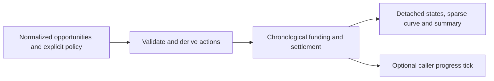

# Evaluation and premium settlement

## Purpose

Layer 6 owns realized outcomes, capital accounting and reports in the [root layer map](../../../ARCHITECTURE.md#2-layers-and-allowed-dependency-direction). The pure premium-funded helper is library-only; no production entrypoint, allocator, ledger, pricing, selection or mark-to-market path is supplied.

## Primary contract and inputs

`premium_settlement.settle_premiums(records, *, initial_cash, max_trade_debit, max_bucket_debit, max_concurrent, report_end, same_time_order, on_action=None)` accepts a list of closed records `{id, bucket, selected, entry_date, settlement_date, debit, credit}`. IDs are unique nonempty strings, buckets are nonempty strings and selection is a frozen plain Boolean. Dates are plain `date` objects, not datetime/string inputs; report end and every policy parameter are explicit. No source, quote or provenance admission is implied.
Cash uses finite plain int/float values, preserving integer and decimal-spelling arithmetic. Initial cash and debit caps are positive; concurrency is a positive plain integer. Supplied debit is positive; supplied credit can be negative. Credit and debit are already-costed totals in one caller-consistent currency; no multiplier, fee conversion or credit clipping occurs.
An absent entry date means an unselected abstention with no cash/settlement. A planned entry without a settlement date has no cash quote. A scheduled settlement can have missing debit/credit; entry precedes settlement and both are covered by report end. Missing credit never prevents otherwise affordable entry. The caller owns decision/exit clocks, settlement-delay conversion and any further experiment policy.

## Outputs

Returns detached `per_opportunity` rows (`id`, `status`, `net_profit`, funded `debit`, `capital_days`), sparse `curve`, summary and explicit equity/capacity policy labels. The curve contains scheduled-action dates plus `report_end`, not every calendar day. No writes, persistent schema or implicit experiment wrapper. Statuses distinguish abstention/no-trade, missing entry, trade/bucket/concurrency/cash refusal, unresolved funding and settlement.
Summary includes all opportunities, funded/unresolved counts, funded coverage, settled net profit, cash, settlement equity, capital-days, settlement drawdown and full-cohort net profit per opportunity. Empty-cohort ratios and unresolved full-cohort profit are None. Missing outcomes are not zero losses. Negative settlement proceeds may overdraw cash; fees are not separately reserved.

## Dependencies and callers

Only stdlib date/Fraction/grouping/math and lower-layer `data.errors` are imported. No ops or research dependency. Current callers are `experiments.distribution_book.funded_book` and synthetic tests; the adapter retains its original experiment admission, wrapper schema and error translation. The optional callback enables caller-owned progress without an upward import.

## External systems

None in the core. A supplied callback may have its own effects; the caller owns bounded stage/progress logging for long calls. Work is O(n log n), memory O(n); no end-to-end resource limit or real-data capacity claim.

## Failure semantics

| Condition | Outcome |
| --- | --- |
| Invalid closed record, scalar, policy, date relationship or nonfinite derived cash output | Nonretryable `DataError/CONTRACT_MISMATCH`, fixed public-safe message; no partial result or automatic repair. |
| Missing required keyword | Python `TypeError`; no economic defaults. |
| Callback failure or resource/programming exception outside numeric guards | Propagates unchanged; callbacks already invoked cannot be rolled back. No cache, journal, retry or transaction. |

For equal valid inputs, callback-free calls return equal detached results without persisting state. Callbacks run again on repeated calls; retry safety depends on callback idempotency, not a core guarantee.

## Invariants

The core derives actions from records, ordered by day, explicit settlement-before-entry or entry-before-settlement phase, then ID. Refusal precedence is missing-entry, trade cap, bucket cap, concurrency cap, cash. Debit, bucket capacity and concurrency stay reserved until settlement; missing credit remains unresolved through report end. No-op scheduled actions remain in curves and callback counts.
Cash comparisons use `Fraction(str(value))` without epsilon. Per-row capital-days pass through finite float before decimal-spelling aggregation, retaining existing research arithmetic. Equity is initial cash plus settled P&L with open debit carried at cost, not marked value; drawdown is sampled once after each complete day. A final report-end observation is present. Inputs are detached before callbacks.

## Data flow

