# `engine/v2/models` — architecture

See the root [`ARCHITECTURE.md`](../../../ARCHITECTURE.md) for the layer
table and enforced import direction. This doc follows
`docs/COMPONENT_ARCHITECTURE_TEMPLATE.md`'s section order.

## 1. Purpose

Layer 3.0 (root doc §2). Replaces legacy `models/registry.py` and the
inline artifact/inference plumbing scattered through `engine/score.py`.
This package owns four things:

- **Contracts** (`contracts.py`) — the immutable shapes a frozen release is
  made of (`ModelBinding`, `ModelRelease`, `ArtifactMember`) and the
  inference call/response pair (`InferenceRequest`, `InferenceResult`,
  `PredictionFrame`). Schemas only: no logic, no I/O.
- **Verified loading and inference** (`adapters.py`, `loader.py`) — the
  adapters that turn a hash-verified member's bytes into a read-only
  predictor, and `FrozenInference`, the one class that runs a request
  through them. Never fits anything (`RuntimeFitForbidden`,
  `ReadOnlyArtifact` block every mutating estimator method by name).
- **Release completeness and today's real inventory** (`releases.py`,
  `inventory.py`) — the abstract "is this release complete" contract, and
  the concrete answer for what is on disk right now (`current_release_inventory`
  reads `data/models/*` and the champion registry; it never hand-writes
  `registry.json`).
- **Frozen non-model serving state** (`admissible_table.py`,
  `analog_artifact.py`, `chooser_analog_pool.py`, `payoff_artifact.py`,
  `recalibration_artifact.py`, `residual_artifact.py`,
  `trailing_cutoff_artifact.py`, dispatched through `frozen_state.py`,
  released through `frozen_release.py`, invalidated through `lineage.py`) —
  the frozen-artifact answer to every piece of calibration state legacy
  used to recompute live from an unversioned file or in-process cache. Each
  is an immutable, content-hashed record with a verified loader; none of
  them are models, so none of them go through `adapters.py`/`loader.py`.
- **Content-addressed staging and the deployment pointer**
  (`deployment.py`) — the durable store a `ModelRelease` is staged into
  once it passes completeness, and the one atomic pointer (`DEPLOYED`)
  that names which staged release is live.

`engine/v2/models/training/` (layer 6.0) is the *only* place any of this
gets fit — see its own package doc reference in the root index. Nothing in
`engine/v2/models` reads a live panel, calls `.fit()`, or writes
`registry.json`.

The research-only `training.magnitude` boundary fits two original-unit candidates
from ops-admitted recipe data for the native experiment CLI. Ridge's
median imputation, full missing indicators and scaling learn from training rows
only; HGB freezes training-all-null columns to zero and routes other nulls natively,
without a random early-stopping split. Both use
fresh per-fold/horizon estimators, one numerical thread and finite nonnegative
predictions. The caller owns protected admission, label qualification and evidence;
this module receives recipe data and numeric matrices, with no I/O or model release.
Invalid shapes/nonfinite labels or predictions raise `ValueError`; the experiment
caller translates fitting failures to `EXPERIMENT_VARIANT_FAILED`. The shared
no-fit guard runs before work. Existing legacy-parity recipes are unchanged.

`magnitude_elasticnet_recipe.elasticnet_recipe` builds closed JSON-only research
metadata without importing training or sklearn. Ordered selected columns and a
caller-supplied dictionary hash bind preprocessing, fixed estimator parameters,
seed and projection; a recipe hash is not a source/fold/candidate seal or proof
of dictionary membership. `training.magnitude_elasticnet.fit_elasticnet_predictions`
consumes this recipe and matching named numeric matrices. It learns imputation,
missing indicators and scaling from training rows only, returning finite nonnegative
forecasts, the full standardized coefficient vector (values and missing indicators),
selected source columns in recipe order, iterations and dual gap.
No runtime caller activates this adapter. Causal membership, source identities,
inner-only subset/parameter choice, resource/attempt caps and failure recording
are caller responsibilities, not guarantees derived from these arrays.

| ElasticNet condition | Outcome |
|---|---|
| Either no-fit guard is active | Its `RuntimeFitForbidden` precedes recipe or array inspection |
| Invalid closed recipe, column order, matrix dimensions, infinities or label domain | `ValueError`; no fit or partial result |
| Nonconvergence or nonfinite fit evidence/predictions | `ValueError`; no partial result, retry or iteration increase |
| Same valid inputs and numerical environment | Deterministic fresh fit, not cached or journal replay |
| Cache, transaction or partial-write concerns | No cache, I/O, persistence or publication; v1 recipes and results are unchanged |

The separate `magnitude_ridge_hgb_recipe` API constructs/validates source-free
`magnitude_ridge_hgb_recipe.v1` metadata for the bounded stage-2 Ridge/HGB grid.
It binds explicit ordered unique columns, a canonical dictionary hash, fixed
preprocessing/estimator policy and derived width; no dictionary or source is read.
The `history_ridge`/`history_hgb` family names reuse the training-layer private
estimator constructor (`training/_magnitude_estimators.build_estimator`, imported by the training fitter) unchanged; each numeric adapter owns its guards and fitting,
not the constructor. This is not the fixed eleven-column v1 execution envelope. Dictionary membership and
truthful matrix order remain caller-owned; a hash alone grants no admission.
`training.magnitude_ridge_hgb.fit_ridge_hgb_predictions(..., columns=...)`
checks both no-fit guards before inspecting metadata or numeric inputs, validates
the closed recipe and exact declared column order, then copies numeric matrices.
A fresh one-thread fit learns only training rows: Ridge keeps every selected column
through median imputation, full missing flags and scaling; HGB freezes training-all-null columns to
zero at training/prediction while routing partial nulls natively. It returns
`magnitude_ridge_hgb_fit.v1` with the validated recipe hash and detached finite
nonnegative predictions. This is an unwired numeric boundary: no source/holdout/fold
admission, CLI, selection or registration; existing eleven-column recipes, fitters
and source closures remain unchanged.

| Ridge/HGB condition | Outcome |
|---|---|
| Either no-fit guard active | Its `RuntimeFitForbidden` precedes recipe, column or array inspection |
| Invalid closed policy/order, unconvertible inputs, matrix shape, infinite features or nonfinite/negative labels | `ValueError` before fit; no partial result |
| Wrong prediction shape or nonfinite predictions | `ValueError` after fit, before projection; no partial result |
| Same valid inputs and numerical environment | Deterministic fresh fit, not cached or journal replay |
| Cache, retry, transaction or partial-write concerns | No cache, retry, persistence or publication |

An automated nightly append cycle for the pool/residual/cutoff artifacts:
release assembly is §2.1, staging §2.2, and the three-phase tick sidecar is §2.2.1; see #192.

## 2. Primary contracts and public interfaces

The full list is `README.md`'s `<!-- public-interface: ... -->` directive
(machine-checked by `checks/package_readmes.py`); the deployment surface:

- `deployment.stage_release(root, release, inventory, payloads, *, clock) -> StagedManifest`
  — validate, then durably stage. Never touches `DEPLOYED`.
- `deployment.semantic_release_hash(release: ModelRelease) -> str` — pure
  `sha256:` identity over the typed release's inference meaning. Binding/member
  collection order and storage paths are ignored; feature/output order is not.
  No I/O, cache, completeness validation or artifact verification; those remain
  with staging/loaders. It does not rewrite stored manifest hashes or versions.
- `deployment.promote(root, release_id, *, clock, expected_previous_release_id=None) -> PointerState` /
  `deployment.rollback(root, *, clock) -> PointerState` — the one atomic
  pointer swap, in either direction. Rollback selects the prior incumbent
  from deployment history; an empty or single-entry undo stack raises the
  typed `NoPriorRelease` refusal without changing the pointer. Operator plans
  pin incumbent sequence and target; stale plans refuse, and recovery recognizes
  only that plan's exact swap, even if history or receipt recording was lost.
- `deployment.rollback_target(root) -> str` — read-only resolution of the
  incumbent `rollback` would select; raises `NoPriorRelease` when none exists.
- `deployment.resolve_release(root, release_id) -> ModelRelease` /
  `deployment.current_release(root) -> ModelRelease | None` — read a staged
  release by id, or by the live pointer.
- `deployment.production_release_root() -> Path` — the one configured
  production STORE root; see §7.4.
- `deployment.production_deployment_root() -> Path` —
  `production_release_root() / "deployment"`, the directory this module's
  own root-taking functions actually want; see §7.4.
- `deployment.restage_semantic_hash(root, release_id) -> StagedManifest`
  — rewrite an already-staged manifest's hash to the current semantic
  version, in place, with no retraining; see §7.5.
- `deployment.mark_staging_succeeded(root, release_id) -> None`
  — after the Phase 5 acceptance gate passes, atomically record success for
  the exact staged `release_id` and `release_hash`; see §7.2.
- `deployment.invalidate_staging_success(root, release_id) -> None`
  — remove any prior candidate success record before Phase 5 re-preparation
  can replace that candidate's manifest or state catalog; see §7.2.
- `release_bindings.resolve_release_binding(release_root) -> ScoringReleaseBinding`
  and `release_bindings.resolve_production_release_binding() -> ScoringReleaseBinding`
  live in `engine/v2/scoring/` (layer 5.0, below `models` — this package
  does not import scoring); they are the production readers of what this
  package stages. Documented in full in
  `engine/v2/scoring/ARCHITECTURE.md`'s `release_bindings.py` section.

Every model-binding/frozen-state member and its adapter is reached only
through the loader for its family (`FrozenInference` for models,
`FrozenStateLoader`/`PayoffArtifactLoader`/`RecalibrationArtifactLoader` for
non-model state) — never by opening a staged object file directly outside
`deployment.py`'s own hash verification.

`FrozenStateLoader(root, max_bytes=None)` accepts an optional positive integer
byte ceiling below `sys.maxsize`, fixed for that loader. A bounded load admits
only a regular file, checks its opened size before reading, and reads at most the ceiling plus one
byte before hash or JSON decoding. The extra byte detects growth after the
size check. Existing callers omitting the ceiling retain their read contract.

| Bounded frozen-state condition | Outcome |
|---|---|
| Invalid limit, nonregular object, or object exceeds the ceiling | `FrozenStateError`; no decoded state or new cache entry |
| Object at/below the ceiling | Existing byte-hash, canonical-hash and typed validation apply |
| Cache, retry, transaction, partial write | Existing per-loader content-hash cache; no retries or writes; failure returns no partial state |

### Snapshot-pinned D14 monthly datasets

`training.build_d14_dataset` builds only the `implied_t1` and `runup_move`
monthly inputs from explicit catalog/store/snapshot/receipt identifiers.
It verifies provenance before calling `d14_dataset.calculate_frame`.
That public helper checks snapshot identity for direct callers but does not
certify calendar provenance or attach `training_inputs`. Its bounded-read,
decision and daily-state helpers are declared in the training README.
Bounded native Repository scans pin earnings,
daily state and the stored `feature_panel` history block to one SnapshotRef.
History is left-joined by ticker/event date; earnings defines decision membership.
Stored history values and missingness are retained from the historical producer,
without reconstruction through `scan_panel_row`.
This is root §5's named compatibility-history exception for these two recipes,
not a claim of native historical production or source availability/finality.
Only daily features at the D14 entry and labels at the session-aware exit are
calculated. The original calendar is read from one explicit committed import
receipt, verified against the snapshot and object hash, with native projection
math. The consumed calendar bytes are hash-verified and capped at 16 MiB.
No mutable calendar file, head resolution or legacy reader is used.

The opt-in `python -m tools.phase5_d14_inputs` CLI has no nightly or ops caller.
It requires explicit catalog, artifact root, snapshot and import-receipt
identifiers, delegating to that same public API. The fixed
2017–2026 event window is the current monthly recipe population, with daily
history from 2016. Snapshot coverage does not widen that recipe contract.
The existing preparation, fold planning and label/membership receipts remain
unchanged. `run_training_job(input_identity=...)` additionally binds the pinned
source identity in `job.json`: `schema_version`, `snapshot_id`, `receipt_id`,
`calendar_hash` and `table_versions`. Changed sources refuse resume even if values
match. Champion jobs, scheduling, source-finality admission, historical panel
reconstruction, held-out residual pools and serving publication are separate.
No eligible decisions refuse before history/daily reads, preventing a zero-fold
success. An absent panel history row stays missing; missing quotes retain legacy as-of
and positional-lag behavior. Nonpositive prices produce missing move labels.

| Condition | Outcome |
| --- | --- |
| Input exceeds table, ticker or calendar-byte bound | `RESULT_LIMIT_EXCEEDED` |
| Snapshot identity or committed receipt association differs | `IDENTITY_CONFLICT` |
| Committed receipt has no pinned reference inputs | `SNAPSHOT_NOT_READY` |
| Explicit snapshot identifier is absent from the catalog | `SNAPSHOT_NOT_FOUND` |
| Null session or fewer than 14 prior calendar sessions | Event excluded, matching legacy membership |
| Catalog, required table/calendar, non-null session outside AMC/BMO, role, integer history or decision population invalid | `CONTRACT_MISMATCH` |
| Calendar object bytes differ from their registered hash/size | `OBJECT_CORRUPT` |
| CLI output is inside configured data root or input store | argparse exit 2 before reads/writes |
| CLI receives a typed data/training refusal | stderr refusal detail and exit 2; no traceback |

### 2.1 Pool release assembly

`release_objects.write_object` returns hash/path in the flat deployment layout; objects are durable before return and publication is create-only. Whole-release concurrency and root ownership stay with callers.

| `write_object` condition | Outcome |
|---|---|
| New object | Durable before return; only invocation-owned staging is cleaned; no unbounded read or cross-filesystem copy fallback |
| Existing/racing identical regular object, or retry | Verify exact bytes (allowance = payload length, including zero) and sync directories; keep the incumbent |
| Wrong/oversized/unreadable bytes or symlink to a regular file | `ObjectVerificationError` (`ReleaseLayoutError`); incumbent retained |
| `read_regular_file(path, limit)`: `limit` not a non-negative int (bool excluded) | `ReleaseLayoutError`; nothing is opened |
| `read_regular_file`: absent path / regular file within `limit` (zero allowed) / directory, FIFO, or longer than `limit` | `None` / its bytes / `ReleaseLayoutError`; a symlink raises `OSError` (callers wrap it) |
| Dangling/nonregular-target symlink, other collision or publication I/O failure | `ReleaseLayoutError` with original `OSError`; never replace; no catalog/pointer (a complete unreferenced object may remain) |

`checks/phase5_release_assembly.py`, beside the catalog layout in `engine/v2/models/release_layout.py` (object hashing, `write_object` and the bounded catalog read live in `release_objects.py`, re-exported by `release_layout`; the `modules_available` probe stays in `checks/phase5_modules.py` because production code may not import dynamically):

- `derive_catalog(prior_catalog, *, release_id, expected_prior_release_id, outputs, chooser, cutoff) -> dict`
  — pure. Returns the candidate catalog body: the six pool members
  (`driver_residual_pool:{size,implied_t1,runup_move}`, `paired_residual_pool`,
  `trailing_pnl_cutoff`, `board_analog_matcher`) and `chooser_analog_pool` each
  get the full set of supplied objects (`outputs` holds one or more
  `PoolOutput` per pool member; `chooser` is one or more; object names are
  unique within a member, and every non-carried object carries `cutoff`), replacing that
  row's objects wholesale; every other member row is copied unchanged;
  `sources.pool_cutoff` advances to `cutoff` and `sources.carried_from` names
  the prior release id. A `PoolOutput` may be `carried=True` (default
  `False`): an object that does not change between monthly refreshes (driver
  residual pools, which do not grow with new events and change only on a
  retrain; the chooser row until the planned monthly advance, §2.3, which does not exist yet) is re-supplied unchanged. It carries a
  caller-supplied `cutoff` (an extended ISO date not after `cutoff`; catalog rows
  record none, `prior_carry_set` supplies the prior `pool_cutoff`) and must equal an object of the
  same member in the prior row (name, `content_hash`, `payload_bytes`). Every
  non-carried object must carry `cutoff` exactly. `prior_carry_set(release_root,
  prior_release_id) -> (pool_cutoff, tuple[PoolOutput])` returns every prior
  pool/chooser object as `carried=True`, recorded at the prior `sources.pool_cutoff`
  (`PRIOR_MISMATCH` on a missing prior or structurally malformed rows, object keys or `pool_cutoff`;
  wrong-typed object fields are not checked here and refuse later as `POOL_SET_MISMATCH`, or `CHOOSER_MISMATCH` for the chooser).
- `classify_prior(release_root, prior_release_id) -> PriorClass` — read-only; handled refusal, validation and I/O failures return `DAMAGED` rather than raising. Kind `NONE`/`NO_POOL_CATALOG`/`USABLE`/`DAMAGED` with a fixed reason (§2.2.2). Every present catalog (with or without `pool_cutoff`) must verify against its staged release and `deployment_id`; a legacy catalog without `pool_cutoff` is not checked for pool rows or objects, which it need not have. `USABLE` needs a valid catalog with an ISO `pool_cutoff`, well-formed pool rows, objects whose hash and size verify, and a `deployment_id` equal to the staged release's.

**Prior classification (#1102).** The `phase5_state_stage` job classifies the prior with one read-only helper, `classify_prior(release_root, prior_release_id)`; it never writes:

| Prior state | Class | Outcome (the `NONE`/`NO_POOL_CATALOG` bootstrap rows are the planned #1102 design; today they refuse `BOOTSTRAP_NOT_BUILT`, see below) |
|---|---|---|
| Pointer absent (nothing ever promoted) | `NONE` | bootstrap; `none` stands for the prior id in phase keys and `expected_previous_release_id` is null |
| Catalog file absent at `catalog_path` for an id that does not start with `pools-` (a release this cycle stages always has a catalog, so an absent one under a `pools-*` id is `DAMAGED`), or a valid catalog whose `sources` has no `pool_cutoff` (legacy-bootstrapped) | `NO_POOL_CATALOG` | bootstrap against that pointer id |
| Catalog valid with `pool_cutoff` | `USABLE` | nightly carry-forward (§2.2), unchanged |
| Catalog present but a symlink, not a regular file, oversize, unparseable, wrong `release_id`/`deployment_id` (also against the staged release), malformed rows or objects, an object whose hash or size does not verify, or a non-ISO `pool_cutoff` | `DAMAGED` | no bootstrap: refuses `VALIDATION_FAILED` (`details.code` `PRIOR_MISMATCH`); a damaged store is operator recovery (#154), never silently replaced |

In `bootstrap` mode the job classifies the prior (`classify_prior`, §2.1) before any object is written, with the refusals in the table below, and the light checks expect `sources.carried_from` null. Nothing submits `bootstrap` mode yet.

| Condition | Outcome |
|---|---|
| Prior `DAMAGED` | `VALIDATION_FAILED`, fixed message, `details.code` `PRIOR_MISMATCH` |
| Prior `NONE`/`NO_POOL_CATALOG` | `VALIDATION_FAILED`, fixed message, `details.code` `BOOTSTRAP_NOT_BUILT` |
| Prior `USABLE` while `mode` is `bootstrap` | `VALIDATION_FAILED`, fixed message, `details.code` `PRIOR_USABLE` |

- `carry_forward_release(release_root, *, prior_release_id, release_id, inventory, outputs, chooser, cutoff) -> Path`
  — verifies the prior staged release, untouched rows and supplied objects on disk,
  re-stages the prior bindings under the new `release_id` (`deployment.stage_release`),
  then writes the candidate catalog. It never touches `DEPLOYED`.

`derive_catalog` and `carry_forward_release` refuse with a stable `ReleaseAssemblyRefusal.code`; stray `KeyError`, `TypeError`, `AttributeError`,
`ValueError`, `RecursionError` map to `PRIOR_MISMATCH` (inventory or stage-time ones to `INVENTORY_MISMATCH`,
publish `OSError` to `PUBLICATION_FAILED`).

| Condition | Code |
|---|---|
| Prior release id empty, not a string or unsafe (`/`, `\`, NUL, leading `.`); prior catalog malformed, wrong id, or `deployment_id` differs from its staged release; a pool/chooser row missing, duplicated or not `STAGED`; no extended-ISO `sources.pool_cutoff`; prior manifest, model payload or untouched STAGED row object missing, corrupt, oversize or not a regular file | `PRIOR_MISMATCH` |
| Outputs do not cover exactly the six pool members; a carried object absent from the prior row of its member; duplicate object name in a member; malformed field or hash | `POOL_SET_MISMATCH` |
| A carried chooser object absent from the prior chooser row; chooser empty, not `PoolOutput`, wrong member id, malformed name, hash or `payload_bytes`, or duplicate name | `CHOOSER_MISMATCH` |
| A non-carried object's `cutoff` differs from `cutoff`; a carried object's cutoff is not an extended date or is after `cutoff`; `cutoff` is not an extended `YYYY-MM-DD` date | `CUTOFF_MISMATCH` |
| `cutoff` is not strictly after the prior's (checked before any per-object `CUTOFF_MISMATCH`) | `CUTOFF_NOT_ADVANCED` |
| Supplied object missing, unreadable, not a regular file, `payload_bytes` above `MAX_OBJECT_BYTES`, longer than its claim, or bytes do not hash to the claim | `OBJECT_UNVERIFIED` |
| Candidate id empty, unsafe or equal to the prior's; inventory `release_id` differs from it; candidate catalog or staged manifest exists with different or corrupt content | `ID_CONFLICT` |
| Inventory missing, malformed, member hashes differ from the prior payloads, incomplete, incompatible with the prior bindings, or its `deployment_id` differs from the prior's | `INVENTORY_MISMATCH` |
| Filesystem error or lock timeout while publishing (inputs not at fault) | `PUBLICATION_FAILED` |

Supplied objects, prior payloads, both catalogs and staged manifests are
opened without following links, must be regular files, and are read under a
byte cap; the lock file is opened without following links and must be regular.
A missing, symlinked, non-regular or oversize prior refuses `PRIOR_MISMATCH`;
a corrupt, symlinked, non-regular or oversize existing candidate refuses `ID_CONFLICT`, an absent one is created. Staging and the catalog write
run under one exclusive `flock` on `deployment/.carry_forward.lock`; a loser
that waits out `LOCK_WAIT_S` refuses `PUBLICATION_FAILED`; otherwise identical
content succeeds and different content refuses `ID_CONFLICT`.

| Rule | Behaviour |
|---|---|
| R1 verified input | Prior release, each output, chooser row, identities, hashes, cutoff, inventory identity and prior model payload hashes validated before any candidate artifact is written |
| R2 cache | None; the prior catalog, staged manifest and objects are re-read each call |
| R3 retry | Repeatable only with the same validated inputs; no fallback to old pools or live registries |
| R4 transaction | Candidate artifacts are written only under the new candidate id (objects are content-addressed); the only other write is the `deployment/.carry_forward.lock` coordination file |
| R5 partial failure | Orphaned objects or a staged manifest without a catalog may remain and a retry completes it; no catalog, nothing promoted |
| R6 idempotency | Identical inputs give identical catalog bytes (no clock in the catalog); same id with different content refuses `ID_CONFLICT` |

### 2.2 `phase5_state_stage` job (nightly pool staging)

An ops job kind (`engine/v2/ops/state_stage.py`; logic in `tools/phase5_state_stage_job.py`
because the assembly helpers live in `checks/`; `projection` resource class (its pinned legacy read set exceeds `delivery`'s scratch), write lease on
`deployment_pointer`; `state_stage_plan` builds the plan; the §2.2.1 sidecar or an operator submits it). It
stages a candidate release; it never touches `DEPLOYED` (`models_promote` is separate).

- Parameters: `release_root` (the store's parent; empty resolves the production root at
  plan time), `prior_release_id` (null only with `mode` `bootstrap` and no prior), `mode` (`carry` default or `bootstrap`, §2.2.2), `release_id`, `cutoff` (extended ISO), `state_files` and
  `input_bindings` (a mapping from each state file name to its `training` output id; the job framework requires
  the producing job to have succeeded), plus a required `legacy_manifest.json` binding (the pinned legacy
  manifest, as `training` jobs bind it): the kind declares a `legacy_store` read, so the job's read set
  carries the legacy tree the inventory reads the champion registry from. A plan without the manifest
  is refused `INVALID_REQUEST`.
- The bound files must cover exactly the advancing members `paired_residual_pool`,
  `board_analog_matcher`, `trailing_pnl_cutoff`. Paired and board objects carry `cutoff` as
  the last name segment; trailing objects are stamped with `cutoff`.
- Every other prior pool/chooser object, and every prior object of an advancing member not
  re-supplied, is carried (`prior_carry_set`), so older causal keys stay selectable and
  driver pools and the chooser keep their hash until a retrain (the planned monthly refresh, §2.3, is not built) re-supplies them.
- Output: a re-verified candidate release (never `DEPLOYED`) and `stage_result.json`. The
  inventory comes from the legacy champion registry under the new id; drift refuses before any write.
- Refusals map to `VALIDATION_FAILED` with fixed messages and `details` (`code` of a
  `ReleaseAssemblyRefusal`, or `PRIOR_USABLE`/`BOOTSTRAP_NOT_BUILT` in `bootstrap` mode (§2.2.2), `members`, `member`, `issues`, `months`; plan-time `INVALID_REQUEST`
  carries `problems`). A trailing object's month may not start after `cutoff`. An unreadable prior
  refuses "prior release could not be read"; an inventory artifact or registry that is a symlink,
  not a regular file, or over its size cap refuses "release inventory could not be built". One attempt only.

| Rule | Behaviour |
|---|---|
| R1 verified input | Bound files are bounded regular files, re-classified by schema and member (self-consistency only: the loader hashes the bytes it read, no recorded hash is compared); assembly validates prior, cutoff, objects and inventory; an incomplete or extra member set refuses |
| R2 cache | None; bound files, prior catalog and inventory are re-read each call |
| R3 retry | One attempt (`RetryPolicy("none", 1)`); a failed job is not retried |
| R4 transaction | New objects go to the shared content-addressed store; the staged manifest and catalog exist only under the new id; `deployment.mark_staging_succeeded` (the record `models_promote` requires) and then `stage_result.json` follow the light checks |
| R5 partial failure | Orphan objects, a staged manifest, or a candidate catalog written before a light-check refusal may remain; no success output, no promotion, the deployed release is unchanged. Inventory drift refuses before any object is written |
| R6 idempotency | Same inputs give the same catalog; the same `release_id` with different content refuses `ID_CONFLICT` |

### 2.2.1 Pool-nightly refresh sidecar (`Service._reconcile_pool_nightly_refresh`, #192 slice 4)

Called from `Service.tick()` beside the other sidecars (`engine/v2/ops/pool_refresh.py`); never a `GRAPH` node, and a
failure never blocks required job dispatch. It advances only the three members `phase5_state_stage` stages
(`paired_residual_pool`, `board_analog_matcher`, `trailing_pnl_cutoff`); driver pools and the chooser stay carried (§2.3). It trains at one cutoff per night: the session of the latest succeeded legacy `finality` or `features` job (the stages that keep the plan's `legacy_manifest.json` binding in snapshot mode, which the scheduled nightly uses; `score` does not). Alpha is
the shadow fill alpha 0.5 (`engine.fills.MID`, as `native_score_batch._SHADOW_FILL_ALPHA`); strategies are the default of
the `board_analog` mode (`strategies=()`: those present in the replay trades). Selection stays exact-key with no latest fallback: a
row whose cutoff is not the session cutoff still needs a release carrying it, which this does not provide.

Phases, each only after the previous succeeded: three `training` jobs (one per advancing member) bound to the session's
scoring manifest; one `phase5_state_stage` job staging a candidate release from their outputs; one `models_promote` job
guarded by `expected_previous_release_id` = the prior release. The scan for the latest scoring session covers a bounded window
of the newest nightly jobs, so a score older than that window is not found.

| Rule | Behaviour |
|---|---|
| R1 verified input | session and manifest id from the latest succeeded `finality`/`features` job (its `legacy_manifest.json` binding); prior release from the live pointer; a missing pointer or a prior without a pool catalog would start a bootstrap cycle (design in #1102, see §2.2.2; not built: today a missing pointer submits nothing, and a catalog-less prior submits the training jobs and the stage refuses `VALIDATION_FAILED`, `details.code` `PRIOR_MISMATCH`) |
| R7 serve lifetime | the scheduled serve (not the snapshot-import serve) also stays up while the latest session's pool cycle is pending: a candidate release for it is not yet deployed, or a phase job (including the promote) is still running, and no phase job has failed; a missing release root or a failed phase ends the wait, and the serve deadline still bounds it |
| R2 cache | durable job and pointer state is re-read each tick; no memo (reads are cheap indexed selects) |
| R3 retry | an existing phase key in any state is never resubmitted; a failed phase or stale-champion refusal stalls that cycle for operator recovery (#154); an incumbent changed before staging starts a new cycle under new keys; once a candidate is staged, the staged id or the guarded promote refuses and the cycle stalls |
| R4 transaction | phase N+1 is submitted only once every phase-N job has succeeded; a sidecar failure is caught and reported (deduped), never raised |
| R5 partial failure | succeeded jobs and staged objects may remain; no later phase or pointer change occurs until prerequisites succeed; before the pointer swap the prior release stays deployed, and a failure after the swap follows the §7.2 history rules |
| R6 idempotency | phase keys are stable per session, scoring manifest and prior release, so a rerun scored from a new manifest retrains; the candidate release id is `pools-{session}-{tag}` and does not include the prior release (the stage refusal carries `ID_CONFLICT` in `details` when the same candidate id is reused with different content; promotion separately checks `expected_previous_release_id`, R3); a deployed release already named so ends the cycle |

### 2.2.2 Bootstrap cycle (not implemented)

Unimplemented; the design is in issue #1102. Today a missing pointer submits nothing. With a deployed pointer whose release has no usable pool catalog, it submits the three training jobs and then `phase5_state_stage`, which refuses `VALIDATION_FAILED` with `details.code` `PRIOR_MISMATCH` ("prior release could not be read").

### 2.3 Monthly retrain refresh (design, cutover PR-13b, #805; not implemented)

Once per calendar month, inside the nightly, the chooser analog pool advances and the objects that change only on a retrain (driver residual pools, and champion/gate models if retrained) are refreshed, covering the month just completed. The run rule is the Trigger paragraph below (user decision 2026-10-16, timing pending D9). One more `Service.tick()` reconcile (same shape as `_reconcile_computed_moves_refresh` and `_reconcile_pool_nightly_refresh` (§2.2.1); never a `GRAPH`/`_DAG_STAGES` node) submits it through `phase5_state_stage` (§2.2; no submitter yet). §2.2 accepts exactly the three advancing members and carries the rest; the monthly path also needs supplied driver pools and the chooser, a slice 1 change to `classify`/`prior_carry_set`. Options and open decisions D1-D9 live in #805 and the PR #822 description, not here.

| Object | Nightly | Monthly |
|---|---|---|
| Board analog, paired residual pools, trailing cutoff | Advance to the settled-event cutoff | Unchanged |
| Three driver residual pools | Carried | Regenerated; content changes only if models retrain (cutoff-independent) |
| Chooser analog pool and row | Carried | Advances to the exclusive cutoff `M_end + 1 day`: keyed `(pool_id, cutoff)`, rows closed before the cutoff |
| Champion and gate models | Carried | Retrained if the models decision (D1) says so |

**Trigger.** Completed months are the calendar months before the session's month whose `M_end + 1 day` is strictly after the base release's `retrain_cutoff` (exclusive, so each month is due exactly once); when the base has no `retrain_cutoff`, only the latest completed month is considered. Each with no durable record (retrain or `superseded`) is due; the target `M` is the latest due, with cutoff `M_end` its last calendar day (a data date fixed by `M`). `M` runs on the first nightly where the settled-event cutoff (the nightly's exclusive pool cutoff) has reached `M_end + 1 day`, so every `M_end` event is settled (pending D9: the user's wording was "first run after month end"), the session's required graph and nightly pool refresh succeeded, and no heavy job runs. Older due months get a durable `superseded:{M1}` marker naming `M`, once (earlier due months, a bounded set).

**Idempotency.** Job key `retrain:{M}`; a key in any state is never resubmitted and a failed key is terminal for `M` (operator recovery, open gap #154). State is derived from durable job and release state each tick. Stage key `retrain-stage:{M}:{n}` (n = attempt, 1 or 2); candidate release id `retrain-{M}-{n}`, recomputable after a crash. The stage job reads `prior_release_id` at stage time (a slice 1 change; today fixed at submit), carries the nightly-advanced members from that base and records it as `sources.carried_from`; the promote guard checks that recorded id. Later steps `retrain-accept|check|promote:{candidate_release_id}`; the reconcile submits the next step in order only when no key exists for it, and a failed key is never resubmitted. The one exception is not a resubmission: when the promote job fails `ConcurrentPromote` (branch key `details.exception_class`), the reconcile starts a new candidate `retrain-{M}-2` with new step keys; that failed promote key stays failed. A `ConcurrentPromote` on attempt 2 is terminal for `M` (no third candidate). Every other failure is terminal for `M`.

**Retrained set and causality.** Inputs are the base release, `M_end` and the pinned snapshot; a row filter on event and outcome data dates admits nothing after `M_end` (never `computed_at`) and the retrain reads only the pinned snapshot (inventory source: the stage job's champion-registry read, §2.2, for a pool-only release; the retrain job's staged release for a model-changing one). One boundary rule for every retrained artifact: the stored cutoff is exclusive, `M_end + 1 day`, and rows dated on or before `M_end` (strictly before the cutoff) are admitted, matching the pool builders' refusal of rows on or after their cutoff (`residual_artifact.py`); `sources.retrain_cutoff` records that exclusive date. Catalog `sources.retrain_cutoff` (one catalog-level ISO date not after `pool_cutoff`, new) names the cutoff of the retrained members; at the member level, retrained members carry it, nightly-advanced members the session cutoff, carried members their prior cutoff. This changes the §2.1 rule that every non-carried object carries the session cutoff exactly (`CUTOFF_MISMATCH`): retrained members instead carry `retrain_cutoff`, which slice 1 implements with the §2.1 text. The first retrain has no prior `retrain_cutoff` and skips this check. The monthly candidate is staged on the stage-time base, which the nightly may already have advanced to the same `pool_cutoff`, so its `pool_cutoff` need not advance: slice 1 changes the §2.1 rule to "`pool_cutoff` or `retrain_cutoff` strictly advances" (else `CUTOFF_NOT_ADVANCED`). A `retrain_cutoff` not past the prior `retrain_cutoff` refuses `VALIDATION_FAILED` with `details.code` `CUTOFF_NOT_ADVANCED`, as in §2.2. Whether production training excludes experiment holdouts is open (D7); until decided, none is applied.

**Promotion.** A pool-only release follows the nightly path: stage, light checks (the stage worker then publishes the staging-success record, §2.2), auto-promote with `expected_previous_release_id`. A model-changing candidate (champion or gate bindings differ from the base's, compared binding by binding; the semantic hash alone cannot say, since it includes `release_id`) also needs a non-regression check on month `C = M − 6` (`C_start` its first calendar day), the newest month outside the rolling experiment holdout for as-of `M` (`ExperimentHoldouts`). A check candidate and a check incumbent, each refit at `C_start − 1` with every pool and the trailing cutoff pinned to that date, score the same events of `C`, excluding "random" and "ambiguous" holdout events. The check measures rank and paired-difference consistency, not a magnitude cutoff. Its receipt binds the check candidate, release candidate and incumbent hashes; promotion requires a receipt naming the release hash being promoted plus the staging-success record. A failure before the pointer swap leaves the candidate staged (or, if staging itself failed, possibly a manifest or catalog without success, per §2.2), the incumbent deployed and a failure receipt. The existing promotion boundary still applies: `DEPLOYED` commits before the history append and the job output is written after `promote` returns, so a failure in either leaves the candidate live with the recorded failure, handled by the §7.2 history rules. Retrained model bindings enter through a new payload set: the retrain job stages the retrained models with `stage_release`, and the stage step uses that release as its inventory source; slice 5a extends the `carry_forward_release` inventory-equals-prior check to accept exactly the retrained champion/gate bindings.

**Rollback.** `rollback` undoes one promotion per call (§7.2), and nightly promotions follow the retrain's, so it cannot target the retrain after one night. Designed path: forward-promote a release re-derived from the pre-retrain models; a re-promote with changed model bindings passes the same acceptance and non-regression gate as any model-changing candidate.

**Resource.** A heavy job under the existing exclusive heavy profile (`engine/v2/contracts/operations.py`, `tools/bounded_run.py --heavy`). `bounded_run` blocks and has no job deadline, so the reconcile needs a non-blocking probe (candidate: `engine/v2/ops/scheduler.py` `_claim_row`/`HEAVY_SLOT_HELD`) and the jobs an enforced deadline (`deadline_at` exists, unenforced); both are slice deliverables sized from a measured peak-memory and wall-time receipt. A retrain still running at the next session delays that session's heavy steps, including scoring.

**Parity.** Parity reports do not record the release id today (`native_parity_report.py` stamps `as_of` and `generated_at`); slice 7 records it and marks the first session under a new release `release_changed`; tolerances are unchanged.

| R | Retrain job | Stage | Accept / check / promote |
|---|---|---|---|
| R1 verified input | Base release, `M_end` and training inputs verified before compute; a cutoff past the settled-event cutoff refuses `VALIDATION_FAILED` | Output hashes, `retrain_cutoff`, member ids and base payload hashes re-verified; drift refuses (`VALIDATION_FAILED`, `details.code` `PRIOR_MISMATCH`) before any write | Receipt and staging-success hash match the candidate; base equals the guard |
| R2 cache | None; durable state each tick | None | Pointer read per swap |
| R3 retry | Failed is terminal; the next due month supersedes | At most two keys per `M`; the second only after `ConcurrentPromote` | A failed key is terminal for that candidate; no alternate target |
| R4 transaction | Outputs private to the attempt and hashed after a clean exit; a model-changing retrain also `stage_release`s its models (shared content-addressed objects plus manifest) | New candidate id; `DEPLOYED` untouched | Existing atomic pointer swap |
| R5 partial failure | Orphans and, for a model-changing retrain, a staged retrained release may remain, never promoted | Orphans stay unused | Refusal leaves pointer and history unchanged |
| R6 idempotency | One `retrain:{M}` key per month; step keys are per candidate (at most two candidates) | Same inputs give the same catalog; a reused id with other content refuses | Re-promoting the live id is a no-op |

Split list (code, in order; estimates in #822): 1 catalog `retrain_cutoff`, stage input contract, stage-time base and the §2.1 chooser line; 2 due-month decision and keys; 3 pool/chooser regeneration job with deadline; 4 monthly sidecar with admission probe; 5a champion/gate retrain kind and check fits; 5b acceptance wiring and non-regression check; 6 promotion and forward rollback; 7 parity release-id recording and marker.

## 3. Inputs

**Forward serving-fold contract.** Offline descriptor authoring is described
below; verified loading is defined below. Size-fold selection is implemented in
`engine/v2/scoring/gate_fold_selection.py`; no batch caller exists yet.
Monthly folds
are separate from the full-refit champion bindings. A `ServingFoldRef`
identifies one release-owned `tier4_folds:size` estimator object, its model,
feature order, output, month start, full Tier-3 panel byte hash and declared
interval policy. Its held-out prediction/residual arrays belong to that same
object. Offline release preparation records this metadata in the hashed state
catalog; a read-only loader verifies it against bounded, hash-checked bytes.
Existing catalogs without this declaration require offline restaging, not a
nightly fit or a guessed interval policy. Verified loading covers size folds and
the chooser producer artifacts below; this alone admits neither training sources
nor a nightly chooser declaration.

Selection uses the exact earlier of the event month and decision month,
and the registered size model and feature order. It never chooses the newest available fold or substitutes a full-refit model.
The panel hash comes from the already-pinned snapshot's single original
`feature_panel` object; an unsupported multi-fragment layout is refused. The
scoring selector (`gate_fold_selection.py`) applies the month rule and the
release-staged descriptor checks only; comparing the descriptor's panel hash
with the pinned snapshot is not done by the selector.
Snapshot ID, dataset version and panel byte hash remain distinct identities.
Selection returns a separate content-addressed, single-binding inference view
linked to its parent release and descriptor; it does not mutate or promote the
champion `ModelRelease`. The existing `tier4-serving-fold.v1` adapter executes
that binding through `FrozenInference`; no second prediction engine is added.

| Forward fold condition | Outcome |
|---|---|
| Exact model/month match, verified metadata and pool | Return immutable selected fold and provenance |
| Missing, duplicate, future or incompatible fold | `MODEL_NOT_READY`; no older-model or training fallback |
| Corrupt, oversized, escaped-path or header/descriptor mismatch | `MODEL_NOT_READY` before inference; redact filesystem details |
| Old cache lacks held-out pool or declared interval policy | Refuse; never rebuild the pool during scoring |

**Offline descriptor authoring.** Immutable `serving_folds.ServingFoldDescriptor`
records parent release/model-manifest identity, model, ordered features, output/clock,
exact month, full panel SHA-256, estimator member, embedded pool fields/count and
explicit interval policy. The enclosing catalog hash binds catalog identity
without a self-reference inside the descriptor.
`tools.phase5_prepare_release` obtains the registered producer's `SizeFoldPolicy`;
`serving_fold_preflight` (this package) validates cache bytes before catalog publication, without fitting/inference.
Serving-fold writers (`tier4.serving_model`, Phase-4 build/backfill) use binary handles and explicit `compress=0`; filename suffixes cannot enable compression.
Release preparation (`--tier4-dir` and raw-byte APIs) requires trusted uncompressed inputs from supported writers; it does not refuse arbitrary compressed inputs before decoding.
Hashes verify bytes, not provenance. The serialized byte cap is not a decoded-memory bound.
Champion registry artifacts retain their separate `compress=3` format.
Retained fold-parent checks reuse deployment's semantic release identity:
binding/member collection order and storage paths may differ on retry;
feature and output order, and every other identity field, remain significant.
All Tier-4 collector roles and chooser/pinned-size destination reads admit
regular files of at most 32 MiB with final-component `O_NOFOLLOW`; final symlinks
refuse. Parent directories remain operator-trusted, not traversed no-follow.
`read_bounded_state(path, limit, no_follow=False)` preserves frozen-loader defaults;
fold/publication callers opt in. It admits nonnegative limits below `sys.maxsize`;
invalid limits/nonregular/oversize raise coded `BoundedStateReadError`; I/O errors propagate.
Absent directories/unmatched files remain empty. Reader/chooser mismatches are unprefixed;
pinned COPY verification and pinned-size byte mismatches use `panel_copy_refused:`.

| Offline authoring condition | Outcome |
|---|---|
| Explicit policy and coherent size cache | Emit descriptor covered by the catalog self-hash; repeat inputs yield identical metadata |
| Header/model/features/full panel/month disagreement, malformed pool or oversized bytes | Refuse publication (before decode for oversize); never infer metadata from a filename prefix |
| No explicit policy in a programmatic legacy caller | Preserve the existing catalog shape; it cannot supply the future fold path |
| Other fold roles without their own explicit policy | Keep existing opaque catalog objects; never reinterpret them as size descriptors |
| Collector or post-write fold recheck encounters unreadable bytes/final symlink | Fixed read refusal with I/O cause; no new catalog/pointer; collector refuses before decode/output |
| Collector or post-write fold recheck encounters a special file | Fixed regular-file refusal before content reads; no new catalog/pointer |
| Collector or post-write fold recheck exceeds 32 MiB, initially or through growth | Fixed byte-limit refusal, before content reads if initially oversized; no new catalog/pointer |
| Shared writer finds retained bytes different from, or longer than, supplied payload | Verification refusal (role-specific mismatch for declared folds); never repair/relabel; no new catalog/pointer |
| Retry with an unchanged corrupt address | Refuse again without changing the object, catalog or pointer |
| Partial write | No pointer changes; staging may leave unreferenced files; no automatic store repair |
| Cache | Authoring validates each supplied object anew; no process-global descriptor cache |

**Chooser producer fold authoring.** `ChooserFoldPolicy` and `ChooserServingFoldDescriptor` declare `implied_t1`/`runup_move` under exact `tier4_folds:<role>` members. The descriptor binds the parent release, full panel hash, ordered features, clock, whole-cache estimator object (not the champion member), pool count and decile/floor policy. It records both the champion binding output and raw D14 chooser column; runup output is never day-scaled here. Standard release preparation obtains each present role's policy from its registered producer and validates the cache against that role's unique wildcard champion. Size descriptors keep their existing schema.
The descriptor hash covers its canonical typed document, including parent, role and estimator identity.
Without pinned COPY, the panel digest is caller-asserted; preparation does not verify panel bytes.

| Chooser fold authoring condition | Outcome |
|---|---|
| Explicit coherent role policy and bounded cache | Catalog-hashed descriptor; no fitting or prediction |
| Unsupported role/output, mismatched policy/header/binding, malformed pool or oversized cache | Refuse preparation; no substitution by size or another role |
| Invalid chooser role/features/panel/interval policy/floor or descriptor month/count/parent hash/clock/output/object (constructor/semantic checks) | Typed `DocumentError`; decode preserves nested paths |
| Unsupported policy-map role or wrong policy type | Fixed `PrepareRefused`; distinguish unsupported role, invalid type and role/member disagreement |
| Registered chooser producer rejects recipe features/target | Fixed `PrepareRefused` with original cause; CLI exits 2 without a traceback |
| Pinned COPY context | Full panel hash must match; preflight precedes output effects and destination bytes must retain the validated hash |
| No policy on a programmatic caller | Preserve opaque catalog objects; no chooser fold declaration is invented |
| Shared fold-reader failure or unchanged corrupt destination | Same refusal outcomes as the offline-authoring table above |
| Destination bytes differ from preflight | Unprefixed chooser mismatch refusal; never repair or relabel an existing object |
| Cache/partial write | Validate anew; no descriptor cache or pointer changes; staging may leave unreferenced files; no automatic store repair |

Typed decoding may refuse earlier with `BAD_ENUM` for invalid role literals or `BAD_TYPE` for invalid field types.
Zero pool counts authorize no runtime selection or activation; COPY consistency does not prove training-source availability or finality.
The Phase-5 shared object writer owns durable create-only publication and typed
I/O failures ([contract](../../../checks/ARCHITECTURE.md)); fold consumers retain byte verification.

**Pinned offline COPY authoring.** `tools.phase5_prepare_release` accepts an
explicit committed snapshot/catalog and artifact-store context. Existing size
descriptors are checked against its one verified original `feature_panel`
object, full byte hash and registered release binding/policy. Snapshot, dataset
version, object and hash remain distinct identities. The manifest carries an
explicit pinned COPY claim; legacy unpinned callers cannot emit that claim.
Preflight and staging consume the same immutable bounded cache bytes. Publication
verifies stored cache bytes against the preflight hash and refuses disagreement;
panel identity is reverified at authoring. Snapshot, cache and policy checks
precede output creation, plan writing, incumbent copy and staging. No fitting,
pool recreation or live-panel fallback occurs in pinned mode.

| Pinned authoring condition | Outcome |
|---|---|
| Verified original panel and matching bounded size cache/policy | Author COPY-consistent descriptor with separate pinned identities |
| Missing/substituted snapshot/object, unsupported layout, corrupt input bytes or policy/header/model/features/output/clock/month disagreement | Refuse before output effects or staging |
| Published destination bytes disagree with the preflight hash | Refuse descriptor/catalog publication; never repair or relabel |
| Equivalent-row rewrite with different bytes | Cannot reuse the old full-hash fold declaration |
| Complete preparation or corrected-source REBUILD assertion without genuine producer evidence | Refuse stronger claim; COPY remains byte/policy consistency only |
| No pinned context | Preserve legacy behavior without a pinned claim |

Cache headers, self-hashed caller assertions and import receipts do not prove
actual training reads. Complete preparation evidence requires independently
verified producer/source-read/output causality; current imported caches lack it.
Training frame-value, membership and label receipts do not supply that proof.

**Verified serving-fold ownership.** `load_serving_fold` validates one
descriptor against a verified parent manifest and catalog identity, returning
a `ServingFoldRef` with immutable metadata/pools, its shared `FrozenInference`
owner and an ephemeral single-binding inference view. The view identity binds
parent, catalog and descriptor; it is never staged or promoted. Size-fold catalog
indexing and causal selection live in `engine/v2/scoring/gate_fold_selection.py`
(see the scoring ARCHITECTURE). Loaders are read-only:
no writes/transactions/retries. Refused calls return no reference but may retain a
hash-verified decoded artifact in the shared cache; each call still validates its
metadata and descriptor. Identical verified inputs produce identical references.

`load_chooser_serving_fold` prepares the separately typed implied-t1/runup-move
artifact from its exact `tier4_folds:<role>` catalog member. It rechecks catalog
schema/self-hash/release/deployment, unique membership, descriptor/object identity,
and the matching wildcard parent binding before decoding. The returned immutable
`ChooserServingFoldRef` preserves the raw D14 producer output and paired held-out
interval arrays; these are not the chooser k-NN population or driver residual state.
It makes no event-month selection or source-ready declaration. Genuine
training-source completion/finality, coordinator publication and per-request causal
bounds are required for admission. Artifact headers/descriptors alone do not
provide that proof. Existing nightly refusals remain.

`FrozenInference.prepare_serving_fold(binding, max_member_bytes=..., expected_bytes=None)`
returns detached immutable `ServingFoldMetadata`, never cached estimator/header objects.
Both fold loaders use it; chooser catalog size is checked against the already-read
buffers, including warm calls. The required byte limit is positive. The resolved
path is checked for containment; bounded reads open the original path with
final-component no-follow through the shared regular-file reader. Parent directories
remain operator-trusted. Missing, special, final-component symlinked, oversized or
changed objects refuse before decode, cold and warm. Direct preparation normalizes bounded I/O and regular-file/size
refusals to path-free `AdapterError`. During `infer()`, bindings without an established
cache-entry byte ceiling, including legacy fold bindings and champions, retain unbounded
verification; preparation always supplies a limit. An established ceiling applies to subsequent inference reads.

`FrozenInference` owns the only decoded-artifact cache, retained for its owner
lifetime without eviction. Its adapter retains fold metadata with the estimator,
so validation and prediction share
one decode. Each cache entry may also own a byte ceiling established by bounded
preparation; subsequent cold/warm verification cannot relax that ceiling.
Legacy entries without a ceiling retain their existing behavior. Prediction
still uses `Tier4ServingFoldAdapter` through the existing inference executors.

| Verified fold condition | Outcome |
|---|---|
| Parent/catalog/descriptor/header or embedded-pool disagreement | `MODEL_NOT_READY`; conditions share one fixed path-free refusal, no inference or fallback |
| Escaped path, missing/corrupt bytes or object above 32 MiB during fold preparation or prepared inference | Refuse before deserialization, including warm reads; unprepared inference with no established byte ceiling retains legacy unbounded verification |
| Repeated preparation and inference on the same owner/object | Reverify bytes; reuse the decoded artifact, never a second model cache |
| Missing/duplicate chooser catalog membership, wrong role/output or opaque undeclared fold | Fixed `MODEL_NOT_READY`; no champion/size/other-fold substitution |
| Source availability/finality or training-bound proof absent | No causal/source-ready claim; artifact preparation cannot bypass consuming admission |
| Different current panel bytes or multi-fragment layout | No equivalence is inferred here; selector availability/provenance contract remains a prerequisite |

- **`current_release_inventory` (`inventory.py`)**: the champion registry
  (`engine.models.registry`) and the real files under `data/models/*` —
  content hashes, never values; a symlink, non-regular or oversize file raises `ValueError`.
- **`deployment.stage_release`**: a caller-built `ModelRelease` +
  `ModelReleaseInventory` (already validated against each other by every
  training/preparation tool) plus a `{content_hash: bytes}` payload map for
  every member across every binding. The inventory is validation-only and
  is never persisted: `resolve_release` and every scoring reader return
  only the `ModelRelease`, so each `stage_release` call needs a freshly
  built, freshly validated inventory.
- **`deployment.promote`/`rollback`/`resolve_release`/`current_release`**:
  a `release_id` and this module's own `deployment/` root — they read only
  what `stage_release` and earlier promotions already wrote under that
  root, never a live panel, a request, or anything outside the store.
- **`deployment.production_release_root`**: the `MODEL_RELEASE_ROOT`
  environment variable — the store root, one level ABOVE the
  `deployment/` directory this module's own functions take as `root`.
  `production_deployment_root` (§7.4) is `production_release_root() /
  "deployment"` — what a caller of THIS module's own functions wants.
- **`deployment.restage_semantic_hash`**: the target `release_id`'s
  already-staged manifest (read once, verified under its own declared
  hash version before anything is trusted) — no payload bytes, no
  training/evaluation artifact.

## 4. Outputs

- **`stage_release`**: content-addressed objects under
  `<root>/objects/<hash>` (write-once; an existing object with the same
  hash is never rewritten) and one immutable `manifest.json` per
  `release_id` under `<root>/releases/<release_id>/`.
- **`promote`/`rollback`**: the single `DEPLOYED` pointer file (atomic
  temp-write + `fsync` + `os.replace` + `fsync(dir)`, so a crash leaves
  either the old pointer or the new one, never a partial file) and one new,
  append-only, sequence-numbered file under `<root>/history/`. Rollback
  refuses with `NoPriorRelease` before either write when history has no
  earlier incumbent.
- **`restage_semantic_hash`**: rewrites exactly one file,
  `<root>/releases/<release_id>/manifest.json`, atomically, in place. No
  other file under the release store is ever touched by this function.
- Every non-model frozen-state builder (`training/residuals.py`,
  `training/chooser_pool.py`, …) returns an immutable dataclass; the
  release/state catalog (`phase5_release.json`) is owned by
  `engine/v2/models/release_layout.py` and stored beside each release manifest.
  The release-root copy selects the last staged candidate for existing
  tooling; it is not authority for a different deployed release.

## 5. Dependencies

Imports only layers 0.0–2.0 (`contracts`, `foundation`, `data`, `features`)
per the root doc's layer table; `checks/import_layers.py` enforces this.
`deployment.py` additionally imports nothing outside this package and
`engine.v2.foundation` (`Clock`, `SystemClock`, `content_hash`,
`format_timestamp`, `from_document`, `fsync_directory`, `to_document`).
`release_layout.py` and `release_objects.py` import only this package and `engine.v2.foundation`
(`content_hash`, `ensure_directory`, `fsync_directory`); `release_objects.py` also uses
`frozen_state_io.read_bounded_state`.

**Callers** (real import edges, `from engine.v2.models import ...` /
`from engine.v2.models import deployment`, checked against `README.md`'s
`<!-- consumers: ... -->` directive):

- `engine.v2.scoring` — `gate_fold_selection.py` calls `load_serving_fold`,
  `validate_serving_fold_object` and `validate_serving_fold_descriptor` from
  `serving_fold_loader`; the verified frozen inference contract/loader for
  the model stage, the payoff-calibration artifact type, and
  `release_bindings.py`'s reads of `deployment.current_pointer`,
  `deployment._read_manifest`, `deployment._manifest_hash_matches`,
  `deployment.production_release_root`, and `deployment.MissingReleaseRoot`.
- `engine.v2.models.training` — the same artifact types and no-fit guards, plus
  closed ElasticNet and Ridge/HGB recipe validation; never imported *by* this package (one-way).
- `engine.v2.ops` — `engine/v2/ops/cli.py` (the no-fit guard for `ops
  rescore`) and `engine/v2/ops/training.py` (`deployment.promote` from the
  `models_promote` job worker, and `deployment.
  production_deployment_root`/`deployment.MissingReleaseRoot` from
  `promote_plan` — NOT `production_release_root` directly: `promote_plan`
  hands its resolved value straight to `deployment.promote`, which takes
  the `deployment/` directory itself as `root`); `engine/v2/ops/pool_refresh.py`
  (reads the `DEPLOYED` pointer through the bounded reader) and `supervisor.py`
  (`deployment.production_release_root`) for the §2.2.1 sidecar, and `nightly_trigger.py`
  (`deployment.production_release_root` for the scheduled-serve hold). Neither `nightly.py`,
  `worker.py` nor `stages.py` import this package's deployment surface
  directly.
- `engine.v2.serving` — `engine/v2/serving/operations.py` reads the
  deployment pointer read-only (`current_pointer`, `resolve_release`) to
  serve `/models/release.json`; never promotes.
- `tools/phase5_state_stage_job.py` — publishes the staging-success record
  (`mark_staging_succeeded`) for a nightly pool candidate (§2.2).
- `tools/phase5_prepare_release.py` and `tools/phase5_inventory.py` — release preparation and
  inventory; the former imports `serving_fold_preflight`, `serving_fold_checks` (fold metadata and
  its policy/header checks) and `pinned_panel` (the pinned panel check), which live in this package.
- `experiments/magnitude_search_trials.py` and `experiments/magnitude_search_execution.py`
  — `no_fit.forbid_fitting` before native trial claims and fixed-child fitting.

## 6. External systems and libraries

A local filesystem tree (the release store root —§7.4's env-configured
key names it for production). `pinned_panel.verify_panel_copy` also opens the
pinned snapshot's SQLite catalog read-only through `engine.v2.data`, and the
serving-fold preflight decodes joblib bytes (`joblib`, `numpy`). No network, no
third-party service. `hashlib.sha256` for every content hash; `os.fsync`/`os.replace`
for the pointer's crash-proof write.

## 7. Failure semantics

### 7.1 `stage_release`

| Condition | Outcome |
|---|---|
| Inventory itself is incomplete (`releases.require_complete_release`) | Refuses `ModelReleaseRefusal`, before anything else runs |
| Inventory is complete, but the inference release doesn't match it (role/strategy/clock binding, feature order, a required member kind missing) | Refuses `StagingRefused`, before any byte is written |
| Missing payload for a declared member, or a payload whose sha256 disagrees with its declared `content_hash` | Refuses `StagingRefused` (`MISSING_MEMBER_PAYLOAD` / `PAYLOAD_HASH_MISMATCH`) |
| Two inference bindings declare the same `(role, strategy_id)` | Refuses `StagingRefused` (`DUPLICATE_BINDING`) — the key is deliberately clock-independent, matching `scoring.release_bindings`'s own ambiguity key; without this a release could stage cleanly yet make every score for that role/strategy fail at read time |
| Caching | None: every call re-derives the release hash and re-checks every member from the caller's arguments |
| Same `release_id`, identical content, restaged | Idempotent no-op: returns the existing manifest byte-for-byte, including its original hash version (never silently upgraded) |
| Same `release_id`, different content | Refuses `RELEASE_ID_REUSED` |
| Same `release_id` already staged, but its manifest cannot be read or parsed | Refuses `StagingRefused` (`MANIFEST_UNREADABLE`) instead of a bare decode error (issue #207) |
| Crash mid-staging | Some content-addressed objects may be left on disk (harmless — addressed by their own hash, reused or ignored later) and no manifest, so the release is not staged |
| Every write | Atomic (temp + fsync + rename); never a half-written manifest or object |
| Idempotency | Same `(release, inventory, payloads)` always produces the same staged manifest |

### 7.2 `promote` / `rollback`

Both go through `_swap_pointer`, which re-validates the target release
independently of whatever staged it.

| Condition | Outcome |
|---|---|
| Unstaged `release_id` | Refuses `ReleaseNotStaged` |
| Staged manifest without a durable successful staging-completion record bound to that exact `release_id` and `release_hash` | Refuses typed, non-retryable `StagingNotSuccessful` before pointer/history writes; leaves the staged manifest and objects intact and creates no partial deployment state. A retry is permitted only after the staging workflow has completed all post-stage checks and published its matching success record |
| Target manifest cannot be read or parsed | Refuses `StagingRefused` (`MANIFEST_UNREADABLE`) instead of a bare decode error (issue #207), checked before the hash-version check below |
| Target's staged `release_hash_version` is not the current semantic version | Refuses `StaleReleaseHash`, checked before anything else — including re-promoting the currently live release, if it is itself stale. `restage_semantic_hash` (§7.5) is the only way to clear this; never automatic |
| Target manifest's recomputed content hash disagrees with its declared `release_hash` | Refuses `CorruptManifest`, before the pointer moves |
| Target manifest declares two bindings for the same `(role, strategy_id)` | Refuses `StagingRefused` (`DUPLICATE_BINDING`) — re-verified independent of `stage_release`'s own check, in case a release predates it or was staged by another path |
| `promote` receives `expected_previous_release_id`, its target is not already live, and the current deployed release is absent or has a different id | Refuses typed `ConcurrentPromote` (`CONCURRENT_PROMOTE`) before pointer/history writes; the expected id is compared with the current pointer read for this swap, with no retry or alternate target. If the target is already live, promotion is an idempotent no-op even when the supplied incumbent differs |
| Caching | None: `current_pointer`/the manifest are re-read from disk on every call |
| `promote` on the already-live `release_id` | No-op: returns the existing `PointerState`, never a new one |
| `rollback` with fewer than two ids left after replaying pointer history as a promote/rollback undo stack | Refuses `NoPriorRelease` |
| `rollback` target | The second-from-top id of that replayed stack (push on every `promote`, pop on every `rollback`) — never the live pointer's own `previous_release_id` field. This makes N chained rollbacks undo N chained promotions and never revisit a release just left |
| Recorded pointer history unreadable, its sequence numbers aren't the contiguous range `0..len(history)-1`, or its replayed top disagrees with what `DEPLOYED` names | `rollback` refuses `StagingRefused` (`HISTORY_UNREADABLE` / `HISTORY_SEQUENCE_GAP` / `HISTORY_INCONSISTENT`) rather than guess a target |
| Pointer write | Atomic; a crash leaves `DEPLOYED` as either the old value or the fully-written new one, never partial |
| Crash after the pointer write but before its history entry is appended | Self-healing: the next call re-derives the missing entry from the live pointer before acting, so the undo stack is never shifted |
| Repeated promote of the same id | Exactly one no-op, not two history entries |

`promote`'s optional `expected_previous_release_id` guard checks the current
pointer for callers promoting from a known incumbent. Omitting it preserves
the existing operator path; supplying it requires that the observed current
pointer still names that incumbent unless the target is already live, in which
case promotion is an idempotent no-op. This optimistic guard does not add a
cross-process lock for direct callers (#137). A refusal never changes the
pointer or history.

#### `mark_staging_succeeded`

This record is separate from the immutable model manifest. Staging alone never
writes it. `checks/phase5_acceptance.py` publishes it only after all release
subjects pass (`RELEASE_PASS` without a Phase 4 corpus, or `PASS` with one),
then writes successful evidence; the `phase5_state_stage` worker (§2.2)
publishes it for a nightly pool candidate after its light checks. A publication refusal leaves no evidence for
that attempt that claims acceptance succeeded. Preparation invalidates the
candidate record before replacing its content. An invalid, failed, or stale
record is never inferred from pointer/history entries or a manifest hash alone;
promotion and rollback refuse without matching staging success.

| Condition | Outcome |
|---|---|
| No prior status record for the candidate | `invalidate_staging_success` is a no-op; preparation continues |
| Removing a prior status record fails | Refuses `StagingRefused` (`STATUS_INVALIDATION_FAILED`) before staging the candidate manifest or writing its Phase 5 state; a deployment root or incumbent copy may remain |
| No manifest under `release_id` | `mark_staging_succeeded` refuses `ReleaseNotStaged` |
| Manifest unreadable, path identity differs, or its content hash is invalid | Refuses `StagingRefused` (`MANIFEST_UNREADABLE` / `RELEASE_ID_MISMATCH`) or `CorruptManifest`; writes no success record |
| Valid manifest; success record write fails | Refuses `StagingRefused` (`STATUS_UNWRITABLE`); no deployment pointer/history is changed and no partial success record is accepted |
| Valid manifest and atomic status write succeeds | Writes exactly `release_id`, `release_hash`, and `state: succeeded` to `staging-status.json` beside that manifest |
| Same manifest marked again | Idempotent: writes the same record |
| Manifest hash changes after marking, including `restage_semantic_hash` | Existing record is stale; complete acceptance again and record the new hash before promotion or rollback |
| Live incumbent staged before status records existed | Rollback refuses `P5_ROLLBACK_REFUSED`; acceptance leaves the candidate unmarked and deployment pointer/history unchanged |
| Release staged before status records existed, or incumbent with an existing invalid/failed/stale record | Remains ineligible; no automatic backfill or overwrite from a pointer/history entry or manifest hash alone, because neither proves successful staging |

### 7.3 `resolve_release` / `current_release` (read-only)

| Condition | Outcome |
|---|---|
| Unstaged `release_id` | `resolve_release` refuses `ReleaseNotStaged` |
| Staged manifest cannot be read or parsed, is a symlink or non-regular file, or exceeds 64 MiB | Both refuse `StagingRefused` (`MANIFEST_UNREADABLE`) instead of a bare decode error; a missing file is still "not staged" — `current_release` inherits this from its own call to `resolve_release` |
| Release staged under a superseded hash version (legacy) | Still resolves — replay of a score already recorded against it must never become unreplayable. Only the write path (§7.2) enforces the current hash version |
| No live pointer | `current_release` returns `None` |
| Caching, retry, transaction, partial write | None of these apply: read-only, no cache, nothing to retry, no write |
| Idempotency | Same `release_id` always resolves the same `ModelRelease` (a staged manifest is immutable once written) |

### 7.4 `production_release_root` / `production_deployment_root`

Both share one `MODEL_RELEASE_ROOT` environment variable;
`production_deployment_root` is `production_release_root() / "deployment"`.

| Condition | Outcome |
|---|---|
| `MODEL_RELEASE_ROOT` unset or blank | Refuses `MissingReleaseRoot` — no fallback to a repo-relative or other default path: this is the one config key naming "which release root is production" |
| Set | Read fresh from the environment on every call (never cached), then resolved via `Path.expanduser().resolve()` — this touches the filesystem to normalize the path (symlink resolution) and, for a relative `MODEL_RELEASE_ROOT` value, resolves it against the current working directory. The scheduled native nightly gets it from the unit's optional per-user `EnvironmentFile`; supervised runs can export it with `set -a; . <EnvironmentFile>; set +a`. Use single quotes around the complete assignment value when it contains spaces or shell metacharacters such as `$`; systemd and shell sourcing treat the quoted content literally. Values containing a single quote are unsupported in this shared-file convention |
| Retry, transaction, partial write | Not applicable: this is a read and a path computation, not a write |

### 7.5 `restage_semantic_hash`

| Condition | Outcome |
|---|---|
| Nothing staged under `release_id` | Refuses `ReleaseNotStaged` |
| Existing manifest cannot be read or parsed | Refuses `StagingRefused` (`MANIFEST_UNREADABLE`) |
| Existing manifest at this path declares a different `release_id` | Refuses `StagingRefused` (`RELEASE_ID_MISMATCH`) — checked before the hash check below |
| Existing manifest fails verification under its own declared hash version | Refuses `StagingRefused` (`RELEASE_ID_REUSED`, the same code `stage_release` uses) — a corrupt manifest is never a starting point for a rewrite |
| Already at the current semantic hash version | No-op: returns unchanged |
| Legacy (member-only) manifest | Its own verification covers `release_id` and every member's `content_hash`, not `adapter`/`feature_order`/`output_names`; the semantic hash this call writes covers all of them going forward, not retroactively |
| Write | One atomic rewrite of `manifest.json` only; nothing else under the release store is touched |
| Existing staging-success record | If the rewrite changes `release_hash`, the old record no longer matches and promotion/rollback refuse; rerun Phase 5 acceptance and record success for the new hash |
| Idempotency | Same starting manifest always produces the same rewritten manifest; a second call hits the "already at current version" no-op above |

### 7.6 Phase-5 state catalogs (staging-tool ownership)

Catalogs live at `<release_root>/deployment/releases/<release_id>/phase5_release.json`.
Release IDs are validated before path construction; preservation requires
a matching, hash-verified staged model manifest.
`release_layout.read_manifest` selects a candidate using the root copy;
production scoring instead selects the release named by `DEPLOYED`.

| Condition | Outcome |
|---|---|
| Selected release-local catalog exists | It is authoritative; schema, self-hash and release identity must validate |
| Cache | `release_layout.read_manifest` and `scoring.release_bindings._read_state_catalog` reload and revalidate catalogs on every call; no catalog data is cached |
| Release-local catalog absent | A valid legacy root catalog is usable only for its own matching release ID; reads do not migrate files |
| Local catalog corrupt or unreadable, a symlink or non-regular file, or over 64 MiB (`release_layout.read_manifest`; scoring `_read_state_catalog` likewise) | Refuse (`ReleaseLayoutError`, scoring `ModelNotReady`); never fall back to a valid root copy |
| Replacing the root candidate or copying a legacy incumbent | Preserve its valid catalog under its own release ID; validate and retain any existing local catalog over a stale root copy; refuse bad or unresolvable inputs; incumbent validation is read-only and precedes copying |
| Catalog publication interrupted | Individual files are replaced atomically; staged files may remain, but deployment pointers are untouched; retries may repeat completed writes; concurrent writers have no safety guarantee, except `carry_forward_release` calls, which serialize on `deployment/.carry_forward.lock` (§2.1) |
| Repeated staging under one release ID | Existing rewrite semantics remain; different release IDs retain separate catalogs |
| Historical catalog was already overwritten before migration | It cannot be recovered from a model manifest; rebuilding that catalog is required |

## 8. Invariants

- **A detected validation issue → typed refusal, never a silent default**
  (root doc §5), scoped to `deployment.py`'s own explicit checks: duplicate
  bindings, payload hash mismatches, a stale or corrupt manifest hash, an
  unparseable manifest, and a broken pointer history each raise a
  `DeploymentError` subclass, never a substituted value. Every call to the
  shared `_read_manifest` helper — from `stage_release`'s re-stage check,
  `_swap_pointer` (`promote`/`rollback`), `resolve_release`, and
  `restage_semantic_hash` — wraps the read in the same
  `except (OSError, ValueError)` and refuses `StagingRefused`
  (`MANIFEST_UNREADABLE`), so a corrupt or undecodable manifest.json on
  disk can never leak a bare `json.JSONDecodeError`/`DocumentError` out of
  any of them (issue #207, closed). An incomplete inventory raises
  `releases.require_complete_release`'s own `ModelReleaseRefusal`, not a
  `DeploymentError`; and `FrozenInference` (`loader.py`) reports every
  refusal it detects through a typed `InferenceResult` with
  `status=MODEL_NOT_READY`, never a raised exception.
- **A hash mismatch never falls back.** No branch anywhere in this package
  substitutes a different object, an older cached value, or a default when
  a content hash disagrees — including the pointer swap itself:
  `promote`/`rollback` recompute and check the manifest hash, not only its
  version tag, before `DEPLOYED` moves.
- **A rollback undoes exactly one promotion.** `rollback`'s target is
  derived by replaying the full pointer history as a stack, never by
  reading a single `previous_release_id` field off the live pointer — so
  chained rollbacks walk chained promotions backward and never revisit a
  release they just left.
- **A staged release covers every inventory binding exactly once.**
  `stage_release` refuses a second inference binding for a `(role,
  strategy_id)` pair already seen in the same release — the same key
  `scoring.release_bindings` resolves by, clock-independent — so it never
  accepts a binding set scoring itself would call ambiguous.
- **Never fits anything.** `RuntimeFitForbidden`/`ReadOnlyArtifact`
  (adapters/loader) and `no_fit.py`'s guard (reused by
  `engine.v2.scoring.native_payoff`) are this package's enforcement of the
  root doc's layering rule that only `engine/v2/models/training` (layer
  6.0) ever calls `.fit()`.
- **Staged content is immutable; only the pointer moves.** A staged
  manifest is written once and never mutated by a later promotion,
  rollback, or a `restage_semantic_hash` upgrade of a DIFFERENT release —
  `restage_semantic_hash` rewrites ONLY the one manifest it targets, and
  only its `release_hash`/`release_hash_version` fields.
- **Deployment requires the current hash version; replay does not.**
  `promote`/`rollback` refuse a stale-hashed release; `resolve_release`/
  `current_release` and every checker that calls `_manifest_hash_matches`
  continue to accept a verified legacy manifest — deliberately different
  rules for deliberately different questions ("is this safe to make live"
  vs. "is this the release a past score actually used").
- **Driver residual pool artifacts use `(role, model_id, fold)` keys and
  content-hashed payloads.**

## 9. Diagrams

```mermaid
stateDiagram-v2
    [*] --> Staged: stage_release()\n(RELEASE_HASH_SEMANTIC_V2 always)
    Staged --> Staged: restage_semantic_hash()\n(legacy manifest -> v2, no-op if already v2)
    Staged --> Deployed: promote()\nrefuses StaleReleaseHash\nunless hash_version == v2\nrefuses CorruptManifest\nif the manifest hash disagrees
    Deployed --> Deployed: promote() same id (no-op)
    Deployed --> Deployed: rollback()\ntarget = 2nd-from-top of the\nreplayed promote/rollback stack\nrefuses StaleReleaseHash/CorruptManifest\non the target release too
    Staged --> [*]: resolve_release()\n(read-only, by id; accepts legacy or current hash version)
    Deployed --> [*]: current_release()\n(follows DEPLOYED; None if unset)
```



```mermaid
flowchart LR
    ENV["MODEL_RELEASE_ROOT\n(environment variable)"] --> PRR["deployment.production_release_root()"]
    PRR -->|"set"| ROOT["release STORE root"]
    PRR -->|"unset/blank"| MRR["MissingReleaseRoot"]
    ROOT --> RB["release_bindings.resolve_production_release_binding()\n(adds deployment/ itself)"]
    ROOT --> PDR["deployment.production_deployment_root()\n(= root / \"deployment\")"]
    PDR --> PP["training.promote_plan()\n(only when --release-root is omitted)"]
    MRR --> RBERR["ModelNotReady('release_root', ...)"]
    MRR --> PPERR["OpsError INVALID_REQUEST"]
```

`experiments/magnitude_search_outer.py` consumes the legacy/v2 no-fit guards
before selected outer refit claims; completed evidence replay never fits.
