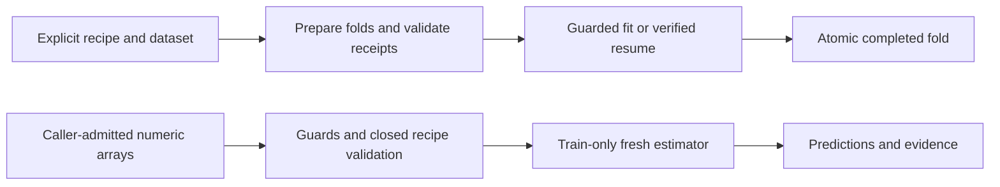

# Model training architecture

## 1. Purpose

Layer 6 in the [root architecture](../../../../ARCHITECTURE.md): offline dataset/recipe preparation, guarded fitting, receipts and frozen-state builders. No score-request fitting or deployment-pointer promotion.

## 2. Primary contracts and public interfaces

The [README public interface](README.md#public-interface) inventories exported types/builders. `current_recipes`, `prepare_dataset`, `plan_folds`, `fold_receipts` and `receipt_issues` feed `run_training_job`; `build_d14_dataset` admits pinned native inputs. `fit_recipe_estimator` fits release recipes. Separate magnitude/Ridge/HGB/ElasticNet/regression APIs and `fit_routes.fit_execution` consume caller-admitted arrays; `magnitude_mlp.fit_mlp_predictions` participates in shared magnitude dispatch, while v1–v5 search requests do not admit MLP. Payoff, recalibration, residual, analog and trailing-cutoff builders return frozen model-state artifacts.

## 3. Inputs

Jobs receive `TrainingRecipe`, frames and explicit output paths; source identity may be bound through `input_identity`. D14 reads explicit catalog/snapshot/receipt/calendar pins; recipe and chooser-source readers bound registry JSON or local parquet. Numeric fitters take closed recipes, ordered columns, training features/labels and prediction features; callers own causal membership, source admission and resource budgets.

## 4. Outputs

Jobs publish identity/summary JSON and per-fold receipts, estimators and optional predictions through `fold_store`. Numeric APIs return detached predictions/evidence, never files: MLP v1 includes recipe hash, one component, convergence, iterations, learned width and standardized-target optimizer loss; inverse-transformed finite predictions clip at zero. Signed regression policies retain signed outputs. Builders return artifacts for caller-owned release assembly.

## 5. Dependencies

Uses lower-layer contracts, foundation, data, features, models and scoring math. `legacy_adapter` is the declared edge to the legacy no-fit switch, not legacy training. Consumers are ops/research and offline experiment/tool orchestration; see [README consumers](README.md#consumers). Lower-layer scoring/features/models cannot import training.

## 6. External systems and libraries

NumPy/pandas, sklearn and threadpoolctl implement numeric fits; joblib/parquet and filesystem rename persist job folds. D14 uses read-only SQLite and verified artifact-store reads. No provider/network acquisition is owned here.

## 7. Failure semantics

| Condition | Outcome |
| --- | --- |
| Missing/invalid input | Dataset errors use `RecipeDataError`; unsupported estimators use `UnsupportedEstimator`; D14 retains typed data refusals. Chooser missing files raise `FileNotFoundError`, invalid/oversized sources `ValueError`. MLP rejects invalid policy/order/matrices/labels before fitting. |
| Guards/numeric failure | `RuntimeFitForbidden` from either guard precedes MLP inspection. Convergence warnings or nonfinite weights/loss/predictions raise `ValueError`, no partial result; unrelated warnings are not convergence failures. Sklearn's interrupted-training warning re-raises its original `KeyboardInterrupt`, never successful evidence. Other fitters retain their documented errors. |
| Cache/retry | Numeric fits are fresh, uncached and never retried. Job resume verifies identity, file hashes and rederived receipts before retaining a completed fold; mismatches raise `TrainingRefused`. |
| Transaction/partial write | Numeric fitters have no I/O/transaction. Jobs publish each completed fold by rename, not an all-job transaction; prior folds survive failure and interrupted partial directories are removed on explicit resume. |
| Idempotency | Same-environment MLP calls fit afresh deterministically; completed job folds are verified and not refit. A new dataset/recipe needs a new job identity, not silent replacement. |

## 8. Invariants

MLP preprocessing, variance filtering and affine target scaling learn only from training rows; prediction rows never set width. Fixed seed, one numerical thread and training-loss stopping use no evaluation split; convergence failure has no fallback. Job receipts expose label-availability and upstream-lineage violations. Numeric evidence is not source/holdout admission, search selection, a release or production-comparator replacement.

## 9. Data flow

