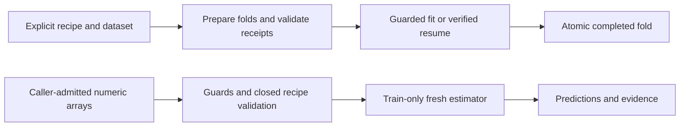

# Model training architecture

## 1. Purpose

Layer 6 in the [root architecture](../../../../ARCHITECTURE.md): offline dataset/recipe preparation, guarded fitting, receipts and frozen-state builders. No score-request fitting or deployment-pointer promotion.

## 2. Primary contracts and public interfaces

The [README public interface](README.md#public-interface) inventories exported types/builders. `current_recipes`, `prepare_dataset`, `plan_folds`, `fold_receipts` and `receipt_issues` feed `run_training_job`; `build_d14_dataset` admits pinned native inputs. `fit_recipe_estimator` fits release recipes. Standalone magnitude/Ridge/HGB/ElasticNet/regression estimators accept arrays; engine candidate and route APIs accept caller-constructed `FitInputs`. The `experiments.magnitude_candidate_fit.fit_candidate` compatibility boundary keeps its raw-array signature and constructs `FitInputs` after guards and family validation. `magnitude_mlp.fit_mlp_predictions` participates in shared magnitude dispatch, while v1–v5 search requests do not admit MLP. Payoff, recalibration, residual, analog and trailing-cutoff builders return frozen model-state artifacts.

### FitInputs contract

`FitInputs` is a frozen in-memory transport: its field bindings cannot be reassigned, but supplied array-like objects may remain mutable. Callers construct it at the call site; direct construction stores objects as given, while `from_recipe` applies guards and ordered-column admission. Optional `train_event_dates` binds canonical ISO dates to training rows; a supplied list is copied to an immutable tuple after validation, and construction refuses a date count mismatch or malformed date. Candidate and route APIs pass the transport to existing fitters without changing recipe, result, experiment or replay identity when dates are absent. Estimator validation retains its refusal order and messages: guard and recipe/column admission, matrix conversion and preflight, row count, then label validation.

## 3. Inputs

Jobs receive `TrainingRecipe`, frames and explicit output paths; source identity may be bound through `input_identity`. D14 reads explicit catalog/snapshot/receipt/calendar pins; recipe and chooser-source readers bound registry JSON or local parquet. Numeric fitters take closed recipes, ordered columns, training features/labels and prediction features; callers own causal membership, source admission and resource budgets.

### Planned chooser analog source refresh contract

The current monthly retrain path reads the existing `data/features/chooser_analog_pool.parquet`; it does not regenerate it. The planned producer in slice 2 will refresh it immediately before `retrain-train` and before freezing the chooser member. It must build from a freshly generated full-menu candidate population and settled outcomes, never reuse the prior parquet as a fallback. EXP-137's enumerated candidate build defines the population: one midpoint candidate per offered structure/event, without downstream chooser selection. EXP-161's `conditional_exit` supplies the realized exit value. Map its seven arms to chooser strategies as in the historical builder (`N7q2_-1_-1_1`→`TWIN-P`, `N5q2_-2_1`→`TWIN-P5`, `N4q0_-1_1`→`CND-PS`, `N3q-2_1`→`BFLY-P`, `N5q-4_1_1`→`BFLY-P5`, `N7q-2_-1_1_1`→`RAMP7`, `N5q-2_-1_2`→`CTR5`). The ordinary `engine.replay` Tier-2 `trades` table is not a substitute: it does not contain this full candidate population or its five analog dimensions.

Each emitted row carries `strategy`, `event_id`, `ticker`, `event_date`, `entry_date`, `exit_date`, `pnl`, `exp_pnl_sim`, `width_over_forecast`, `n_legs`, `anchor_over_spot`, and `rel_spread`. `event_date` comes from the candidate event and `entry_date` from the replay plan. The plan's quote `exit_date` is not always label availability: when `conditional_exit` replaces the quote exit with terminal expiry payoff, the producer must publish `exit_date` as the expiry date; otherwise it is the quote exit date. `pnl` is the conditional settled `exit_value - entry_cost` at fill alpha 0.5 and is knowable by the published `exit_date`. `exp_pnl_sim` is the candidate's simulated expected P&L; `width_over_forecast` is half-width as a percent of entry spot divided by the event forecast; `n_legs` is the chosen structure's leg count; `anchor_over_spot` is the primary strike divided by entry spot; `rel_spread` is mean relative entry spread across used legs. These five dimensions are measured at entry and may use only information available by `entry_date`. Monthly candidate selection uses effective exit-availability dates, never event-date month; the retrain admits only rows with `exit_date < cutoff`.

The shared pure settlement helper is `engine.v2.models.training.conditional_exit.conditional_exit(frame)`: it returns a repaired copy with the historical conditional-exit and realized-P&L semantics, and is imported by EXP-161 and `tools/build_chooser_pool.py`; EXP-167/169 reach it through EXP-161. The EXP-161 import is also in the legacy nightly evidence import closure. Importing it loads the v2 package initializers. The root architecture records the single scoped exception and its retirement condition. The helper does no I/O and does not mutate its input.

The refresh requires the current event, forecast/residual, option-chain and candidate-settlement inputs needed to regenerate those candidate rows. Missing or failed required input raises typed `TrainingRefused` (surfaced by ops as `VALIDATION_FAILED`); it must stop that monthly attempt before the prior source can be read and must never silently fall back to it. The output is parquet with the schema above, including `event_date`; the existing bounded chooser reader continues to validate it. The source producer belongs to the monthly pool-refresh path, ahead of `retrain-train`, rather than the generic features job, because only the monthly path has the retrain cutoff and must guarantee a fresh source before artifact freezing.

## 4. Outputs

Jobs publish identity/summary JSON and per-fold receipts, estimators and optional predictions through `fold_store`. Numeric APIs return detached predictions/evidence, never files: MLP v1 includes recipe hash, one component, convergence, iterations, learned width and standardized-target optimizer loss; inverse-transformed finite predictions clip at zero. Signed regression policies retain signed outputs. Builders return artifacts for caller-owned release assembly.

## 5. Dependencies

Uses lower-layer contracts, foundation, data, features, models and scoring math. `legacy_adapter` is the declared edge to the legacy no-fit switch, not legacy training. Consumers are ops/research and offline experiment/tool orchestration; see [README consumers](README.md#consumers). Lower-layer scoring/features/models cannot import training.

## 6. External systems and libraries

NumPy/pandas, sklearn and threadpoolctl implement numeric fits; joblib/parquet and filesystem rename persist job folds. D14 uses read-only SQLite and verified artifact-store reads. No provider/network acquisition is owned here.

## 7. Failure semantics

| Condition | Outcome |
| --- | --- |
| Missing/invalid input | Dataset errors use `RecipeDataError`; unsupported estimators use `UnsupportedEstimator`; D14 retains typed data refusals. Chooser missing files raise `FileNotFoundError`, invalid/oversized sources `ValueError`. MLP rejects invalid policy/order/matrices/labels before fitting. |
| EXP-137 monthly candidate build | `build_all(limit_exit_month=...)` requires canonical `YYYY-MM`; forecast and chain coverage gaps follow full-build filtering, known benign structural/quote/expiry/zero-cost skips remain skips, expiry-selection errors and required candidate/source failures raise `TrainingRefused`, and monthly results stay in memory without publishing full-build artifacts. |
| Guards/numeric failure | `RuntimeFitForbidden` from either guard precedes MLP inspection. Convergence warnings raise `ValueError` without a partial result except for a fixed-budget recipe warning at its `max_iter`; chrono fits one epoch at a time with `partial_fit`, so it neither emits nor accepts sklearn's convergence warning, and its `converged` is true when patience stops before the cap and false at the cap. Nonfinite weights/loss/predictions still raise `ValueError`, and unrelated warnings are not convergence failures. Sklearn's interrupted-training warning re-raises its original `KeyboardInterrupt`, never successful evidence. Other fitters retain their documented errors. |
| Chrono date/split refusal | Missing or malformed aligned ISO event dates refuse `ValueError` before estimator construction; too few rows for the chronological fit/validation split refuse `ValueError` before fitting. |
| FitInputs factory refusal | Guards precede column access; an ordered-column mismatch raises `ValueError`. |
| FitInputs event dates | Dates are optional. When supplied as a list or tuple, their count must match sized training rows and each value must be a canonical ISO date; unsupported date containers, unavailable row counts, mismatch or malformed values raise `ValueError`. |
| Numeric fit validation | Matrix conversion/shape/infinity checks precede row-count checks, then label checks; existing messages are preserved. |
| Conditional exit missing columns | Missing any of `exit_arb_ok`, `exit_value`, `exit_value_expiry` or `entry_cost` propagates pandas `KeyError`; no frame is returned and the input remains unchanged. |
| Conditional exit missing values | Rows with missing `entry_cost` or post-repair `exit_value` are dropped; the remaining frame is returned and the input remains unchanged. |
| Conditional exit below-debit result | A repaired return below `-1.0 - 1e-8` raises `RuntimeError("conditional exits still contain a loss below the debit")`; no frame is returned and the input remains unchanged. |
| Cache/retry | Numeric fits are fresh, uncached and never retried. Job resume verifies identity, file hashes and rederived receipts before retaining a completed fold; mismatches raise `TrainingRefused`. |
| Transaction/partial write | Numeric fitters have no I/O/transaction. Jobs publish each completed fold by rename, not an all-job transaction; prior folds survive failure and interrupted partial directories are removed on explicit resume. |
| Idempotency | Same-environment MLP calls fit afresh deterministically; completed job folds are verified and not refit. A new dataset/recipe needs a new job identity, not silent replacement. |

## 8. Invariants

MLP preprocessing, variance filtering and affine target scaling learn only from training rows; prediction rows never set width. All profiles use a fixed seed and one numerical thread. The original profiles use training-loss stopping without an evaluation split; fixed-budget profiles set `n_iter_no_change=201`, above their 200-epoch cap, so they complete the budget without training-loss early stopping. The four early-stopping profiles use sklearn's seeded random 10% training-row validation split. The six chronological profiles require aligned ISO dates, fit only earlier rows sorted by `(date, position)`, hold out the latest 15%/10%, use `partial_fit` one epoch at a time with patience 20, restore the best holdout weights and report `converged=True` when patience stops before the 400-epoch cap and `converged=False` at the cap; they do not report sklearn warning state. `n_iter` is the last attempted/stop epoch, while the receipt's weights and optimizer loss are restored from the best holdout epoch. Convergence warnings fail unless a fixed-budget recipe reaches its declared cap; that successful budget completion reports `converged=False` when sklearn warns, distinguishing the epoch cap from optimizer convergence. Nonfinite fit evidence still fails. Job receipts expose label-availability and upstream-lineage violations. Numeric evidence is not source/holdout admission, search selection, a release or production-comparator replacement.

## 9. Data flow

