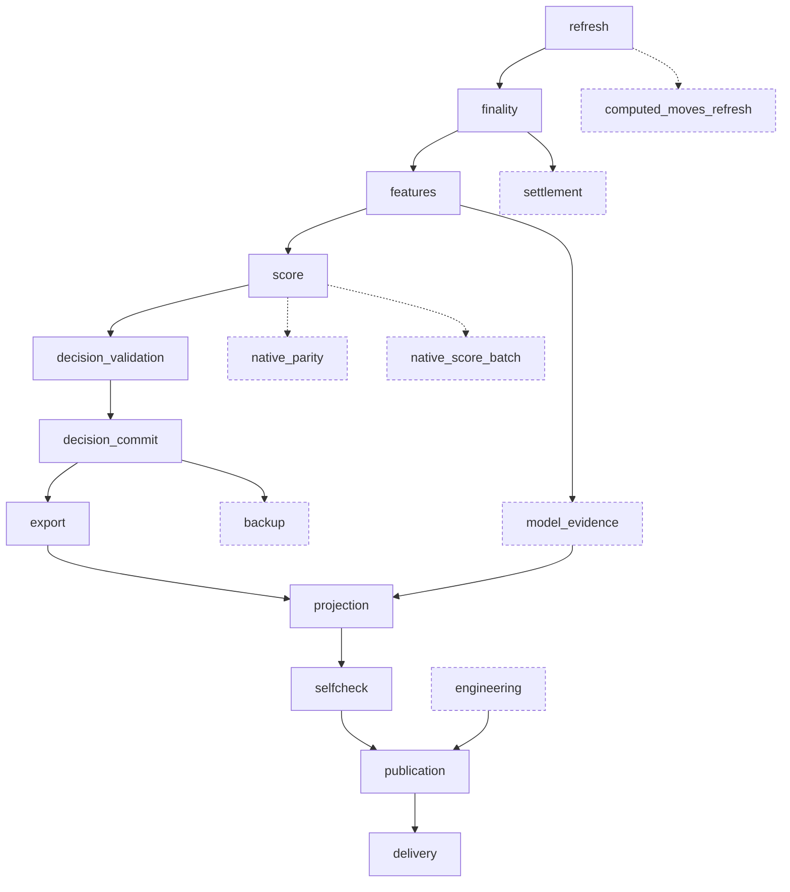
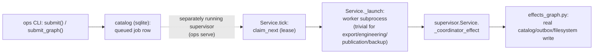
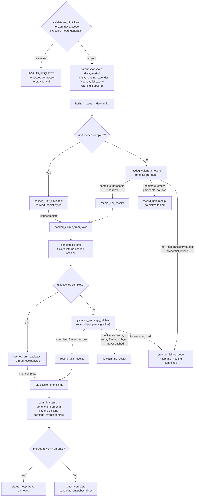
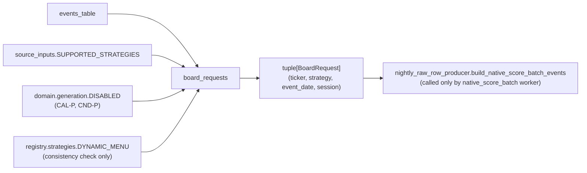

# `engine/v2/ops` — architecture

Layer 7.0 in the root `/ARCHITECTURE.md` layer table. Replaces the new supervisor/catalog design,
`dashboard/nightly.py` (as a job graph) and `tools/bounded_run.py` (as an executor adapter). The root doc covers shared
layer rules; this doc covers package detail.

## Purpose

Durable job submission, leases, retry history and dependencies; resource
admission (each constrained cgroup uses `max(0, memory.current - (file - shmem))`, reading `file` and `shmem` from that same directory’s `memory.stat`; active and inactive file cache is reclaimable, while shmem/tmpfs stays counted; missing, malformed or unreadable statistics fall back to `max(0, memory.current - inactive_file)`, then raw usage; headroom remains `min(host_available, container_remaining) - free_margin`) and per-job CPU placement; the nightly job graph and its release
boundary. It does not decide research conclusions (`engine/v2/evaluation`) and does not compute a score (`engine/v2/scoring`) — it only sequences and persists the jobs that call into those packages. `legacy_render` renders the staged score document's board rows, which scale with output rows, and builds a `Scorer` without calling its scoring path. Its `feature_panel`, `trades`, and `earnings_events` inputs are whole-table reads; `FeatureContext.load` filters its `daily_market` input by plan `context_tickers` and year range, while `Scorer` construction separately reads each historical `daily_market` year slice, then filters it to trade-derived ticker chunks, spanning the trade entry years plus one prior year. The lazy Tier-4 forecast path is not reached. The render profile (`projection`) must account for the complete evidence working set, which can include more tickers than the staged board rows; its 3 GiB reservation and cgroup `memory.max` cap are INTERIM, sized from the observed 100-ticker render only and NOT shown to fit the full universe, so the bounded/chunked read design tracked by issue #505 is the actual fix; available subset evidence does not establish full-universe fit.
This doc also covers `native_board_universe.py`: a pure, answer-free enumerator reproducing legacy `engine.score.score_calendar`'s event × strategy enumeration for supported and disabled strategies, without the legacy chain index or a legacy `Scorer`; the native worker runs `build_native_score_batch_events` over the pinned snapshot, off the supervisor tick (see "Dependencies"); schema migrations follow the [checksummed R1–R6 table-recreate contract](MIGRATIONS.md).

**Planned package split.**
The `design/ops-package-split` PR records the proposed module homes and move slices. The planned dependency direction is entrypoints → runtime → workflows → stores → {legacy, native, providers} → core, with no upward or peer-package imports. Before implementation, remove prerequisite cycles and migrate all callers per move; no compatibility modules or re-export shims.

## Primary contracts and public interfaces

`publication.publish_local` refuses an ineligible release with `PUBLICATION_REFUSED` and sorted `details.failed_gates` names from the manifest's `gates` whose `ok` value is `false`.
**Operations health output.** `health` emits `operations_health.v1.1`; it selects the current delivered release from each published scope's `CURRENT` pointer, then orders those releases by occurrence, delivery time and release ID. `requested_session` and `resolved_session` come from the unique delivered `ledger_export_receipt.v1.0` associated through a consistent `release_intent` receipt with that release, including same-session reruns; the export receipt's scope must match the selected pointer scope or validation is `VALIDATION_FAILED`. Sessions never come from `generated_at`. Invalid or ambiguous evidence is `VALIDATION_FAILED`; the CLI removes its output and does not retry. Identical catalog, pointer and clock inputs produce byte-identical JSON; evolution follows `guides/component_contracts.md` §2.3 and older versions remain valid. A publication status sidecar compares withheld releases against its own scope's delivered `CURRENT` row; when none exists, it treats current as absent and does not fall back to another scope's latest delivery. Unsafe unrelated-scope pointers do not prevent that write; aggregate health reads each published scope pointer and propagates unsafe-pointer errors. **I/O outcomes:**

| Condition | Outcome |
|---|---|
| Catalog read | Uses the supplied connection directly; no health-specific transaction or cache (an existing caller transaction still applies). |
| Receipt evidence invalid | `VALIDATION_FAILED`; CLI removes the configured output and does not retry. |
| Persisted release association omits its primary ID | `VALIDATION_FAILED`; session evidence is not emitted. |
| Temporary write, file fsync or replace fails | Before replacement, the prior destination remains; a partial or complete sibling temporary file may remain. |
| Directory fsync fails after replacement | The new destination exists; crash durability is uncertain. |

The operator interface is the versioned command protocol exposed by `engine/v2/ops/cli.py`
(`python3 -m engine.v2.ops <command>`), derived directly from its `argparse` definitions:

- `init`, `doctor`, `health`
- `serve` — starts the supervisor loop
- `plan {nightly,experiment,training,promote,rollback}` — builds and saves a plan
  document; flags apply by kind: `training` takes `--training-mode`, `--recipe`,
  `--state`, `--alpha`, `--cutoff`, `--strategy`, `--pairs`, `--ticker-chunk`; native monthly training additionally uses `--training-input-mode native_d14`, `--training-catalog`, `--training-artifact-root`, `--training-snapshot-id`, `--training-receipt-id`;
  `promote` takes `--release-root`, `--release-id` and `--expected-previous-release-id`;
  `rollback` takes `--release-root` and refuses `--release-id`. It pins the rollback target at plan time; only `NoPriorRelease` leaves the target unset. A submitted rollback with an incumbent but no pinned target is refused as typed `VALIDATION_FAILED` before pointer or history mutation. Other resolver errors become typed `VALIDATION_FAILED`.
- `submit --plan --idempotency-key`
- `rescore --request --native-inputs` — read-only, no provider pulls, no fitting
- `capture-inputs --as-of --tickers --context-tickers --year-start --year-end --source-root --output`
- `reconcile <job_id> --expected-attempt`; `reclaim [--apply]` (dry run by default; see "Attempt staging reclaim")
- `provider-account --account --remaining --live-reserve`
- `snapshot {plan-import,submit,promote,rollback}`
- `ledger {import-history,status,calibrate,book}` — history summaries count new provenance writes as `imported` (excluding new divergences), and remaining lines as `already_present`; identical committed content under another purpose writes no provenance. Dry runs report the same projected counts and roll back writes.
- `decisions supersede --row-id --reason --from-json`
- `price-refresh --session [--dry-run] [--tickers @file --source-root]` (`--tickers` plans exactly those names plus SPY from `<source-root>` fetch history, like the nightly; each flag requires the other, else `INVALID_REQUEST`; without them the legacy universe; a daily ticker is skipped only if a cached fetch was stamped strictly after the required trading day's regular 16:00 ET close plus a 30-minute buffer (a stamp equal to that cutoff is not coverage), and every trading day uses that close, so on half-days a fetch made before 16:30 ET may be refetched (accepted); a bad post-close response is not retried until a run targets a session whose close plus the buffer is at or after that fetch's stamp, and that run refetches it; capture rejects a retrieval that starts later than the stored history but does not check coverage of the requested session, so a valid response that is missing trailing bars can pass capture and then counts as covered (accepted trade-off); the refetch passes a unique `refetch_token` to `Fetcher.fetch`, a new cache entry and a network call for each fresh token, so the stale body is kept and never served). A real run (not `--dry-run`) also refreshes the legacy S&P csv `gspc_daily.csv` (`engine.data.pulls.gspc_refresh`) and reports `gspc_daily: {"ok": true, "last_date", "rows"}` or `{"ok": false, "reason"}` (`fetch_failed`, `unparseable`, `shrunk`, `older_than_existing`, `unreadable`, `unwritable`) in both the nightly and the CLI report. The fresh series is cut to start 2006-01-01 like the stored file, so a refresh only appends and corrects the tail: stored `Close` values older than the last 5 stored rows must match (`history_changed` otherwise); the last 5 may be corrected. Outcomes: fetch error or non-200 `fetch_failed`; empty, close-less, oversize or no-finite-close body `unparseable`; dropped stored date, fewer rows or later start `shrunk`; earlier end `older_than_existing`; unusable existing file `unreadable`; lock or write failure `unwritable`. A complete, non-shrinking series replaces the file atomically under an exclusive lock; identical bytes leave file and mtime alone; a refusal leaves the file unchanged, is not retried within the run and is retried by the next real run with a fresh fetch. `CredentialRotated` propagates. `add_regime_features` warns, once per file version, when the series ends over 7 days before the decision date; it never refuses or raises.
- `price-history capture --source-root --scope [--dry-run]` (refuses `SOURCE_NOT_FOUND` without a usable calendar ticker, SPY; rebuild: [guide](../../../guides/native_board_rebuild_runbook.md))
- `computed-moves capture --source-root --scope --as-of [--dry-run]`
- `get`/`logs`/`cancel`/`resume`/`explain <job_id>`

Internally: `nightly.py`'s `GRAPH`, `graph_order()`, `OPTIONAL`, `NO_JOB_STAGES`, `build_nightly_plan`,
`build_legacy_job_requests`, `_stage_sequence` (see "Diagrams" below); `supervisor.Service`/`serve`; the
coordinator-effect functions in `effects_graph.py`; `training.py`'s `training_job_kind`/`promote_job_kind` (registered in
`stages.py::_core_kinds`, not in `supervisor._COORDINATOR_EFFECT_KINDS`), `training_plan`/`promote_plan`,
`run_training_worker`/`run_promote_worker`; `native_training_pin_problems((catalog, store, snapshot, receipt), require_absolute=True)` returns a problem list without I/O (CLI validates raw pins with `False` before path resolution); `state_stage.py` (`phase5_state_stage`); `BoardRequest`/`board_requests(as_of, horizon_days, tickers, events_table)`
(`native_board_universe.py`) — `board_requests` emits one `BoardRequest` — the pure key `(ticker, strategy, event_date, session)` — per event ×
native-covered or disabled (CAL-P/CND-P, refused downstream) strategy, plus one `DYN-SV` meta-request per event; `calendar_moves_jobs.py`'s
`computed_moves_job_kind`/`forward_calendar_job_kind`, `CalendarMovesParameters`/`calendar_moves_parameter_problems`/
`calendar_moves_job_spec`, and `run_computed_moves_worker`/`run_forward_calendar_worker` (dispatched by `worker.py`).
`forward_calendar_refresh` has a `JobKind` but no nightly submitter. `native_gate_pricing` and `native_gate_evaluation` are smoke-only, single-thread staged kinds: the executor launches only the fixed `experiments.native_gate_entrypoint` module, which passes its narrow callback to `worker.main` after the launch gate; registration/spec/code/environment checks precede pricing or fitting. Neither has a coordinator ledger effect or cache reuse; see `experiments/ARCHITECTURE.md`.

`forward_calendar_store.run_forward_calendar_refresh` is a standalone, keyword-only native fetcher in ops: non-fetcher arguments validate before catalog/provider access; empty tickers mean whole market.
Commit fencing checks the head before the attempt within one transaction; cancelled/expired attempts refuse before commit. An omitted attempt fence preserves generic-refresh and research callers.
The forward-calendar worker loader wraps both provider-unit fetchers with `provider_budget.budgeted_fetcher`, bound to the staged attempt/fence and each source's own account. Budget transactions/connections end before provider I/O; complete cache hits bypass charging.
`catalog.connect(must_exist=True)` opens an existing catalog without creating a replacement; its default still permits catalog creation. Guard construction performs no I/O.

`native_score_batch.py`: the batch-shaped seam between the board universe
(`native_board_universe.BoardRequest`) and
`engine.v2.scoring.application.score_batch`. `assemble_score_batch_inputs`
turns one release binding (`ScoringReleaseBinding`) plus a sequence of already-staged `NightlyEventInputs` into `dict[BoardRequest, tuple[ScoreRequest, NativeScoreInputs]]` plus a tuple of typed per-row refusals — a pure function; an empty `events` sequence is a legitimate no-op.
`run_native_score_batch_worker(parameters, root)` resolves the release, builds
`events.json` and `producer_refusals.json` from the pinned snapshot in the
`projection` worker, then assembles, scores under `no_fit_guard()`, and writes
`records.json`/`refusals.json`. **Supports `STR-THRU` and `STR-RUNUP`** — any other
strategy refuses per-row. The tick sidecar only submits the shadow job for a
new eligible snapshot-pinned identity (`producer_mode="snapshot"`); direct
worker callers default to staged `events.json`; snapshot mode derives `calendar_revision` from pinned earnings data, while staged mode uses its parameter. The snapshot producer's `Repository` is opened with `pin_snapshots=True` (resolution and scan/bound membership are memoized per instance; `fragment_records` is not) and each admitted row runs inside a `compose_event_<done>_of_<total>` progress step. Other ops workers that scan one fixed snapshot open it pinned too (`materialization_worker._write_root`, `snapshot_stages.validated_request`, `snapshot_planning.generated_population`/`pin_snapshot_inputs`, `nightly._build_native_computed_moves_plan`, `cli.computed_moves_command`, `computed_moves_store.run_computed_moves_refresh`, `forward_calendar_store._execute_forward_calendar_refresh`; output-identical, because the pin memoises only immutable catalog identities); single-resolve sites and `price_history_store` (commits, then re-reads the moving head) stay unpinned.
The production-default `legacy`/unpinned path stays a no-op; production uses `projection` (3 GiB, 2 CPUs). A producer exception fails the native attempt
before writing that attempt's event/refusal or score outputs; reused-root files
may remain as untrusted residue. The worker job has five bounded attempts, with delays of 30s, 2m, 10m and 30m. Worker production cannot stall supervisor ticks or renewals, and native failure leaves legacy jobs unaffected.
Snapshot parameters raise `VALIDATION_FAILED` for an unsupported `producer_mode` or, in snapshot mode, a missing or incomplete `catalog_path`/`objects_root` pair.

**DYN-SV batch boundary.** `board_requests` emits one DYN-SV key last per
event, but the batch assembler refuses it with `UNSUPPORTED_STRATEGY` after
key/calendar validation; earlier source refusals retain their own codes.
The worker calls `score_batch`, not the separate menu resolver described in
[scoring](../scoring/ARCHITECTURE.md#native-nightly-dyn-sv-boundary).
Enumeration order does not establish a scoring dependency. Encodable meta
refusals use the keyed output; invalid keys use `unkeyable_refusals`.

**Cutover PR-4 (redo — 2026-09-27, user decision option (c). This section
REPLACES the original PR-4 design, which proposed `tools/native_parity_run.py`,
a manual/operator-invoked script, as `native_parity`'s production caller.
The parity inputs are pure functions: `legacy_parity_rows`,
`native_parity_report._empty_native_report` and
`native_parity_report.apply_native_refusals` (`SCHEMA_VERSION` `v1.1`), joined
on `native_score_batch.py`'s `v2.0` keyed `records.json`/`refusals.json`
schema (`_board_request_key`, the `INVALID_KEY_FIELD` refusal, tags
`native_score_batch_records.v2.0` / `native_score_batch_refusals.v2.0`) through
`native_parity_report._population_key_from_board_request_key` and
`_native_rows_and_refusals` (pure projections; "Primary contracts" below).
`native_score_batch.py`'s worker and shadow sidecar are unaffected by the
bump (cutover PR-3 `#66` worker dispatch, PR-7a `#126` tick-loop submission).
The `native_parity` job kind -- `stages.py::_native_parity_kind`,
`worker.py`'s dispatch branch, `run_native_parity_worker`,
`NativeParityParameters` -- is real. Its nightly-side builder,
`nightly.submit_native_parity_if_ready`/`_native_parity_identity`, and
its tick-loop caller, `supervisor.Service._reconcile_native_parity`, are
both real too: `Service.tick()` calls it every tick the way
`_reconcile_native_score_batch_shadow` (`#88`) already does (its failures print `native_score_batch_reconcile_failed` with `error_type` and the typed problem's code and bounded details: short scalars and short string lists). For non-`Problem` failures, at most the first 256 characters of `str(exc)` are kept only in the in-memory dedup key; nonempty text emits the fixed `<redacted>` `details.exception_message`, while empty text emits no `exception_message` (the details mapping is empty). `_bounded_problem_details` omits string values longer than 120 characters; these size limits do not sanitize exception text or make raw text safe to publish. The
`nightly.GRAPH` node width is doc-only (`run_shadow_nightly`'s test-only graph walk; no submission path reads it). Cutover PR-3 (`native_score_batch.py`, `#66`) and cutover PR-7a's design (`#88`) and shadow-submission code (`#126`) are all already merged; PR-7a's code (`#126`) implemented the tick-loop submission sidecar only, not the `v2.0` schema this redo's design always said was `native_parity`'s own PR to build (see "the row-key/join gap is not designed here" below) — `#185` is that build. One piece is untouched by this redo, real code already on `main`, independent of everything `#66`/`#88`/`#126` supply: `native_parity_report.py`'s tolerance policy is already pluggable — see "the tolerance policy is now pluggable" below, unchanged.**

`native_parity` closes the gap the root doc §4 and this doc's own
"Diagrams" section both name: `run_shadow_nightly` "has no production
caller, only tests ... call it," so in production `native_parity` today
never actually compares anything — a production run supplies no
`parity_rows`, `_registered_handlers` defaults both sides to `{}`, and
`compare_native_vs_legacy`'s own `_refuse_empty_inputs` raises
`VALIDATION_FAILED` before any comparison runs, which `_run_stage` turns
into a `"degraded"` receipt for this `OPTIONAL` stage (see "Outputs"
below for why this is NOT the same claim as "writes an empty-input
report" — no report is ever written either). **This redo does not close
that gap through `run_shadow_nightly` at all.** That function keeps its
existing stage-walk and `native_parity_handler`'s existing signature
contract completely unchanged (both already correctly consume real
`legacy_rows`/`native_rows` dicts today — proven by
`tests/v2/ops/test_native_shadow_render.py` — and stay exactly the
test-only path they always were; nothing before this redo, or in it,
builds real dicts to hand `run_shadow_nightly` in production). The gap
closes through a SEPARATE production path: a new `native_parity` job
kind, submitted by `supervisor.Service`'s own tick-loop sidecar —
mirroring `computed_moves_refresh` (Part 4, `#54`) and `native_score_batch`'s
own shadow submission (`#88`) byte-for-byte in shape — never through
`build_legacy_job_requests`, so a broken parity submission can never
abort a required legacy stage. That job's worker calls the exact same
`compare_native_vs_legacy`/`native_parity_handler` functions
`run_shadow_nightly` already calls, so the two paths — one test-only, one
production — can never silently diverge in comparison logic: root doc
§5's "one shared parity comparator" invariant, restated one level up as
one shared CALLER of that comparator, reached two ways.

Four new symbols, mirroring `native_score_batch`'s own PR-7a shape:

- `supervisor.Service._reconcile_native_parity` — the tick-loop sidecar
  called from `Service.tick` right after
  `self._reconcile_native_score_batch_shadow()` (`#88`); a CONFIRMED
  `schema_mismatch` parks the job id and short-circuits later ticks.
- `nightly.submit_native_parity_if_ready` — the builder the sidecar calls,
  mirroring `submit_computed_moves_refresh_if_ready` (`nightly.py:858`)/
  `submit_native_score_batch_shadow_if_ready` (`#88`) in signature shape.
- `nightly._native_parity_identity` — a cheap catalog-only identity check
  mirroring `_computed_moves_identity` (`nightly.py:830`): finds the
  latest succeeded `native_score_batch` job by its own idempotency key
  (`"nightly:<as_of>:<scope_hash>:native_score_batch"`, `#88`'s own R6),
  parses `(as_of, scope_hash)` out of it, and recovers the paired
  succeeded `"score"` job's id with the SAME query `#88`'s own
  `_native_score_batch_identity` already runs to find a session's
  `"score"` job (`"nightly:<as_of>:<scope_hash>:score"`) — reused here
  with `(as_of, scope_hash)` already known rather than searched for,
  never a second, independently written lookup. Returns `(as_of,
  scope_hash, score_job_id, native_score_batch_job_id)`, or `None` when
  no succeeded `native_score_batch` job exists yet.
- `stages.py::_native_parity_kind()` — **implemented, slice 2B(a)** — a `JobKind`, mirroring `_native_score_batch_kind()` (`stages.py:271`) in shape: `name="native_parity"`, `worker="native_parity"`, `parameters=NativeParityParameters` (new, `RescoreParameters`-shaped — only `expected_ids` and `input_bindings`; this job carries no scalar data of its own, since every input it reads is job-bound), `resource_classes=frozenset({"validation"})` (a pure comparison, no provider fetch — the same classification `decision_evidence` already has), `effects=("staged",)`, `retry=RetryPolicy("bounded", 2, (5, 30))`, `checkpoint_contract="native_parity_report.v1.3"` (matching `native_parity_report.SCHEMA_VERSION`; v1.3 adds `ticker` and `reason` to native refusal entries below), `namespaces=frozenset({"shadow", "smoke"})`. `worker.py::dispatch` routes the `"native_parity"` branch to `native_parity_report.run_native_parity_worker` (below), using the same lazy-import-inside-`_dispatch_*` pattern as `_dispatch_native_score_batch` (`worker.py:167-168`, `:198-200`).

`nightly.GRAPH` has a `"native_score_batch": ("score",)` node (`#88`),
while `"native_parity"` remains `("score",)` (`nightly.py:124`). Widening
that node to `("score", "native_score_batch")` is separate topological
documentation work for `run_shadow_nightly`'s whole-graph test-only
walk; runtime parity submission already binds both jobs directly. No
submission path reads either edge (the rule Part 4 established for
`computed_moves_refresh`'s own node).

- **`native.parity_inputs.legacy_parity_rows(score_document: Mapping[str, Any]) -> dict[str, dict]`** (new, this package). Keys legacy `score.json` rows by complete `ticker|strategy|event_date` identity using the shared `engine.v2.foundation.score_population.population_key`, also used by bridge, adapter, and replay. The native `native_row_key` derives its corresponding identity from event reference and resolved request. Pure: no filesystem, clock, or `engine.v2.serving` import (a peer layer). A `score_document`
  with no `"rows"` key returns `{}` (not a refusal —
  `native_parity_handler`'s existing `_refuse_empty_inputs` already turns
  an empty `legacy_rows` into `VALIDATION_FAILED` downstream, so this
  function does not need its own empty-input check).
  **`legacy_parity_rows` does NOT reuse `population_key`'s own
  `.get(key, "")` empty-string substitution for a missing
  `ticker`/`strategy`/`event_date`** (root doc §5: "a missing or unusable
  input produces an explicit withheld/refused status," never a silent
  default) — reusing that substitution here would let one malformed row's
  empty-string-keyed entry either collide with a genuinely empty-fielded
  row, or, more likely with real data, simply end up unique and reported
  as an ordinary `only_legacy` row: quietly absorbed into the report as a
  population difference rather than surfaced as the malformed input it
  actually is. **Duplicate keys are the same class of finding, not a
  separate one**: `_action_score`'s own population check
  (`observed_keys = {_population_key(row) for row in rows}`) compares
  `population_key` values only as a SET, so a `score.json` carrying two
  rows under one `ticker|strategy|event_date` key (sibling precedent:
  `decision_replay.decision_population` rejects a duplicate population
  key explicitly, via `VALIDATION_FAILED`; `_action_score` does not)
  already passes that check today without ever proving the two rows
  agree — a plain `{key: row for row in rows}` comprehension in
  `legacy_parity_rows` would then silently keep whichever row iterated
  last and drop the other with no trace. `legacy_parity_rows` therefore
  validates every row before keying any of them: a missing, non-string,
  or empty `ticker`/`strategy`/`event_date`; a `ticker` or `strategy`
  containing the `"|"` `population_key` delimiter (CodeRabbit round 3 —
  `population_key` joins on `"|"`, so an unescaped delimiter inside a
  field would let two distinct rows collide under one key); OR two rows
  sharing one `population_key` value — each raises `OpsError` — matching
  `decision_population`'s own code, `VALIDATION_FAILED` (detail naming
  the row index/offending field, or the repeated key and both rows'
  indices) — for the WHOLE call, before any dict is constructed: a
  batch-level refusal, never a per-row skip or a last-write-wins
  collision, so a malformed or duplicate-keyed `score.json` is never
  silently read as smaller, or different, than it actually is. The same
  refusal covers the shape one level up, before `population_key` is ever
  called on a row: `score_document["rows"]`, if present, must be a list of
  mappings — a non-list value or any non-mapping element raises `OpsError`
  (`VALIDATION_FAILED`) rather than letting `population_key`'s own
  `.get(...)` calls raise a bare `TypeError`/`AttributeError` on a
  malformed element.
  Parity's population validation remains independent of score-plan validation.
- **`native_parity_report.run_native_parity_worker(parameters, root)`**
  (implemented, slice 2B(a), this PR) — the `native_parity` job kind's worker entrypoint (dispatched
  from `worker.py`, registered in `stages.py::_core_kinds`). Reads its two
  job-bound inputs (`score.json` from the paired `"score"` job;
  `records.json`/`refusals.json` from the paired `native_score_batch` job
  — see "Inputs" below for exactly how `_native_parity_identity` finds
  both). The worker ITSELF also refuses `VALIDATION_FAILED` up front,
  before reading a single row, if either document's `schema_version` is
  not exactly `native_score_batch_records.v2.0`/
  `native_score_batch_refusals.v2.0` (gate finding on `#191`, real: the
  generic job-submission API can submit a `native_parity` job against ANY
  bound artifacts today, entirely independent of
  `submit_native_parity_if_ready`'s OWN pre-submission check and the
  sidecar's own schema-mismatch park-and-short-circuit — a worker-side
  check stays REQUIRED defense-in-depth regardless: a
  generic submission always bypasses any one caller's own pre-submission
  check, and a directly-submitted job has no caller-side memo to protect
  — it simply fails, correctly, at the worker). See "Cutover PR-4
  (redo)'s own input sourcing" above for why the sidecar-layer check
  additionally exists, for retry-semantics reasons this worker-side
  check does not address. It builds
  `legacy_rows`/`native_rows`/`native_refusals`/`unkeyable_refusals` (via
  `_native_rows_and_refusals`, below), projects every native record
  through `_native_comparison_row` (gate finding on `#191`, real: a raw
  `to_document(ScoreRecord)` preserves `ScoreRecord`'s own nested
  per-dimension dicts, while `_dimension_view` looks up every field at
  the row's top level — an un-flattened record compares as all-`None`,
  masking real native values and reporting false mismatches against
  real legacy ones; this projection reads each dimension from the same
  nested sources `checks/phase4_real._numeric_views` already reads them
  from, a data-shape port only, never a new comparison rule), and
  branches on whether `legacy_rows` and
  `native_rows` share any key (below, `_empty_native_report`) before
  calling the SAME `compare_native_vs_legacy` (unchanged) and the new
  `apply_native_refusals` (below) — see "Outputs" for what it writes.
  This is the only production producer of `native_parity_report.json`; the one other producer of this format is the operator exporter `tools/captured_native_comparison.py`.
- **`financial_diagnostics` view of a legacy row (#681).** Legacy score rows never carry `entry_cost_pct`; `_dimension_view` derives it as `entry_cost / spot * 100` (`None`, never an exception, when either is absent, non-numeric, non-finite or too large for `float()` (`OverflowError`, e.g. an integer beyond ~1e308), or `spot` is 0; the comparator reports `None` as a mismatch only when the other side has a value, and `None` against `None` agrees; `checks/phase4_real._expected_financial_diagnostics` arithmetic). A row that already carries the key keeps its value.
- **`native_parity_report._empty_native_report(legacy_rows, native_rows,
  dimensions, tolerance_policy) -> dict`** (new, private) — closes a real
  gap in `compare_native_vs_legacy`: its unchanged guards reject an empty
  native side and a comparison with no shared key. The worker first rejects
  empty `legacy_rows`, then computes shared keys before calling the
  comparator. With no shared key, it builds `_empty_native_report` when
  every legacy key has its own keyed refusal, when an empty native side has
  an unkeyable refusal and no keyed refusals, or when an empty native side
  has a timestamp-keyed refusal for the same population and calendar day as
  a legacy key. Thus timestamp-keyed refusals remain unmatched with their
  exact identity; they are never normalized to a legacy day key. An
  unrelated keyed refusal cannot explain an absent legacy row. No row or
  comparison value is invented.
  Empty native rows with no refusals still fail `VALIDATION_FAILED`.
  Non-empty disjoint native rows still require matching refusals for every
  legacy key; an unrelated refusal does not explain an absent legacy row.
  Shared-key inputs keep using the unchanged comparator path.

  `_empty_native_report` preserves the comparator's report shape: all
  legacy keys are `only_legacy`, all native keys are `only_native`, and
  `compared`/`mismatches` are empty. `apply_native_refusals` then classifies
  refusals as it does for comparator reports. The decision is private to
  `run_native_parity_worker`; `compare_native_vs_legacy` gains no branch.
  The test-only `run_shadow_nightly` path calls `native_parity_handler`
  directly and does not reach this worker branch.
- **`native_parity_report.apply_native_refusals(report, native_refusals,
  unkeyable_refusals=()) -> dict`** separates explicit native refusals from
  unmatched legacy rows. The worker applies it after comparison (or the
  empty-native report); the test-only handler supplies empty refusals.
  A keyed refusal matching `only_legacy` moves to `native_refused`; an
  unmatched refusal goes to `native_refused_unmatched`. Keyed entries carry
  `row_key` and `refusal_code`. Unkeyable refusals always enter the latter
  list with their structured key, without attempting a lossy keyed join.
  Every refusal is reported exactly once. The writer's disjoint
  records/refusals contract prevents a key from being both scored and refused.
  `only_legacy` means no native record or keyed refusal explains that legacy
  key; it does not imply that native never enumerated the strategy.
  In particular, `board_requests` already enumerates DYN-SV last per event.
  Its current `UNSUPPORTED_STRATEGY` refusal belongs in `native_refused`
  when legacy emitted that row, otherwise `native_refused_unmatched`.
  DYN-SV uses the same keyed comparison/refusal classification, never a
  wildcard exemption. Numeric comparisons continue to use the shared parity
  comparator, with no special tolerance or legacy-derived native value.
- **`native_parity_report._population_key_from_board_request_key(key) ->
  str`** (new, private) — projects one `records.json`/`refusals.json` key
  (the 4-field canonical `BoardRequest` string `#88` specifies,
  `f"{ticker}|{strategy}|{event_date.isoformat()}|{session}"`) down to the
  3-field `population_key` format `legacy_parity_rows` already uses, by
  splitting on `"|"` into exactly 4 parts and calling
  `engine.v2.foundation.score_population.population_key({"ticker": ticker,
  "strategy": strategy, "event_date": event_date})` — REUSING
  `population_key`'s own join format rather than string-concatenating a
  fourth time, so the two sides can never silently drift onto two
  different separators or field orders. `session` is validated as present
  (exactly 4 parts) but never folded into the key: legacy rows carry no
  `session` field to join against. A key that does not split into exactly
  4 parts is a batch-level `OpsError` (`VALIDATION_FAILED`) — matching
  `legacy_parity_rows`'s own all-or-nothing malformed-input discipline —
  raised before `run_native_parity_worker` builds `native_rows`/
  `native_refusals` at all, never a per-row skip.
- **`native_parity_report._native_rows_and_refusals(records_document,
  refusals_document) -> tuple[dict[str, dict], dict[str, str], tuple[dict,
  ...]]`** (new, private) — the ONLY caller of `_population_key_from_board_request_key`
  (above), and the place a duplicate collision is caught: the projection
  from a 4-field `BoardRequest` key down to a 3-field `population_key` is
  LOSSY (it drops `session`), so two DISTINCT `records.json`/`refusals.json`
  keys — the same `(ticker, strategy, event_date)` under two different
  `session` values, a genuinely possible events-table shape this design
  does not assume away — can project to the SAME `population_key`
  (CodeRabbit round 1, real finding). Silently keeping whichever one a
  dict comprehension iterates last would be exactly the last-write-wins
  collision `legacy_parity_rows` already refuses to allow for
  `score.json`'s own rows (above) — so this function applies the IDENTICAL
  discipline to the native side: every key in `records_document["records"]`
  and every key in `refusals_document["refusals"]`, TOGETHER (one row can
  never be both a record and a refusal, but two DIFFERENT rows — one a
  record, one a refusal, or both records, or both refusals — can still
  collide after projection, and this check catches all three shapes), is
  projected, and any `population_key` value produced by more than one
  distinct source key raises `OpsError` (`VALIDATION_FAILED`, detail naming
  the colliding `population_key` and both source `BoardRequest` keys) for
  the WHOLE call, before `native_rows`/`native_refusals` are built — never
  a per-row skip or a silent overwrite. No collision has ever been observed
  in practice (native's own board universe enumerates one `BoardRequest`
  per `(ticker, strategy, event_date, session)` combination the events
  table actually carries); this guard exists because the projection makes
  a collision POSSIBLE, not because one has occurred. **This function
  REQUIRES the key — `refusals_document["unkeyable_refusals"]`, never
  `.get("unkeyable_refusals", ())` (CodeRabbit round 6, real finding).**
  This function's only caller, `run_native_parity_worker` (below), is only
  ever reached for a job `submit_native_parity_if_ready` ("R2, cache",
  below) already confirmed carries `refusals_document["schema_version"]
  == "native_score_batch_refusals.v2.0"` before submission, and the v2.0
  writer ALWAYS emits this key, even as `[]` for a batch with no unkeyable refusals (the
  "refusals.json" bullet, above) — so its absence on a document already
  confirmed v2.0 means the file is malformed (truncated, hand-edited, or
  written by a defective producer), never a legitimate "this batch has
  none" case a silent default could paper over. A `KeyError` here is
  caught by `run_native_parity_worker` alongside its other
  `records.json`/`refusals.json` decode failures (below, "R1, missing
  input") and fails the WHOLE job attempt, exactly like a document that
  fails to decode at all — never a per-row skip, and never a silently
  empty `unkeyable_refusals`. The (now guaranteed-present) value is passed
  through completely unchanged — `INVALID_KEY_FIELD` rows (below) never
  had a `population_key` computed for them at all (that is exactly what
  makes them "unkeyable"), so there is nothing for this function to
  project, decode, or collision-check; it is `apply_native_refusals`
  (above), not this function, that consumes them.

**The original PR-4 design's "explained" bucket (`ROW_EXPLANATION_CODES`,
`row_explanations`) is dropped from this redo, not carried forward** —
see "Out of scope" below: no reusable stale-px/finality-drift classifier
exists today, so there is nothing for it to plug into yet, and this redo
does not invent one. A future PR can add it exactly as originally
specified, against `compare_native_vs_legacy`'s unchanged signature,
whenever a real classifier exists.

**The tolerance policy is now pluggable, not hardcoded — this part of the
PR is real code, already merged into this push, independent of `#66`.**
`engine.v2.parity.dimensions.compare_dimension` gained a keyword-only
`tolerance_policy` parameter (default `SCORE_RECORD_V1`, so the Phase 4
checker and every existing test are unaffected — none of them pass this
argument, so none of them can observe a behavior change);
`native_parity_report.compare_native_vs_legacy`/`native_parity_handler`
each gained the identical parameter, threaded straight down to
`compare_dimension`, and the written report now records
`"tolerance_policy_id": tolerance_policy.policy_id` so a reader of
`native_parity_report.json` can always see which policy compared it —
never an implicit, undiscoverable default. **Per-field tolerances come
from ONE config policy, the `engine.v2.parity.tolerance.TolerancePolicy`
type** (never a second ad hoc mechanism): the default that ships in this
PR is still `SCORE_RECORD_V1`, which declares zero per-field rules
(`rules=()`), so every one of the five dimensions' 30 fields —
`FORECAST_FIELDS` (12), `SIMULATION_FIELDS` (7), `FINANCIAL_FIELDS` (5),
`GATE_FIELDS` (3), `ANALOG_FIELDS` (3) — still compares under exact
equality until a caller explicitly plugs in a different policy. **No
per-field tolerance VALUE is added, chosen, or implied by this PR** —
that is a user decision, taken to the user separately, and per instruction
none of those values belong in this doc, the PR body, or an issue; only a
`TolerancePolicy` built and ratified elsewhere is ever passed in here.
`tolerance.py`'s own docstring names the risk this design avoids:
"chosen to make the first run pass" is a named failure mode, so this PR
adds the SEAM a ratified policy plugs into, not a guess at what it should
contain.

**Out of scope for this redo** (each a real gap, named rather than
silently left implicit): the stale-px/finality-drift classifier and the
"explained" bucket mechanism the original PR-4 design specified (above —
still no reusable classifier exists; a future PR adds it once one does,
against `compare_native_vs_legacy`'s unchanged signature); a
dashboard-facing "latest report" pointer path (this design's only durable
location is the catalog-addressed `job_<id>#report` binding — see
"Outputs" below); and building the actual user-approved, per-field
`TolerancePolicy` object itself (the pluggable seam already in place
takes it as a parameter — this redo does not construct one, and no
tolerance value appears in this doc, a PR body, or an issue).

**Corrected, not merely superseded: the original PR-4 design's own
out-of-scope line said flipping `native_parity` "onto a schedule, a job
kind, or the supervisor's tick loop" needed to wait for "Phase 7
[to change] legacy authority" first.** That reasoning was wrong even at
the time it was written, and two precedents that shipped since prove it:
`computed_moves_refresh` (Part 4, `#54`) and `native_score_batch`'s own
shadow submission (`#88`) both flip an OPTIONAL, shadow-only stage onto
the supervisor's tick loop without touching legacy authority, because
neither carries `store_domains` or any effect beyond `"staged"` — the
same is true of `native_parity` here (`effects=("staged",)`, no
`store_domains`, no scheduler edge from any required legacy stage to it).
A job kind reaching the tick loop is not itself a legacy-authority
change; only a `store_domains` write against a legacy-owned table, or a
`GRAPH`/`_DAG_STAGES` edge a REQUIRED legacy stage depends on, would be —
neither is true of `native_parity`, which is exactly why this redo can
schedule it now, well before Phase 7.

**Cutover PR-7a (implemented — wiring and refusal gate only).**
`native_score_batch` is registered as a job kind
(`stages.py::_native_score_batch_kind`) and has a production caller —
`supervisor.Service`'s tick sidecar, alongside legacy scoring, with no
authority change. Three symbols, mirroring `computed_moves_refresh`'s own
shape: `supervisor.Service._reconcile_native_score_batch_shadow`
(tick-loop sidecar, called from `Service.tick`);
`nightly.submit_native_score_batch_shadow_if_ready` (the builder the
sidecar calls — see "Raw-row producer" below for what it does once a
`"score"` job pins a snapshot); `nightly._native_score_batch_identity` (a
cheap catalog-only identity check parsing the paired `"score"` job's own
idempotency key to recover `(session, scope_hash, snapshot_pinned)`, or
`None`). `nightly.GRAPH` gains a `"native_score_batch": ("score",)` node
(topological documentation only — no submission path reads it) and
`OPTIONAL` gains `"native_score_batch"`. A `legacy`-input-mode plan built
directly via `ops plan` (not the scheduled trigger) still gets a silent
no-op (see "Failure semantics" below).

**Cutover PR-7b (implemented, #145/#150): the shadow nightly plan pins a snapshot before scoring.** `nightly_trigger._default_plan` runs in `input_mode="snapshot"`, `snapshot_scope="shadow"`: legacy `"score"`/`"decision_replay"`/`"projection"`/`"selfcheck"`/`"model_evidence"` read through that pinned snapshot. `pin_snapshot_inputs` binds the scheduled plan to the exact `snapshot_id` produced by its price-history capture; its three required bindings are `core/snapshot_contracts.py::SNAPSHOT_BINDINGS`. The native batch worker resolves that pinned snapshot and enumerates its forward board. This never starts the real legacy nightly: `nightly_trigger.py` runs on its own systemd timer (`ops/systemd/native-nightly-trigger.timer`, every 30 minutes), separate from whatever schedules the legacy nightly.

`nightly_trigger._ensure_shadow_snapshot(root, as_of, clock, attempt, ...) -> (status, snapshot_id | None)`, called from `_submit_plan` immediately before `plan_fn`, on every pre-plan attempt:

| Outcome | Meaning | Attempt/error budget |
|---|---|---|
| `("ready", snapshot_id)` | a `shadow`-scope snapshot fresh for `as_of` is committed; `snapshot_id` comes from the committed `SnapshotImportReceipt`, never a re-read of the mutable head | not consumed |
| `("not_yet", None)` | the legacy store has not caught up to `as_of` yet (a session mismatch) | free — no `snapshot_attempt`/`error_count` spent; the next tick retries under the SAME `attempt` |
| `("timed_out", None)` | drive-to-terminal hit `_serve_deadline`; the import job is left running, not cancelled | free (a separate consecutive-timeout counter, mirroring `serve_fn`'s own) |
| raises (terminal `snapshot_import` failure, or `INPUT_CHANGED`: the shadow head moved since verification) | routed through `_submit_plan`'s existing `_failure` path | bumps BOTH `error_count` and `snapshot_attempt` |

Idempotency key: `f"shadow_snapshot_import:{as_of}:{attempt}"` — `attempt`-suffixed, not bare `as_of`, because an existing row under an unchanged key is matched and returned regardless of its own state; a bare `as_of` key would make one terminally-failed import permanent for the rest of that `as_of`'s retry window. A key that already has a non-terminal row is reattached and driven to terminal directly — never resubmitted — so one key's request is submitted exactly once, ever. A terminal-but-failed row raises `INPUT_CHANGED` immediately without resubmitting under the same key; the NEXT `_submit_plan` entry mints a genuinely new key via the bumped `snapshot_attempt`.

`TriggerReceipt.snapshot_attempt: int = 0` is a single, monotonic per-`as_of` counter, carried on every receipt regardless of status (independent of `error_count`, which resets on several unrelated statuses), and bumped on `INPUT_CHANGED` from snapshot preparation or planning, never a transient failure. Give-up is an OR of two independent bounds: `error_count >= MAX_CONSECUTIVE_ERRORS` (unchanged) OR `snapshot_attempt >= MAX_CONSECUTIVE_ERRORS` (new) — an alternating `"error"`/`"timed_out"` sequence can no longer defeat the give-up bound by resetting only the old counter. Any status in `RESUME_STATUSES` (which includes `"snapshot_not_yet"`, a resumed `"not_yet"` outcome) resumes on the next tick regardless of whether `plan_ref` is set — a pre-plan timeout/error genuinely has no `plan_ref` yet, and this is what makes it resumable rather than permanently `"missed"`.

Commits land directly in scope `"shadow"` (no candidate-scope-then-promote step): `"shadow"` has no downstream consumer needing pre-advance validation. The captured `snapshot_id` is forwarded as `expected_shadow_snapshot_id` → `_default_plan`'s `args.expected_snapshot_id` → `workflows/commands.py::_snapshot_inputs` → `pin_snapshot_inputs`'s `expected_snapshot_id` argument. When population generation supplies a scanned snapshot ID, `_snapshot_inputs` uses that ID instead; the population scan checks the caller's expected ID first. The guard compares the already-loaded `SnapshotRef.snapshot_id`, without a second head resolution. A mismatch raises `INPUT_CHANGED` before materialization request construction or registration; equality keeps that ref. Omitting the expected id preserves direct and legacy caller behavior.

Before capturing its input manifest or plan, the scheduled `_prepare_default_plan` refreshes every ticker in its own scoring watchlist, plus the calendar ticker, then captures price history into scope `"shadow"`. The nightly refresh consumes that same watchlist, including names absent from events and both price sources; it uses the selected source root and the existing daily cache/fetch policy, without an independent ticker list.
Per-ticker fetch failures handled by `run_refresh` are retained in the refresh report and refresh proceeds to capture; missing planned-history reports are nonfatal. Capture's `RESOURCE_UNAVAILABLE` with resource `supervisor.lock` records resumable `busy_supervisor`, preserving setup-error and snapshot-attempt budgets; completed-import timeout counts are not setup-error counts, and the next tick retries even after the admission window. Other capture-wide errors and the existing required-calendar-ticker refusal still propagate. A per-ticker `diff_retrieval` refusal (a retrieval omitting stored dates, data doc) is not capture-wide: that retrieval records `refused_partial` and writes nothing (another retrieval of the same ticker that diffs cleanly still commits), and the other tickers still capture. The capture report lists each refused retrieval under `failures` (`ticker`, `error` = the data code, `details`) and counts distinct failed tickers in `failed_tickers`, so the run result shows it.
The private per-session price report lists each planned ticker without any captured rows with `PRICE_HISTORY_NOT_AVAILABLE`; this presence check reports without refusing the plan or scoring rows and does not establish a usable session close.
Capture optionally checks `expected_snapshot_id` under its lock and again before committing; a changed head is `INPUT_CHANGED`. The captured snapshot ID becomes the plan's expected pin, whose existing final equality guard remains in force.
If capture committed before a later failure or crash, its rows and fetched bytes remain. A stale import pin on retry refuses, advances `snapshot_attempt`, and causes the next trigger attempt to import afresh within the existing retry budget.
The report is replaced atomically after capture; a report-write failure leaves the committed capture available. A saved plan resumes without another refresh. Direct `ops plan` and standalone `price-refresh` retain their existing behavior. The planned refresh also refreshes `gspc_daily.csv` as described for `price-refresh`; `engine.paths.WRITABLE_EXCEPTIONS` makes that one file writable inside the otherwise read-only `earnings_predictions` tree, and its outcome is in the report as `gspc_daily`.

### Current nightly orchestration boundary

`nightly_trigger` coordinates import, planned-price refresh/capture, plan, submit and serve; Tier-4 rebuild, computed-moves capture and history bootstrap remain separate commands. It has no complete-chain step journal or explicit same-session rerun interface. The proposed replacement contract, failure table and implementation slices are in [PR #564](https://github.com/yshewchuk/investment-validation/pull/564), not implemented here.

| Current condition | Outcome |
|---|---|
| Saved plan retry with changed digest; matching snapshot-import job already exists | Changed digest is `IDEMPOTENCY_CONFLICT`; existing job content is not replaced. Matching import reattaches while nonterminal; success supplies its committed receipt, terminal failure raises `INPUT_CHANGED`. |
| Trigger session is terminal; `serve --once` reaches idle | Trigger returns idle without replanning; diagnostic `resume --dry-run` does not reset a failed job. Serve returns without a success receipt; trigger checks submitted DAG jobs, while native batch/parity remain separate sidecars. |
| Same-session candidate differs from authoritative decision; source preflight receives readable evidence | Record divergence, preserve the first decision, and let OPS-5 withhold the watermark; release still requires the matching-session decision gate. Source preflight still refuses without a registered positive EOD verifier. |

### Nightly session identity (`nightly_session.py`, slice 1 of #564)

Leaf module, not yet called by `nightly_trigger`; the per-date `<as_of>.json` receipts keep their meaning. `session_key = H(version, as_of, scope, selection_identity, catalog_identity)` and `run_id = H(session_key, generation)`. Callers cannot supply either identity or choose the generation an ordinary call or rerun allocates. An ordinary call resumes the one derived session; only an explicit rerun allocates a generation, so code changes alone never do. State is one per-session document under the supplied root: `revision`, plus each generation's `run_id`, `reason` (`initial`/`rerun`), `status` (`allocated`/`started`) and explicit invalidation roots. Updates use revision-based compare-and-swap, serialize per session and publish atomically. The exported transition lock rejects a non-`SessionIdentity` or invalid filesystem root; bounded writes accept only `None` or a nonnegative exact integer byte limit (not `bool`), with malformed arguments refused as `INVALID_REQUEST` before filesystem access. State and lock reads reject symlinked or nonregular leaf files; state reads accept at most 1 MiB and recheck the limit after reading to catch growth. Unsafe temp entries, the final publication-directory entry, or destinations return `INTEGRITY_FAILED`; stale regular temps are reclaimed on retry. Cleanup after write failure is best effort: if cleanup also fails, the primary publication error is preserved and a regular temp may remain. The read-only `nightly_repair.py` planner builds a generation-specific plan from a started generation, stage graph, invalidation roots, and prior output bindings. It returns the plan identity, stages to execute, and inherited bindings; it writes no receipts or decisions and runs no decision/publication gates.

| Condition | Outcome |
|---|---|
| Calls, reruns, or concurrent callers | A first ordinary call creates generation 1 `allocated`; later ordinary calls return it and never allocate. Explicit rerun appends generation n+1 and roots in one swap; a pre-swap crash writes nothing, a post-swap retry reattaches to `allocated`, and a started generation makes the next rerun allocate. One swap wins; losers re-read; bounded retries raise `LEASE_LOST`; a returned revision may become stale; a superseded generation marking itself started raises `CHECKPOINT_INCOMPATIBLE`. The caller's lock decides when the older owner is gone. |
| Invalid or unsafe session state, lock, temp, final publication-directory entry or destination; malformed session/repair input | Unparseable JSON or wrong key/run ID/numbering raises `INTEGRITY_FAILED`; another schema raises `CHECKPOINT_INCOMPATIBLE`. Symlink/nonregular session, lock, or temp leaves, unsafe final publication paths, and session state over 1 MiB raise `INTEGRITY_FAILED`. Old per-date receipts are never read. Empty/malformed session identity or rerun without state raises `INVALID_REQUEST`; malformed/unknown repair invalidation roots or malformed effects also raise `INVALID_REQUEST`; refusal does not publish state or completion reports. |
| Prior binding is missing/unsuccessful, identity/digest differs or effect is unprovable; stage is absent or invalidated; prior output has an external effect | Recompute affected work; drop absent-stage bindings, ignore absent roots and execute explicit invalidations with dependents. Inherit only succeeded, verified matching bindings with their producer `run_id`; never inherit external effects. |

### Nightly step receipts (`nightly_receipts.py`, slice 2 of #564)

Leaf, not yet called by `nightly_trigger`; it runs no effect. One document per `run_id` beside the session state, usable only for the active `started` generation (else `CHECKPOINT_INCOMPATIBLE`). Before an effect a step records an `intent`: its request digest and the effect it will produce, a `catalog_job` (deterministic job id), an `artifact` (absolute path and sha256, published atomically) or an `external` effect that cannot be probed. `complete_step` proves a `catalog_job` or `artifact` effect itself (an `external` effect cannot be probed, so the caller's assertion alone marks it) and then marks the step `succeeded`; a succeeded step is never reset, so resume skips it. Reconciliation probes the effect itself, never the clock or the mutable head. Contract: updates are serialized with session transitions, so a rerun cannot interleave; receipts are never cached; a receipt write is atomic, so a crash before it leaves the previous document (the step stays at its earlier state; `begin_step`/`complete_step` are idempotent and reconciliation re-proves the effect) and a crash after it leaves the new one.

| Condition (crash points included) | Outcome |
|---|---|
| No receipt or intent with no job row/artifact file; intent with the effect proven | No effect: `not_started`, repeat under the same identity. Proven job `succeeded` or matching artifact hash: `completed`, adopt the receipt. |
| Intent and the effect unproven: job live, failed, cancelled or blocked, artifact with other bytes, or any `external` effect | Uncertain: `CHECKPOINT_INCOMPATIBLE`, nothing written. It never auto-repeats an external effect; a live job is reattached by its owner, anything else needs a rerun generation. |
| Different request digest/effect; incomplete or malformed step/request/effect; unparseable or foreign receipt | Changed inputs: `IDEMPOTENCY_CONFLICT` (lost succeeded effect: `INTEGRITY_FAILED`). Missing intent, invalid 64-hex artifact hash, NUL ref or missing catalog connection: `INVALID_REQUEST`. Foreign/unparseable file: `INTEGRITY_FAILED` / `CHECKPOINT_INCOMPATIBLE`. |

### Nightly snapshot chain (`nightly_chain.py`, slice 4 of #564)

Leaf, not yet called by `nightly_trigger`; it imports no CLI or store. The pinned-history helper is test-only until a later orchestration slice wires it into `nightly_trigger`. `run_snapshot_chain` walks caller-supplied `ChainStep`s serially; callers place planned-ticker refresh before price-history capture. Each step gets its predecessor's exact committed snapshot id, never the mutable head, and a receipt (`request_digest = H(name, predecessor)`). A step supplies `effect(pred)`, `run(pred)` and `successor(pred)`; a no-snapshot step's caller returns its predecessor only after proving the effect. History imports the validated, pinned ledger file set through D-1; pin capture and reads reject symlinked paths, nonregular files and opened files outside `source_root`. Same-run history calls serialize pin preparation through receipt completion, and resume reuses pins. Before receipt completion, the pinned path set and hashes are revalidated; drift raises `INPUT_CHANGED` after any earlier per-file commits. After a succeeded history receipt, a same-generation rerun re-proves the receipt and skips without rereading source files. History keeps its existing per-file transactions and conflict authority.

| Condition | Outcome |
|---|---|
| Successor already committed (finished step, or crash between commit and receipt) | Receipt completed, `run` not called, step `skipped`. No successor: `run` once, re-read, complete; still none is `DEPENDENCY_FAILED`. A succeeded receipt is re-proved first (`reconcile_step`): with its effect no longer holding, or no successor, it is `INTEGRITY_FAILED` and nothing downstream runs. A `catalog_job` effect not yet `succeeded` is `INVALID_REQUEST` from completion: `run` returns only once its job is terminal, and a rerun reattaches. |
| Recorded step differs or history input drifts; callback raises | Changed predecessor/effect: `IDEMPOTENCY_CONFLICT`; history drift: `INPUT_CHANGED` (added/missing files refuse before import; later drift preserves earlier commits). Succeeded receipts re-prove and skip without rereading; changed pins need a new run ID. Callback errors propagate and stop later steps: effect errors leave no receipt, later errors leave `intent` or prior `succeeded`; malformed successor is `INTEGRITY_FAILED`. |

### Nightly completion reports (`nightly_completion.py`)

`Service.record_nightly_completion` records explicit dispositions for the active started session generation and its `run_id`, under the session-transition lock. A malformed identity is `INVALID_REQUEST` before locking or writing; a missing, inactive, or unstarted generation is `CHECKPOINT_INCOMPATIBLE`. Required and qualification outcomes remain separate from overall completion, and invalid evidence requires recovery. Pending selected sidecars keep the report waiting; terminal sidecar problems can yield `completed_degraded`. Session state is limited to 1 MiB; an encoded state over that limit is rejected before publication and leaves any prior state unchanged. Reports contain stable work names, roles, statuses, reason codes, counts, and evidence-validity flags, without exception text or local paths. Supervisor idleness does not imply completion.

| Condition | Outcome |
|---|---|
| Identity/work is malformed; the generation is not the active started generation; session state/report is unsafe or outside its size limit; publication I/O fails | Malformed identity/work: `INVALID_REQUEST`; a generation that is not the active started generation, including a wrongly typed generation: `CHECKPOINT_INCOMPATIBLE`; unsafe or oversized state, oversized report, or unsafe/failed I/O: redacted `INTEGRITY_FAILED`. No report is published before validation completes. |
| Completion report is accepted for the active started generation | The report is rebuilt from supplied dispositions and atomically replaced under the session lock; identical inputs are byte-stable. A failure before replacement preserves the prior report or leaves none on first write. A directory-sync failure after replacement reports failure although the new report may be visible. Unsafe destinations and failed publication I/O are refused with a redacted `INTEGRITY_FAILED`. |

### Nightly legacy readiness (`nightly_readiness.py`)

**Temporary legacy-completion dependency ([#875](https://github.com/yshewchuk/investment-validation/issues/875); removed when [#876](https://github.com/yshewchuk/investment-validation/issues/876) ships).** The native start gate is `nightly_trigger`'s own `probe_finality` (the ORATS summaries/cores coverage probe). It is coverage-only, not proof of source availability ([#260](https://github.com/yshewchuk/investment-validation/issues/260)). Native still reads legacy panel, tier-4 and `legacy_manifest.json` outputs, so once the probe is final a fresh `run_trigger` tick calls `check_legacy_report(<root>/reports, as_of)` through the injectable `legacy_ready_fn`. A refusal is the non-terminal receipt status `legacy_not_ready` with detail `<CODE>: <message>` (message at most 200 characters), carrying the prior `snapshot_attempt`: nothing is planned or submitted, and the next tick re-evaluates inside the retry window (after it, the usual `missed`). Each report read is bounded at 4 MiB; a larger file is `INTEGRITY_FAILED`. Admission (lock, window, default session) stays in `nightly_trigger`. There is no rebuild step and no rebuild fallback: `check_legacy_report(reports_dir, as_of)` only verifies what the legacy nightly produced. It reads the legacy run reports as plain JSON (no `engine.dashboard` import) and returns a `LegacyReadiness` record for the most recent report whose recorded session is D. A report's content decides, never its name beyond locating it, nor mtime, locks or elapsed time. Read-only, nothing written. A session that is not canonical `YYYY-MM-DD` is `INVALID_REQUEST`.

| Condition | Outcome |
|---|---|
| No candidate resolves to D; report is stopped or tiers absent/degraded/errored | `SOURCE_NOT_FOUND` (retry within admission window); `DEPENDENCY_FAILED` (`details.step="tiers"` for tiers; native chain stops, no rebuild). In the trigger each typed code below and here is `legacy_not_ready`, one receipt per tick, no other write; never terminal and not an error streak. |
| Finality is not final for D; candidate file is unparseable (including pathologically nested), unreadable, a symlink or other non-regular file (opened no-follow and non-blocking, so a FIFO never stalls the legacy lock), over 4 MiB or wrong-shaped | `SOURCE_NOT_FINAL`; `INTEGRITY_FAILED` (malformed is never treated as absent). In the trigger: a non-final native probe is `not_yet` and the check is not consulted; a resumed run (recorded `plan_ref` or resumable status) skips the check; any other exception (e.g. `INVALID_REQUEST`) propagates out of `run_trigger` with no receipt and is never treated as ready. |

**Generated expected population (`ops plan nightly`).** With `--input-mode snapshot` and no `--expected-population`, `snapshot_planning.generated_population` derives the population from the pinned snapshot; a supplied file always wins and is read bounded and no-follow (an unusable file or any key that is not `ticker|strategy|YYYY-MM-DD` is `INVALID_REQUEST`, one validator shared with the nightly trigger, `direct_scope_for` and `_submit_nightly`, which refuses a stored plan holding such a key with `INVALID_REQUEST` before any job request is built; a missing file is `INPUT_CHANGED`); a supplied empty list is refused by `pin_snapshot_inputs` (`INVALID_REQUEST`) in snapshot mode and leaves `planned_population` blocked in `legacy` mode. It reuses `nightly_raw_rows.scan_forward_board_requests` for `as_of..as_of+GENERATED_HORIZON_DAYS` (35, mirroring the legacy board's `HORIZON_DAYS`), resolves the carried set from that same pinned snapshot, and filters uncarried event tickers before expanding the legacy population across every `STRATEGY_IDS` member. Each excluded candidate ticker is recorded in sorted `candidate_exclusions` evidence with `reason_code: UNCARRIED_TICKER` and sorted `missing_tables`; that evidence is stored in the plan and contributes to `plan_hash`. The filtered population records sorted, de-duplicated `ticker|strategy|event_date` keys (ISO date). `_legacy_params` derives the `legacy_score` ticker parameter from the keys when exclusions exist. The native score-batch sidecar uses that job's ticker parameter for `scan_forward_board_requests`/`board_requests`. Missing or unreadable carried-set tables refuse planning with `INPUT_CHANGED` and the source reader's code in `details.data_code`. The ordinary live legacy board remains unchanged. The scanned events are crossed with every `STRATEGY_IDS` member: the rows the legacy `score` stage's `score_calendar` emits per event (disabled CAL-P and CND-P included), because `_action_score` requires every planned key to be observed under the shared score-population rule. Never `DYN-SV`, which `score_calendar` appends only for events its chooser ranked: `_action_score` accepts a `DYN-SV` row for a planned event, while a planned key still has to be observed and a row for an unplanned event is still refused (`VALIDATION_FAILED`). The window is anchored on `as_of`, so a run whose finality walked back to an earlier session with different events in its window is refused by that check, never scored on a different population.

| Condition | Outcome |
|---|---|
| no eligible event remains in the window after carried filtering | `INVALID_REQUEST`, never an empty plan; refusal details include the typed candidate exclusions |
| no head, `earnings_events` missing or failing its contract, or either carried-set table missing or unreadable | the source reader's typed error, surfaced as `INPUT_CHANGED` with `details.data_code` (as for other pin failures); a null or unparseable `event_date` is `board_requests`'s `INVALID_REQUEST` |
| head differs from a caller-supplied `expected_snapshot_id`, moved after the scan (the head is resolved twice: `generated_population` scans it, `pin_snapshot_inputs` re-resolves it against the scanned id), or its artifact fails to load (any `ArtifactError`: missing, integrity-failed, unsafe path) or is undecodable (`details.artifact_error`, the error's own `details.artifact_code`) | `INPUT_CHANGED`; no plan is saved, so a population never pairs with another snapshot |
| scope | the `--tickers` watchlist the score stage scores; none is `INVALID_REQUEST`, never a fallback to the wider `--context-tickers`. `legacy` input mode has no snapshot: nothing generated, `planned_population` stays blocked. With exclusions, `build_legacy_job_requests` scopes effects to eligible score tickers, preventing partial scoring from advancing global shadow effects; the wider context remains available for evidence loading |
| same snapshot and `as_of` | identical population and scope hash; no provider or network call |

A generated population comes from the same snapshot that is scored, so it checks coverage (every upcoming event in the data got scored or refused) but cannot detect a hole in the events themselves; qualification runs keep the file override for an independent expectation.
`nightly_raw_rows.scan_forward_board_requests` enumerates pinned forward events without a `src_orats` filter; `pin_snapshot_inputs` returns `calendar_version`. `nightly_raw_rows.scan_calendar_row(repository, snapshot, key, **staged)` returns `CalendarRowInputs(calendar_revision, calendar_row)` with the matched event row ID and the pinned earnings-events dataset version, not the snapshot calendar placeholder.
These two earnings-event reads take their result bound from the pinned manifest's selected-population bound for the exact selection — the one shared bound the scan enforces before any row streams — so the broad forward enumeration carries no result ceiling of its own, and an empty selection is simply a zero-row query with a positive batch limit; this module's exact-key calendar read now takes that same shared population bound instead of its own result-row cap, and explicit local ceilings stay only where they encode the caller's own operational requirement: `nightly_calendar_inputs`, `nightly_chain_batch`, `nightly_quote_rows`, `computed_moves_store` and `forward_calendar_store`, each keeping its own batch limit and every other retained guard, deadline and invariant unchanged. Both native readers publish catalog refresh output only at the final catalog commit. A source-scan refusal in either reader or a forward-calendar provider refusal before that commit prevents partial catalog publication; successful forward-calendar provider receipts may remain cached.
Entry/exit/expiry, spot and calendar-observed-through are caller-staged; validation covers shape, not strategy or sourcing. No match → `EVENT_NOT_FOUND`; multiple → `IDENTITY_CONFLICT`; invalid staged/key/identity input → `INVALID_REQUEST`; repository failures propagate.
`source_availability.verify_eod_availability(conn, store, repository, snapshot, *, table_name, session_date, decision_at)` validates canonical clocks, exact pinned identity and catalog-bound candidate receipt bytes, then always refuses; no source/finality validator is installed, so positive EOD admission remains unavailable. Affirmative EOD admission still requires manifest-bound source/finality proof, producer/attempt/fence and exact object/domain checks, with genuine completion/publication at or before cutoff; reconstructed/import clocks do not qualify. Quote expiry remains explicit caller input, spot requires its own exact pinned source, and no quote/raw-row assembler is implied by source admission alone. `nightly_quote_rows.scan_quote_rows(repository, snapshot, key, *, expiry, decision_session, chain_rows=None) -> QuoteRowInputs(quote_rows, quote_status)` is that reader for `quote_rows`: exact `(ticker, decision_session)` match, never a lookback (mirrors `chains.get_chain`), `expiry`-filtered in Python, null bid/ask pass through as `None`; no match → `quote_status="empty"`; malformed key/dates → `INVALID_REQUEST`; `decision_session` after `expiry` → `QUERY_NOT_BOUNDED`; missing `option_chains` table → `CONTRACT_MISMATCH` (per-key scan; with `chain_rows` the table is refused by `scan_chain_slices`); `chain_rows` that is not a collection of full chain rows for the key's ticker and session → `INVALID_REQUEST`; rows (per-key or `chain_rows`) with a null expiry, strike or right, an unusable strike or right, or a non-numeric bid or ask → `CONTRACT_MISMATCH`; repository failures propagate.

**Raw-row producer.** `nightly_raw_row_producer.build_native_score_batch_events` runs in the `native_score_batch` worker over its pinned snapshot, never in `Service.tick()`. Snapshot reads remain SHADOW-only, un-admitted pending [#260](https://github.com/yshewchuk/investment-validation/issues/260). The raw SPY history is reused across rows only within one producer build, keyed by snapshot ID, pinned `daily_market` version and scan window; only the existing bounded query result is retained, and the cache is released when the build returns. **Batched option-chain read** (`nightly_chain_batch.scan_chain_slices(repository, snapshot, tickers, *, decision_session)`): the producer reads `option_chains` once per build for the admitted tickers at the decision session, grouped by ticker, and hands each ticker's rows to `scan_calendar_row_inputs` and `scan_quote_rows` as `chain_rows` (the calendar reader forwards them to `scan_candidate_expiries`); several keys of one ticker share that ticker's rows. For valid rows the output equals the per-key scans; malformed rows are refused before the spot or session-after-expiry checks. The `chain_rows=None` per-key branch is test-only. Condition → outcome: ticker with no rows → empty list (`NO_RESOLVABLE_EXPIRY` / `quote_status="empty"`); missing `option_chains` table → build fails `CONTRACT_MISMATCH`; any repository error → build fails, no per-key fallback; more than 2,000,000 rows for the admitted tickers at the session → build fails `RESULT_LIMIT_EXCEEDED`; malformed session, tickers or `chain_rows` shape → `INVALID_REQUEST`; unusable row fields → `CONTRACT_MISMATCH`, which fails the build when a composed key's calendar or quote reader reads the row (bid/ask checked by the quote reader only). **Cap observability** (#779): when the scan finishes, the build writes one worker-progress step `option_chains_rows_returned` whose `units` is the number of rows read, and logs a warning when that count reaches 80% of the 2,000,000-row result cap. The worker result already carries `self_peak_bytes`. Both are observation only: they never change the rows or the failure outcomes above. **Read counters.** Each `Repository` instance carries `read_counters` (`engine.v2.data.read_counters.ReadCounters`), so counts are scoped to that instance and nothing is global. Per table it counts scans, fragments opened, rows decoded, rows returned, bytes (file size of opened fragments) and seconds spent opening and batch-reading. `snapshot()` returns a plain per-table dict; rows decoded / rows returned is the amplification signal. A counter failure is swallowed: instrumentation never changes scan results or fails a scan. **Read attribution** (#754): each `compose_event_*` step-end record carries `reads`, the producer `Repository`'s counter delta since the previous compose step, and the supervisor copies it to that progress event's `step_reads` (any dict, else `None`; the producer keeps it bounded, the supervisor does not validate its size). `reads` holds the top 3 tables by rows decoded, each with `rows_decoded` and `bytes_read`. Every build exit, success, early return or failure, emits one step `read_summary` whose `step_reads` holds `wall_seconds`, `cpu_seconds`, `peak_rss_bytes`, `process_read_bytes` (`/proc/self/io` `rchar`), `tables` (per-table totals plus `amplification` = rows decoded / rows returned, null when none returned) and `slowest_steps` (the 10 slowest compose steps with their `reads`). A field that cannot be read is `null` and the summary lists it in `unavailable`; a counter or summary error is swallowed, never changes events or refusals and never fails the job.

`nightly_calendar_inputs.py` exposes `scan_decision_calendar(repository, snapshot, *, decision_session, event_through) -> CalendarSessions`, `scan_candidate_expiries(repository, snapshot, key, *, decision_session, chain_rows=None) -> tuple[str, ...]`, and `scan_calendar_row_inputs(repository, snapshot, key, *, decision_session, calendar, chain_rows=None) -> CalendarRowInputs`. The calendar source is the pinned SPY price series through the decision session; its observed maximum stays distinct from projected sessions. Candidate scans use one exact option-chain session (`chain_rows` that is not a collection of full chain rows for the key's ticker and session is `INVALID_REQUEST`; one with a null or unusable expiry, strike or right is `CONTRACT_MISMATCH`), and `generation.resolve_expiry` applies native policy. Spot is the finite positive raw close on that session. The helper stages the independent exit, expiry and matched earnings revision; RUNUP alone also carries nonnegative integer `days_before_print`, the foundation session distance from entry to the BMO/AMC pre-print close, including zero. It adds no reads, preserves calendar gaps/projection and never mutates the shared panel. Other strategies' calendar rows are unchanged.

| Native score batch raw-row producer and sidecar (R1–R6) | Outcome |
|---|---|
| R1: per-key producer refusal (`NO_RESOLVABLE_EXPIRY`, `EVENT_NOT_FOUND`/`IDENTITY_CONFLICT`, `INTRADAY_EVENT_NOT_ADMITTED`, `UNSUPPORTED_STRATEGY` (disabled CAL-P/CND-P, after the intraday check), `PANEL_HISTORY_NOT_AVAILABLE`, `PRICE_HISTORY_NOT_AVAILABLE`, `RUNUP_HORIZON_NOT_AVAILABLE`, `INVALID_RUNUP_HORIZON`, or a calendar/expiry refusal) | Recorded in `producer_refusals.json` and surfaced as parity `native_refused`; complete rows for other keys proceed. Price-history refusal covers absent ticker history or unusable exact-session close; RUNUP horizon unavailable means missing date/pre-print coverage, invalid means a negative session distance. Malformed calendars/source data and repository failures are not retyped. A later snapshot is evaluated afresh. Missing eligible score identity, an existing job, unavailable release, or a sidecar tick that does not reach production means no submission. |
| R2: producer-wide failure (missing source table, malformed source input, or a repository failure) | Returns no partial tuple; the native worker attempt fails before score outputs are committed and follows its bounded retry policy. Tick-side leases and legacy jobs are unaffected. The producer keeps no durable/negative cache and fetches no provider data: reuse is build- and snapshot-scoped, and unchanged inputs reproduce the same result or refusal. |
| R3: late or unavailable prerequisite, or a readiness no-op | No producer refusal and no job; the next eligible sidecar tick reevaluates under existing scheduling/backoff behavior — no specific retry time is promised. |
| R4: caller and builder boundaries | The worker is the sole producer caller, and the read-only producer makes no catalog writes. The tick builder supplies the snapshot identity and producer parameters; the worker derives the calendar revision from that pinned snapshot. |
| R5: worker failure boundary | Producer failure returns no partial tuple and fails only the native job attempt; staged worker files are private to the attempt and no score checkpoint is committed. Other jobs continue through supervisor ticks and legacy outcomes are unchanged. |
| R6: preserved invariants | Event order and deterministic document content, exact event identity and earnings dataset revision, timestamp-preserving refusal identity — `YYYY-MM-DD` for midnight and canonical naive ISO for intraday, including `INTRADAY_EVENT_NOT_ADMITTED` ([#356](https://github.com/yshewchuk/investment-validation/issues/356)) — disjoint event and refusal keys, the shadow/smoke namespace and `(session, scope_hash)` idempotency, and compatibility with a missing optional refusal artifact. |

## Inputs

- Plan documents built by `plans.py::nightly_plan`/`build_nightly_plan`
  (pinned decision clock, read set, session).
- The operations catalog (sqlite, via `catalog.py`'s `transaction`) — job
  rows, leases, retry history, provider-account budgets.
- The artifact store (`ArtifactStore`, filesystem-backed) for refresh plans
  and other bound inputs.
- Legacy filesystem reads (px CSV tree, yfinance fetch cache) through the
  declared adapter, for `price-history capture`, `price-refresh`, and
  `computed-moves capture`.
- `computed_moves_store.run_computed_moves_refresh(...)` reads `earnings_events` and `daily_market` (`date`,
  `implied_move`, `src_iv`) from the pinned parent and commits `computed_moves.v5` rows (data doc, "computed_moves.v5"): one event-isolated row per distinct `(ticker, event_date)` among the `earnings_events` rows dated before `as_of` (same-date rows collapse, a confirmed row winning), every omitted event carrying its `not_computed_reason`. Target selection is unchanged except that a ticker without `daily_market` rows is still a target (null implied move). A target whose close series is empty (`legitimate_empty`, or empty after the `as_of` truncation) emits `no_price_history` rows. A ticker with fewer than `MIN_SCOREABLE` past confirmed events is never fetched; the writer emits its rows with no prices loaded (`prices_known=False`, reason `ticker_too_few_events`) and logs the count to stderr. A capture-log row records each such ticker with outcome `below_bar`. Provider failures (transient/refused) still fail the job. `computed-moves capture` uses the newest successful Tier-1 yfinance `history(period=max)` entry; missing
  history is `legitimate_empty`, it never fetches live, and dry-run reports cache coverage without writing. The selected source root is authoritative: catalog unit receipts do not substitute for missing or changed Tier-1 entries. The worker binds `as_of` and the fetcher; target selection follows the legacy ORATS-confirmed-session rule in `target_tickers_from_snapshot`.
- `forward_calendar_store` derives trading calendars from pinned `daily_market` (weekday fallback if absent), then uses the `catalog_path`, `objects_root`, parent/plan IDs, `as_of`, ticker, horizon, scope and fences in "Primary contracts", plus injected Nasdaq date and yfinance pending-ticker fetchers.
- Bounded retention on the active refresh paths (the exported `daily_by_ticker` helper is unbounded and unused there): neither store accumulates scan leases into a history-sized list or frame.
  `computed_moves_store` retains per-ticker summaries plus at most one bounded ticker chunk, never a whole source table.
  `forward_calendar_store` retains only the distinct `daily_market` session dates and only the existing
  `earnings_events` rows whose `(ticker, event_date)` is a claim key, so retained rows follow sessions and claims, not
  table size. Pin, results, typed refusals (an empty `daily_market` pin still selects the weekday fallback) and the
  `MAX_SCAN_ROWS` guard are unchanged; a ticker above the guard refuses `RESOURCE_LIMIT_EXCEEDED`.
- `ops.pinned_partition_reader` yields bounded leases to both stores; `MAX_SCAN_ROWS` bounds live input; consume before advancing (advance clears it; `list(iterator)` retains empty leases). R1 missing,
  corrupt or incompatible pin → typed refusal, never empty/newer; R2 provisional until full validation; R3 integrity
  refusal terminal/no retry; R4 each partition uses the same pin/scope; R5 failure discards attempt state/output;
  R6 identical inputs yield byte-identical output. Cache: no row/result cache;
  exact per-process stat-tuple match with real directories skips hashing; first open/stat drift re-hashes; digest mismatch/instability gives terminal `OBJECT_CORRUPT`. Transactions: read-only catalog reads roll back on success/error; reader writes/commits nothing. Caller publishes after validation; failures/early close publish nothing.
- `board_requests`: an already-loaded events table (`ticker`, `event_date`,
  `session` columns), an `as_of` date, a horizon in days, and an optional ticker filter. It performs no I/O itself — the caller loads the table; see "Failure semantics" for its input-validation rules.
- `assemble_score_batch_inputs`'s own arguments: `as_of` (the night's
  cutoff), `snapshot_id` and `calendar_revision` (caller-supplied identity
  strings this module never resolves itself — a later caller derives them
  from the pinned plan/read set), one `ScoringReleaseBinding` (resolved once
  by the caller, never re-resolved per row), a sequence of
  `NightlyEventInputs` (one `BoardRequest` key plus its staged
  `calendar_row`/`panel_row`/`panel_anchor`/`tier4_row`/`quote_rows`/optional
  `quote_status` — the calendar row must carry a non-empty string
  `event_id`, see "Failure semantics"), the batch's `feature_names`, and an
  optional `gate_policy: Mapping[str, Mapping[str, Any]]` keyed by strategy
  (when the worker's parameter is empty it uses the release's own, see below). The
  worker's own `NativeScoreBatchParameters` carries `release_root`, the pinned
  snapshot ID, and the catalog/object roots used to open it.

**Native batch input sourcing.** The tick sidecar performs bounded identity
and release checks, then submits. The worker does the snapshot reads:

- **The release binding.** `Service._native_release_root_or_none` resolves the production release root, re-verifying it only when it may have changed since last checked, and passes only the resolved root (a plain string) to `submit_native_score_batch_shadow_if_ready`'s own `release_root` argument. `run_native_score_batch_worker` never receives the sidecar's `ScoringReleaseBinding` object; it independently re-resolves and re-verifies the binding itself, matching that type's documented contract. Every failure mode here (unset/blank env var, no pointer, or a release that fails hash verification) is Failure semantics R1 below.
- **Per-event raw rows** (`calendar_row`/`panel_row`/`panel_anchor`/`tier4_row`/`quote_rows`): the worker's raw-row producer builds these from the exact pinned `snapshot_id`; it takes the calendar revision from that snapshot's `earnings_events` table version.
- **The tick builder only submits.** It preserves the `(session, scope_hash)` job identity and tick-side memo/backoff; it does not resolve the snapshot or call the producer.

`SourceBundle` construction (`assemble_nightly_source_bundle`, `source_inputs.build_native_score_inputs`) happens inside the worker — both are pure, I/O-free functions over the worker-local event documents, so the submission side never touches `engine.v2.scoring.source_inputs`.

Worker compatibility: `events.json` is required and `producer_refusals.json` is optional for existing callers; when present, producer refusal records merge into the worker's own refusals, and successful event keys and refusal keys are disjoint. The existing shadow/smoke namespace and `(session, scope_hash)` idempotency are preserved.

**Cutover PR-4 (redo)'s own input sourcing --
`submit_native_parity_if_ready`/`_native_parity_identity` and their
tick-loop caller, `Service._reconcile_native_parity`.**
`submit_native_parity_if_ready` gathers nothing beyond what
`_native_parity_identity` already found, WITH ONE DELIBERATE EXCEPTION
(CodeRabbit round 6; refined by an Opus gate finding on where it belongs,
both real) — unlike `native_score_batch`'s own sidecar, this job's body
has no board-universe enumeration or release resolution of its own, since
every value it needs is already a committed job output:

- **The one exception: a `schema_version` pre-submission check, not a
  row read.** `_native_parity_identity` (above) is a cheap
  CATALOG-only lookup — it finds the latest succeeded `native_score_batch`
  job by idempotency key alone, never opening that job's own staged
  `records.json`/`refusals.json`. But `native_score_batch`'s own worker
  changing schema (`v1.0` → `v2.0`, this redo, above) means a shadow
  deployment window where the "latest succeeded" `native_score_batch` job
  `_native_parity_identity` finds predates this redo's rollout and is
  still `v1.0`-shaped is a real, transient state, not a defect — and once
  `submit_native_parity_if_ready` submits a `native_parity` job for THAT
  identity, "R2, cache" (below) means that `(as_of, scope_hash)` key is
  NEVER retried: the existence check alone gates every future tick, so a
  job that would only ever fail (or worse, misread a `v1.0` array as
  `v2.0`) can never be corrected by a LATER `native_score_batch` re-run.
  `submit_native_parity_if_ready` therefore fully reads and JSON-decodes
  both artifacts (`_native_score_batch_document_schema_ok`, `nightly.py`)
  — the SAME `job_<native_score_batch_job_id>#records`/`#refusals`
  artifacts the worker later reads — but consults only the resulting
  mapping's `"schema_version"` field (`== "native_score_batch_records.v2.0"`/
  `"native_score_batch_refusals.v2.0"`); the `records`/`refusals` row
  arrays inside each document are decoded but never iterated or used here,
  BEFORE calling `engine.v2.ops.submission.submit` at all.

  **A confirmed mismatch is a permanent wait state for THIS
  `native_score_batch_job_id`, not a retried one.** Only when no
  `native_parity` job exists yet (an existing one
  short-circuits first): a mismatch on EITHER tag makes `submit_native_parity_if_ready`
  raise `VALIDATION_FAILED` (`reason: "schema_mismatch"`) on the tick it is first
  found, submitting NOTHING — so no job — and no `(as_of, scope_hash)` key — is
  ever created for this identity (unlike `_native_parity_identity` returning `None`, a quiet, non-exceptional wait). This identity's
  `native_score_batch_job_id` names a real, already-succeeded job whose
  staged `records.json`/`refusals.json` are fixed for good, and
  `native_score_batch`'s own R2 (`#88`) never resubmits a job for an
  `(as_of, scope_hash)` key that already has one — so `_native_parity_identity`
  will keep finding THIS SAME job id, tick after tick, for as long as this
  `(as_of, scope_hash)` stays current, and re-opening and re-decoding both
  files against that unchanging outcome, roughly once a second, buys
  nothing. The sidecar therefore memoizes a confirmed mismatch by
  `native_score_batch_job_id` (`self._native_parity_schema_mismatch_job_id`,
  a single-slot field alongside `self._native_parity_memo`; see "R1,
  missing input" and "R2, cache" below for the full mechanics) and skips
  the file reads entirely on every later tick whose identity carries the
  SAME job id — no exception, no attempt against `self._native_parity_memo`,
  just a cheap `==` check. What actually resolves the memoized mismatch is
  a DIFFERENT identity: a new `as_of` (the next session), or the same
  `as_of` under a NEWER succeeded `native_score_batch` job's `scope_hash`
  (a release swap mid-session, "R2, cache" below) — either carries a
  different `native_score_batch_job_id`, which misses the memo and
  triggers one fresh check. A `native_score_batch` re-run for the SAME
  `(as_of, scope_hash)` key, which the earlier draft's "re-checked … once
  a `native_score_batch` run … produces a `v2.0` artifact for that
  session" wording depended on, cannot happen: that key already has a
  job, so `native_score_batch`'s own sidecar never resubmits it — there is
  no later run "for that session" to ever land.

  Missing output bindings, undecodable documents, or confirmed artifact
  `INTEGRITY_FAILED` errors cause non-retryable, redacted `VALIDATION_FAILED`
  in `submit_native_parity_if_ready`, with no job submitted. Other artifact
  errors and storage I/O failures propagate unchanged to the caller.

  This is a wait state exactly like the missing-job case, never a refusal
  and never a job failure — because, unlike every other input this
  sidecar reads, `native_parity`'s own worker has no way to retry a
  session whose job already exists.

- **Legacy source.** `job_<score_job_id>#legacy_score` — the SAME `score.json`
  `attempt_outputs` binding every other legacy-dependent job already reads
  (`_job_output("score", keys)`, `nightly.py:180`), decoded into
  `legacy_rows` via `native.parity_inputs.legacy_parity_rows` (above), unchanged from
  the original PR-4 design.
- **Native source, per `#88`.** `job_<native_score_batch_job_id>#records`
  and `job_<native_score_batch_job_id>#refusals` — the `native_score_batch`
  job's own staged outputs. Both bindings resolve through the same
  `input_bindings.resolve_bindings`/`_resolve_job_binding` mechanism
  `score.json` uses — no new binding mechanism. The `native_parity`
  `JobSpec`'s `dependency_job_ids` carries BOTH `score_job_id` and
  `native_score_batch_job_id`, since `_resolve_job_binding` refuses any
  binding whose dependency is not declared (`input_bindings.py:34-36`) —
  each binding is checked against `spec.dependency_job_ids` independently,
  so a spec that named only one of the two jobs would fail to resolve the
  other's binding.
- **`tolerance_policy`.** Unchanged pluggable seam from `#72`: defaults to
  `SCORE_RECORD_V1` (exact for every field). `NativeParityParameters`
  carries no tolerance data of its own — a future, user-ratified
  `TolerancePolicy` is instantiated in code wherever that ratification
  lives and passed to `compare_native_vs_legacy` directly, never
  round-tripped through a job parameter (matching `#72`'s own stance that
  no tolerance value belongs in a doc, a PR body, an issue, or — this
  redo adds — a job's persisted parameters row).

**`records.json`/`refusals.json`'s own key schema — designed HERE, not by
`#88`.** `#88`'s final text (above, "Row keys") deliberately does NOT
prescribe a fix: an earlier draft of that bullet proposed a concrete
canonical-string-keyed schema, and the Opus gate on `#88` struck it —
"acceptance criterion 4 of this same design states the row-key/join gap
is 'not designed here'... choosing `records.json`'s own future output
schema is a change to `native_score_batch.py`'s output contract... which
belongs to whichever PR builds `native_parity`, reviewed on its own
terms." `#88` names only the HAZARD (a refused row breaks positional
`events.json`/`records.json` pairing) and points at the "starting
material": `BoardRequest`'s own fields and
`NativeScoreBatchRowRefusal.as_document()`'s existing `"key"` dict
(`native_score_batch.py:56`, `:82-91`). This redo makes that choice:

- **The key.** One canonical string per row,
  `f"{ticker}|{strategy}|{event_date_identity}|{session}"`. The date
  component is `YYYY-MM-DD` for a midnight event (preserving existing
  wire/key identity) and canonical naive ISO datetime for an intraday event.
  The same strict
  formatter feeds refusal documents and joined keys; relative dates,
  timezone-aware values and non-canonical wire forms are rejected. Thus the
  JSON string key preserves all four `BoardRequest` identity fields without
  normalizing intraday events onto a calendar day.
  **The join character is validated out of every source field before
  encoding, not merely tolerated after (CodeRabbit round 3, real
  finding).** `event_date_identity` can never contain `"|"` (the strict
  date/datetime formats contain no separator), but
  `ticker`/`strategy`/`session` are free-text-shaped inputs this design does
  not control at the source. A NEW per-row check,
  `native_score_batch._board_request_key(key: BoardRequest) -> str`, raises
  a `NativeScoreBatchRowRefusal` (new code `INVALID_KEY_FIELD`, the same
  collected-never-raised per-row mechanism `UNSUPPORTED_STRATEGY` already
  uses) the moment `"|"` appears in `key.ticker`, `key.strategy`, or
  `key.session` — BEFORE that row is ever encoded into `records.json`'s
  own keys (which route through this one function).
  **This check runs FIRST among `_assemble_one_event`'s per-row checks,
  before `_calendar_row_problem`/`CALENDAR_ROW_INVALID` and every other
  existing check in the "R1, missing input — per row" list below (Opus
  gate finding, real gap).** `_board_request_key` reads only `key`
  (`BoardRequest`'s own `ticker`/`strategy`/`session` fields, fixed at row
  construction, never the staged `calendar_row`/`panel_row`), so it needs
  no staged input to evaluate and has no ordering dependency on anything
  that check list resolves; placing it first means a row whose key is
  unsafe to encode is ALWAYS refused `INVALID_KEY_FIELD`, never one of the
  other codes, even when that same row would independently also fail a
  later check (a malformed `calendar_row`, an unsupported strategy, and so
  on) — a row can be refused only once, so the FIRST check that trips
  decides its code, and this ordering guarantees that code is always
  `INVALID_KEY_FIELD` whenever the key itself is unsafe. Every check AFTER
  this one — `_calendar_row_problem` included — can therefore assume
  `key.ticker`/`key.strategy`/`key.session` are already known "|"-free and
  need not re-validate them before their own encoding or comparisons. This
  makes the
  `records.json` join a true bijection BY CONSTRUCTION for every row that
  DOES get a canonical key (none of the four source values feeding it can
  ever contain the separator, so encoding and
  `_population_key_from_board_request_key`'s own decode are exact
  inverses) rather than merely "safe because a malformed encoding would
  also fail to re-parse as exactly 4 parts," which was this design's
  original, weaker argument and is not enough on its own: two DISTINCT
  malformed rows sharing an embedded `"|"` could still encode to the
  IDENTICAL 5-or-more-part string and be silently indistinguishable to a
  reader, even though each individually fails `_population_key_from_board_request_key`'s
  own 4-part check.
  **An `INVALID_KEY_FIELD` refusal is never given a canonical key at all
  (CodeRabbit round 5, real finding).** `_board_request_key` raising is
  precisely the statement "no safe string exists for this row" — inventing
  a SECOND, reversible escaping scheme just for this one code would add a
  new format this design would then have to prove correct too, for a
  refusal-only edge case. Instead `refusals.json` (below) puts these rows
  in a SEPARATE array, `"unkeyable_refusals"`, each entry carrying the raw
  STRUCTURED key `NativeScoreBatchRowRefusal.as_document()` already
  produces unjoined — `{"key": {"ticker": ..., "strategy": ...,
  "event_date": ..., "session": ...}, "code": "INVALID_KEY_FIELD",
  "detail": ...}` — never a string, so there is nothing to collide or to
  fail re-parsing `_population_key_from_board_request_key`'s 4-part check.
  `_native_rows_and_refusals` (below) passes this array straight through
  uninspected; `apply_native_refusals` (above) reports every one of its
  entries in `native_parity_report.json`'s new `native_refused_unmatched`
  list unconditionally, never attempting to match it against `legacy_rows`
  by any key. One row refusing this way is a normal, reportable per-row
  outcome for `native_score_batch` itself — same job-success semantics as
  any other refusal, never a batch-level `OpsError` there. Phase 2's test
  plan adds a case for each of `ticker`/`session` (the two genuinely
  free-text fields) carrying an embedded `"|"`, asserting the row refuses
  `INVALID_KEY_FIELD` into `unkeyable_refusals`, every OTHER row in the
  same batch still assembles normally, and `native_parity`'s own
  acceptance test asserts it surfaces in `native_refused_unmatched`.
- **`records.json`.** `"records"` changes from a bare array (today) to a
  JSON object: `{canonical_key: to_document(record), ...}`. Built inside
  `run_native_score_batch_worker` by zipping `assembled.keys()` (the
  `BoardRequest`s, in `assembled`'s own dict order) against `records` (the
  `tuple[ScoreRecord, ...]` `score_batch` returns) — valid because
  `batch.requests = tuple(r for r, _ in assembled.values())`
  (`native_score_batch.py:463`, unchanged) is built from that SAME
  `assembled.values()` iteration, and `score_batch` preserves
  `batch.requests` order (existing R6 invariant, unchanged) — never a
  reconstruction from `events.json`'s own order, which is exactly the
  positional pairing `#88` names as broken once any row has refused. New
  schema version: `native_score_batch_records.v1.0` → `v2.0`.
- **`refusals.json`.** Every refusal EXCEPT `INVALID_KEY_FIELD` is rekeyed
  the identical way `records.json` is, for symmetry and so `native_parity`
  needs exactly ONE join key format for both files, never two:
  `"refusals": {canonical_key: {"code": ..., "detail": ...}, ...}` — the
  same `code`/`detail` fields `NativeScoreBatchRowRefusal.as_document()`
  already carries, minus the now-redundant nested `"key"` dict (the
  object's own key IS the row identity; carrying it twice invites the two
  copies drifting apart). A NEW sibling array, `"unkeyable_refusals":
  [{"key": {...}, "code": "INVALID_KEY_FIELD", "detail": ...}, ...]`
  (above), holds exactly the rows that cannot be safely rekeyed at all —
  its entries keep the nested structured `"key"` dict UNCHANGED from
  `NativeScoreBatchRowRefusal.as_document()`'s own shape, since there is
  no canonical string to make it redundant. The worker's own return-value
  output tag moves `"native_score_batch_refusals.v1.0"` →
  `"native_score_batch_refusals.v2.0"` alongside both changes.
  `assembled`/`refusals`'s own row-level SET is unchanged —
  `assemble_score_batch_inputs`'s per-row either/or contract (PR-3: a key
  is either in `assembled` with a complete pair, or in `refusals`, never
  both) is exactly what lets `apply_native_refusals` (above) trust the two
  files never claim the SAME key twice.
- **What does NOT change.** `run_native_score_batch_worker`'s assembly and
  the no-fit guard are unchanged by this redo; every EXISTING per-row
  refusal code (`UNSUPPORTED_STRATEGY` and the rest) keeps its exact prior
  meaning — this redo adds exactly one NEW code, `INVALID_KEY_FIELD`
  (above), for the one new failure mode the keyed schema itself introduces
  (an embedded `"|"`), and changes the two output files' own top-level
  shape. A caller that reads `records.json`'s OLD array shape (none exists
  in production today — see "Cutover PR-4 (redo)" above) would break; no
  such caller exists to migrate.

**Native `native_score_batch` submission contract.** The tick-loop sidecar
submits producer parameters for an eligible snapshot-pinned `"score"`
identity after its release check; production's default `"legacy"` input mode
pins no snapshot, so there it stays a normal no-op — `None`, no JobSpec, no
raise. The native worker resolves the pinned snapshot and builds both producer
documents. For a NEW eligible identity, a missing `snapshot_id` raises typed
`VALIDATION_FAILED` before any job is created. Until some
`native_score_batch` job has succeeded, `_native_parity_identity` (above)
keeps returning `None` (R1, "Failure semantics" below) — the same graceful
"nothing to do yet" outcome as a night that has not reached that point yet,
not a distinct failure mode this redo handles specially: `native_parity`
waits without submitting until its paired succeeded inputs are ready.

## Outputs

- **ORATS rows** (`providers/orats_daily_market.py`): `fetcher(unit)` returns `(raw_bytes, response_kind, response_meta, ticker_rows)`; `ticker_rows` supplies the `daily_market` rows. Out-of-range scaled fields and nonpositive `implied_move` become `None` without raising. Missing mcap remains null; backward carry belongs to `data.incremental.merge_daily_market`.
  `orats_daily_market._fetch_attempts` and `_should_retry` own the bounded summaries/cores retry for nonempty 2xx missing tickers; nightly admission reserves its full paired-retry budget via `nightly.ORATS_CALLS_PER_DAILY_MARKET_UNIT`. Remaining gaps retain partial coverage, session/attempt metadata and raw receipts, never complete; empty/404 remains not_final. Credential, rate-limit and not-final outcomes precede partial.
  `data.incremental._fetch_unit` validates returned coverage and records raw receipts. `provider_response` owns pure `classify_response`, `OutcomeKind`, `AcquisitionOutcome`; `ops.incremental_data` re-exports them, importing neither refresh store. `calendar_moves_jobs` owns callback loaders. ORATS imports `provider_response` directly; that leaf depends only on stdlib and `ops.errors.fail`, so provider imports never reach orchestration.
  Classification validates unique nonempty requested keys, returned/empty/unsupported subsets and nonnegative quota; invalid values remain `INVALID_REQUEST`. Equal inputs produce equal outcomes, without I/O, cache, retry, transaction, writes or partial return.
- **Massive Basic planning/acquisition/snapshots**: `python -m tools.v2_massive_plan` selects exact cache or generation planning; [the store contract](stores/massive/ARCHITECTURE.md) owns bounded reuse, refresh, recovery and refusals. Planning is read-only/network-free. `provider_budget.before_request` optionally caps cumulative job/account calls, including released attempts. Page/completion evidence commits atomically with fenced raw receipts through `data.incremental.cache_raw_receipt`. Separate `python -m engine.v2.ops.massive_snapshot` submission binds one successful acquisition output for supervised, network-free daily/action normalization and atomic native publication through `snapshots.commit_snapshot_for_attempt`; `data.massive_daily`, `massive_actions` and `massive_refresh` own normalization and parent-interval composition. Saved mosaics are never replanned. These reconstructed snapshots prove neither historical availability nor source finality; `price_history.v3` is preserved and only the explicitly selected head advances. Library callers own read consistency; planner CLI retains its bounded read-only child.
- `StageReceipt`/`NightlyReceipt` documents recording each stage's status,
  input/output hash and (for a failure) an error code.
- Job records in the catalog (leases, attempts, outbox rows).
- **`assemble_score_batch_inputs`** returns `(dict[BoardRequest,
  tuple[ScoreRequest, NativeScoreInputs]], tuple[NativeScoreBatchRowRefusal,
  ...])` — a key is present only with a complete, buildable pair, plus every
  row that could not be assembled as a typed refusal. `run_native_score_batch_worker`
  writes this as two staged files, both keyed by the same canonical
  `_board_request_key(key: BoardRequest) -> str` string (see "Primary
  contracts" for the key design and the `INVALID_KEY_FIELD` refusal that
  makes it a bijection): `records.json` (`schema_version
  native_score_batch_records.v2.0`, `authoritative: false`, `known_gaps: []`
  — neither field is populated today; both stay in the schema for a future
  gap this module might need to flag — and a `records` object mapping
  canonical key to each succeeded, serialized `ScoreRecord`) and `refusals.json`
  (`schema_version native_score_batch_refusals.v2.0`, a `refusals` object
  keyed the same way, plus an always-present `unkeyable_refusals` array for
  rows whose own key was unusable). Keying by canonical key, rather than
  array position, is what keeps the pairing correct once any row has
  refused. A batch whose every row refuses still completes the job
  successfully with an empty `records` object — refusing every row is a
  valid, reportable outcome, not a worker failure. Exception: the job fails
  if two refusals, or a record and a refusal, collide on canonical key
  (the full event-date instant is in the key, so distinct instants remain distinct),
  the worker raises before either output file is written, rather than silently
  dropping one row.
- `computed_moves_store.py` publishes one object/fragment per event inside each rewritten ticker partition; inspected singleton key/time bounds bind its identity. Shared streamed partition hashes preserve logical content independently of layout.
  Other tables and untouched ticker fragments/hashes remain pinned; existing snapshots are never rewritten. A refreshed old whole-ticker partition gains a new physical version even when its logical rows agree.
  Parameters pin the parent receipt for reference inputs/lineage; legacy unpinned jobs resolve it at commit. Lineage uses `price_history_capture`; append-only captures dedupe by `capture_id`.
  All event objects and hashes are prepared before the atomic catalog/head/capture-log commit. A failed preparation leaves no partial generation; immutable objects and completed raw receipts may remain for retry.
  No-fragment runs persist attempts only after fence and parent receipt validation. `computed_at` derives from `as_of`; unchanged same-layout, same-`as_of` retries resolve to the parent without a generation.
- Coordinator-side effects for every kind in
  `supervisor._COORDINATOR_EFFECT_KINDS` (cited by name rather than copied
  here since the list can drift) — catalog/outbox/filesystem writes
  dispatched from `supervisor.Service._coordinator_effect`; the worker
  subprocess for each of these kinds is trivial, the real write happens on
  the coordinator side, spread across `effects_graph.py`, `decision_commit.py`,
  `snapshot_promotion.py`, `snapshot_stages.py`, and `supervisor.py` itself
  — `effects_graph.py` is one of several implementation modules, not the
  only one.
- Private shadow artifacts only: `build_nightly_plan` refuses any `mode`
  other than `"shadow"` (`INVALID_REQUEST`), so this package's nightly
  output never reaches the legacy board.
- **`native_parity_report.json`.** `run_native_parity_worker` writes the
  report as an ordinary staged attempt output, `name="report"`, durably
  addressed `job_<native_parity job id>#report` — resolvable through
  `input_bindings.resolve_bindings` exactly like `score.json`'s own
  `job_<id>#score` binding, so a future job can bind
  `{"native_parity_report.json": "job_<id>#report"}` the same way
  `_decision_bindings`/`_render_bindings` already do. This is the same
  staged-attempt-output mechanism `records.json`/`score.json` use: the
  report stages privately and only becomes visible once the attempt is
  recorded `succeeded` — a killed worker leaves no output row, never a
  half-written file. No dashboard-facing "latest" pointer exists; a reader
  finds the report by job id (`ops get`/`ops logs`/`ops explain <job_id>`).
  Schema `native_parity_report.v1.1` adds `"native_refused"` (a
  `population_key`-matched legacy row moved out of `only_legacy`) and
  `"native_refused_unmatched"` (a native refusal with no legacy row to
  move) to v1.0's `compared`/`only_legacy`/`only_native`/`mismatches`/
  `tolerance_policy_id` fields; `only_legacy` now excludes rows
  `native_refused` claims. `nightly.submit_native_parity_if_ready` and its tick-loop caller, `Service._reconcile_native_parity`, submit such a job automatically once its inputs are ready. `v1.2` (cutover PR-4 slice 1 of #327) adds top-level `as_of`/`generated_at` (run identity, stamped by `_stamp_report_identity` at the write step, after `apply_native_refusals`, in both `run_native_parity_worker` and `native_parity_handler` -- never inside `compare_native_vs_legacy`/`_empty_native_report`, which stay wall-clock-free) and, inside each `mismatches` entry, `values` (that entry's own mismatched fields only, `{legacy, native}` -- `engine/v2/parity/ARCHITECTURE.md`); `v1.3` adds `ticker` and `reason` to every native refusal entry.
- `forward_calendar_store.run_forward_calendar_refresh` commits revisions
  into the existing `earnings_events` contract through
  `engine.v2.data.generic_incremental` — never `engine.data.rebuild.rebuild`
  — and returns a `RefreshCallbackResult` (`status` one of `complete`/`noop`;
  invalid input or an unconfigured fetcher pair raises `OpsError` instead of
  returning a `"failed"` result). A run whose merged claims equal the parent
  snapshot's own rows reports `noop` rather than a spurious `complete` (the
  commit layer's own equality check decides this, never key presence in the
  parent).
- `training`/`models_promote`/`models_rollback` are `_core_kinds()` jobs, not
  `supervisor._COORDINATOR_EFFECT_KINDS`; subprocesses do their writes (so does `phase5_state_stage`, registry-added, via `tools/phase5_state_stage_job.py`: models doc §2.2).
  `run_training_worker` uses the legacy tool by default; `input_mode="native_d14"` selects receipt-verified `build_d14_dataset` only for monthly `implied_t1`/`runup_move`, then passes `training_inputs` to the same resumable training job and writes `training_result.json`.
  The worker code manifest includes the tracked `engine/models/registry.json` used for recipe feature order and seeds. Native plans require absolute `catalog_path`/`objects_root` and explicit `snapshot_id`/`receipt_id`; incomplete, mixed legacy or unsupported recipe bindings refuse before source reads. No mutable-head discovery, legacy staging/lease or cross-run cache reuse occurs. Source failures map to `INPUT_CHANGED` with `data_code`; training resume mismatch remains `CHECKPOINT_INCOMPATIBLE`. `run_promote_worker` calls `deployment.promote`;
  `run_rollback_worker` uses its plan-pinned incumbent and target, then writes `pointer_state.json`. Recovery recognizes that exact prior swap without moving the pointer again. None run in the nightly DAG; the pool sidecar (models doc §2.2.1) or operators submit with
  `ops plan training|promote|rollback` + `ops submit`. Rollback uses principal
  `operator`, namespace `shadow` and the caller idempotency key like promote.
- `board_requests`: a tuple of `BoardRequest`, ordered by
  `(event_date, ticker)` outer, native-covered and disabled (CAL-P, CND-P) strategies alphabetically
  then `DYN-SV` last inner. No side effect, no write.

**`computed_moves_refresh` and `forward_calendar_refresh` nightly wiring.**
Both job kinds dispatch through `worker.py` to `calendar_moves_jobs`.
Only `computed_moves_refresh` has a nightly `GRAPH`/`OPTIONAL` node and submitter.
`forward_calendar_refresh` is direct-submit only.

`computed_moves_refresh` is submitted only by `supervisor.Service`'s own
tick loop (`_reconcile_computed_moves_refresh`, wrapped in the same
degrade-only-this-stage try/except `_reconcile_publication_status` uses),
via `nightly.submit_computed_moves_refresh_if_ready`: it finds the latest
succeeded native `"refresh"` session, accepting colons within its scope hash,
resolves the shadow head fresh, and keys the job purely by session — no
`scope_hash`, since its target set is always every scoreable ticker on the
pinned head, independent of which watchlist's `"refresh"` triggered the
tick. It is submitted alone (`submission.submit`, never `submit_graph`),
never sharing `build_legacy_job_requests`'s graph — bundling a REQUIRED and
an OPTIONAL job into one all-or-nothing graph submission is exactly what
R4 below forbids. If a job already exists under that key, in any state,
nothing is rebuilt or resubmitted. `Service._computed_moves_memo` bounds
unsuccessful rebuild attempts; a new session or head resets that budget.
Its `complete`/`noop` coverage is the full derived whole-market target set,
including targets without a written fragment.

**Provider requirements.** `provider_requirements.py` normalizes scalar input for submission/scheduler: no account means no requirement; otherwise one `(account, calls)`, defaulting omitted calls to one. No I/O, cache or retry occurs there.
`JobSpec`/parameter wire documents and request digests are unchanged; existing scheduler guards retain their precedence.

| Condition | Outcome |
|---|---|
| `parameters.provider_calls_by_account` present, including empty/null | `INVALID_REQUEST` before submission SQL; a stored request stays queued with `PROVIDER_UNAVAILABLE` / `specification_change`, without an attempt or reservation. |
| Forward-calendar tickers or expected IDs empty/duplicated, or their sets differ | `INVALID_REQUEST` before a submission transaction or job insertion. |
| Forward-calendar unique nonempty selections have equal sets in different orders | Queued without fetching or executing; no attempt or raw receipt is created by submission. |

`forward_calendar_refresh` remains direct-submit only; only its standalone runner accepts whole-market `tickers=()`.
`plan_forward_calendar` returns separate Nasdaq/yfinance plans; confirmation tickers derive from discovery claims. Scalar scheduler admission/reservation names one account, so one job does not reserve both sources.
Native refresh `expected_ids` identify units; unit `expected_keys` carry context tickers, not the paired score request's watchlist and horizon.

Both stores validate their own staged input document and `parameters`
up front, before the sqlite connection opens (unknown keys, wrong types,
non-existent `catalog_path`/`objects_root`, malformed identity/hash fields,
a document value disagreeing with the job's own parameters) — see "Primary
contracts and public interfaces" and the `forward_calendar_store.py` /
`calendar_moves_jobs.py` Failure semantics table below for the exact refusal
set. A stale `expected_head_snapshot_id`/`expected_head_generation` is
deliberately not checked before fetching — only at commit time, as
`SNAPSHOT_CONFLICT` — matching the store's optimistic design: a stale head
costs only the fetches this run already made, staged durably and reused as
cache on the next attempt.

**Cutover PR-7a/PR-6: where the native `ScoreRecord`s will land.** The
unpinned-snapshot branch still returns before any job is built; the
pinned-snapshot branch reaches a real `native_score_batch` attempt, whose
worker builds `events.json` from the pinned snapshot before scoring.

- **Durable address.** `job_<native_score_batch job_id>#records` (and
  `#refusals`) — resolvable through `input_bindings.resolve_bindings`
  exactly like `score.json`'s own `job_<id>#score` binding; no new binding
  mechanism is needed.
- **Per-night identity.** The idempotency key is keyed to the specific
  succeeded `"score"` job selected (Failure semantics R6), never session
  alone — a later `"score"` job for the same session under a different
  `scope_hash` is a genuinely different native batch and gets its own key.
- **Row keys.** `records.json`/`refusals.json` are keyed by the same
  canonical `_board_request_key` string described above, not by array
  position, so a row is never paired against `events.json` positionally.
  `native_parity_report._native_rows_and_refusals`/
  `_population_key_from_board_request_key` already join on this key today
  (built, not designed here). Submitting and scheduling the `native_parity`
  job itself is built too, through `nightly.submit_native_parity_if_ready`
  and its tick-loop caller.
- **Namespace/authority.** Every one of these jobs is submitted under a
  `NamespacePolicy` scoped to `{"shadow"}` only; `native_score_batch`'s
  registered `namespaces=frozenset({"shadow", "smoke"})` already forbids
  anything else, and its `effects=("staged",)` with no `store_domains`
  means it commits no legacy-store head and holds no read/write lease the
  legacy board depends on. No code path from this job reaches the legacy
  board, the decisions pipeline, or publication.

## Dependencies

Top-level imports, all strictly below this package's own layer (7.0):
`engine.v2.contracts` (0.0), `engine.v2.foundation` (0.5), `engine.v2.data`
(1.0 — `errors`/`generic_incremental`/`incremental_tables`/`incremental` (`load_raw_receipt`, `cache_raw_receipt`, `RawPayload`, `RAW_SCHEMA_REF`; [Massive acquisition](stores/massive/ARCHITECTURE.md))/`repository.Repository`/
`computed_moves`/`computed_moves_table`), `engine.v2.registry` (3.0,
`DYNAMIC_MENU`), `engine.v2.scoring` (5.0 — `native_board_universe.py`'s
`SUPPORTED_STRATEGIES`/`source_inputs`; `native_score_batch.py`'s
`release_bindings`/`nightly_source_bundle`/`source_inputs`/`stages`/
`identity`/`application`, and since #681 `native_analog_query.analog_declarations` plus `identity.score_request_key`, declaring the frozen board analog pool on each row whose release carries a matching one), `engine.v2.ledger` (6.0), `engine.v2.parity`
(6.5). `engine.v2.models` (3.5) permits top-level `payoff_artifact_key` in `native_score_batch` and `PayoffSurfaceArtifact`/`payoff_artifact_key`/`DriverResidualPoolArtifact` in `native_runup_inputs`, and `engine.v2.models.deployment`/`frozen_state_io` in `pool_refresh`; all other direct model imports are lazy.
`engine.v2.domain.generation` (4a, `Geometry`/`Pricing`) is lazy-only except the top-level `DISABLED` import in `native_board_universe.py` and `nightly_raw_row_producer.py`. Ops does not import the native experiment adapter; the executor selects a fixed child module.
`engine.v2.domain.generation` supplies geometry to the rescore decoder
(`native/input_decoding.py::_load_native_score_inputs`). The `nightly_calendar_inputs`
calendar helper, called by `nightly_raw_row_producer`, uses its public expiry-only API lazily. Native foundation supplies calendar arithmetic;
`engine.v2.models` (`no_fit`/`payoff_artifact`/`deployment`/`training`/
`RuntimeFitForbidden`/`TrainingRefused`) has more call sites, spanning
rescore (`cli.py`, `native_score_batch.py`, `worker.py`) as well as
`training.py`'s and `supervisor.py`'s own training/promotion/
release-resolution call sites — including `training.py`'s `promote_plan`,
one of the plan-builder functions the Invariants section below cites for
self-derived fingerprinting roots.

It does not import its layer-7.0 peers `engine.v2.serving`/
`engine.v2.research`, or higher packages (`engine.v2.diagnosis`, `engine.v2.dashboard`), lazily or otherwise. The unlayered native child imports the ops protocol, then its fixed pricing or evaluation adapter after the launch gate opens; ops never loads an experiment module from submitted parameters.
Worker snapshots cover the entrypoint and both adapters; native registration binds the fixed runner's source closure. Legacy reads go through the
one declared adapter module, `engine/v2/ops/legacy_adapter.py` (its `configured_root` exposes `engine.paths.ROOT` to both Massive submitters)
(`checks/legacy_adapters.json`); its own further legacy `engine.*` imports
are the adapter's job and are not layer-checked v2 dependencies. `finality.py` never imports the adapter: it takes legacy reads and monkeypatch-seam lookups as explicit `FinalityReads` callbacks the adapter supplies, and `legacy_adapter.session_finality`/`resolve_final_session`/`covered_tickers` bind them. `resolve_final_session` starts a non-trading request at the prior trading session (`calendar.shift(stamp, 0)`), checks it before stepping back, and returns the first final session within `max_sessions`, else raises `RuntimeError`.

`native_board_universe.py` deliberately never imports `engine.score`, `engine.structures`, `engine.replay`,
or `engine.fills` — the first two each pull in `engine.replay`/`engine.fills` (the legacy chain index and
fill model) at their own top level, which would violate the isolation invariant at import time even for
a read-only comparison. It performs no consistency check against `engine.score.DISABLED_STRATEGIES` either:
`SUPPORTED_STRATEGIES` (native's own input-builder strategy set, exported from `engine.v2.scoring.source_inputs`)
excludes both disabled strategies (CAL-P, CND-P), so the enumerator adds the v2-owned `engine.v2.domain.generation.DISABLED` keys to the set (no legacy read): every legacy key ends as a record or a keyed refusal ([#1105](https://github.com/yshewchuk/investment-validation/issues/1105)). The raw-row producer refuses each such key in place as `UNSUPPORTED_STRATEGY` with fixed detail (once the intraday check has passed; an intraday disabled key is refused as `INTRADAY_EVENT_NOT_ADMITTED`), before the `option_chains` check or any calendar, panel or quote read; other rows are unaffected (per-row, collected, no cache/retry/partial write). `SUPPORTED_STRATEGIES` is also checked against
`engine.v2.registry.strategies.DYNAMIC_MENU` (a subset assertion paid once at import time, no I/O, no legacy dependency).

**Callers:** dashboard's documented lazy `cli.refresh_action` import (root §4), and unlayered callers under `tools/`, `experiments/`, `checks/`, and `tests/`; no other layered or legacy engine caller imports ops. The raw-row producer consumes `board_requests`; only `native_score_batch.run_native_score_batch_worker` calls it in production, in the worker process.
`experiments.native_sweep_collection` consumes `catalog.transaction`/`sql_text_budget`/`decode_bounded_text`, `checkpoints.registered_artifact`, `experiments.experiment_spec_from_document`, `fingerprints.source_closure`, `native_registration.read_native_evidence`/`native_evidence_json`/`MAX_NATIVE_EVIDENCE_BYTES`, `submission.get_job`/`MAX_JOB_FAILURE_BYTES` and `errors.OpsError`/`fail` to verify exact terminal attempts and coordinate native scientific publication. Its direct catalog reads are `attempts` and `attempt_outputs`, and its immutable intent/index binding updates `experiment_runs.evidence_json` inside `catalog.transaction`; artifact registration lookup remains owned by `registered_artifact`.
`experiments.v2_gate_collect` consumes `catalog.connect`, `submission.get_job`/`MAX_JOB_FAILURE_BYTES` and `errors.OpsError`/`fail`; observation grants no supervisor ownership or final-read authority. `experiments.registered_runup` consumes `experiments.ExperimentSpec`/`resolve_experiment_plan` and `errors.OpsError`/`fail`; `experiments.v2_runup_study` consumes `catalog.connect`, `experiments.experiment_spec_from_document` and `errors.OpsError`/`fail` for registered CLI admission.
`experiments/native_registration.py` imports ops `catalog.transaction`/`sql_text_budget`/`decode_bounded_text`, `errors.OpsError`/`fail`, `experiments.ExperimentSpec`, `experiments.resolve_experiment_plan`/`register_hypothesis_in_transaction`,
`experiments.NATIVE_GATE_RUNNERS`/`NATIVE_GATE_WORKER`/`NATIVE_GATE_ENTRYPOINT`, `fingerprints.environment_identity`/`source_closure` (failure semantics: a missing declared file, or a `.py` over 8 MiB, refuses `INPUT_CHANGED`, while an unresolved import is omitted without refusal; the capped read at open feeds both the digest and the parse, and a non-`.py` file keeps the streamed `file_hash` with no cap and no import expansion; an undecodable or unparseable `.py` lets the builtin error escape), and `native_registration.verified_registration_bytes`/`native_evidence_json`/`magnitude_execution_document`/`MAX_NATIVE_EVIDENCE_BYTES`; the registration loader and optionally bounded reservation use the shared verifier/serializer; it owns the `catalog.transaction` around `register_hypothesis_in_transaction`.
That unlayered caller also imports research's `_pricing.STRUCTURES`, `experiment_population.load_population` and `magnitude_folds.magnitude_window`/`plan_magnitude_folds`; these are caller dependencies, not ops-to-research edges.
The shared verifier accepts magnitude v1.2/v1.3/v1.4/v1.5 only with closed request/plan envelopes, intact digests and matching snapshot/holdout/event/fold identities. v1.3 requires the exact `magnitude_execution_document` policy, canonical evaluation cutoff after every evaluation event, seed zero and empty economics; v1.4 additionally cross-links its exact history request, feature pin, producer context and fixed history policy. v1.5 adds the closed original-unit fitted recipe; malformed/hybrid schemas refuse `EXPERIMENT_IDENTITY_CONFLICT`.
`magnitude_execution_document`, `magnitude_history_execution_document`, `magnitude_fitted_execution_document` and `magnitude_history_request` construct closed policies from canonical explicit inputs, refusing `INVALID_EXPERIMENT_SPEC`. `validate_magnitude_execution` checks v1.3; `validate_magnitude_history_execution` checks v1.4 and `validate_magnitude_fitted_execution` v1.5, refusing `EXPERIMENT_IDENTITY_CONFLICT`. These pure checks neither grant reads nor reconstruct plans; registration owns the recipe data without importing research, training or sklearn. The experiment caller passes the admitted recipe to guarded fitting. Old wire policies remain unchanged; source fingerprints still track changed implementation.
`experiments/record_export.py` consumes `errors.fail` / `errors.OpsError` for typed refusals and failure causes (`experiments/v2_gate.py` and `experiments/v2_prediction.py` call its `export_or_skip`); `experiments/native_outcomes.py` consumes `catalog.transaction`, `errors.OpsError`/`fail`, and `native_registration.read_native_evidence`/`native_evidence_json`; artifact/CSV effects stay outside SQL. Prediction reporting consumes `experiment_folds.TrainFoldRule`/`fit_walk_forward_fold`; its CLI uses `catalog.connect`/`experiments.experiment_spec_from_document`. Magnitude admission/reporters and search planning consume matching policy constructors/validators and `errors.fail`; search planning also consumes `errors.OpsError` and fingerprints installed sources/environment. The unlayered registrar consumes `magnitude_history_request` and both history/fitted execution constructors/validators. `experiments/magnitude_search_trials.py` consumes `migrations.migrate`/`require_current`, `fingerprints.source_closure` and typed failures; `magnitude_search_records.py` consumes `migrations.Migration`, catalog transactions and typed failures; `magnitude_search_errors.py` consumes `errors.OpsError`/`fail`; `magnitude_search_execution.py` consumes `executor.THREAD_VARIABLES` and `errors.fail`; `magnitude_search_worker.py` consumes `errors.OpsError` for estimator-local failure classification. `magnitude_fitted.py` consumes `errors.OpsError`/`fail` for strict propagation and legacy failure mapping. `experiments/magnitude_search_outer.py` consumes `migrations.require_current`, `fingerprints.source_closure` and typed failures. `experiments.v2_magnitude_search_run` consumes the same interfaces plus `catalog.connect` and `experiments.experiment_spec_from_document` for serial CLI admission. These unlayered callers own the immutable search journal; ops does not invoke them. Other modules stay internal.
Native gate children consume public `stages.NativeGateParameters`, `executor.THREAD_VARIABLES` and runner constants for admission; their entrypoint consumes `worker.main(dispatcher=...)` with only fixed pricing/evaluation callbacks. Required strategy is independent of arm IDs. Resolver, registration and pricing share `NATIVE_GATE_RUNNERS`; each child admits its exact runner. `v2_gate_sweep` consumes `submission.submit_graph`/`NamespacePolicy`/`validate_receipt_read_policy`, `stages.registry`, `catalog.connect`/`transaction`, `migrations.require_current`, `schema.OWNER`/`MIGRATIONS`, `experiments.experiment_spec_from_document`, `errors.OpsError`/`fail`, artifact registration and fingerprints; immutable `native_gate_sweeps` rows seal rosters after existing-arm checks and before child submission, without scientific completion. `HOLDOUT_ACCESS_DENIED` preserves R5 through the supervisor pipe.

### Final-holdout authorization (#490)

| Condition | Outcome |
| --- | --- |
| Authorization and failure | `authorize_final_holdout` stays private and grants no read capability. Exact terminal assent records UID, UTC time and request in immutable migration-10 spend keyed by `experiment_id`; this is procedural, not human authentication. Registration is checked before assent and in the committing transaction. `BEGIN IMMEDIATE` serializes state; an identical confirmed retry by the same UID returns its original acknowledgement after account rename. Changed request bytes → `IDEMPOTENCY_CONFLICT`, registration mismatch → `EXPERIMENT_IDENTITY_CONFLICT`, noninteractive/cancelled assent or another UID → `HOLDOUT_ACCESS_DENIED`, storage failure → `RESOURCE_UNAVAILABLE`; uncertain authorization commit returns no acknowledgement and reconciles only by an identical interactive retry. Ops does not import research. |
| Read lifecycle | Ops-internal start rechecks the permanent spend, its original confirmation and valid timestamp, and exact bound registration/variant, then appends one process-identity owner/fence before any outcome read. Start's authorization-evidence validation and recovery's full evidence validation return `VALIDATION_FAILED`; start returns `HOLDOUT_ACCESS_DENIED` for an actor/UID mismatch before evidence validation. Publication fencing and recovery return `VALIDATION_FAILED` for malformed owner identity. Start refuses an existing started event with `HOLDOUT_ACCESS_DENIED`; revocation returns existing revocation evidence without validating its owner identity. A publication fence is current only for a started event with a valid owner identity. The publication fence requires a canonical experiment ID, a request digest of `sha256:` plus 64 lowercase hexadecimal characters, and a positive SQLite-range exact-integer fence; invalid arguments yield `VALIDATION_FAILED` before catalog lookup. Recovery rejects noncanonical experiment IDs with `VALIDATION_FAILED` before lookup. Competing starts serialize; revoked or spent state is `HOLDOUT_ACCESS_DENIED`; no state is inferred as unread. Revocation appends immutable authority history, never refunds spend, denies later starts and invalidates publication after a started read. If a started event is already at the maximum SQLite fence, revocation returns `VALIDATION_FAILED` before appending; authorization and event history remain unchanged. Recovery never resumes a started read; a live owner is `HOLDOUT_ACCESS_DENIED`, and no started read or moved fence is `STALE_EXPECTATION`. It appends terminal `indeterminate` only after the recorded boot/PID/start identity is proven dead, otherwise the read stays started and spent. No timeout or lease expiry proves death. |

## External systems and libraries

| System / library | Used for | Notes |
|---|---|---|
| `sqlite3` | the operations catalog | — |
| Local filesystem | artifact store, snapshot roots, legacy px/fetch-cache trees | legacy trees are read only through `legacy_adapter.py`; the only write into the legacy research tree is the `price-refresh` refresh of `gspc_daily.csv` (plus its lock and staging siblings); `price-refresh` also appends to the Tier-1 fetch cache |
| `massive-stocks` provider account | [bounded Basic raw acquisition](stores/massive/ARCHITECTURE.md) | keyed; executor allowlist forwards only `MASSIVE_API_KEY`; always paced by its versioned policy |
| `orats-daily-market` provider account | ORATS daily-market rows | keyed, reads `ORATS_API_KEY`; credentials are never held here, only remaining-call/reserve counts |
| `nasdaq` provider account (`providers/nasdaq_calendar.py`) | forward-calendar rows via Nasdaq's public `api.nasdaq.com/api/calendar/earnings` endpoint, one date per call | unmetered, keyless (empty `PROVIDER_CREDENTIAL_VARIABLES`); still budget-tracked like a keyed account; needs a browser user-agent (the endpoint 403s the default client UA) |
| `yfinance` provider account (`providers/yfinance_edge.py`) | quote/earnings-date rows via the third-party `yfinance` library (`Ticker.history`/`Ticker.get_earnings_dates`, one call per ticker) | unmetered, keyless; `yfinance` is imported lazily inside the default callables, so importing the module touches no network |
| `pandas`/`numpy`/`scikit-learn` | `native_board_universe.py`'s events-table filter, `BoardRequest.event_date` typing, and its `isinstance(v, (numbers.Number, np.number))` scalar-date guard; `fit_walk_forward_fold`'s estimator and threshold fitting | already transitive dependencies of this package; no file, network, or database access of their own; `scikit-learn` is imported lazily inside that fitting only, so importing the package touches no sklearn code |

All four provider accounts are operator-provisioned budget rows, reserved uniformly whether keyed or not.

## Failure semantics

Every stage/effect follows the root doc's 4c R1–R6 template (missing input, cache, retry, transaction, partial write, idempotency); these conventions apply package-wide unless a subsystem table says otherwise. **Condition — test-owned `run_until` timeout with tracked processes; outcome —** reports sanitized worker stderr and identity-checked process details (mismatches are unavailable); a live, identity-matched stalled worker may be terminated to obtain its Python traceback when faulthandler is enabled.

| # | Convention |
|---|---|
| R1 | A missing/malformed input is a typed refusal, never a default, except admission memory stats which fall back from invalid file/shmem to inactive_file then memory.current (`shmem > file` is invalid); a whole-call refusal means the request is not meaningful, while row-scoped refusals are collected without sinking a batch. |
| R2 | The catalog's `data_raw_receipts` table (`unit_receipts.py`) is the one durable fetch cache: only a `complete` receipt is reused; `legitimate_empty` is always re-verified live, and `not_final`/`transient`/`refused` are never cached. |
| R3 | `lifecycle.py`/`recovery.py` govern lease and ownership recovery; a stale lease is reclaimed only after ownership is proven gone. A tick-loop sidecar (below) never resubmits a job that already exists under its own key in any state — that is a coarser, separate budget from a job's own `RetryPolicy`. |
| R4 | Catalog writes go through `catalog.transaction`. A coordinator effect's own filesystem write must be replay-safe and idempotent, not atomic with the DB commit (root doc §6) — one exception, legacy `experiment_effect`, appends a ledger CSV row inside the transaction and recovers by replay. An explicit variant ID must be a non-blank string; only `None` defaults to the resolved spec hash. A fixed-arm run validates one primary arm before runner execution and records one immutable variant identity/count in its report and durable run evidence; reuse refuses a conflicting stored identity/count or an existing `ran` ledger identity, and its ledger row carries the same registered identity. Registered runner/arm pairs without an audited fixed-arm selector are refused before runner invocation and variant-count recording. Smoke execution passes `--no-ledger`. A primary registered run is authorized in the operator and experiment-kind `primary` namespaces; it stages its wrapper, registered spec at `HERE/spec.yaml`, declared runtime sources, and declared runtime input files at their checkout-relative paths as input bindings. A binding path that resolves outside the checkout is refused with `VALIDATION_FAILED` before its bytes are published. The wrapper writes its report at the staging root for worker publication. A wrapper enters staging mode only when the adapter-only `INVESTING_PLAN_PINNED_SOURCE` is set, which `run_legacy_script` sets only for a runner with declared runtime sources (and clears otherwise); `INVESTING_PLAN_ROOT` stays the general root and never selects staging, so a direct wrapper run is unchanged. If it is set but a staged input (pinned source, spec) is missing, the wrapper fails loading it, the runner exits non-zero and the worker refuses `VALIDATION_FAILED`; it never falls back to checkout paths. |
| R5 | Artifact publication is atomic (`ArtifactStore`): a killed process leaves the old artifact or nothing. |
| R6 | Job identity is `job_id_for(namespace, key)`; a resubmission in the same namespace with the same key and a different digest is refused `IDEMPOTENCY_CONFLICT`, never merged. A new key scheme is checked against legacy's own keyspace, not only sibling native writers. The common worker manifest conservatively includes the native child, its static source closure and the explicit evaluation runner asset `experiments/v2_gate.py` for every kind: changes can refuse previously planned non-native jobs with `INPUT_CHANGED` at launch and prevent reuse of their implementation-bound checkpoints. Native gate jobs already disable cache reuse. |

| Experiment execution condition | Outcome |
|---|---|
| Unknown/unused spec field, invalid fixed-day or target/stop exit recipe/source/fill, mismatched resolved plan, economics without `execution_plan`, malformed fold rows/labels/rule, numeric overflow, mismatched named columns, or mixed named/positional features | `INVALID_EXPERIMENT_SPEC`; refuse before work, return no result, and write no artifact, report, or ledger row. The shared `foundation.experiment_exits.valid_exit_recipe` predicate admits recipes during plan resolution; target/stop recipes require positive target P&L, negative stop P&L, and positive `trading_days`, and retain every recipe field in canonical plan identity. Optional `threshold_units` is `quote_price_times_quantity` (omitted-field behavior) or `entry_debit_fraction`, a signed ratio of positive net opening debit at declared alpha; fees, commissions and multipliers are excluded. |
| Plan write, later runner failure, or fold clone/fit/score/threshold failure, including absent or malformed fitted `classes_` | Typed attempt failure; candidate stays unpublished. A failed plan write may leave partial bytes in the failed attempt root. Worker exit status determines `WORKER_FAILED`; fold scoring failure is non-retryable `EXPERIMENT_VARIANT_FAILED`, with no fitted result retained, no artifact, report, or ledger row written, and the source estimator unchanged. |
| Disabled registered runner (EXP-182) Retired registered runner (EXP-184/EXP-185; absent from `RUNNER_INVENTORY` and `REGISTERED_RUNNERS`) | **Disabled:** `experiment_plan` refuses `INVALID_REQUEST` before plan construction; primary CLI planning creates no job/attempt rows; `_registered_runner_manifest` preserves the refusal before source binding. `worker.dispatch` refuses non-retryable `INVALID_EXPERIMENT_SPEC` before adapter launch; `runner_manifest`, `legacy_adapter.run_legacy_script`, and direct `run.py` refuse `INVALID_REQUEST` before manifest use, rooted import, or source loading. **Retired:** admitted at plan time, then refused before subprocess by `worker.dispatch` with non-retryable `INVALID_EXPERIMENT_SPEC`; `runner_manifest` and `legacy_adapter.run_legacy_script` raise `INVALID_REQUEST`. No resolved plan, report, or ledger row is written. |
| Feature read: snapshot mismatch; no match; any post-entry match; conflicting tie at latest eligible instant Successful fold helper call | `SNAPSHOT_UNRESOLVED`; `FEATURES_MISSING`; non-retryable `FEATURE_LOOKAHEAD` (no clipping, shifting, or dropping); `INVALID_EXPERIMENT_SPEC`, respectively. Refusal returns no feature value and writes no artifact or report. Returns only an in-memory result; writes no artifact, report, or ledger row. |

Worker exit status determines `WORKER_FAILED`; an already-delivered outbox row supplies the retry receipt and short-circuits the effect. Two distinct heartbeats govern a live attempt: `attempts.heartbeat_at` is the fenced lease-renewal stamp (`lifecycle.heartbeat`), while a `progress_events` row of `kind="heartbeat"` is only a throttled supervisor observation event (`HEARTBEAT_EVENT_SECONDS` or a state change) and never a lease signal; failure diagnostics expose the lease heartbeat stamp and the worker process-family liveness (recorded launch `ProcessIdentity`, ownership proof) separately from the latest progress event/step. `fit_walk_forward_fold(estimator, train_features, train_labels, test_features, threshold_rule: TrainFoldRule) -> WalkForwardFoldFit` and `TrainFoldRule.fit_threshold(scores, labels) -> float` are pure fold-local helpers; `TrainFoldRule` accepts an optional `top_fraction`. The threshold uses training-fold scores and binary labels only; the estimator fits only on training rows, then scores test rows. Positive scores use the probability column whose fitted `classes_` label is `1`; `classes_` must be exactly binary `{0, 1}` in either order. Test labels are not accepted. Feature matrices are copied before estimator calls so caller-owned rows remain unchanged across folds, and threshold scoring uses original-value training rows even if fitting mutates its input. Named train/test frames require identical column names in identical order; unnamed arrays use positional columns, and mixed named/positional inputs are refused. Observed-source callers apply `ExperimentFeatureContext` to enforce `FEATURE_LOOKAHEAD`; the explicitly reconstructed `experiments.gate_report` instead enforces prior-completed-session history ceilings without claiming observed availability. `fit_walk_forward_fold` itself does not inspect temporal metadata. Test-owned job polling in `tests/ops_support.py` is bounded by the test's own deadline. If that budget or an earlier helper deadline expires before the job is terminal, polling raises a typed timeout that identifies the last observed job state and reports its queue/admission reason, attempt count, and last heartbeat. The admission watch shares the polling deadline and cannot defer those diagnostics beyond it. A timeout is observational: it does not retry the job or extend the polling budget.

### Massive Basic planning

| Exact-mode condition | Outcome |
|---|---|
| Malformed/reversed input or unavailable capability/history | Redacted `INVALID_REQUEST`, with a capability reason only for policy refusals; no catalog access or date clipping. |
| Supplied catalog lacks the raw-receipt table | Non-retryable `VALIDATION_FAILED`, before unit lookup or raw-store access. |
| Malformed or contradictory cached response envelope | `SOURCE_INVALID`. |
| Cached object reference rejected by the shared manifest decoder | `MANIFEST_CORRUPT`. |
| Malformed/mismatched receipt identity, artifact identity mismatch, or raw object with wrong type, byte count or hash | `INTEGRITY_FAILED`. |
| Declared byte size is not an integer, is negative, or exceeds the planning bound | `RESOURCE_LIMIT_EXCEEDED`, before reading the raw object. |
| Selected receipt disappears before the shared loader reads it (library callers own transaction consistency) | `INPUT_CHANGED`. |
| Store root, raw object or its parent is absent when needed by a selected complete receipt | `MISSING`; cache misses do not require a store root. |
| Other unsafe/unopenable raw-store paths | `UNSAFE_PATH`. |
| Other CLI catalog/filesystem error, stalled child, launch failure or abnormal child exit | `RESOURCE_UNAVAILABLE`, without partial output. |

### `board_requests` (`native_board_universe.py`)

| Condition | Outcome |
|---|---|
| `events_table` missing/duplicated `ticker`/`event_date`/`session`, or `event_date` numeric/unparseable/`NaT`/timezone-aware | `INVALID_REQUEST`, before any row is read |
| `as_of` is `None`/`NaT`/timezone-aware/a bare number, or `horizon_days` is not a non-negative `int` | `INVALID_REQUEST` |
| valid input | pure, deterministic `tuple[BoardRequest]` — same input always returns the same tuple in the same order; no cache, no job identity of its own |

### `forward_calendar_store.py` / `calendar_moves_jobs.py`

| Condition | Outcome |
|---|---|
| any submit-time argument malformed (`catalog_path`, snapshot/plan-hash shape, `as_of`, `tickers`, `horizon_days`, `scope`, head expectations) | `INVALID_REQUEST` before the catalog opens or any provider call |
| an unknown field, wrong type, or `bool` where `int` is declared | `INVALID_REQUEST`, before decode returns |
| `tickers` non-empty but not equal to `expected_ids` as a set, or empty specifically for a `forward_calendar_refresh` job | `INVALID_REQUEST` at submission |
| `attempt_id`/`fence` set inconsistently (one without the other) | `INVALID_REQUEST` before any I/O |
| both set, but the fence is void or the lease expired | refused before publication inside the commit transaction; worker cache misses also refuse `CANCELLED`/`LEASE_LOST` before the provider is called |
| worker source reservation absent/released/blocked, exhausted, or in backoff | `CREDENTIAL_INVALID`, `RESOURCE_UNAVAILABLE`, or `RATE_LIMITED` before that source call, respectively; no new charge or snapshot publication. Earlier source receipts may remain cached. |
| SQLite/filesystem error opening or charging the worker budget | redacted `RESOURCE_UNAVAILABLE`, no provider call; owned guard connections close on success or failure. |
| a charged provider-unit invocation subsequently fails | charge remains committed, including uncertainty; no refund or internal retry. Counts cover date/ticker fetcher invocations, not hidden library HTTP requests. |
| no committed `daily_market` session on the parent snapshot | not a refusal — weekday-calendar fallback, recorded as a result warning |
| a unit's provider response is not-final/transient (retryable) or refused/credential-invalid (not) | one of four ranked failure codes; a mixed batch reports the worst, and nothing partial is committed |
| a cached unit exists (`response_kind="complete"`) | re-read from its receipt, never re-fetched |
| merged rows equal the parent's | `status=noop`, head unmoved |

### `nightly.submit_computed_moves_refresh_if_ready` (`computed_moves_refresh`)

| Condition | Outcome |
|---|---|
| no succeeded native `"refresh"` job yet, no shadow head, or a resolved target list that comes back empty | returns without submitting anything — not a failure, since `computed_moves_refresh` has no receipt to degrade until an attempt exists |
| shadow head has scoreable targets but no committed import receipt | planner raises `SNAPSHOT_NOT_READY` before job submission; the sidecar records a failed build attempt and backs off this identity |
| a job already exists under today's session key, in any state | never rebuilt or resubmitted |
| idempotency key | session-only, never `scope_hash`-qualified — this job's target set is the whole scoreable universe, independent of which watchlist's `"score"` job happened to trigger the tick |

### Training / deployment (`training.py`, `deployment.py`)

| Condition | Outcome |
|---|---|
| incomplete, blank, NUL-containing or mixed native pins, unsupported native recipe/options, or non-absolute library source paths | non-retryable `INVALID_REQUEST` before source reads; CLI validates raw pins before resolving relative paths. Plan/worker admission retains the exact `problems` list. |
| native source verification raises `DataError` | non-retryable `INPUT_CHANGED` (`native D14 inputs refused`); private worker diagnostics retain `data_code` through `diagnostic_ref`, never raw source paths. |
| a training-tool refusal, or `deployment.DeploymentError` (including a superseded release hash, `ConcurrentPromote` (`CONCURRENT_PROMOTE`) for a missing/stale expected incumbent when the target is not already live, or `NoPriorRelease` when rollback history has no earlier incumbent) | mapped to a typed `OpsError` (`CHECKPOINT_INCOMPATIBLE`/`VALIDATION_FAILED`), never a bare `WORKER_FAILED`; a stale rollback plan writes no successful output or pointer/history change |
| no explicit `release_root` given AND `MODEL_RELEASE_ROOT` unset, or `ops plan promote` supplies a blank `--expected-previous-release-id` | `INVALID_REQUEST` at plan time; no empty `release_root` reaches the worker, and only an absent incumbent option means no guard |
| a recipe job's `pairs_path` does not resolve beneath the attempt's own pinned legacy root | `INPUT_CHANGED` at execution, even after passing plan-time validation |
| any `models_promote`, `models_rollback` or `phase5_state_stage` (failure rows: models doc 2.2) claim | serialized globally by one write lease on the deployment pointer; resubmission with the same namespace and idempotency key returns the existing job |

### `native_score_batch.py`

Batch-level (raises, no per-row attempt): malformed binding/events, duplicate event identities, unresolvable release or, when `gate_policy` is absent or empty, a gate `threshold` member that fails `scoring/ARCHITECTURE.md`'s `resolve_gate_policy` (`ModelNotReady`, once per worker, no fallback), request-hash collision, invalid worker identity fields, a supplied `feature_names` that is not a list/tuple (`null`/omitted means empty), or malformed `events.json`/`producer_refusals.json`. Invalid timestamp wire values raise `ValueError` during decoding.
Quote bounds are validated during decoding and in `_checked_batch_arguments`, including direct assembly callers: only `null` or non-negative integers are accepted. Booleans, floats, strings, and negatives raise `ValueError`, mapped to nonretryable `VALIDATION_FAILED` before scoring or output writes; invalid bounds are malformed batch inputs, not row refusals.
This classification does not apply to every shape error: a missing `events.json` item `key` raises `KeyError` and
maps to retryable `WORKER_FAILED`. R2: no cache. R3: no internal retry. R4: no catalog transaction. R5: writes follow assembly, scoring and collision checks. R6: strict timestamp identity for duplicate/overlap checks.

Per row (collected as a refusal, never sinks the batch):

| Refusal code | Condition |
|---|---|
| `INVALID_KEY_FIELD` | the row's own key contains a reserved separator |
| `MISSING_STAGED_INPUT` | the staged `calendar_row` has no non-empty string `event_id` |
| `CALENDAR_ROW_INVALID` | the staged calendar row is not a mapping, or its `event_date`, `expiry`, or non-null `entry_date` does not parse |
| `CALENDAR_ROW_KEY_MISMATCH` | the staged row's ticker/event_date disagrees with the row's own key |
| `UNSUPPORTED_STRATEGY` | the row's strategy has no `_STRATEGY_REGISTRY` entry; no bundle is built. The raw-row producer also emits it for `DISABLED` strategies (CAL-P, CND-P) |
| `RELEASE_MISSING_ROLE` | any ordered driver declaration has neither its exact role nor optional alias, or the registered gate role is absent |
| `RELEASE_MISSING_FEATURE_ORDER` | `feature_names` is empty and any driver or gate identity has an empty `feature_order` |
| `AMBIGUOUS_DECISION_CLOCK` | any resolved driver identity disagrees with the gate on decision clock; every required role resolves before clock comparison |
| `GATE_POLICY_NOT_STAGED` | the selected policy lacks the registered `gate_policy_key`: a non-empty supplied policy is used as is (the release is not consulted); otherwise the release's gate `threshold` members, which may omit it |
| `POST_AS_OF_ROW` | the row's panel anchor is dated after `as_of` |
| re-wrapped | any other source-bundle refusal, or an input-assembly `ValueError` |

Re-wrapped/malformed codes carry a fixed `detail`; `NATIVE_INPUT_BUILD_FAILED`
adds the exception class and, for `AnswerFieldsInSource` (bundle or assembly: refuses only that row), answer-field names,
never staged keys, values or messages (`refusals.json` is published). The release is resolved once per attempt and reused for
every row. Assembly is a pure function of its inputs (no clock, no RNG) —
a newly promoted release genuinely changing the output is by design.

**Strategy registry / driver aliases.** `_STRATEGY_REGISTRY` is an immutable internal mapping to frozen `_StrategySpec` entries: a nonempty ordered tuple of `_DriverSpec(output, role, alias)` with unique output names, gate role, policy key, bundle strategy, and optional driver-name override. Invalid code-owned declarations raise `ValueError`; they are not runtime input. STR-THRU and STR-RUNUP are registered; the seven sized puts and DYN-SV remain refused. RUNUP declares `driver:STR-RUNUP` or `implied_t1:*` for `driver_prediction`, `runup_move:*` for `runup_move_prediction`, `gate:STR-RUNUP`, and `im_t1`. Each exact driver wins over its alias; actual resolved keys, every output recipe/reference, and gate identity are retained. All drivers and gate must share a clock; empty requested features derive their sorted union minus stage-owned columns, while explicit feature requests keep existing validation. Request artifact hashes retain declaration order then gate, deduplicating identical hashes. The override applies only when configured; STR-THRU retains its caller-supplied driver name and size alias. Missing roles/policy retain typed per-row refusals; other rows continue. This pure assembly path has no I/O, cache, retry, transaction or partial write; equal STR-THRU inputs preserve byte-identical results. It adds no chooser execution.

**Feature names.** At the assembly boundary a non-empty `feature_names` is used as given and any malformed shape (`0`, `False`, `{}`, `""`, non-str element) refuses `INVALID_FEATURE_NAMES`; only `None` or an empty list/tuple derive: per row, the sorted de-duplicated union of every driver and gate `feature_order`, minus the stage-derived gate columns (`GATE_FORECAST_COLUMNS`, `GATE_ANALOG_COLUMNS`: projecting them would suppress native derivation). A pure function of the recorded identities, so it changes with the model's inputs; the leakage denylist still applies (`LEAKED_FEATURE_NAME`).

Release-backed STR-THRU retains its primary `driver` residual slot, optional payoff selection and empty simulation recipe. RUNUP's `native_runup_inputs` declaration requires both champion pools: outputs `driver_prediction` and `runup_move_prediction` bind slots `driver` and `runup_move`, independent of declaration order, using each resolved identity's actual role/model and fold `None`. It requires one `PayoffSurfaceArtifact` with the exact strategy/fill/`min(as_of, entry_date)` key; lines and other keys cannot substitute. Missing, ambiguous, wrong-model/fold or numerically unusable required artifacts refuse the row with `MODEL_NOT_READY`: pools need finite nonempty flat residuals and usable buckets; the surface needs the kernel's finite coefficient vector and finite nonempty residuals. No rows, alternate model, fitting or recalibration fills a gap. RUNUP declares separate simulation `not_applicable`, matching its model gate rather than arithmetic entry-rule simulation; payoff Monte Carlo still runs. Existing source-stage refusals and release-wide corrupt-member `MODEL_NOT_READY` remain. Admission proves this frozen model/gate path, not analog parity or availability of a real promoted release.

### Native parity (`run_native_parity_worker`, `native_parity_report.py`)

A `native_parity` failure never blocks, degrades, or slows the legacy
board: it has no scheduler edge from any required stage and no descendant
job.

| Condition | Outcome |
|---|---|
| `legacy_rows` is empty | `VALIDATION_FAILED`, unconditionally — a missing legacy input is never explained by a native refusal |
| no shared key and every legacy key has its own keyed refusal, or native rows are empty with a same-population/day timestamp refusal (or only unkeyable refusals) | reported normally; unmatched refusals keep their exact timestamp identity |
| no shared key and neither condition above applies, including empty native rows with no refusals | `VALIDATION_FAILED`; missing native input has no silent default |
| identical inputs, clock, and code are re-run | byte-identical report, including refusal identity and classification |
| the records/refusals schema tag is stale, no `native_parity` job exists yet for this identity | `submit_native_parity_if_ready`'s pre-submission check raises `VALIDATION_FAILED` (`reason: "schema_mismatch"`), submitting nothing |
| the records/refusals schema tag is stale, a `native_parity` job already exists for this identity | the existing-job short-circuit returns `None` before the check ever runs |
| a `native_parity` job reaches `run_native_parity_worker` with a stale schema tag anyway (e.g. the generic job-submission API used directly) | the worker's own independent check fails `VALIDATION_FAILED` |

### Tick-loop sidecars: submission identity

| Sidecar | Missing-input case | Idempotency key scope |
|---|---|---|
| `native_score_batch` shadow | no succeeded legacy score / no promoted release — reported, not submitted; an eligible pinned-snapshot tick submits producer parameters and the worker produces both documents (R1–R6 above) | the specific succeeded score job read, not session alone |
| `native_parity` | no paired, succeeded `native_score_batch`/`score` identity yet — returns without submitting; a CONFIRMED schema mismatch parks that `native_score_batch_job_id`, skipping the artifact read and attempt spend on every later tick carrying it (the identity/existing-job lookup itself still runs on eligible ticks) | the specific `native_score_batch` identity read |
| `_ensure_shadow_snapshot` | the legacy store has not caught up to `as_of` yet — `"not_yet"`/`"snapshot_not_yet"`, resumable, no attempt consumed | `(as_of, attempt)`; a genuine retry after a terminal failure mints a fresh `attempt`, never reusing a dead key |
| pool-nightly refresh | no succeeded `finality`/`features` job, no deployed pointer, or no `legacy_manifest.json` binding on that job — returns without submitting; a pointer that is not a bounded regular file is reported | one key per phase, scoped by session, scoring manifest and prior release id (`Service._reconcile_pool_nightly_refresh`; contract in models doc §2.2.1) |

### `supervisor.py`: leases during a long single-attempt effect

| Condition | Outcome |
|---|---|
| a coordinator effect or launch pre-work (hashing/copying a large read set, a long subprocess) outlives one lease period | every OTHER running attempt's lease is renewed periodically through the same keepalive primitive; a renewal failure for another attempt is swallowed, not raised. The CLAIMED attempt's own lease, which `_poll` cannot renew before it is in `running` (read-set pin and copy in `_launch`), is renewed first through the same fenced `heartbeat`, throttled to once per `LEASE_SECONDS / 4` (one throttle across the pin and copy phases), so staging of any duration reaches `record_launch` with a live lease |
| the CURRENT or claimed attempt's own renewal fails (fence void, job cancelling, lease already expired), or the supervisor crashes mid-staging | a failed renewal raises `LEASE_LOST`: staging stops, nothing is launched, and the refusal is recorded through the fence-aware `_commit_failure` path (a lost lease is handed to recovery); a heartbeat never extends a lease whose fence is gone (it verifies the fence first and writes nothing on refusal). A crash stops renewal, the lease expires, and the existing recovery path (`expire_leases`, reconcile) settles the attempt as before |
| a long subprocess (e.g. the engineering gate) exceeds its own deadline, or the keepalive call itself fails mid-run | killed and reaped before the failure propagates; refused as before |

### Attempt staging reclaim (`reclaim.py`, #609, #467) — governs attempt staging only; retention of complete materialization roots is a separate policy

| Condition | Outcome |
|---|---|
| durable vs read-once, under `attempts/<id>/staging/` | only `legacy/` (the read-set copy, or the overlay of symlinks into a verified materialization root) is read-once: the worker reads it during the attempt and nothing afterwards. Kept: `diagnostics/` (read by `ops explain`/`logs`), candidate outputs, bound-input copies, and every catalog row and object. A retry or `resume` is a NEW attempt with its own staging and reads catalog outputs, never an earlier attempt's staging |
| eligible | `state` in `succeeded`/`failed`/`cancelled` and `process_state` in `unlaunched`/`exited`/`verified_dead`; `starting`, `running`, `cancelling`, `recovery_pending` and any other process state are never touched. An orphan `<ops>.materializations/.<hex>.partial-<attempt_id>` of an eligible attempt follows the same rule (finished roots never). A target with a symlinked ancestor (`attempts/<id>`, `staging`, or the materialization base) is refused before sizing or traversal and reported as `SymlinkedAncestor`; nothing is touched |
| when | the supervisor tick removes at most one eligible entry per pass, idling when none is left and resuming at once when an attempt ends; `ops reclaim` is a dry run listing entries with bytes unless `--apply` is given. Symlinked entries are only unlinked, never sized or traversed. Tick cleanup renews other attempts' leases during both sizing and removal; `ops reclaim` does not, so it is meant for a stopped or idle supervisor |
| crash mid-reclaim | eligibility is the entry's existence, so a partly removed tree is finished by the next pass; nothing is recorded |
| reclaim fails | an entry's `OSError` is reported (tick: one JSON line per distinct failed (kind, attempt) entry for the process lifetime; CLI: that entry's `error`) and the other entries still run; a catalog read error or an unexpected materialization-base listing error aborts the pass (tick: reported once, swallowed; CLI: the usual redacted error), while an absent base is treated as empty. Nested stat or scan errors inside an entry do not abort: sizing skips what it cannot stat (bytes may undercount), and removal of a tree it could not fully scan fails at the non-empty parent and is reported as that entry's error. No job or attempt state ever changes, so a job is never failed or rolled back; the entry is retried after the 30 s idle interval |

### `legacy_features` / `legacy_score`: the features receipt (`legacy_adapter.py`, `features_compare.py`)

`legacy_score` refuses unless `features.json` (the receipt `legacy_features` writes) still describes the panel and Tier-4 tables it reads. **Legacy mode**: byte-exact `panel_sha256`/`tier4_sha256`, unchanged. **Snapshot mode**: score reads the materialization's tables, not the stage's rebuild, and a refit is not bit-reproducible (1-ulp noise), so `features` is a cross-check stage (`nightly.CROSS_CHECK_STAGES`, like `finality`): it binds the snapshot artifacts, launches as `finality_check`, receives the materialization root (`envelope["finality_cross_check"]`) and compares with `features_compare.compare_tables` (a table byte-identical to its pinned copy takes `compare_identical`, which only validates the Tier-4 stamp). Score re-hashes the materialization against the receipt's pinned hashes, so a later swap is still refused.

| Condition | Outcome |
|---|---|
| R1: no `features.json` | `FEATURES_MISSING` (both modes) |
| R1: snapshot score, receipt lacks `comparison`, `verdict` or `pinned_*` hashes | `FEATURES_STALE`, reason `not_compared` (a missing verdict never reads as a pass) |
| Exact: row count, schema (names, dtypes), keys (panel `ticker, date`; Tier-4 `ticker, event_date`), non-float columns except the Tier-4 stamp `tier3_snapshot`, which is checked for form only (non-null, 64-character, lowercase-hexadecimal sha256 on both sides, when the column exists; bad stamp = reason `provenance_stamp`; a stamp column over the row or byte cap, on either table and byte-identical or not, is refused from the parquet footer before any decode as `stamp_rows_over_cap` / `stamp_bytes_over_cap`, or a footer over its cap `stamp_footer_over_cap` (checked from the file tail before parsing); a table without the column is unaffected), NaN/inf positions. Float columns: `abs(a-b) <= FEATURES_ATOL + FEATURES_RTOL*abs(b)`, with the two constants named once in `features_compare.py` (a judgement call, not derived from the data) | features records `verdict: "mismatch"` (also for a table missing on either side) and does not raise; score raises non-retryable `FEATURES_STALE`, reason `mismatch` |
| Materialization hashes at score differ from `pinned_panel_sha256`/`pinned_tier4_sha256` | `FEATURES_STALE`, reason `pinned_changed` |
| R2-R6 | no cache or retry (rerun the stage); `features.json` is an atomic stage output, tables read-only; same tables give the same verdict |
| Recorded in `features.json` | `comparison` (`numeric.v1`, `rtol`, `atol`), `verdict`, `pinned_*_sha256`, per table max absolute/relative diff and differing-column count, and on mismatch up to 5 columns (`reason`, `n_rows`, diffs); never cell values |

Worker `details` follow the private staging path (§5.2), `diagnostics/failure_details.json`, and are published as `failure_diagnostic.v1.0` via `diagnostic_ref`. Coordinator Problems instead pass classification admission at every size: valid small envelopes retain inline details and exact canonical bytes in `failure_json`; oversized originals retain every field in a `problem.v1.0` artifact referenced by a bounded summary.

### `nightly_trigger.py`

| Condition | Outcome |
|---|---|
| `serve` runs past its bounded same-day deadline (ahead of the legacy cron's own start) | stops, returns `"timed_out"`; in-flight jobs are left for the standing recovery pass, not cancelled; a recurrence for the same `as_of` is counted apart from an `"error"` streak and, past a fixed bound, the receipt becomes terminal `"failed"` |
| a resource profile could never fit this host | refused at submit time, before `serve` ever waits on it |
| legacy's nightly lock is held | on a tick resuming prior state, an ephemeral `busy_legacy` is returned for this tick only (durable prior state, with its plan, untouched); on a non-resuming tick `busy_legacy` is persisted, since there is no prior plan to protect |
| the per-`as_of` input manifest is captured, and the scoring context years | manifest written fresh to a per-`as_of` path on every plan build, never a shared static file (a session mismatch is `INPUT_CHANGED`); years derived from `as_of` on every call, mirroring legacy's own formula; `--input-manifest` is read bounded (64 MiB) and no-follow, and a missing, symlink, non-regular or oversize file is `INPUT_CHANGED` |
| no explicit tickers and `expected_population.json` absent | (direct edges to `snapshot_planning.snapshot_event_tickers` and `workflows.commands.read_bounded_json`/`MAX_EXPECTED_POPULATION_BYTES`/`require_valid_population_keys`) the universe (and the context, unless supplied) is the event tickers of the pinned shadow snapshot (same 35-day window as `ops plan`) and the plan generates the population; a day-level finality probe over it that is not final (partial ticker coverage is not refused) or any `SOURCE_NOT_FINAL` raised during plan build (including the legacy price refresh) yields `not_yet`, or `snapshot_not_yet` on resume, never an error streak; an unreadable snapshot or moved head is `INPUT_CHANGED`, no events in the window is `INVALID_REQUEST`, and no plan is saved |
| the file is present (with or without explicit tickers) | the plan reads it once and it is the override (with no explicit tickers its tickers get the same day-level finality probe, a non-final probe yielding `not_yet`; explicit tickers are probed by the tick's decide step), not cross-checked against the snapshot; a symlink, non-regular, oversized, unreadable, no-ticker or malformed-key (not `ticker|strategy|YYYY-MM-DD`) file is `INVALID_REQUEST` before any price refresh, and nothing falls back |
| crash after `plan_fn` returns but before the `"submitting"` receipt is durable (issue #186) | accepted risk: a retry may produce the same or a different plan; only the plan named by the durable receipt is submitted or scored. If the rebuilt plan differs, the first artifact is orphaned. Fresh retries recheck the window and probe; resume retries skip the window check and may submit after it closes. |

### `capture_inputs.py`: `legacy_features` read set

`capture` enumerates `legacy_features`' data-dependent read set (a barrier kind) because its worker stages only manifest `file_refs`. It is read-only, makes no provider or network calls and leaves the manifest schema unchanged.

| Condition | Outcome |
|---|---|
| `moves_*.json` directly under the oquants moves directory or `data/raw/computed_moves` (family `features_moves`; panel's glob, other names excluded) | listed in the manifest |
| `px_<T>.csv` and Tier-1 yfinance history entry for each ticker those files cover (family `features_price_series`; JSON `ticker` field, else file-name stem) | listed when present |
| neither directory holds a matching file | `INPUT_CHANGED` at capture (panel raises `FileNotFoundError`); `manifest_problems` flags `features_moves` for a manifest with none, so an older capture must be redone |
| one directory absent or empty | the other's files are captured |
| a covered ticker has no price file or yfinance entry | tolerated: nothing captured, panel leaves its run-up columns NaN |
| a moves file or directory is a symlink, or a real directory matches the glob | `INPUT_CHANGED`; never followed or skipped |
| a moves file cannot be parsed | captured with the stem ticker; the job fails with panel's parse error |
| same tree captured twice | identical sorted paths and hashes |

### `computed_moves_store.py`: capture and inherited fragments respect `as_of`

| Condition | Outcome |
|---|---|
| a fetched price series | truncated to on-or-before `as_of` before hashing; an event outside the as-of-bounded window is filtered, both before rows are built |
| truncation empties the series, an event's exit price falls past the truncated series, or a ticker has fewer than `MIN_SCOREABLE` past confirmed events | a below-bar ticker is never fetched: its events commit `ticker_too_few_events` rows (capture outcome `below_bar`, stderr progress with rate, ETA and RSS; never rewritten when the target capture handled it); an empty series commits one `no_price_history` row per event (capture outcome `no_history`, a new generation); an exit price past the truncated series is an ordinary skipped (`no_price_window`) row; neither raises |
| a same-`as_of` rerun with an unchanged provider fetch | truncates identically both times — same hash, same no-op/re-resolve behavior |
| any commit candidate would inherit a fragment whose `primary_key_max` event date is on or after its basis `as_of` | `_commit_generation` refuses the whole generation with non-retryable `VALIDATION_FAILED`, before catalog commit. Rewritten tickers use the capture-time truncation above. Refusal leaves the parent, head and capture-log rows unchanged; already-published fragment objects and completed raw-unit receipts may remain. Retrying with the same parent and `as_of` cannot succeed while that fragment remains inherited; use a parent whose inherited rows precede `as_of` or request a later `as_of`. The same refusal ("full rebuild required") applies when the parent holds computed_moves partitions under a non-v5 contract (v3 or v4) that the run neither rewrites nor attempts; a run that rewrites or attempts all of them publishes a complete v5 manifest and drops the older records (a run that produces no v5 rows over such a parent refuses instead of leaving the old head live), and in an all-v5 parent unselected tickers are carried forward unchanged. Existing v4 data is rebuilt by the standard capture, never migrated. |
| `computed-moves capture` has no source root, a held lock, no scoped head/parent pins or a missing/mismatched pinned receipt, invalid `as_of`, a lost head CAS, or a missing source table | Refuses with `INVALID_REQUEST`, `RESOURCE_UNAVAILABLE`, `SNAPSHOT_NOT_READY`, `INVALID_REQUEST`, `SNAPSHOT_CONFLICT`, or the reader's typed contract refusal, respectively. |
| a source table or column missing, a corrupt, out-of-order or under-bounded pinned fragment, or one ticker's rows above `MAX_SCAN_ROWS` | Selection and chunk packing refuse before any fetch, receipt or fragment write: the reader's own typed code, or `RESOURCE_LIMIT_EXCEEDED` for the ticker case. No partial result; fragment bytes, receipts, snapshots and every other refusal are unchanged. |
| Tier-1 history is missing, `--dry-run` is set, or identical same-`as-of` inputs are rerun | Missing history is `legitimate_empty`/`no_history`, counted without a live fetch, and its tickers still commit `no_price_history` rows; dry-run reports cache coverage without writes or receipts; an identical rerun resolves to the parent without a generation. |

### `decision_validation.py`: finality coverage of candidates

The finality receipt's `covered_tickers` (from `finality_coverage.json`) lists only tickers individually final on the session. The check compares it against the candidate decisions' tickers (the population actually being decided), not every score row. Scoring a ticker that lacks a final session is legitimate. Candidate status comes from the entry-dated decision population, not from `covered_tickers`: such a ticker is tolerated while it has no candidate row and refuses once it does. The finding keeps its name `missing_candidate`, which now describes the comparison: a candidate ticker missing from the covered list. Consumers should match on `{field: "evidence.finality.covered_tickers", reason: "missing_candidate"}`.

| Condition | Outcome |
|---|---|
| a candidate's ticker is absent from `covered_tickers` | `VALIDATION_FAILED`, finding `evidence.finality.covered_tickers` / `missing_candidate`; non-retryable |
| a scored ticker absent from `covered_tickers` has no candidate | tolerated: no finding |
| `covered_tickers` missing, not a list or holds a non-string | `VALIDATION_FAILED`, finding `evidence.finality` / `unbound`, with or without candidates; never passes vacuously |
| no candidates and a well-formed `covered_tickers` (even empty) | no coverage finding: nothing to cover; the empty population is still verified independently against the score document |
| `is_final`, `daily_share`, `chain_share` and `covered` floors | unchanged (`finality.*` findings) |

## Invariants

Score-plan validation shares `foundation.score_population.population_difference` with serving: only an extra `DYN-SV` key with an exact planned non-chooser ticker/date is allowed. Every planned key remains required; other differences retain `VALIDATION_FAILED` before score output. Enforces or is bound by, from the root doc §5: missing-input typed refusal; no parity-only mode (`native_parity` runs the real code, never a legacy-shaped branch); one shared parity comparator (`native_parity_report.py` calls `engine/v2/parity`, never a second comparator); snapshot/root isolation (data and artifact paths resolve through `engine.paths`/the v2 foundation, never a module's own `Path(__file__)`-derived root); a root-doc requirement, not something this package mechanically enforces everywhere, is that nothing published carries a local path, raw exception text, or an unsanitised free-text field. `worker.py` keeps a caught traceback in a private per-attempt file, never the result pipe, which is the model other stages follow — but that one convention does not by itself cover every diagnostic or native batch output writer in this package.

**The one documented root-isolation exemption is worker-*source*
fingerprinting**, and it applies only to that — never to a data or artifact
root. A plan builder that runs outside a live `Service`
(`build_legacy_job_requests`, and `training.py`'s/`experiments.py`'s own
plan builders) may self-derive its own worker-source fingerprint root,
since it has no live `Service` to draw one from. A stage that runs *inside*
`Service` (`submit_computed_moves_refresh_if_ready`) must instead take
`code_source` as a caller-supplied parameter and fingerprint that, never a
root of its own.

`native_score_batch.py` adds **no runtime fitting** (root doc §2's
layer-6.0 rule): `run_native_score_batch_worker` runs `score_batch` inside
`engine.v2.models.no_fit.no_fit_guard()`, the same guard
`worker.py::_dispatch_adhoc_rescore` wraps `score_one` in.

`native_board_universe.py` adds two invariants of its own:
- **Native vs. legacy values.** `ticker`, `event_date`, and `session` come
  from the shared events table, which neither side owns; `strategy` comes
  from the native-covered strategy set (`SUPPORTED_STRATEGIES`), the v2 `DISABLED` keys or the
  `DYN-SV` literal, never from the events table. Its one consistency
  assertion (`DYNAMIC_MENU` is a subset of `SUPPORTED_STRATEGIES`) reads
  only v2-native names — never `engine.score.DISABLED_STRATEGIES` or any
  other legacy-owned name.
- **Isolation.** This module never loads the legacy option-chain index or
  constructs a legacy `Scorer`, and never *imports* `engine.score` or
  `engine.structures`, so its import graph never reaches
  `engine.replay`/`engine.fills` either — isolation holds at import time,
  not only at call time.

## Diagrams

### Nightly stage graph (`nightly.py::GRAPH`)

Dashed nodes are `OPTIONAL`: their failure degrades the receipt but never blocks the graph. This diagram is the *shadow* graph — `run_shadow_nightly` is the only function that walks it whole, inline, for every stage including `native_parity`; it has no production caller, only `tests/v2/ops/test_v2_ops_legacy_workflows.py` and `tests/v2/ops/test_native_shadow_render.py` call it. `computed_moves_refresh` and `native_score_batch` are both real submittable job kinds and `GRAPH` nodes; `run_shadow_nightly` reaches both through its whole-graph walk. Automatic *production* submission reaches them only through their tick-loop sidecars (`Service._reconcile_computed_moves_refresh` / `Service._reconcile_native_score_batch_shadow`); `_stage_sequence` filters both out of every job-submission stage list by name (see "Outputs"). `native_score_batch`'s sidecar returns a normal no-op if the selected `"score"` job pinned no snapshot or no eligible identity exists (never a JobSpec, never a raise — R3 above); for a new eligible snapshot-pinned identity it submits producer parameters, and the native worker is the raw-row producer's only production caller — see "Outputs"/"Failure semantics" for both cases.

**`native_parity`.** The job kind and its worker
(`run_native_parity_worker`, dispatched from `worker.py`) receive jobs through
the production sidecar: `Service.tick()` calls `_reconcile_native_parity()`,
which calls `nightly.submit_native_parity_if_ready` once paired succeeded
`native_score_batch`/`score` inputs are ready. This diagram's `native_parity`
node (`"native_parity": ("score",)`) describes the separate inline handler
(`native_parity_handler`) in the test-only `run_shadow_nightly` graph.

**Production job submission does not walk this diagram's graph at all** — it
uses the separately maintained `_DAG_STAGES`, never containing
`native_parity`, `computed_moves_refresh` or `native_score_batch`. Their only
path is `supervisor.Service`'s tick loop: `computed_moves_refresh`'s and
`native_score_batch`'s sidecars both reach `submission.submit`, the latter
for an eligible snapshot-pinned identity with producer parameters only
(see "Outputs"); `native_parity` submits through its own tested builder
(`nightly.submit_native_parity_if_ready`), also called from the tick loop.

### CLI → catalog → coordinator effect

| Condition | Outcome |
| --- | --- |
| `submit()`/`submit_graph()` admission | Insert a `queued` or `blocked` job row in one transaction; never claim a lease or launch a worker. |
| Submission replay or inspection through `get_job` | `get_job` and `submit_graph` accept optional `max_failure_bytes=None` and `receipt_decode_failure_code=None`. Omitted/None means a finite 8 MiB UTF-8 ceiling; larger historical failures need an explicit larger finite budget, without automatic migration. Size refusal before decoding uses the supplied receipt code or `RESOURCE_LIMIT_EXCEEDED`. Wrong-type, invalid-encoding or malformed failure JSON retains `INTEGRITY_FAILED`; the optional code also types only queue/resource/progress decoder failures. Unexpected errors propagate. `validate_receipt_read_policy` rejects invalid policy with `INVALID_REQUEST` before effects. Collection forwards fixed 1 MiB/R6 through `submit_sweep` and every receipt read. |
| Failure persistence and diagnostic commit | Oversized coordinator Problems are published as complete `problem.v1.0` artifacts preserving all fields and prior diagnostic references, then represented by bounded summaries retaining code, category, retryability and the artifact reference. Canonical failure writers enforce the 1 MiB ceiling without truncation; small failures keep identical bytes, and storeless lifecycle/recovery, scheduler and initially blocked insertion paths refuse oversize atomically with `RESOURCE_LIMIT_EXCEEDED`. Publication failures are typed storage/integrity errors chained to the original Problem; supervisor launch/completion boundaries report them and leave completion uncommitted for existing lease expiry and reconciliation, retaining reservations until recovery. Other workers continue. Invalid classifications and unrelated commit or unexpected errors still propagate. A successful supervisor commit records consistent summary/ref/schema, validates the fence, registers the artifact and updates both receipts in one transaction. Before successful publication no disk durability is claimed. Crash/fence/catalog failure after publication can leave a complete orphan; restart never infers completion or rewrites historical failures from orphans. Identical publication and registration are idempotent, preserving registered provenance/time; metadata conflicts return `INTEGRITY_FAILED` (`artifact identity conflict`). Registration alone owns no transaction or fence. Existing raw worker-details `failure_diagnostic.v1.0` semantics remain unchanged. `checkpoints.register_artifact` remains a compatible wrapper over shared registration. |
| Bounded native evidence read/write | Project one verifier/evidence snapshot with a 16 MiB UTF-8 default (32 MiB SQL bytes for UTF-16, then UTF-8 recheck); the writer enforces the same canonical object ceiling. Catalog `sql_text_budget` shares encoding/transfer allowance and `decode_bounded_text` admits UTF-8 length, raising `ValueError` for missing/oversized text or invalid encoding; callers retain their SQL snapshot, budget and refusal code. Native evidence, artifact metadata, job/attempt failures and sweep seals use these primitives. Malformed/oversized evidence refuses R6; raw storage failures propagate. Native outcomes consume both native evidence helpers. |
| Registration and outcome/replay/export metadata opts in | `max_evidence_bytes`, default None, bounds registration/outcome/completion artifact metadata before reads. `checkpoints.registered_artifact(max_metadata_bytes=None)` offers a reference-JSON cap: non-text/oversized/invalid-encoding text refuses `INTEGRITY_FAILED`; malformed JSON/contract decoders retain raw `ValueError`/`DocumentError` or `RecursionError`. Existing defaults retain their policy. |
| Supervisor claims and launches | A separately running supervisor (`ops serve`'s `Service.tick`, via `claim_next`) is the only path that acquires a job's lease before calling `_launch`. |
| Worker has a `supervisor._COORDINATOR_EFFECT_KINDS` kind | These 14 kinds (see "Outputs" above) never touch the catalog from the worker process. All real state change happens in `_coordinator_effect`, called from the coordinator, not the worker. |
| Coordinator effect dispatches | `_coordinator_effect` dispatches to `effects_graph.py` for some kinds and to `decision_commit.py`/`snapshot_promotion.py`/`snapshot_stages.py`/its own `supervisor.py` methods for the rest (see "Outputs"). `effects_graph.backup_effect` calls `retention.py` after a successful backup and watermark; retention depends on catalog integrity checks, fingerprint hashing, snapshot root/stage helpers, foundation path helpers, and `reclaim.remove_tree`. A backup unlink I/O failure leaves earlier deletes durable and later incomplete scopes refuse without deleting; the contract is in [`ARCHITECTURE.md` §4.1 "Backup retention (#1156)"](../../../ARCHITECTURE.md#backup-and-materialization-retention-1156). |

### Forward-calendar refresh: two-source, cache-first fetch (`forward_calendar_store.py`)

Nasdaq runs first and is the *discovery* pass (which tickers have a date at
all); yfinance runs only against `pending_tickers` — the tickers Nasdaq's
pass left without a resolved session — as a *confirmation* pass. Both
passes are cache-first and unit-independent: a same-session retry re-reads
every already-cached unit's bytes by receipt (`cached_unit_payloads`) and
only fetches the units that are still missing, so the retry's claims are
identical to a clean single run's. `provider_failure_code` is checked once,
after both passes, over the combined kind list: the yfinance pass still
runs and still caches its own successful units' receipts even when a
Nasdaq unit already failed (each unit records its own receipt as soon as
it resolves, spec R3 — one unit's failure never discards another unit's
already-recorded receipt within the same run), but no `generic_incremental`
commit happens until the combined kind list is clean.

### `native_board_universe.py`: `board_requests`

`board_requests` itself only consumes an `events_table` a caller passes in; it does no scanning of its own. `_ensure_shadow_snapshot` commits a real shadow-scope snapshot via `import_snapshot.plan_import`/`submit_import` only — never a `Repository.scan("earnings_events")` call, which belongs to `computed_moves_store._scan_once` instead, a different boundary. It is reachable today for `nightly_trigger._default_plan`'s scheduled `"score"` job specifically (see "Primary contracts"); a plan built directly with the lower-level plan builder can still default to `legacy` input mode instead. The raw-row producer consumes these requests in the native batch worker. Slice 1's `carried_set.resolve_carried_set` reads the per-table ticker sets from one pinned snapshot, using `daily_market.date` and `option_chains.obs_date` in the inclusive January 1 of the prior calendar year through `as_of` window; `computed_at` and future data dates do not count. `build_uncarried_exclusions` emits one ticker-sorted `UNCARRIED_TICKER` per supplied non-carried candidate, with sorted missing-table names. Missing or unreadable tables propagate the Repository's typed refusal. Slice 2 applies this resolver while building the supervised nightly population, carries the exclusion records in the saved plan, and passes the filtered ticker set to both the legacy score parameters and native board enumerator. The ordinary live legacy dashboard keeps its current population; An uncarried ticker is absent from the decision candidates and so never enters the `candidate_tickers ⊆ covered_tickers` check, while a carried ticker without final coverage still refuses `VALIDATION_FAILED`. The exclusions live in the saved plan only; `decision_plan`/`decision_evidence` documents do not carry them.
