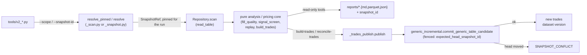

# `engine/v2/research` — architecture

Layer 7.0 in `checks/layer_map.py` and root `/ARCHITECTURE.md`. Native snapshot-reading counterparts to `tools/signal_screen.py`, `tools/fill_quality.py`, `engine/data/pulls/polygon_fills.py`'s read path, `engine/replay.py` (committed snapshots) and `engine/build_trades.py`'s v2 write path. Legacy modules remain untouched and publish as before; parallel `tools/v2_*` CLIs read pinned v2 snapshots. `tools/log_diagnostics.py` stays put: it reads only a local transactions-log CSV and optional sibling `metrics_*.json`, never Tier-2, so needs no snapshot counterpart.

## Purpose

Offline analysis CLIs cover real-fill quality, cross-sectional screening, the real-trade pull's universe plan, deterministic as-of replay and its trade table, reading exactly one resolved named snapshot per run instead of mutable Tier-2. Measured tables/reports are for a person: no research verdict, provider fetch or legacy-ledger mutation. `experiment_trades.load_trades` extends this contract to v2 experiments, reading committed `trades` published by `tools/v2_build_trades.py`, never legacy mutable storage. Completed experiments need not stay runnable; historical wrappers are unsupported execution boundaries.

## Source-free magnitude distributions

`magnitude_distribution.recipe`, `histogram`, `validate_distribution` and `bin_index` are source-free numerical APIs, consumed only by the research math/payoff helpers below and synthetic tests; no runtime/source admission exists. The closed plain-JSON `research_magnitude_distribution.v1` represents absolute simple-return percentage points: quarter-point half-open bins through 20, then uncapped overflow; finite-bin interpolation is uniform, with no zero atom. `histogram(probabilities, tail_excesses=None)` and `validate_distribution(document)` return detached documents; 81 finite masses in [0, 1] must sum to one within absolute 1e-12, without repair/smoothing.
Tail policy is `unresolved` (zero samples) or `empirical_excess` (nonempty equal-weight nonnegative excesses relative to 20); duplicates, order and explicit `sample_count` are retained. Zero excess means exactly 20; a supplied tail is retained even with zero forecast overflow mass. Samples are not authenticated training evidence.
`bin_index(magnitude)` accepts plain `int`/`float` (not bool/subclasses), finite after float conversion and nonnegative; exact boundaries go right, including 20 to overflow. The same numeric rules apply to histogram masses/edges/excesses. No caller value is echoed in refusals.
Stdlib numeric/list operations plus native errors suffice. Validation costs O(81 + n) time/detached space for n tail samples, with no hard sample cap, I/O, partial results, cache, retry, writes or transaction.
`magnitude_distribution_math.components` returns ordered immutable `(lo, hi, mass)` uniform intervals or atoms (`lo == hi`); default `uniform` and explicit `lower`/`upper` endpoint sensitivity modes leave recorded bin labels unchanged. Duplicate tail atoms remain distinct at `20 + excess`.
`cdf` gives P(A ≤ threshold), or P(A < threshold) with plain boolean `strict=True`; `mean` and `crps` return percentage-point quantities. These full-law APIs and `components` refuse unresolved tails even at zero overflow mass. Numerical validation is not causal tail admission.
`bin_scores` returns unscaled 80-threshold RPS and natural-log observed-bin loss from recorded masses, allowing unresolved tails; exact 20 is overflow. `brier(probability, outcome)` requires a plain boolean outcome. `empirical_crps(samples, observation)` preserves equal-weight nonnegative atoms, including the control's zero atoms, without histogramming.
Arithmetic explicitly divides accepted masses by their `fsum` (only admitted 1e-12 roundoff), without mutating documents or smoothing zeros; CDF endpoints clamp arithmetic roundoff. CRPS analytically integrates the piecewise CDF, not Monte Carlo or a tail-pair matrix: O(n log n) time/O(n) space. Unsupported numerical overflow refuses rather than capping outcomes.
`magnitude_distribution_payoff.bridge_summary` applies supplied `max(0, (intercept + slope*A)*spot) + residual*spot`; `empirical_bridge_summary` applies the identical bridge to equal-weight magnitude atoms. Supplied equal-weight payoff residuals are independent of magnitude in this frozen bridge, not fitted/admitted joint evidence.
Both return `expected_profit`, `probability_profit` (strictly positive), `mean_exit_value` and `probability_negative_exit` under the supplied independent move/residual law. Spot is positive; entry cost is nonnegative; both are per-share dollar decision-quote proxies. Residuals are spot fractions, and slope maps percentage-point magnitude to spot fraction. Fees, fills, multipliers, IV repricing and capacity are absent: these are not realized net-profit forecasts. Residuals remain after clipping, preserving impossible negative exits as a diagnostic.
`mean_matched_control(target_mean, residuals)` returns detached empirical `magnitudes`, target/raw/anchored means, scale and zero count: clip negative target-plus-residual draws to zero, then anchor their mean by positive rescaling. This is named support repair, not incumbent parity; target mean must be positive, and earlier-OOF provenance is the later caller's responsibility. Empirical scoring/bridge APIs preserve these zero atoms.
Bridge integration costs O(n log n + m log n + 80m) time/O(n+m) space for n components/m residuals, not a tail×residual product. Mean matching is O(m). All helpers are opt-in/source-free, with no runtime caller, I/O, writes, cache, retries or transaction; no batch execution/resource policy is installed.
No source/fold/calibration envelope, fitting, holdout access or production wiring is provided; `earnings_magnitude.v1` is unchanged. The [experiment design PR](https://github.com/yshewchuk/investment-validation/pull/1425) is a scientific proposal, not a code dependency, preregistration or approval of results.

| Condition | Outcome |
| --- | --- |
| Malformed histogram schema/types/support/masses/tail policy/counts | Non-retryable `CONTRACT_MISMATCH`; no partial result |
| Invalid `bin_index` numeric type, negative/nonfinite or unrepresentable magnitude | Non-retryable `CONTRACT_MISMATCH`; no index |
| Invalid math/payoff arguments, unresolved full-law tail, nonfinite/unrepresentable arithmetic, nonpositive target mean or zero repaired mean/scale | Non-retryable `CONTRACT_MISMATCH`; no partial result |
| Zero observed-bin probability | `bin_scores.log_loss` is positive infinity; no smoothing |
| Omitted required argument to any numerical helper | Python `TypeError` |

## Stage-2 magnitude panel foundation

`magnitude_confirmed_metadata.build_index(repository, snapshot, *, tickers, limits)` is synthetic-only complete pinned-view admission returning one detached, content-hashed proof. Contract: catalog admission uses one owned read transaction, released before the detached `bounded_snapshot` session is yielded (later scans hold no transaction); any failure returns no partial proof; repeated successful calls over the same pinned snapshot, canonical tickers and admissible limits return the same proof; `limits` gate admission and retention but do not enter the `index_id` hash; `index_id` is the content hash of the proof document with the `index_id` field omitted. All catalog/request/retention/proof limits are explicit, with no defaults, retries, cache, fallback SQL or durable writes. Admission authenticates exact `snapshot_inputs` and the frozen earnings contract allowlist and is complete or refused: inventory scan-row, total-object-byte and per-object-byte caps bind before any object read; retained-row and retained-byte caps bind as scan data is read. This is not an RSS guarantee. Native diagnostic envelopes propagate unchanged; malformed shapes/incomplete inventory refuse CONTRACT_MISMATCH, unknown contracts UNSUPPORTED_CONTRACT, caps RESULT_LIMIT_EXCEEDED and semantic conflicts IDENTITY_CONFLICT. Receipt references stay unopened. Complete pinned membership proves neither expected-population coverage, observed-PIT knowledge nor protected/numerical eligibility; no production caller exists. Work is bounded by admitted catalog/partition scans and retained-row reduction; progress emits aggregate stage/RSS/counts at bounded cadence without source diagnostics or secrets.

`confirmed_metadata.reduce_sequences` is public pure reduction: a pure seven-column DataFrame reducer of a complete caller-supplied view, not evidence of completeness. Strict naive `datetime64[ns]` types precede public `confirmed_event_metadata.classify_metadata`; public `event_sequence(warmup=4)` counts all supplied confirmed rows from zero; no date cutoff applies. All rows participate in duplicate ID, ticker/day, date-conflict and ticker/cluster refusal, including unconfirmed siblings; equal clusters across tickers are independent. Detached sequences retain exact empty states/counts/seven-field evidence. Work is O(n log n + t log t), state O(n + t) for n rows/t tickers; no hard cap or RSS bound exists here. No partial output, I/O, cache, retry, transaction, index identity, source admission, coverage, holdout/value eligibility or runtime integration exists.

`magnitude_panel_table` uses native `TableContract`/`ColumnContract`, JSON and canonical hashing. Its immutable v1 event/context/horizon key has ordered H/HM/HMO dictionaries, excluding learned Tier4 outputs/current-event outcomes. Rows require exact cohort coverage, finite typed values, missing/quote status and per-observation date, knowledge mode, row/fragment identity and canonical SHA-256 `content_hash`. Contexts are reconstructed-only, never relabeled observed; pure validation checks digest syntax/binding, not source membership or value equality.

`magnitude_panel_plan` (no production caller; grants no raw-payload read authority) reconstructs protected population/calendar metadata and checks exact history receipts and isolated history/prior-outcome fragments without payloads. Its context binds snapshots, history, dictionary, producer/environment and complete observed calendar/source metadata. Detached validation checks JSON types, closed event/request/recipe/producer schemas, native folds, fragments and calendar-source consistency; repository preflight authenticates membership/source truth. Horizon cutoffs require native calendar reconstruction, not hashes alone. Public history interfaces `validate_context_identity`, `validate_event_forecasts`, `preflight_source` and `validate_features` share existing validation without new authority. `magnitude_features.calendar_input` exposes session metadata; `magnitude_inputs.target_object_identity` detaches admitted `event_id`, `fragment_id`, `object_id` and object `content_hash` without reading target payload values. `magnitude_panel_table.canonical_day` requires canonical date strings or refuses `CONTRACT_MISMATCH`. No raw payload permission is issued; raw-source protected-event policy is not implemented by this plan. There is no writer, materializer, CLI, model or registration integration.

Panel boundaries require plain JSON (nested history before normalization); detached refusals use `CONTRACT_MISMATCH`, native refusals propagate.

`magnitude_panel_v2_policies.policy_definitions()` supplies detached source/derivation/quote/missing policies to `magnitude_panel_v2_table`. The [parity design](https://github.com/yshewchuk/investment-validation/blob/26b5958d868afc5189611aa77ec1774a9e246d71/experiments/SUPER_SIZE/STAGE2_DESIGN.md#incumbent-parity-amendment-october-24-design-only) policies use JSON copying and public eligibility declarations, not a registry/parser or computations. The additive v2 table exports `CONTRACT`, `feature_dictionary(subset)` and `recipe(subset)`; explicit H/HM/HMO have 11/28/42 ordered numeric descriptors. Uniform inline source/derivation policies change all dictionary hashes (including H); v1 APIs, contracts, hashes and eleven H numeric values/order remain unchanged. Recipes own 11/28/43 raw model columns: HMO alone appends `has_implied_quote`, outside the numeric table; learned missing indicators remain family-owned. Native contract and dictionary hashes are distinct; neither admits sources/snapshots/rows. The source-free versioned compiler consumes recipes; no v2 context, reader, model or runtime activation exists.

| Condition | Outcome |
| --- | --- |
| Index malformed request/row/partition, incomplete inventory, or unsupported holder/session | Nonretryable `CONTRACT_MISMATCH`; no partial index |
| Index missing/nonexact/unresolvable native snapshot | `SNAPSHOT_UNRESOLVED`; no object access or index |
| Index unsupported exact earnings contract; explicit cap exceeded; semantic conflict | `UNSUPPORTED_CONTRACT`; `RESULT_LIMIT_EXCEEDED`; `IDENTITY_CONFLICT`, respectively; no partial index |
| Index native catalog/query/object failure | Same exception/code/category/retryability/stage/message/details; no retry or partial index |
| Index success after every partition exhausts | Detached plain-JSON proof; mutating it cannot alter admitted/caller state; membership is not numerical/PIT eligibility |
| Malformed reducer request/frame/row, including unrequested ticker | `CONTRACT_MISMATCH`; no partial sequence |
| Reducer duplicate ID, ticker/day, date-conflict or ticker/cluster conflict | `IDENTITY_CONFLICT`; no partial sequence |
| Reducer native failure | Existing `DataError` code/retryability unchanged; no partial sequence |
| `policy_definitions()` | No arguments; detached metadata only, no I/O/fits/verification or retry/cache. Shared declaration exceptions propagate unchanged. |
| Invalid v2 subset (not a plain H/HM/HMO string); omitted argument | `CONTRACT_MISMATCH`; omitted argument raises Python `TypeError`. Detached metadata only; no I/O/fits/admission or retry/cache. |
| Invalid detached panel identity/schema, nested digest/folds, snapshot, calendar, cutoff or row | `CONTRACT_MISMATCH` |
| Malformed or forged direct calendar snapshot | `SNAPSHOT_UNRESOLVED` |
| Empty native observed session calendar | `CALENDAR_UNAVAILABLE` |
| Malformed builder producer/snapshot, non-plain history metadata or invalid lane | `CONTRACT_MISMATCH` |
| Native history identity/digest or committed binding differs | `IDENTITY_CONFLICT` |
| Builder history metadata exceeds structural depth | Existing native `IDENTITY_CONFLICT` |
| Structurally invalid direct history identity / source-admission input | `CONTRACT_MISMATCH` / `IDENTITY_CONFLICT`, respectively; native identity/safety refusals remain unchanged |
| Lineage is not plain UTF-8 text or exceeds 1 MiB UTF-8 per row | `CONTRACT_MISMATCH` before JSON decoding |
| Invalid `validate_event_forecasts`, `validate_features`, `canonical_day` or feature subset input | `CONTRACT_MISMATCH` |
| Protected requested event or unprovable physical isolation | `HOLDOUT_ACCESS_DENIED` |
| Snapshot ID is absent from the native catalog | `SNAPSHOT_NOT_FOUND` |
| Catalog snapshot/manifest identity is inconsistent | `MANIFEST_CORRUPT` |
| Repository-reconstructed temporal population lacks training/evaluation coverage | `POPULATION_COLLAPSED` |
| Cache / retry | Observed days are reused per weak-referenceable pinned repository and snapshot ID; failures are not cached. `preflight_context` reconstructs metadata through native repository APIs (including their catalog caches); no panel-layer retries. |
| Transaction / partial write / idempotency | No enclosing/write transaction or durable writes; native repository resolution/table reads use read transactions. No partial artifact; identical inputs and metadata give the same `context_id`. |

## Partial daily-market blocks

`magnitude_panel_daily.build_daily_blocks` is an opt-in library-only reader; only synthetic tests call it. Inputs are pinned source/history/price_history snapshots, the unchanged metadata-only v1 plan, plain-JSON producer metadata, grouped eligibility declarations and explicit source/event/byte bounds. Output has a distinct versioned context and detached daily-market/regime blocks, never stored-panel admission. The context binds the parent, bounds, policy, exclusions, snapshot fragment inventory and producer. Producer and label bounds are declarations, not installed-code attestation or verified outcome intervals. Protected evaluation membership confers no reads; grouped exclusions retain or remove all event horizons.

The thirteen daily fields and nine historical `spy_*` values obey each forecast's source ceiling. Regime closes come from pinned `price_history` `REGIME_TICKER` (`^GSPC`) via `get_price_series`, never daily SPY spot; that snapshot binds the context. Reads are row-capped: one ticker/year scan per event ticker plus one regime-series read at the latest ceiling. Daily anchors require IV surfaces; regime uses admitted closes. Availability is reconstructed, not observed-PIT/fit-admissible; fragment inventory and regime source dates remain explicit.
Row bounds apply across years per ticker; event bounds apply before exclusions. No cross-call cache/retry.
A required context-bound `max_object_bytes` bounds new value scans through native byte/footer/expansion limits;
it does not change inherited metadata-preflight scans.
No enclosing/write transaction, durable write, CLI, fit, registration or runtime consumer; native read transactions remain.
No history/runup block or outcomes are read. Repeat calls revalidate and reread pinned sources.

| Condition | Outcome |
| --- | --- |
| Non-plain/malformed producer or detached parent, changed policy/clocks, unpinned repository, invalid limit/window or source contract | `CONTRACT_MISMATCH`; no partial result |
| Duplicate/malformed source date or value, negative implied quote, nonpositive/non-convertible `^GSPC` regime close or infinite regime result | `CONTRACT_MISMATCH`; no partial result |
| Invalid byte cap (including None/bool/nonpositive) | Native `QUERY_NOT_BOUNDED` before repository access |
| Declared event, cumulative row, physical-object or expanded-object limit exceeded | `RESULT_LIMIT_EXCEEDED`; no partial result |
| No events survive shared eligibility | `POPULATION_COLLAPSED`; no value reads |
| Snapshot, parent-binding, catalog or shared admission failure | Native refusal propagates unchanged; no partial result |
| Missing optional field/history, zero implied quote, absent/late market-cap anchor | Null with explicit missing/quote status; no cohort complete-case filtering |

## Primary contracts and public interfaces

CLI leaves (`tools/`, one process per run, each takes `--catalog`,
`--store-root`, `--scope` and `--snapshot-id`):

- `tools/v2_fill_quality.py` — real Polygon trades vs ORATS quotes.
- `tools/v2_polygon_fills.py` — the real-trade pull's contract universe
  (plan only; fetches nothing — the legacy `build_plan`/`execute` network
  half stays in `engine/data/pulls/`).
- `tools/v2_signal_screen.py` — the long-put cross-sectional screen.
- `tools/v2_replay.py` — deterministic as-of replay of selected structures.
- `tools/v2_build_trades.py` — replay a strategy set and publish a new
  `trades` dataset version.
- `tools/v2_reconcile_trades.py` — tombstone the `trades` table's
  non-canonical simulated rows as a new dataset version.

These CLI files sit outside `checks/import_layers.py`'s hook (it only parses
`engine*` importers), so no `engine` package is recorded as importing this
one; the library entrypoints below are this package's real public interface:

`magnitude_panel_v2_table.CONTRACT`, `magnitude_panel_v2_table.feature_dictionary`, `magnitude_panel_v2_table.recipe`, `magnitude_panel_v2_policies.policy_definitions`, `eligibility_policy.eligibility_policy`, `eligibility_policy.plan_eligibility`,
`experiment_population.canonical_events`, `experiment_trades.classify_events`,
`snapshot_inputs.snapshot_reference`, `snapshot_inputs.admit_snapshot`,
`signal_screen.run`, `fill_quality.run`, `polygon_fills.run`, `replay.replay`,
`replay.replay_one`, `replay.ALPHA_GRID`, `_replay_run.run`,
`_replay_run.events_frame`, `_plan.plan_events`, `_chains.ChainIndex`,
`_chains.load_chain_index`, `_chains.filter_plan_by_availability`,
`_chains.read_chain_keys`, `_chains.read_chain_keys_for`, `_chains.read_chains_for_years`,
`_trades_table.to_trades_table`, `_build_run.run`,
`reconcile_trades.run`, `_trades_publish.publish`, `build_trades.coverage`,
`_pricing.STRUCTURES`, `_pricing.trading_calendar_from_snapshot`,
`_pricing.execution_variant_label`.

The RUNUP comparison's public entry-selection seams are
`replay.clean_chain_rows` (returns valid quote rows without input mutation),
`_pricing.MIN_MEANINGFUL_COST`, `ChainSnapshot`, `FillModel`, `StructureError`
and `price_structure` (existing pure native selection/spread arithmetic).

`experiment_trades.load_trades(repository, snapshot, strategy, *, as_of_month=None,
purpose="training", event_ids=None)` is a library call, with no dedicated CLI.
Omitted/`None` as-of month refuses with `HOLDOUT_ACCESS_DENIED`; there is no implicit month.
Given a `Repository` and resolved `SnapshotRef`, it returns one strategy's
committed, session-joined trades with legacy-compatible columns and holdout context.
`_pricing.trading_calendar_from_snapshot` lets pinned-snapshot repricers share
`replay()`'s calendar instead of a second implementation or legacy CSV fallback.
`_pricing.execution_variant_label` supplies `experiments/v2_candidate_grid.py`'s
`price_candidate_grid` with replay's execution-variant labels for each priced
grid-position step.

Experiment training, selection-fold and sweep reads exclude the union of the
two holdouts specified in [#373](https://github.com/yshewchuk/investment-validation/pull/373).
Shared membership definitions live in `foundation.experiment_holdouts`.
The explicit rolling as-of month and both membership versions accompany the
snapshot id in returned columns; exclusion labels are in `holdout_exclusions`
frame attributes. Conflicting event IDs at one ticker/date/session or cluster,
and other ambiguous canonical identity/date matches, are excluded and
labelled `ambiguous`. Released eligible rows are labelled `post-release selection`.
A requested `event_ids` population containing any excluded event raises the
non-retryable `DataError(HOLDOUT_ACCESS_DENIED)` during population validation,
before returning a frame to metric/report writers. Missing/invalid context,
an as-of month later than the current UTC month,
unknown purposes and an entirely excluded population receive the same refusal.
There is no date fallback, partial returned frame, report write or retry here.
Final holdout reads are unavailable. The loaders write nothing themselves; the
recorded native prediction runner appends one plain `refused` row (no metrics;
replay adds no second) when a `run` on an admitted registration hits
`HOLDOUT_ACCESS_DENIED`, unless a different immutable outcome for that variant is
already saved, success or failure: identity conflict, ledger unchanged.
`register`, a run with no admitted registration, and `--no-ledger` smoke write
none. `ledger_context` excludes `refused*` rows from specs tried.

`experiment_population.load_population` validates an exact committed
`SnapshotRef` and returns canonical event metadata under that same holdout
contract, without reading outcomes. Explicit IDs are checked against the full
canonical calendar, including conflicting siblings, before any caller can
consume an eligible population. It shares the trade loader's membership and
ambiguity logic; neither source dates nor ticker names substitute for event IDs.
Multiple IDs on one ticker/day are ambiguous even when their sessions differ:
the prediction outcome table cannot distinguish those event identities.
`experiments.v2_gate_variant` consumes this population in sweep mode before
fresh native replay, directly or through the smoke-only pricing/evaluation
workers. Their no-report/no-ledger contracts live in `experiments/ARCHITECTURE.md`.
`experiments.gate_report` separately composes population, observed calendar sessions,
protected `event_history` and fresh replay for each fold's training/evaluation rows;
its reconstructed date-ceiling and native publication contracts live in that same doc.
`prediction_inputs.load_prediction_targets` consumes this population first,
then scans each eligible ticker/event-date pair in pinned `computed_moves`. The history
and magnitude readers (`event_history`, `magnitude_inputs`, `magnitude_history_store`)
accept the `computed_moves.v4` or `computed_moves.v5` contract and refuse any other
`CONTRACT_MISMATCH`; on v5 a row with a `not_computed_reason` other than `no_price_window`
is `skipped` and carries no outcome, so it never counts as a scoreable event. The
writer's reason is the only reason research reports for a skipped row: the history and
training-label and opt-in evaluation omission lists (`omitted_history`, `omitted_labels`) carry the row's
`not_computed_reason` as the omission `reason` (v4 rows, and v5 rows without a reason, keep
`skipped`; the magnitude search's `validate_targets` accepts exactly `skipped` and the writer's
closed reason set, so a receipt with any other reason is `EXPERIMENT_IDENTITY_CONFLICT`), never a research-side re-derivation. Non-skipped rows the readers omit for
availability keep the reader's own `unavailable` / `not_available_before_fit` reasons. The
isolation guard of the history and magnitude readers (`_plans`'s per-candidate checks, shared with `plan_with_reader`) is unchanged: every
candidate still needs exactly one isolated fragment, and a candidate with no fragment
refuses `HOLDOUT_ACCESS_DENIED`. `prediction_inputs` does not use that guard: it refuses a
table whose contract is neither native contract with `CONTRACT_MISMATCH` before any target
scan, and a v5 skipped row with `EXPERIMENT_VARIANT_FAILED` naming the reason (the v5 contract
requires one; a reason-less skipped row is malformed and gets the generic target message).
It returns the signed move, binary `positive_move` target, and
`target_available_on` date. The date is required and later than the event;
fold consumers must admit training labels only when available before their
decision cutoff. This input prerequisite performs no feature construction,
model fitting, or report/ledger publication, and has no supervisor caller.

| Prediction/population input condition | Outcome |
|---|---|
| Snapshot cannot be resolved or its identity does not match (design #372 R2) | Non-retryable `SNAPSHOT_UNRESOLVED`; no source fallback. |
| Integrity or object failure during a table scan | Repository's typed refusal, such as `MANIFEST_CORRUPT` or `OBJECT_CORRUPT`; no partial returned frame. |
| Missing table or malformed table contract | Repository's typed refusal; no partial returned frame. |
| Invalid holdout context, unknown requested ID, excluded/ambiguous requested event, or empty explicit population (R5) | `HOLDOUT_ACCESS_DENIED` before target scans; no metrics or report. |
| Well-formed `computed_moves` contract that is neither native v4 nor v5 | `CONTRACT_MISMATCH` before any target scan; no partial returned frame. |
| Empty bulk canonical calendar | `POPULATION_COLLAPSED`; no empty success. |
| Missing, skipped, non-finite target, non-date outcome key or invalid target availability (R4) | `EXPERIMENT_VARIANT_FAILED`; no partial returned frame. |
| `omit_not_computed=True` and a row is `skipped` | Event omitted, object still bound in `consumed_inputs`, listed in `omitted_labels`; other events returned. |
| `omit_not_computed=True` and every planned label is `skipped` | Empty frame whose attrs list every event in `omitted_labels`; scoring then refuses `EXPERIMENT_VARIANT_FAILED` ("require scored rows"), which the inner search records as a refused terminal. |
| `omit_not_computed` is not a `bool` | `CONTRACT_MISMATCH` before any repository access. |
| Cache, retry, transaction, partial write, replay | No cache or automatic retry; read-only, no writes; complete scans precede return; identical pinned inputs return identical rows (R6). |

These readers preserve no economic variant identity and cannot authorize the
separate user-only final holdout read.

`event_history.load_event_history(repository, snapshot, *, event_id, as_of_month,
decision_session, history_start, purpose="selection")` constructs prior-event
features for one admitted canonical target. Both dates are explicit calendar
days with `history_start <= decision_session <= target event day`. Shared
`load_population` admits the target and excludes random, rolling and ambiguous
history identities before any outcome access. Candidates are the same ticker's
events in `[history_start, min(target day, decision_session))`.

Every candidate query is planned before any outcome scan, using the same
fragment planner as Repository. Preflight indexes fragment metadata once by
partition and canonical time intervals after shared full-key bound admission.
Malformed keys remain in a global fallback; uncertain times stay partition-local.
Selected records retain manifest order and planner refusal precedence, including
malformed keys outside the selected issuer/day. Each bound is reused for query construction.
Its entire surviving membership must be one
inspected singleton with the exact ticker/day key, partition and time bounds.
The resolved committed catalog/manifest identity is the metadata trust anchor;
this trusts native producer inspection, not adversarially forged metadata.
Caller rows, implicit latest, and another experiment's outputs are not inputs.
Mixed, missing or unprovable membership refuses `HOLDOUT_ACCESS_DENIED` before
opening outcome objects. This intentionally refuses old whole-ticker layouts;
it neither migrates them nor treats row predicates as physical isolation.

Skipped or null-availability historical labels are explicitly omitted. A valid
availability day must follow its event and be on or before the decision day;
later labels are omitted before numeric validation or feature arithmetic. Their
admitted objects are decoded; protected event objects have a no-read guarantee.
Malformed availability or invalid eligible values refuse
`EXPERIMENT_VARIANT_FAILED`; repository failures propagate. The date bound is reconstructed source availability, not a claim of
intraday publication/finality evidence. Pure `panel_math.history_features` owns
the arithmetic: empty history and undersized EMAs retain `None`, never zero fill.
Results carry features, `available`/`empty` status, ordered consumed event/object
identities and availability, omitted-history reasons, snapshot/dataset/month/
membership-version/cutoff pins and their deterministic history digest.
The `research_event_history.v2` identity also binds `read_inputs`: every decoded
candidate object, including skipped/unavailable labels omitted from arithmetic.
No cache, automatic retry, transaction, write or partial return occurs.
The reader performs no supervisor dispatch, provider/market-price access or
publication; `experiments.gate_report` consumes it for fold-local exploratory
reporting. Production panel reads and final-read authority remain unchanged.

`iv_crush_inputs.load_iv_crush_targets(repository, snapshot, *, as_of_month,
labels_before, purpose="selection", event_ids=None)` reads signed relative IV30
change from the exact current `iv_crush_targets` contract, including its definition
hash (`iv_crush_targets.v2`, semantic version `2.0.0`). `preflight_iv_crush_targets(..., as_of_month, event_ids)` requires explicit
selection participants (`CONTRACT_MISMATCH` when absent) and returns metadata-only planned-object evidence; it is
not a capability, and the loader repeats admission. These offline library APIs
do not publish sources, register experiments or participate in production entrypoints.

| IV-crush boundary | Outcome |
|---|---|
| Snapshot/population | Shared canonical snapshot, holdout-union and ambiguity admission precedes targets; unsupported/final purposes or malformed holdout context refuse `HOLDOUT_ACCESS_DENIED`; a missing/malformed label cutoff refuses `CONTRACT_MISMATCH`. Bulk reads omit events on/after the explicit calendar-day label cutoff; explicit requests containing one refuse `CONTRACT_MISMATCH`. An empty eligible set refuses `POPULATION_COLLAPSED`. |
| Public planner candidates | `plan_event_targets` requires ticker and naive midnight event_date columns. Only candidate shape/identity checks translate to `CONTRACT_MISMATCH` before repository access; every error raised while planning, including native `DataError` envelopes, propagates unchanged. |
| Physical admission | Every candidate passes public `event_history.plan_event_targets` (metadata-only singleton admission for already admitted populations) before any target opens. Missing/mixed objects or unprovable exact ticker/date bounds refuse `HOLDOUT_ACCESS_DENIED`; nonmatching contract/hash refuses `CONTRACT_MISMATCH`. Every declared target object is capped at 1 MiB before any target opens (`RESULT_LIMIT_EXCEEDED`); bounded Repository scans also cap compressed and total uncompressed bytes. This resource ceiling accommodates singleton labels without authorizing arbitrary payloads. Computed-moves defaults remain unchanged. |
| Stored label | Exactly one matching ticker/date/session, boolean false skip and null reason are required. Canonical anchors span 1–5 calendar days: AMC requires pre ≤ event < post; BMO requires pre < event ≤ post. Availability equals post plus one calendar day, follows the event and precedes the cutoff before numeric use. These checks do not prove source-row adjacency or exchange sessions. Skipped, late or malformed rows refuse the whole read with `EXPERIMENT_VARIANT_FAILED`; finite signed values, including zero and values below -100, remain unchanged. |
| Provenance | Row identity includes target object; attributes bind full dataset/contract ref, cutoff, month/membership pins, purpose, future exclusions and ordered fragment/object/content hashes plus caller source_id/input_hash. Source marker/hash syntax is checked, not independently authenticated or recomputed from source quotes. Publication/finality remain unverified; availability is a modeled floor. |
| Progress | Admission, planning and read stages report start/end/failure, elapsed time and peak RSS to stderr. Completed-item ticks report count/rate/ETA at most every 30 seconds. Aggregate decisions include bulk/explicit selection, admitted/holdout/ambiguity/cutoff counts and planned batch/byte limits; IV refusals include the native refusal code only, never message text, event identities or error details. Logging cannot change results, identities, errors or read authority. |
| Effects/failures | No source-quote reads, target rebuilding, retries, persistent cache, writes, partial returns or experiment authority. Earlier admitted objects may decode availability before a late-label refusal. Native repository integrity/resource refusals propagate unchanged. |

This consumer accepts only the exact definition, without grandfathering earlier hashes.
`event_history.POPULATION_CONTEXT_COLUMNS` names the shared snapshot/holdout context.
No publisher, source-receipt validation, forecast recipe or model is supplied.

`magnitude_inputs.forecast_cutoff(event_date, session, horizon, calendar)` is a
pure contract over native `CalendarSessions`: horizons are five, three or one
full intervening sessions, counted backward from the shared last-pre-print
close. Wednesday AMC at one uses Tuesday close; Wednesday BMO uses Monday.
Invalid dates/sessions/horizons/calendars, projected anchors, gaps in the
required session window or insufficient history refuse `CONTRACT_MISMATCH`.
Its identity binds event/session/horizon, calendar contents, pre-print close
and source-session ceiling. It does not assert an intraday issue time, source
publication/finality or that the earnings schedule was known at that cutoff.
An experiment caller must bind the calendar to its pinned native snapshot;
this pure helper does not load a calendar or select a forecast horizon.

`magnitude_inputs.load_magnitude_targets(repository, snapshot, *, as_of_month,
labels_before, purpose="selection", event_ids=None)` is the separate label
view. The fixed target recipe is absolute split-neutral, non-dividend-adjusted
earnings close-to-close return in percentage points; the native signed
`computed_moves` value is retained, never rescaled, clipped or adjusted again.
Its primary prediction estimand is conditional mean, selected by pooled RMSE;
MAE and quantile calibration are secondary; the magnitude reporter implements
MAE while quantile calibration remains unimplemented.
Shared population admission precedes label access. Bulk reads exclude events
on/after `labels_before`; explicit requests containing one refuse. All
remaining objects pass `event_history`'s shared singleton preflight before
any is opened; mixed inherited snapshots refuse. Decoded label availability
must be strictly before `labels_before`; missing, skipped, malformed or
non-finite labels refuse the whole call, with zero remaining a valid value.
Exception, opt-in only: `omit_not_computed=True` (used by the magnitude search's inner and outer
evaluation reads) treats a row the writer marked `skipped` (v5 `not_computed_reason`, e.g. `not_orats`)
exactly as `qualify_magnitude_training_targets` does: it is omitted, never parsed, and listed in the
frame attrs and receipt as `omitted_labels` (`[{"event_id", "reason"}]`, sorted by event ID), where `reason` is the row's
`not_computed_reason` (`skipped` for a row without one), the same rule as the training qualifier.
`omit_not_computed` must be a `bool` (`CONTRACT_MISMATCH` otherwise). The receipt carries `omitted_labels` only when non-empty (receipts with none are byte-identical to before).
Every other refusal above is unchanged; only `skipped=true` is omitted, never null/late availability.
Forecasts for omitted events are made but not scored; `event_count` counts scored events.
Earlier events with late availability can be decoded to check their recorded
date; this is reconstructed availability, not verified publication evidence.
Output rows carry target/object identity; frame attributes bind recipe,
label cutoff, snapshot/dataset/month/membership versions and consumed inputs.
Forecast cutoff and training/evaluation label cutoff are distinct contracts;
this seam neither fits a model nor joins labels into forecast features.
Repository failures propagate; no cache, retry, write or partial return.
`experiments/magnitude_report.py` consumes the strict target loader through the
magnitude CLI; there is no supervisor or final-read caller.

`magnitude_inputs.preflight_magnitude_targets(repository, snapshot, *,
as_of_month, event_ids)` admits an explicit selection population and proves
every candidate object's singleton isolation without opening outcomes. Its
detached digest binds the exact population/context and planned object identities.
The magnitude runner preflights the union of actual train/evaluation participants
across all folds before its first label read; unused window events need not join.
The preflight is evidence, not a capability: target loaders repeat their own
admission and physical checks and accept no caller-supplied scan plan.

`qualify_magnitude_training_targets(repository, snapshot, *, as_of_month,
labels_before, event_ids)` admits explicit candidates whose event dates precede
the fit boundary, with whole-population physical preflight before outcome access.
Skipped, unavailable and cutoff-late labels are distinct omissions before numeric
parsing; eligible labels require valid identity/availability and finite signed values.
Zero and negative values retain their absolute percentage-point magnitude, without
clipping or zero fill. The training identity binds every candidate and decoded
object (including omissions), qualified IDs, omission reasons and the cutoff.
Empty qualification refuses `POPULATION_COLLAPSED`; malformed eligible labels
refuse `EXPERIMENT_VARIANT_FAILED`. Protected/ambiguous identities and mixed objects
refuse before outcome access. Late admitted objects may be decoded for qualification;
protected objects are never opened. Repository refusals propagate, with no cache,
retry, write or partial result. Existing strict target identities remain unchanged.
These library seams neither publish evidence nor compute historical feature aggregates.

`magnitude_features.load_magnitude_history(repository, snapshot, *, event_id,
as_of_month, horizon, history_start, purpose="selection")` binds one canonical
event's prior-history features to its full-session forecast ceiling. Exact
snapshot and target holdout/alias admission occur before calendar or outcomes.
The calendar is the sorted union of canonical `daily_market.date` values from
that snapshot, with no projected days or external calendar override. Only the
date column is requested; ordinary Repository object verification still applies.
Missing/empty calendars refuse through the shared reader/`CALENDAR_UNAVAILABLE`;
malformed dates, invalid horizons or incomplete anchor/session windows refuse
`CONTRACT_MISMATCH` before historical outcome access.

The shared `forecast_cutoff` computes the ceiling; `load_event_history` uses
that exact day, excluding protected/ambiguous/current/future outcomes before
its physical singleton preflight. This adapter never reads the target label.
Prior-label availability on the source-session day is admitted by the existing
history contract; later dates are omitted, not used as zero-filled features.
Outputs bind canonical event/session, snapshot, calendar version, calendar
dataset/object identities, horizon/cutoff, target and history-feature recipes,
all history reads/omissions and membership versions into one deterministic
input digest. Empty history retains explicit null features; non-finite derived
features refuse `EXPERIMENT_VARIANT_FAILED` rather than reaching a model.

Provenance explicitly says reconstructed date bounds, with event-schedule
as-known and source-publication evidence unverified. Calendar reconstruction
and source hashes do not establish that evidence; strict PIT experiment
admission remains a later prerequisite. The stored build uses `plan_magnitude_folds`,
`event_history._assemble_history` and `_feature_recipe`, not this adapter.
The adapter has no fitting, target-join, CLI, provider, report, ledger or final-read
caller, and no retry, write or partial result; its only cache is the
observed-session read (see its failure row); Repository failures propagate.

`magnitude_folds.plan_magnitude_folds(repository, snapshot, *, as_of_month,
evaluation_years, training_start, event_ids=None)` plans metadata-only expanding
annual evaluation folds from one admitted snapshot and its pinned calendar.
`magnitude_folds.magnitude_window(evaluation_years, training_start)` exposes the
same pure request validation to native preregistration and returns a detached
canonical window; invalid requests refuse `CONTRACT_MISMATCH` without reads.

`magnitude_folds.annual_fold(year, events)` is the public annual rule shared by
the native planner and `experiments.magnitude_search_plan` for admitted metadata.

| Shared annual-rule condition | Outcome |
|---|---|
| Admitted event metadata has evaluation events and strictly earlier candidates | Return detached year, conservative fit cutoff and training/evaluation IDs in input order; no I/O or label qualification. |
| No evaluation events or earlier candidates | Preserve the native `POPULATION_COLLAPSED` `DataError`; callers own boundary-specific translation. |

- Exact snapshot and random/rolling/ambiguous-union admission precede calendar
  reads. Bulk membership includes `training_start` and excludes January 1
  after the last evaluation year.
- Each event's 5/3/1 horizons share its event-year fold. Training candidates
  precede `min(year_start, all evaluation source-session ceilings)`; usable
  labels separately require availability strictly before that boundary.
- Earlier evaluation events may train later folds, including the same issuer.
  Annual membership need not cover a full year; no inner HPO split is defined.
- The deterministic digest binds request, target/fold rules, ordered canonical
  event/cutoff memberships, holdout versions, snapshot and metadata-source objects.
  With all other inputs fixed, equivalent admitted explicit/bulk memberships
  yield the same `plan_id`; selection mode is not part of identity.
- No computed-move, label or history-feature access, fitting or registration/
  final-read authority. Native non-session announcement anchoring is preserved;
  schedule/publication evidence remains unverified reconstruction, not PIT data.

| Magnitude fold condition | Outcome |
|---|---|
| Years not explicit ordered unique four-digit strings, or training start not canonical and before the first year | `CONTRACT_MISMATCH` before repository access. |
| Explicit event outside the declared window | `CONTRACT_MISMATCH` before calendar access. |
| Empty window or any year lacking evaluation events/training candidates | `POPULATION_COLLAPSED`; no empty success. |
| Missing calendar table, snapshot/admission or repository failure | Shared typed error propagates; no source fallback. |
| Empty calendar / malformed dates or incomplete session window | `CALENDAR_UNAVAILABLE` / `CONTRACT_MISMATCH`; no outcome access. |
| Catalog transactions | Short read-only SQLite transactions; no planner-owned write transaction or transaction spanning the full call. |
| Cache, retry, partial write, replay | The only cache is the observed-session read below; no retry, write or partial return; identical pinned inputs give identical plans. |
| Observed-session read | The `daily_market` observed days are read once per pinned `Repository` (`pins_snapshots`) and snapshot id; the cache lives and dies with that repository, a second repository or snapshot reads again, and an unpinned repository reads on every call. A failed read caches nothing. Output and `calendar_input` identities are unchanged. |

`experiment_exits.walk_exit(repository, snapshot, positions, economic_params=...)`
accepts entered `EnteredPosition`/`PositionLeg` contracts and resolved experiment
economics with `price_source="option_chains"` and explicit numeric `fill` in
the existing alpha ladder's range. It supports `exit={kind: "fixed_day",
trading_days: N}` and `exit={kind: "target_stop", trading_days: N,
target_pnl: T, stop_pnl: S}`; N is a positive integer, T is finite and positive,
and S is finite and negative. Declaration admission is shared with ops through
`foundation.experiment_exits.valid_exit_recipe`. Target/stop recipes may declare `threshold_units`:
`quote_price_times_quantity` (also the omitted-field behavior) or
`entry_debit_fraction`. Fractions multiply each position's positive net opening
debit, priced once at the declared alpha, before walking its daily closing marks.
This basis includes spread but excludes fees, commissions and contract multipliers;
it is not gross premium or a portfolio return. Zero/credit entry or converted
thresholds that overflow or underflow to zero refuse the whole call. Fractions
are signed ratios, never percentage-point inputs; no clipping or normalization.
The immutable resolved economics and canonical
plan identity retain every recipe field, so changing a threshold changes the
consumed plan identity. The walker aggregates net position P&L from each day's
held-leg quotes in the pinned `option_chains` snapshot and uses the pinned
`daily_market` calendar, `_pricing.FillModel`, and existing alpha ladder; it
adds no projected calendar, replacement contract or mark source. A target or
stop exits on its first observed crossing. If one day's alpha 0/1 aggregate
position mark range spans both thresholds, the stop is selected,
`ambiguous_exit` is true because the daily marks cannot order the two exits,
and its exit value and P&L are priced at the worst existing alpha (0.0) so the
ambiguous result cannot be better than the stop. No crossing by N sessions
uses the 7a fixed-day fallback; the existing expiry bound and typed refusal
still apply. Results are
`mark_based` net held-position P&L with exit reason/date, visited dates, source,
the declared recipe alpha, the alpha actually applied at exit
(`exit_fill_alpha`, equal to the recipe alpha except for an ambiguous stop) and
snapshot identity. `exit_report_frame` projects those
decisions into one row per trade with separate `mark_based_pnl`, `exit_reason`,
`exit_day`, ambiguity and provenance columns for report callers; it does not
write files or blend mark-based P&L with fill-validated results.

| Exit-walker failure condition | Outcome (design #372 R4) |
|---|---|
| Malformed position or leg record | Non-retryable `EXPERIMENT_VARIANT_FAILED`; whole call fails, no excluded trade or partial tuple. |
| Missing required leg mark or mark past held-leg expiry | Non-retryable `EXPERIMENT_VARIANT_FAILED`; whole call fails, no excluded trade or partial tuple. Failure details identify the trade and failing session. |
| Unusable quote reaching pricing | Non-retryable `EXPERIMENT_VARIANT_FAILED`; whole call fails, no excluded trade or partial tuple. |
| Insufficient calendar coverage | Non-retryable `EXPERIMENT_VARIANT_FAILED`; whole call fails, no excluded trade or partial tuple. |
| Invalid fractional debit basis or converted threshold | Non-retryable `EXPERIMENT_VARIANT_FAILED`; whole call fails, with entry trade/session context and no partial tuple. |

Other repository refusals propagate.
No cache, retry, transaction or write: identical inputs return identical results.
Other experiment report/ledger publication remains outside this library seam.

Internal (not interface, despite the non-underscore package norm elsewhere):
`_scan.py` and `_snapshot.py` (see Dependencies — two independent
snapshot-read helpers), `_pricing.py` (except the names carved out above),
`_trades_revisions.py`, `_final_population.py`, `_final_evaluator.py`.

### Proposed authorized final read (#490)

Request preparation, the private ops authorization/spend primitive, the private metadata-only final population reader and the private frozen evaluator are implemented; no production authorization entrypoint, final-read caller or result retrieval exists. The remaining lifecycle belongs to later #490 slices and preserves #445's union exclusion; #555 refusal/audit integration is dropped and handled separately in #489.
The [user decision](https://github.com/yshewchuk/investment-validation/issues/490#issuecomment-6072905454)
permits agents/supervisors to prepare requests, never to authorize them.

**Request.** Canonical versioned bytes use the existing `experiment_id` as the decision identity, without a question record or alias detection, per the [user decisions](https://github.com/yshewchuk/investment-validation/issues/490#issuecomment-6101284544).
They bind the selected registered `variant_id`/registration reference,
resolved plan/source/evaluation-recipe and applicable frozen-model hashes, exact committed
`snapshot_id`, `holdout_as_of_month`, `random_membership_version` and
`rolling_membership_version`. No latest-head resolution, caller population override,
alternate arm, fitting, threshold search or evaluator callback is accepted.
Membership stays in `foundation.experiment_holdouts`: random and rolling sets under
its versioned as-of-month contract, with ambiguous identities refused, never admitted.
Both sets are bound together; changing month, version, snapshot or winner cannot reset a decision's spend. The request digest identifies bytes, not a new decision.
`native_registration.prepare_final_holdout_request` verifies existing catalog/artifact registration metadata only; it never resolves a head, scans a population or reads results.
Native registration's optional `final_read` declaration seals recipe, completeness-bar and frozen-model artifact references before authorization; preparation derives them, never accepts replacements. Registrations without that declaration refuse preparation.
Request validity proves neither winner selection nor read eligibility. The later metadata-only preflight must verify the preregistered completeness artifact and refuse an unmet bar before any holdout outcome read; declared references alone do not prove completeness.

**Population reader.** Private `_final_population.load_final_population(repository, request)` is the only final-read reader that returns separate held-out event-ID sets. It accepts a validated `FinalHoldoutRequest` (never a caller population) and returns a frozen `FinalPopulation` with sorted random and rolling IDs, overlap and ambiguity counts, and bound snapshot/month/version context. It reads only canonical `earnings_events` metadata with the loaders' shared membership/ambiguity rules, excludes ambiguous events from both sets, performs no writes, and does not inspect ops state or hold a grant. It is not exported or reachable from loaders, training, selection or sweep.

| Population reader condition | Outcome |
|---|---|
| Invalid request object, unsupported membership version, or as-of month later than the current UTC month | Non-retryable `HOLDOUT_ACCESS_DENIED` before any scan. |
| Snapshot unresolved, or resolved identity differs from `request.snapshot_id` | `SNAPSHOT_UNRESOLVED`; no fallback. |
| `earnings_events` absent from the snapshot | `CONTRACT_MISMATCH`; no partial population. Present with no fragments, the scan yields no events and the empty-population row applies. |
| `resolve` raising a non-integrity `DataError` (such as not-found), `ValueError`, `TypeError` or `KeyError` | `SNAPSHOT_UNRESOLVED`. An integrity-category `DataError` (such as `MANIFEST_CORRUPT`) and any other exception propagate unchanged. Integrity failures during the scan propagate as the repository's typed refusal. |
| Both sets empty after ambiguity exclusion | `POPULATION_COLLAPSED`; never an empty success. Preregistered completeness remains the later preflight's refusal. |
| Retry, cache, write | None; read-only, identical pinned inputs return identical populations. |

**Evaluator.** Private `_final_evaluator.evaluate_final_holdout(repository, request, population)` takes only a validated `FinalHoldoutRequest` and the `FinalPopulation` that `load_final_population` returns; it has no other parameter, fit, alternate arm, threshold search or callback. It scores the committed `trades` rows of the pinned snapshot with this package's provenance whose `variant` equals `request.variant_id` (the frozen winner); the table is read whole, then filtered. It returns frozen `FinalMetrics` with the random and rolling results separately, each with event count, trade count, events without a trade, total and mean `ret` and win rate (`None` when a set has no trade), plus overlap and ambiguity counts; the sets are never averaged or merged. It does no writes, caching or retries, never imports ops, and checks no fence or revocation: the later leaf does that before invoking it.

| Evaluator condition | Outcome |
|---|---|
| `population` is not a `FinalPopulation` (event-ID list, training/selection/sweep frame), or differs from the one derived from `request` | `HOLDOUT_ACCESS_DENIED` before any trades read; an equal hand-built population is indistinguishable and accepted. |
| Invalid request, or snapshot mismatch | The population reader's refusal (`HOLDOUT_ACCESS_DENIED`, `SNAPSHOT_UNRESOLVED`), before any trades read. |
| Trades table has no fragments, or no winner trade falls in either set | `POPULATION_COLLAPSED`. |
| Retained winner trade's event date or ticker differs from its pinned canonical event (for example after a calendar correction that kept the event ID) | `CONTRACT_MISMATCH` listing the offending event IDs; never skipped or scored. |
| Non-finite `ret` | `CONTRACT_MISMATCH`; infinities are already refused at publication. |

**Authority/ownership.** A proposed `tools/v2_final_holdout.py` leaf composes ops'
private authorization/state owner with a private research final evaluator. It is
the sole supported evaluator caller; ops/research remain layer-7 peers with no imports between them. Foundation supplies membership and pure request validation, never grants or state.
Training's lower layer cannot import either owner. Selection/sweep/loaders gain no
grant argument, final purpose, environment bypass or returned holdout frame.
Import/call-site regression guards also cover unlayered tools/experiments, which
the layer checker alone does not cover. Only the dedicated leaf may compose these owners; registered training/selection/sweep entrypoints cannot reach that leaf.
The leaf checks live ops state/fence before its sole evaluator invocation and before publication; research checks the immutable bound request, never imports ops state.
No reusable grant escapes that invocation. This is procedural/audited, not a security boundary against arbitrary code, a forged terminal or catalog edits.

**Durability.** Ops owns the append-only authorization/spend ledger in its catalog;
one transaction records who, UTC when, explicit confirmation, request digest and
the permanent decision spend. An interactive terminal and fresh explicit user
confirmation of the displayed binding are required; flags/piped input/agents cannot assent.
`ops.final_holdout.authorize_final_holdout` is currently test-consumed only: it verifies the exact catalog-owned registration, displays canonical request bytes and requires a terminal-entered phrase containing the digest and recorded process OS identity. This is procedural confirmation, not authentication of the human at the terminal. Its persisted acknowledgement is not a read grant or completeness verdict; the later fenced reader must still verify winner/revocation and the preregistered completeness artifact before scans.
Unique `experiment_id` plus compare-and-swap state serialize authorization and reads.
States are `authorized_unread`, `read_started`, `result_staged`, `complete`, or terminal `revoked`/`indeterminate`; every transition appends evidence, never refunds. Authorization has no expiry; revocation or a changed winner ends eligibility with `HOLDOUT_ACCESS_DENIED`, retaining the spend. Interrupted reads stay spent with no continuation; no renewal resets spend.

| Proposed condition | Required outcome before any returned metric/report |
|---|---|
| Missing user record, noninteractive authorization, tuning/training/selection/sweep, new read after `read_started`, or revoked/changed winner | Non-retryable `HOLDOUT_ACCESS_DENIED`, before holdout outcome scans or metrics; no partial result. Recheck winner/revocation at the fenced start and publication. Revocation after start but before completion burns the read and withholds its result. |
| Duplicate authorization | Identical request returns the original acknowledgement only after the same interactive checks; never another grant/spend. Changed bytes under the same decision refuse `IDEMPOTENCY_CONFLICT`; changed registration refuses `EXPERIMENT_IDENTITY_CONFLICT`. |
| Authorization recorded, no read started | A first user-invoked read may atomically commit `read_started` with one owner/fence before any holdout outcome scan. This never continues an interrupted read; missing/corrupt state never means unspent. |
| Crash after `read_started`, before durable `result_staged` | Once ownership is proven gone, mark `indeterminate`; never reread, even if the crash might precede the first scan. No result is released and the spend remains. |
| Crash after durable result, before completion receipt | Only a catalog-bound `result_staged` reference to fully synced immutable result bytes permits artifact-only reconciliation. Verify hashes/pins and the current fence/winner, then commit the receipt reference; never evaluate again. Unbound files cannot prove completion. |
| Receipt/diagnostic/ledger publication failure | Preserve the original refusal and durable state; no success output. Retry storage reconciliation only. Missing/malformed evidence is `VALIDATION_FAILED`, conflicting identities `IDEMPOTENCY_CONFLICT`, transient storage `RESOURCE_UNAVAILABLE`; a visible file alone, including failed sync/rollback residue, is not committed evidence. |
| Missing/mismatched snapshot or failed bounded scan | `SNAPSHOT_UNRESOLVED` or the existing repository refusal; no fallback, cache, partial report or scan retry. Failure after `read_started` keeps the spend. |

Results remain private until completion binds the request, authorizing act, spend, both memberships, per-set counts/metrics and overlap count; never average the sets.
Random-set temporal-neighbour correlation and post-release-selection provenance remain disclosed (#373).
Only the authorizing user may view results through the dedicated tool, with fresh interactive confirmation. Results belong in a separate namespace excluded from agent-facing tools and covered by an agent read-deny rule; no encryption or OS containment. Other callers refuse `HOLDOUT_ACCESS_DENIED` before output.
Ops durably audits the viewing actor, UTC when, verified request/report references and checked revocation-history revision before output; failed checks/audit publication release nothing. Retrieval returns unchanged verified artifacts with that history alongside them; it never scans, recomputes, tunes, reauthorizes or spends again.
Agent reconciliation may verify private artifacts but cannot return their metrics/report. No loader, training, selection or sweep report interface or `--no-ledger` final read is available.
Completion is the release point: later revocation appends audit history and accompanies retrieval; it cannot erase the completed report or renew read access.

## Inputs

Target research reads cover each full pinned partition, including null and
non-midnight observation times, subject to caller predicates and batch
filtering. The manifest population bound limits candidate rows, not RSS or
process memory — the recorded row-count sum of pinned fragments surviving
pruning ([data scan population rule](../data/ARCHITECTURE.md#invariants)).
Each scan uses that same bound for its snapshot, contract and predicates;
the partial daily builder additionally enforces its explicit cumulative row bound. Empty selected membership
allows zero result rows with a positive batch size. Month/day retries and
null-overflow refusals are not part of this contract: a complete read either
returns its population or raises its typed refusal. Predicates, exact-pair
filtering, batch filtering, successful row ordering and deduplication remain
part of the read contract.

Shared `_scan` reads report decoded-row progress against the candidate-row bound
on stderr at bounded cadence, with rate, ETA and the selected batch-row limit. Predicates and batch filtering
may retain fewer rows; the denominator is an upper bound, not a final row count.
Filtered scans also report cumulative retained/skipped rows at that same cadence.
Every row scan logs start and completion/failure with elapsed time and peak RSS,
including short scans; periodic ticks remain silent below their cadence.
No additional scan is used for telemetry, and native errors propagate unchanged.

Public `_chains.read_chains_for_years` delegates a nonempty iterable of years to
internal `_snapshot.read_table`/`_scan.read_table`, with the fixed chain projection,
optional key predicates and `batch_filter`. It materializes retained rows and
performs no experiment holdout admission. The callback runs immediately after each Arrow
batch becomes a pandas frame, before retaining frames; it returns narrowed
rows or `None` for no rows. Omitting it or passing `None` preserves existing
reads. `_chains.load_chain_index` uses it to keep exact requested ticker/date
pairs while reading one manifest year at a time; stored dates retain their
original timestamp semantics and requested dates use the existing normalization.
Independent ticker and date memberships may prune a scan batch, but only the
exact pair mask — never their cross product — defines the retained rows.
Successful frames retain ordering and duplicates.
This bounds retained unmatched rows, not total process RSS.

- `--catalog` (sqlite path) and `--store-root` (`ArtifactStore` root):
  required by every CLI; opened once per run via
  `engine.v2.ops.bootstrap.open_catalog` / `engine.v2.foundation.ArtifactStore`.
- `--scope` (default `"shadow"`, `_scan.DEFAULT_SCOPE`/`_snapshot.DEFAULT_SCOPE`)
  and `--snapshot-id` (default `None`): together they resolve the *one*
  `SnapshotRef` the run reads. An explicit id reproduces a run after the
  scope's head has moved; omitting it resolves the scope's current pinned
  head. A CLI that resolves before its first table read passes that id to
  downstream runners; any later lookup uses the explicit id rather than
  resolving the possibly advanced scope head again.
- Tier-2 tables, read through `Repository.scan` against that one snapshot:
  `option_chains` (ORATS EOD quotes — fill quality, replay's chain reads),
  `option_daily` (Polygon traded bars — fill quality), `daily_market`
  (signal screen; also the replay/build-trades planning calendar, see
  below), `trades` (build-trades' read-before-append, reconcile's
  read-before-prune) and `earnings_events` (the canonical event universe
  both trade-table tools filter to).
- Replay and build-trades derive the trading-day calendar `plan_events`
  needs from that same pinned snapshot's `daily_market` table
  (`_pricing.trading_calendar_from_snapshot`, reading only the `date`
  column through `_scan.read_table`) — never from a local file or
  `INVESTING_PLAN_ROOT`. A snapshot with no `daily_market` table refuses
  (`CONTRACT_MISMATCH`) rather than inventing a calendar; see Failure semantics.
- `--since`, `--min-date`, `--years`, `--strategy` (repeatable, from
  `_pricing.STRUCTURES`): per-tool read/filter narrowing; never widen a read
  past the resolved snapshot.
- `tools/v2_replay.py --alpha A` is repeatable. When supplied, the ordered
  values replace replay's default `ALPHA_GRID`; repeated values remain
  separate requests, and each priced event produces one row per requested
  fill alpha. Values must be finite and in `[0, 1]`. When omitted,
  `_replay_run.run` uses its default `ALPHA_GRID`. The CLI continues to
  derive its calendar from the pinned snapshot rather than accepting an
  external calendar.
- `--dry-run` (build-trades, reconcile-trades): compute the candidate
  changeset, skip `commit_generic_table_candidate`.

## Outputs

- Fill quality / signal screen: a parquet of joined/scored rows and a
  markdown summary under `reports/`, both stamped with the resolved
  `snapshot_id`; fill quality also accepts `--csv`.
- Polygon fills: a JSON contract plan under `reports/` (contract count,
  contract-days, ordered contracts), carrying `snapshot_id`. No network
  call and no write to the pull's raw cache.
- Replay: per-trade records (`_trades_table.to_trades_table`) with
  `snapshot_id` and `provenance` columns set to this package's own
  provenance tag, never the legacy `engine.replay` tag.
- Build-trades / reconcile-trades: a **new version** of the `trades` table,
  committed through `engine.v2.data.generic_incremental`, plus a JSON
  outcome summary (`committed`, `outcome`, `committed_snapshot_id`,
  `emitted_revisions`) — never a rewrite of the table version the run read.
- Every snapshot-reading output that carries data also carries the `snapshot_id` it was
  read from, so a report is reproducible without re-resolving anything.
  `experiment_trades.load_trades` includes its explicit snapshot and holdout
  context columns alongside the legacy-compatible trade columns.

## Dependencies

`engine.v2.data` (`Repository`, `errors`, `generic_incremental`, `incremental_tables`,
`bounded_snapshot`, `catalog`, `objects`, `manifests`, `query`, `time_formats`, `computed_moves_table`, `computed_move_bounds`, `confirmed_event_metadata`, `event_history`,
`iv_crush_table`, `price_history_query`, `price_history_table`), `engine.v2.contracts` (`RevisionCandidate`, `CompletedCoverage`,
`CoverageKey`, `CoverageOutcome`, `TimeInterval`), `engine.v2.contracts.data`
(`DataQuery`, `KeyPredicate`, `SnapshotRef`, `TimeInterval`, `ObjectRef`,
`TableContractRef`, `ColumnContract`, `TableContract`),
`engine.v2.contracts.final_holdout` (`FinalHoldoutRequest`, for `_final_population`),
`engine.v2.features.panel_math` (`history_features`, `DAILY_STATE_FIELDS`) and
`engine.v2.features.regime` (`add_regime_features`, `validated_regime_closes`),
`engine.v2.foundation` (`ArtifactStore`, `SystemClock`, `canonical_json`, `iter_canonical_json`,
`content_hash`, `from_document`, `to_document`, `format_timestamp`, `market_calendar`,
`experiment_exits.valid_exit_recipe`,
`experiment_holdouts.calendar_date` (canonical days for IV input/anchor/clock validation),
`experiment_holdouts.ExperimentHoldouts` (panel membership-policy versions), plus
`final_holdout.request_from_document` and `typed.to_document` for `_final_population`).
Only lower-layer imports are allowed (`checks/layer_map.py`, `only_imports` unset):
no `engine.v2.scoring`, `engine.v2.evaluation`, `engine.v2.ledger` or sibling/higher
packages. Ops and research are both layer 7.0, so research cannot import ops.
`engine.v2.ops.bootstrap.open_catalog` belongs to the `tools/v2_*.py` CLI leaves,
which open `--catalog` and hand the connection to research (see Inputs).
Stored history publishes new objects/manifests through `data.catalog.commit_snapshot`;
this native write path advances only its dedicated context scope, never source heads.
`_pricing.py` copies pure primitives from legacy `engine.structures`,
`engine.fills` and `engine.calendar`; `polygon_fills.option_ticker` is copied
verbatim from `engine.data.sources.polygon.option_ticker`. Research has no legacy
adapter; v2 cannot import legacy without a declared adapter.

**Known duplication (issue #69):** `_scan.py` (used directly by
`fill_quality.py`, `polygon_fills.py`, `signal_screen.py`, and
`_pricing.trading_calendar_from_snapshot`) and
`_snapshot.py` (used by `_chains.py`'s replay reads and
`_trades_publish.py`'s build/reconcile reads) are still two independent
modules. `_snapshot.read_table` delegates its scan to `_scan.read_table`,
forwarding caller `key_filter` predicates; `_snapshot.py` keeps its partition-key
resolution, its own no-partition refusal, and its own empty-result frame
shape. Merging the two remains issue #69: that would change both
modules' callers, outside this PR's one concern.

Callers: no `engine/` modules import this package (checked by `checks/import_layers.py`).
`experiments/runup_exit_report.py` consumes population admission, calendar/plan,
chain index, the entry-selection seams above and exit walking for read-only comparisons.
`experiments/magnitude_inputs.py` consumes `magnitude_inputs.preflight_magnitude_targets`;
`experiments/magnitude_report.py` consumes `preflight_magnitude_targets`,
`load_magnitude_targets` and `qualify_magnitude_training_targets`.
`experiments/native_registration.py` consumes
`experiment_population.load_population` and `magnitude_folds`' window/planner.
`experiments/magnitude_search_plan.py` consumes `magnitude_folds.annual_fold`.
`experiments/magnitude_search_request.py` consumes `magnitude_panel_table.recipe` and `eligibility_policy.eligibility_policy` for declarations only.
`experiments/magnitude_search_request_versions.py` consumes both v1/v2 panel `recipe` APIs for source-free dictionary dispatch, not admission.
`experiments/magnitude_search_evidence.py` consumes `read_stored_for_events`, `preflight_magnitude_targets`,
`qualify_magnitude_training_targets` and `magnitude_recipe` for shared inner/outer admission.
`experiments/magnitude_search_trials.py` directly consumes `load_magnitude_targets`,
owns legacy/v2 no-fit guards and delegates bounded inner fitting to
`experiments.magnitude_search_execution` (using ops executor thread constants); it performs no outer evaluation.
`experiments/magnitude_search_outer.py` directly consumes `load_magnitude_targets` for selected outer folds.
`experiments/magnitude_history_store.py` consumes the stored-history context, build and read APIs.
Other consumers include `tools/v2_*.py` CLI leaves. `experiments/common_v2.py` reads
trade, calendar, and chain inputs from pinned v2 data. The archived
trade-read caller omits required holdout context and is refused.
Historical EXP-147 reads its native replay tag from `experiment_trades.PROVENANCE`.
`experiments/v2_candidate_grid.py` (`price_candidate_grid`, issue #266
slice 2) reads
`_chains.filter_plan_by_availability`/`read_chain_keys_for`, `_plan.plan_events`,
`_pricing.STRUCTURES`/`execution_variant_label`/`trading_calendar_from_snapshot`,
and `replay.ALPHA_GRID`/`replay_one` to price one strategy family across a
grid-position sweep on one pinned snapshot. `experiments/EXP-186_.../run.py`
reads `_replay_run.events_frame` for its known-session event universe before
handing it to `price_candidate_grid`. None of these research callers are
parsed by the layering hook (it only parses `engine*` importers, and
`experiments/` is outside it too).

### Stored magnitude-history materialization

`experiments.magnitude_history_store` derives the supported build/read context.
The engine accepts digest-consistent contexts; materialization independently guards target identity/windows.
It does not authenticate arbitrary rehashed calendars as builder-derived.

| Boundary | Contract |
|---|---|
| Inputs | Exact source snapshot, admitted temporal plan, history start, fixed 5/3/1 clocks, per-feature missingness and installed producer source/environment identity. No experiment outputs. |
| Protected reads | The complete eligible singleton candidate union is preflighted before any outcome opens. Protected/ambiguous objects never open; admitted late labels may decode availability and be omitted before arithmetic. |
| Build boundaries | Full candidate preflight completes before any outcome opens. An admitted candidate outcome is decoded once per build while its run stream stays open; a finished run's decoded rows stay for the build, as the per-event row cache already does. No cache persists across builds. Memory has no fixed byte cap; production scale is unmeasured. A scan failure propagates its native code and fails the build before any snapshot, receipt or head is published (see Publication). Batched outcome reads: the build reads candidate outcomes through `event_history.plan_with_reader`: the `plan_event_targets` preflight plus unique non-null `event_id`s; malformed candidates refuse `CONTRACT_MISMATCH`. Adjacent candidates of a ticker share one run scan, and a protected, mixed or unadmitted fragment is never opened. Membership that is not exactly the preflighted set, an unplanned event, or a mismatched day, ticker or request refuses `HOLDOUT_ACCESS_DENIED` before the run opens any outcome. Each outcome object is capped at 1 MiB (`MAX_OUTCOME_OBJECT_BYTES`); a larger one refuses `RESULT_LIMIT_EXCEEDED`. At most 32 run streams are live at once (a finished run does not count); the oldest live one is closed to make room and is re-scanned if asked for again. Rows equal per-candidate reads. One scan per run holds while a ticker's requests stay grouped, as the build's event order gives; interleaving beyond the cap costs extra scans only. |
| Catalog reads | The CLI opens its `Repository` with `pin_snapshots=True`, so each scan and bound reuses the pinned snapshot's cached table membership instead of re-decoding it from the catalog (decodes were quadratic in candidates). `fragment_records` and a table's first use still decode membership; `earnings_events` is still read once by fold planning and once by preflight. Output, receipts and identities are unchanged; the pin is per process and immutable-identity keyed. |
| Progress | All canonical population scans, including explicit selections, report row-scan start/end/failure with elapsed seconds and peak RSS on stderr. Full-universe `load_population` additionally reports outer completion after 5 s. Build stages use the same `progress.stage`; periodic `progress.Progress` ticks report count/rate/ETA/RSS at most every 30 s, against the candidate-row bound for scans, with retained/skipped counts when batch-filtered. `progress.decision` emits aggregate control decisions; opt-in refusal stages include the native DataError code only, without messages or details. Telemetry never changes results, errors or stdout; native experiment CLIs retain JSON stdout, while replay/chain readers retain their existing stdout diagnostics. |
| Per-forecast features | Shared history arithmetic preserves availability and numeric-refusal order. Consumed objects, omissions and availability accompany all eleven columns. Exclusion rosters remain transient; persisted lineage omits `holdout_exclusions` and the stored reader refuses it. Empty `n_prior` is zero; other missing values are null with `on_missing=null`. No runtime imputation or production v4 aggregates. |
| Output | Features-only `research_magnitude_history.v1` snapshot, separate from unchanged source. Three ordered horizons per event-isolated object; primary key `(event_id, context_id, horizon_sessions)`, physical context field and context partition. |
| Publication | Inspected objects/manifests and success receipt commit atomically under an initially empty deterministic scope. Failure admits no snapshot; complete unreferenced objects remain for normal cleanup. |
| Replay/conflict | Matching success receipt returns the original artifact without moving a head. A failed/conflict receipt for the same context refuses with `IDENTITY_CONFLICT`; conflicting receipts/heads also refuse. Nothing retries automatically. |
| Stored read | Supported entrypoint reconstructs context; engine verifies exact receipt/output and complete object isolation, then all row metadata before feature-column decoding. Checksum verification reads bytes. No historical outcomes or arithmetic; malformed reads return no partial rows. |
| Trust/authority | Native inspected catalog metadata is trusted, not independent attestation against malicious catalog writers. Schedule/source-publication availability remain unverified reconstruction. No experiment/final-read authority; registration v1.0–v1.3 and fixed baseline are unchanged. |
| Refusals | Missing or changed context/receipt: `IDENTITY_CONFLICT`; unprovable isolation: `HOLDOUT_ACCESS_DENIED`; bad stored schema/metadata/missingness: `CONTRACT_MISMATCH`. |
| Invalid projection | Non-string selections, malformed selection containers, unknown event/feature or duplicate feature: `CONTRACT_MISMATCH` before any payload scan. |
| Source/publication failures | Unknown source/feature snapshot ID: `SNAPSHOT_NOT_FOUND`; resolved source-pin mismatch during public build/read context derivation: `SNAPSHOT_UNRESOLVED`; direct `materialize` source/context mismatch: `IDENTITY_CONFLICT`. Non-native computed-moves contract: `CONTRACT_MISMATCH`; empty fold: `POPULATION_COLLAPSED`; invalid eligible label/features: `EXPERIMENT_VARIANT_FAILED`; competing head: `SNAPSHOT_CONFLICT`. Other native catalog/object/source-admission errors propagate. |

`magnitude_history_inputs.admit_stored` delegates to `magnitude_history_store.preflight_stored`: exact receipt/output, features-only contract and event isolation; no payloads or arithmetic.
Missing/changed receipt/pin refuses `IDENTITY_CONFLICT`, bad contract `CONTRACT_MISMATCH`, unprovable isolation `HOLDOUT_ACCESS_DENIED`.
Its unlayered caller owns context derivation/registration; `experiments/magnitude_history_report.py` uses stored reads and target qualification. Both v1 consumers remain unchanged.

**Eligible history:** sole public build/read boundary `experiments.eligible_history` rejects producer overrides and fingerprints installed code/environment; backend `_materialize`/`_read`/`_iter_read` are trusted internal helpers, not admitted APIs or Python security. SIZE's library-only wrapper consumes the public `iter_read` stream for bounded panel composition and validates it on stored reads and receipt replay. No production/nightly entrypoint invokes that wrapper; production wiring and data runs require separate authorization.
The separate `research_eligible_history.v1` table binds exact source/bounds, policy/month/membership versions, history start, fixed 1/3/5 clocks, contributors and producer identity. Exact receipts replay; live/v1 aggregates never substitute.
Full canonical metadata establishes protected windows. Once selected target/history population is known, missing required ticker/event bounds refuse `CONTRACT_MISMATCH` before outcomes; unrelated tickers need no bounds. Native bounds precede grouped eligibility/object preflight; null historical bounds are omissions, wrong object binding/isolation remains `HOLDOUT_ACCESS_DENIED`.
All selection targets, including annual evaluation, require retained eligibility; protected confirmation is not this API. Read only eligible prior outcomes available by each ceiling; preserve native means/EMA/nulls.
`eligible_history_table.admit_fields` accepts only the exact research contract/recipe/policy and known H11 fields; live/unknown provenance and unsupported aliases/derivations refuse before feature reads. Implied history remains separate.
Limits cap decoded source rows, fragments and physical source bytes after native catalog resolution; output byte caps apply after per-target serialization, not peak allocations. Progress is bounded; failures publish no receipt, unreferenced objects use normal cleanup.
Publication/schedule-as-known remain unverified reconstruction. Full admitted object bytes are hashed; protected outcomes stay unopened. Refusals: malformed dates `CONTRACT_MISMATCH`; fields/provenance/producer overrides, unisolated outcomes/excluded targets/wrong artifact `HOLDOUT_ACCESS_DENIED`; limits `RESULT_LIMIT_EXCEEDED`; changed receipt `IDENTITY_CONFLICT`. Native errors propagate; no production/provider/fit/final-read authority.

`magnitude_history_store.read_stored_for_events` is the projected search reader.
Every call revalidates the complete receipt, isolation, metadata and feature content,
including events and columns not retained. Complete metadata admission precedes
numeric validation; corruption or inconsistent source content refuses the read.
Returned `inputs_id` names the exact original `read_stored` full-source envelope,
not the projection. Selected rows contain only primary-key identity and requested
numeric features, without lineage strings. Full-snapshot lineage is not retained;
memory still scales with metadata and selected rows, with no fixed overall byte cap.
A prior successful read never substitutes for fresh validation.
The original full-row `read_stored` API and its returned envelope remain unchanged.

## Opt-in eligibility policy boundary

`eligibility_policy.eligibility_policy` declares an explicit supported version and
nonnegative integer calendar-day width. `plan_eligibility` is metadata-only and
opt-in; existing consumers are unchanged. It uses `experiment_population.canonical_events`
for exact committed-snapshot admission and the six-column metadata projection and `experiment_trades.classify_events`
for detached membership/structural ambiguity labels and caller-pinned context.
Shared `snapshot_inputs` validates reference shape and exact committed identity;
the pure classifier checks shape only, without claiming repository commitment.

The closed producer envelope binds snapshot/month/policy and event groups with
explicit label bounds and every declared horizon's decision/source ceiling.
Bounds contain the event, with source ceiling <= decision <= event. These are
producer declarations, not proof of price-bracketing or publication times.
No calendar guessing, outcome/feature decoding, write, registration or fit occurs.

Random-held windows are merged per ticker. Inclusive event/label interval or
forecast-point overlap excludes an entire development group; shared random,
rolling and ambiguous labels also exclude it. Results bind sorted groups, policy,
metadata identity, merged windows, retained IDs, reasons, coverage and a separately
preserved evaluation manifest into `plan_id`. Supplied documents are detached.
There are no retries, persistence, cache or partial results. Bounded membership,
metadata, window and group progress plus stage timing/RSS go to stderr; admission
and planning refusals report only the native error code, not row values.

| Condition | Outcome |
| --- | --- |
| Unknown, malformed or mismatched snapshot reference | `SNAPSHOT_UNRESOLVED` |
| Repository integrity failure other than unknown snapshot | Original native error propagates |
| Unsupported policy, stale digest/envelope, malformed bounds, duplicate declared group IDs or malformed/duplicate evaluation IDs | `CONTRACT_MISMATCH` |
| Missing/duplicate classifier columns, malformed event IDs or metadata values that prevent classification | `CONTRACT_MISMATCH` |
| Invalid scalar dates/sessions or structural collisions handled by membership classification | Successful classification with `ambiguous` membership; structural ambiguity IDs returned |
| Invalid as-of month, unknown group/evaluation identity or colliding canonical population IDs | `HOLDOUT_ACCESS_DENIED` |
| Ambiguous random-event identity or overflowing window bounds | `HOLDOUT_ACCESS_DENIED` |
| Valid protected/overlapping development group | Excluded whole event with reasons; evaluation IDs preserved |

This is neither a physical-read capability nor a statistical isolation guarantee.
Long-memory/cross-ticker effects remain; chronological and random holdouts are
complementary, not interchangeable.

## External systems and libraries

Libraries: pandas/numpy for tables/numerics, pyarrow for stored-history Parquet.
No network calls or third-party service; Polygon/ORATS pulls stay in legacy
`engine/data/pulls/`. Snapshot access uses `ArtifactStore` and the supplied sqlite
catalog connection. Two local-file exceptions are outside the snapshot store:

- `fill_quality.write_report`, `signal_screen.write_report`, `polygon_fills.run`,
  `_replay_run.run`, `_build_run.run` and `reconcile_trades.run` write
  Markdown/parquet/JSON under caller-provided `reports_dir`/`out_dir`.
  Fill quality's optional CSV uses the independently supplied `csv` destination.
- `_pricing.trading_calendar()` reads the local legacy S&P 500 daily CSV,
  only for legacy-parity tests and direct library callers. No other research
  module imports or calls it.

Replay/build-trades calendars come from pinned snapshots or explicit arguments,
never this CSV (see Invariants and Failure semantics).

## Failure semantics

The 4c R1–R6 template covers data-boundary refusals, generally `DataError`
(`engine.v2.data.errors.DataError`) carrying a registered `DATA_FAILURE_CODES` code.
CLI leaves catch these at `main()` and exit 2: stored-history runtime refusals
are JSON on stdout; other tools print code/message on stderr.
Argument validation is separate because it can refuse before that handler.
One pre-existing data-path exception, called out below
where it applies (`_snapshot.py`'s bare `ValueError`, issue #70), escapes as
an uncaught traceback instead.

| Shared row-scan condition | Outcome |
| --- | --- |
| `read_chains_for_years` receives an empty year iterable | Raise `ValueError("option_chains: years must not be empty")` before repository access or scan telemetry; never expand to all years. |
| `read_chains_for_years` receives scalar str/bytes | Raise `ValueError("option_chains: years must be a non-string iterable")` before repository access; string elements inside an iterable remain supported. |
| Scan iteration or batch filtering raises | Attempt the failed boundary on stderr with elapsed time/RSS; propagate the original exception unchanged, with no partial frame or retry. |
| Default stderr emission fails | Suppress the telemetry error; preserve the scan's rows or original failure. |

- **CLI argument parsing (before R1–R6).**
  - **A supplied replay `--alpha` is non-finite or outside `[0, 1]`.**
    The CLI parser exits 2 before `open_catalog` or `ArtifactStore` is
    called, so no replay runs.
- **R1, missing input.**
  - **No committed scope head, and no explicit `--snapshot-id`.**
    `resolve_pinned(scope)` (or `_snapshot.py`'s `head_generation`) raises
    `SNAPSHOT_NOT_READY` (`category="dependency"`, **retryable**).
    With a committed head, resolution is deterministic and once per run;
    outputs carry its ID for later explicit `--snapshot-id` replay even after
    the head moves.
  - **An explicit `--snapshot-id` that does not exist.**
    `Repository.resolve`/`resolve_full` raises `SNAPSHOT_NOT_FOUND`
    (`category="dependency"`, not retryable) — an unknown id is refused,
    never silently substituted for the scope head.
  - **A resolved snapshot's manifest fails its own identity or hash
    check** (a dataset version, contract, or fragment that does not match
    its catalog identity, references an unknown object, or a scan result
    that is out of the manifest's declared primary-key order).
    `Repository.resolve`/`resolve_full`/`scan` raises `MANIFEST_CORRUPT`
    (`category="integrity"`, not retryable) — a tampered snapshot is
    refused rather than read.
  - **A table absent from the resolved snapshot** (`_scan.py`'s path).
    `CONTRACT_MISMATCH` (`category="validation"`, not retryable).
    `_scan.read_table` itself returns an *empty* frame, not a refusal, when
    a partition filter simply matches no fragment records. A replay or
    build-trades run receives the same refusal when its pinned snapshot
    has no `daily_market` table:
    `_pricing.trading_calendar_from_snapshot` reads `daily_market` through
    this same `_scan.read_table` path, so a snapshot that cannot supply a
    calendar is refused here rather than falling back to
    `trading_calendar()`'s local CSV.
  - **A `daily_market` table that IS part of the snapshot but has no valid
    dates in it** (present, zero fragments, or every date unparseable).
    `_pricing._calendar_from_dates` raises `CALENDAR_UNAVAILABLE`
    (`category="validation"`, not retryable) — distinct from the
    `CONTRACT_MISMATCH` case above, which is about the table's absence, not
    its contents. `plan_events` (`_plan.py`) raises the same code for a
    different reason: it has no repository/snapshot of its own, so a
    caller that reaches it with `calendar=None` (bypassing `replay()`'s own
    derivation, or calling `plan_events` directly) is refused rather than
    silently reading `trading_calendar()`'s CSV — the fallback this package
    used to have. Either way, exit 2 with a code, never an uncaught
    `ValueError`.
  - **No declared partition column, or no partition values available at
    all** (no table fragments). `_snapshot.read_table` cannot build a
    `KeyPredicate` and raises bare `ValueError`, not `DataError`.
    Omitted or empty `partition_keys=[]` derives values from snapshot fragments;
    empty keys alone do not cause this refusal. Valid nonmatching keys return an
    empty frame. Affected readers: `_replay_run.py`, `replay.py`, `_chains.py` and
    `_trades_publish.py`, not `_scan.py`. Their CLIs (`v2_replay.py`,
    `v2_build_trades.py`, `v2_reconcile_trades.py`) catch only `DataError` at `main()`;
    this condition escapes as an uncaught traceback.
  - **No overlap rows after a join/filter** (fill quality's
    `since`-filtered join, or `experiment_trades.load_trades`'s
    strategy/provenance filter on the read `trades` table).
    `POPULATION_COLLAPSED` (`category="validation"`, not retryable) — an
    empty report, or an empty trades frame, is refused rather than returned
    as a zero-row "result".
  - **A resolved snapshot with no `trades` table at all**
    (`experiment_trades.load_trades`, via `_trades_publish.
    read_existing_trades`). `CONTRACT_MISMATCH`, the same code and the same
    helper `tools/v2_build_trades.py`'s own read-before-append already uses
    for this condition. `load_trades` raises the same `CONTRACT_MISMATCH`
    for a zero-fragment `earnings_events` table (the same issue #70 bare
    `ValueError`, converted the same way). Missing or ambiguous event joins
    are excluded under the holdout population contract above.
- **R2, cache.** None: every run resolves its snapshot and reads its tables
  fresh through `Repository.scan`; nothing is cached across runs or across
  processes. Within one run, the resolved `SnapshotRef` and, in the replay
  path, the loaded `ChainIndex` are held once in memory for that run's
  reads only (module-level caches the legacy code held for a mutable store
  are gone, on purpose — a pinned snapshot never changes under a run, so
  there is nothing to invalidate). The one exception is the magnitude
  observed-session day tuple, held per pinned `Repository` and snapshot id.
  With `index=None`, replay scopes chain availability and loaded chain
  data to the plan's own years, tickers and dates. The resulting
  `ChainIndex` contains only available plan keys. An explicit `index=`
  bypasses chain reads. `_build_run.run` creates an independent replay
  for each strategy.
- **R3, retry.** No scan automatically retries. `SNAPSHOT_NOT_READY` and
  `SNAPSHOT_CONFLICT` and propagated `RESOURCE_UNAVAILABLE` are retryable;
  an operator may rerun after the missing head appears or a conflicting
  writer finishes. Limit and integrity refusals, including
  `RESULT_LIMIT_EXCEEDED` and `MANIFEST_CORRUPT`, are not retried.
- **R4, transaction.** Build-trades and reconcile-trades are the only
  writers here; both go through the one shared path,
  `_trades_publish.publish` → `engine.v2.data.generic_incremental.
  build_generic_table_candidate` / `commit_generic_table_candidate`. The
  commit is fenced to the exact snapshot the run read
  (`expected_head_snapshot_id`, `expected_head_generation`): if another
  writer advanced the scope's head in between, the commit refuses
  `SNAPSHOT_CONFLICT` (`category="dependency"`, retryable) rather than
  silently overwriting or merging. `--dry-run` builds the same candidate
  and stops before the commit call, so the changeset can be inspected with
  no write at all.
- **R5, partial result/write.** Read batches stay provisional until scan
  exhaustion; a later failure returns no partial frame. A smaller explicit
  caller limit raises `RESULT_LIMIT_EXCEEDED`. Writes use the atomic
  `commit_generic_table_candidate`: a pre-call crash leaves the parent
  untouched, and commit atomicity is guaranteed by `generic_incremental`.
- **R6, idempotency.** A byte-identical read of the same pinned snapshot and
  request returns identical rows. Read-only tools (fill quality, polygon
  fills, signal screen, replay by itself) are naturally idempotent: the same
  resolved snapshot and arguments always read the same rows and produce a
  byte-identical report. Build-trades and reconcile-trades are NOT
  idempotent in the sense of "running twice changes nothing": each
  successful commit publishes a new `trades` version pinned to the
  snapshot it read, so re-running against the same parent snapshot after a
  successful commit reads a different (newer) `trades` version and can
  produce a different, non-empty changeset (or a `noop` outcome when the
  replay recomputes the same revisions the previous run already
  published). The commit call itself is not re-entrant/retried internally;
  a caller that wants "publish this exact changeset once" relies on the
  `SNAPSHOT_CONFLICT` fence, not on this package silently no-op-ing a
  duplicate call.

## Invariants

- Every run reads one selected snapshot: CLI-resolved IDs remain explicit in
  downstream lookups, every read and output, including experiment context columns
  (see Inputs/Outputs; root §5's "no silent default" invariant).
- Every experiment runner reads from its pinned v2 snapshot, applying shared random/rolling holdout enforcement through the reader appropriate to its inputs:
  `experiment_trades.load_trades` for trades; `experiment_population.load_population` for populations and its prediction/history consumers. Inadmissible reads refuse.
  Direct parquet/file reads bypass snapshot pinning and both holdout sets and are inadmissible.
- Never reads the legacy mutable Tier-2 store (`engine.data.store`) —
  every table read is a bounded `Repository.scan` against the one resolved
  snapshot.
- Every scan carries its own partition predicate alongside caller key
  predicates, so result rows cannot duplicate across partitions.
- No production entrypoint derives calendars from local files/environment variables.
  `_replay_run.run` and `_build_run.run` pass the pinned snapshot's `daily_market`
  calendar into `replay()` via `_pricing.trading_calendar_from_snapshot`; `replay()`
  derives it from its own `(repository, snapshot_ref)` whenever `calendar` is unset.
  Missing table: `CONTRACT_MISMATCH`; no valid dates: `CALENDAR_UNAVAILABLE`.
  `plan_events` also refuses `CALENDAR_UNAVAILABLE` when no calendar is supplied.
  CSV changes cannot affect replay/build-trades output; see External systems for
  the isolated legacy CSV reader, Failure semantics for refusals.
- **Year-scoped rebuilds cannot tombstone other years.**
  `_build_run.run` passes the same `years` to `_trades_revisions.filter_events` and
  `_trades_revisions.revisions_for_rebuild`. A tombstone requires replay provenance,
  membership in `rebuilt_strategies`, a `trade_id` absent from the rebuild, and
  (when `years` is supplied) the existing row's own `year` in that scope.
  Omitting `--years` rebuilds and tombstones across all years.
- Never mutates the legacy trades ledger and never calls a network
  provider; `engine/build_trades.py` and `engine/data/pulls` (legacy,
  unchanged) keep doing both.
- A trade-table write always goes through
  `engine.v2.data.generic_incremental`'s fenced commit — never a
  read-modify-write of an existing table version.
- Pricing/planning/chain-indexing cores that moved from legacy
  (`replay.py`, `_plan.py`, `_chains.py`, `_trades_table.py`) stay
  byte-identical to their legacy counterparts; only the store-reaching
  edges were rewritten, so the v2 path and the legacy board cannot drift
  on arithmetic. `tests/test_v2_research_tools.py` /
  `test_v2_research_replay.py` / `test_v2_research_build_trades.py` /
  `test_v2_research_reconcile_trades.py` enforce this by comparing against
  the legacy function on the same synthetic frame.

## Diagram

### Qualified SIZE panel composition

`experiments.size_panel` is the installed public boundary over internal composition/storage helpers. Its v3 dictionary binds eligible history without changing v1/v2 identities; complete metadata, independent quote groups and daily/runup/^GSPC inputs preserve projection-independent source admission. Native clocks/outcome guards, exact versioned anchors and ticker/year/date fragment membership bind lineage; date-only quote windows do not attest computed-outcome capture. Native immutable catalog/Parquet storage enforces physical/expanded limits and exact bounded receipt/context replay. Fitting authority belongs to the execution/fold consumer; see the stage-2 contract for reconstruction limits and synthetic-only verification.

| Qualified panel admission condition | Outcome before dependent reads |
| --- | --- |
| Request/admission refusals | Malformed request or empty required inventory: `CONTRACT_MISMATCH`; caller producer override or incompatible frozen SIZE policy: `HOLDOUT_ACCESS_DENIED` |
| Memory/bounds | Peak memory is bounded by explicit query/source limits plus selected targets, the unique contributor union and the active ticker's source window. Streaming adds one scanner batch, one decoded history row and up to three output rows; no fixed RSS cap is claimed. Stored reads and receipt replays validate complete history coverage before returning. Coverage mismatch refuses `CONTRACT_MISMATCH`; panel publication exposes no partial snapshot. |
| Non-native snapshot reference shape | `SNAPSHOT_UNRESOLVED` |
