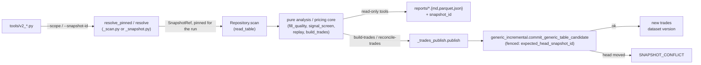

# `engine/v2/research` architecture: moved detail

Original text of blocks that the second compression of `engine/v2/research/ARCHITECTURE.md` replaced with shorter contract text. Each section below is the verbatim wording from `origin/main` (line numbers are those of the pre-compression file) and is design/implementation detail, not contract: the contract statements, refusal codes and invariants stay in ARCHITECTURE.md. Where a block there says "see this guide", this is the text.

## Source-free magnitude distributions (main lines 11-23)

`magnitude_distribution.recipe`, `histogram`, `validate_distribution` and `bin_index` are source-free numerical APIs, consumed by the math/payoff helpers, experiment distribution declarations/fitting/OOF adapters and synthetic tests; these numerical APIs own no source admission. The closed plain-JSON `research_magnitude_distribution.v1` represents absolute simple-return percentage points: quarter-point half-open bins through 20, then uncapped overflow; finite-bin interpolation is uniform, with no zero atom. `histogram(probabilities, tail_excesses=None)` and `validate_distribution(document)` return detached documents; 81 finite masses in [0, 1] must sum to one within absolute 1e-12, without repair/smoothing. Tail policy is `unresolved` (zero samples) or `empirical_excess` (nonempty equal-weight nonnegative excesses relative to 20); duplicates, order and explicit `sample_count` are retained. Zero excess means exactly 20; a supplied tail is retained even with zero forecast overflow mass. Samples are not authenticated training evidence.
`bin_index(magnitude)` accepts plain `int`/`float` (not bool/subclasses), finite after float conversion and nonnegative; exact boundaries go right, including 20 to overflow. The same numeric rules apply to histogram masses/edges/excesses. No caller value is echoed in refusals.
Stdlib numeric/list operations plus native errors suffice. Validation costs O(81 + n) time/detached space for n tail samples, with no hard sample cap, I/O, partial results, cache, retry, writes or transaction.
`magnitude_distribution_math.components` returns ordered immutable `(lo, hi, mass)` uniform intervals or atoms (`lo == hi`); default `uniform` and explicit `lower`/`upper` endpoint sensitivity modes leave recorded bin labels unchanged. Duplicate tail atoms remain distinct at `20 + excess`.
`cdf` gives P(A ≤ threshold), or P(A < threshold) with plain boolean `strict=True`; `mean` and `crps` return percentage-point quantities. These full-law APIs and `components` refuse unresolved tails even at zero overflow mass. Numerical validation is not causal tail admission.
`bin_scores` returns unscaled 80-threshold RPS and natural-log observed-bin loss from recorded masses, allowing unresolved tails; exact 20 is overflow. `brier(probability, outcome)` requires a plain boolean outcome. `empirical_crps(samples, observation)` preserves equal-weight nonnegative atoms without histogramming. `prepare_empirical_crps(samples)` returns a scorer over a detached immutable empirical law: validate/sort once in O(n log n), then use the same analytic core in O(n) per observation with O(n) retained space. Repeated calls do not reread/re-sort inputs; no pairwise matrix, causal admission, fitted parameters or shared cache.
Arithmetic explicitly divides accepted masses by their `fsum` (only admitted 1e-12 roundoff), without mutating documents or smoothing zeros; CDF endpoints clamp arithmetic roundoff. CRPS analytically integrates the piecewise CDF, not Monte Carlo or a tail-pair matrix: O(n log n) time/O(n) space. Unsupported numerical overflow refuses rather than capping outcomes.
`magnitude_distribution_payoff.bridge_summary` applies supplied `max(0, (intercept + slope*A)*spot) + residual*spot`; `empirical_bridge_summary` applies the identical bridge to equal-weight magnitude atoms. Supplied equal-weight payoff residuals are independent of magnitude in this frozen bridge, not fitted/admitted joint evidence.
Both return `expected_profit`, `probability_profit` (strictly positive), `mean_exit_value` and `probability_negative_exit` under the supplied independent move/residual law. Spot is positive; entry cost is nonnegative; both are per-share dollar decision-quote proxies. Residuals are spot fractions, and slope maps percentage-point magnitude to spot fraction. Fees, fills, multipliers, IV repricing and capacity are absent: these are not realized net-profit forecasts. Residuals remain after clipping, preserving impossible negative exits as a diagnostic.
`magnitude_distribution_math.mean_matched_control(target_mean, residuals)` returns detached empirical `magnitudes`, target/raw/anchored means, scale and zero count: clip negative target-plus-residual draws to zero, then anchor their mean by positive rescaling. This is named support repair, not incumbent parity; target mean must be positive, and earlier-OOF provenance is the later caller's responsibility. The original payoff-module export remains compatible, including its legacy refusal Problem; `distribution_oof` imports the neutral math implementation without payoff/book dependencies. Empirical scoring/bridge APIs preserve these zero atoms.
Bridge integration costs O(n log n + m log n + 80m) time/O(n+m) space for n components/m residuals, not a tail×residual product. Mean matching is O(m). All helpers are opt-in/source-free; `experiments/distribution_oof` consumes mean reconstruction/control, with no I/O, writes, cache, retries or transaction in these numerical helpers; no batch execution/resource policy is installed.
`magnitude_distribution_diagnostics` is an opt-in source-free API, currently consumed only by synthetic tests. `quantile(document, probability)` and `empirical_quantile(samples, probability)` return the generalized inverse for interior probabilities and finite support endpoints at 0/1; empirical inverses compare floating CDF ranks without interpolation. `interval_diagnostics(document, observation)` returns 50/80/90/95% equal-tail intervals (`level`, `lower`, `upper`, `width`, inclusive `covered`), in percentage points; `pit_bracket` returns `(P(A<y), P(A<=y))`, not a midpoint or randomized value. Histogram calls reuse uniform `components`/`cdf` and refuse unresolved tails even at zero overflow. `prepare_empirical_diagnostics(samples)` validates/detaches/sorts once, preserves zero/duplicate atoms, and returns an observation callable producing detached `intervals`, `pit_lower`, `pit_upper`. Preparation/histogram calls cost O(n log n) time/O(n) space; prepared calls use O(log n) time/constant output space. Plain nonnegative finite numbers are required; probabilities must be in [0,1] and empirical samples a nonempty plain list. Invalid inputs use nonretryable `CONTRACT_MISMATCH` with no partial result. Stdlib bisect/arithmetic suffice; no pairwise matrix, hard sample cap, I/O, retry, shared cache, fitted calibration, tuning, source admission or randomization exists. Caller owns sample eligibility, resource limits and sealed reproducible PIT randomization.
No source/fold/calibration envelope, fitting, holdout access or production wiring is provided; `earnings_magnitude.v1` is unchanged. The [experiment design PR](https://github.com/yshewchuk/investment-validation/pull/1425) is a scientific proposal, not a code dependency, preregistration or approval of results.

## Stage-2 magnitude panel foundation (main lines 35-35)

`magnitude_confirmed_metadata.build_index(repository, snapshot, *, tickers, limits)` is complete pinned-view admission (consumed by `magnitude_panel_qualified` and, through it, `experiments.size_panel`) returning one detached, content-hashed proof. Contract: catalog admission uses one owned read transaction, released before the detached `bounded_snapshot` session is yielded (later scans hold no transaction); any failure returns no partial proof; repeated successful calls over the same pinned snapshot, canonical tickers and admissible limits return the same proof; `limits` gate admission and retention but do not enter the `index_id` hash; `index_id` is the content hash of the proof document with the `index_id` field omitted. All catalog/request/retention/proof limits are explicit, with no defaults, retries, cache, fallback SQL or durable writes. Admission authenticates exact `snapshot_inputs` and the frozen earnings contract allowlist and is complete or refused: inventory scan-row, total-object-byte and per-object-byte caps bind before any object read; retained-row and retained-byte caps bind as scan data is read. This is not an RSS guarantee. Native diagnostic envelopes propagate unchanged; malformed shapes/incomplete inventory refuse CONTRACT_MISMATCH, unknown contracts UNSUPPORTED_CONTRACT, caps RESULT_LIMIT_EXCEEDED and duplicate `event_id` or `(ticker, day)` IDENTITY_CONFLICT. The proof's `counts` also carry `unconfirmed_date_conflict` and `unconfirmed_cluster_ambiguous`, and `policy.conflicts` is `unconfirm_date_and_cluster_conflicts.v2`. Receipt references stay unopened. Complete pinned membership proves neither expected-population coverage, observed-PIT knowledge nor protected/numerical eligibility. Work is bounded by admitted catalog/partition scans and retained-row reduction; progress emits aggregate stage/RSS/counts at bounded cadence without source diagnostics or secrets.

## Stage-2 magnitude panel foundation (main lines 37-37)

`confirmed_metadata.reduce_sequences` is public pure reduction: a pure seven-column DataFrame reducer of a complete caller-supplied view, not evidence of completeness. Strict naive `datetime64[ns]` types precede public `confirmed_event_metadata.classify_metadata`; public `event_sequence(warmup=4)` counts all supplied confirmed rows from zero; no date cutoff applies. All rows, including unconfirmed siblings, participate in duplicate ID and ticker/day refusal. Identity-conflict rule: a `date_conflict` row is unconfirmed with reason `date_conflict`, and every row of a duplicated `(ticker, event_cluster_id)` is unconfirmed with reason `cluster_ambiguous`; neither refuses the view. This is a deliberate modeling assumption (rationale in `experiments/SUPER_SIZE/CONFIRMED_METADATA_DESIGN.md`), not a deferred leak: both are disregarded for training and evaluation, matching live behaviour. A later-dated sibling may unconfirm an earlier row by design, and the view applies no as-of cutoff. Such rows leave the confirmed sequence (ordinals, warm-up) but stay in `selected_rows`; a row already unconfirmed for another reason keeps that reason and is not counted. `reduce_with_counts` returns `(sequences, {unconfirmed_date_conflict, unconfirmed_cluster_ambiguous})`; `reduce_sequences` returns the sequences only. Failure semantics: R1 missing input, none; R2 malformed shape or types, CONTRACT_MISMATCH before any conflict check; R3 duplicate `event_id` or `(ticker, day)`, IDENTITY_CONFLICT with no partial output; R4 no retry, cache or fallback; R5 counts come from the same pass as the sequences, so a refusal records nothing; R6 equal input gives equal output. Equal clusters across tickers are independent. Detached sequences retain exact empty states/counts/seven-field evidence. Work is O(n log n + t log t), state O(n + t) for n rows/t tickers; no hard cap or RSS bound exists here. No partial output, I/O, cache, retry, transaction, index identity, source admission, coverage, holdout/value eligibility or runtime integration exists.

## Stage-2 magnitude panel foundation (main lines 39-45)

`magnitude_panel_table` uses native `TableContract`/`ColumnContract`, JSON and canonical hashing. Its immutable v1 event/context/horizon key has ordered H/HM/HMO dictionaries, excluding learned Tier4 outputs/current-event outcomes. Rows require exact cohort coverage, finite typed values, missing/quote status and per-observation date, knowledge mode, row/fragment identity and canonical SHA-256 `content_hash`. Contexts are reconstructed-only, never relabeled observed; pure validation checks digest syntax/binding, not source membership or value equality.

`magnitude_panel_plan` (no production caller; grants no raw-payload read authority) reconstructs protected population/calendar metadata and checks exact history receipts and isolated history/prior-outcome fragments without payloads. Its context binds snapshots, history, dictionary, producer/environment and complete observed calendar/source metadata. Detached validation checks JSON types, closed event/request/recipe/producer schemas, native folds, fragments and calendar-source consistency; repository preflight authenticates membership/source truth. Horizon cutoffs require native calendar reconstruction, not hashes alone. Public history interfaces `validate_context_identity`, `validate_event_forecasts`, `preflight_source` and `validate_features` share existing validation without new authority. `magnitude_features.calendar_input` exposes session metadata; `magnitude_inputs.target_object_identity` detaches admitted `event_id`, `fragment_id`, `object_id` and object `content_hash` without reading target payload values. `magnitude_panel_table.canonical_day` requires canonical date strings or refuses `CONTRACT_MISMATCH`. No raw payload permission is issued; raw-source protected-event policy is not implemented by this plan. There is no writer, materializer, CLI, model or registration integration.

Panel boundaries require plain JSON (nested history before normalization); detached refusals use `CONTRACT_MISMATCH`, native refusals propagate.

`magnitude_panel_v2_policies.policy_definitions()` supplies detached source/derivation/quote/missing policies to `magnitude_panel_v2_table`. The [parity design](https://github.com/yshewchuk/investment-validation/blob/26b5958d868afc5189611aa77ec1774a9e246d71/experiments/SUPER_SIZE/STAGE2_DESIGN.md#incumbent-parity-amendment-october-24-design-only) policies use JSON copying and public eligibility declarations, not a registry/parser or computations. The additive v2 table exports `CONTRACT`, `feature_dictionary(subset)` and `recipe(subset)`; explicit H/HM/HMO have 11/28/42 ordered numeric descriptors. Uniform inline source/derivation policies change all dictionary hashes (including H); v1 APIs, contracts, hashes and eleven H numeric values/order remain unchanged. Recipes own 11/28/43 raw model columns: HMO alone appends `has_implied_quote`, outside the numeric table; learned missing indicators remain family-owned. Native contract and dictionary hashes are distinct; neither admits sources/snapshots/rows. The source-free versioned compiler consumes recipes; no v2 context, reader, model or runtime activation exists.

## Partial daily-market blocks (main lines 77-84)

`magnitude_panel_daily.build_daily_blocks` is an opt-in library-only reader; only synthetic tests call it. Inputs are pinned source/history/price_history snapshots, the metadata-only v1 plan (unchanged unless an ambiguous random event exists), plain-JSON producer metadata, grouped eligibility declarations and explicit source/event/byte bounds. Output has a distinct versioned context and detached daily-market/regime blocks, never stored-panel admission. The context binds the parent, bounds, policy, exclusions, snapshot fragment inventory and producer. Producer and label bounds are declarations, not installed-code attestation or verified outcome intervals. Protected evaluation membership confers no reads; grouped exclusions retain or remove all event horizons.

The thirteen daily fields and nine historical `spy_*` values obey each forecast's source ceiling. Regime closes come from pinned `price_history` `REGIME_TICKER` (`^GSPC`) via `get_price_series`, never daily SPY spot; that snapshot binds the context. Reads are row-capped: one ticker/year scan per event ticker plus one regime-series read at the latest ceiling. Daily anchors require IV surfaces; regime uses admitted closes. Availability is reconstructed, not observed-PIT/fit-admissible; fragment inventory and regime source dates remain explicit.
Row bounds apply across years per ticker; event bounds apply before exclusions. No cross-call cache/retry.
A required context-bound `max_object_bytes` bounds new value scans through native byte/footer/expansion limits;
it does not change inherited metadata-preflight scans.
No enclosing/write transaction, durable write, CLI, fit, registration or runtime consumer; native read transactions remain.
No history/runup block or outcomes are read. Repeat calls revalidate and reread pinned sources.

## Primary contracts and public interfaces (main lines 163-197)

`experiment_population.load_population` validates an exact committed
`SnapshotRef` and returns canonical event metadata under that same holdout
contract, without reading outcomes. Explicit IDs are checked against the full
canonical calendar, including conflicting siblings, before any caller can
consume an eligible population. It shares the trade loader's membership and
ambiguity logic; neither source dates nor ticker names substitute for event IDs.
Multiple IDs on one ticker/day are ambiguous even when their sessions differ:
the prediction outcome table cannot distinguish those event identities.
`experiments.v2_gate_variant` consumes this population in sweep mode before
fresh native replay, directly or through the smoke-only pricing/evaluation
workers. Their no-report/no-ledger contracts live in `experiments/ARCHITECTURE.md`.
`experiments.gate_report` separately composes population, observed calendar sessions,
protected `event_history` and fresh replay for each fold's training/evaluation rows;
its reconstructed date-ceiling and native publication contracts live in that same doc.
`prediction_inputs.load_prediction_targets` consumes this population first,
then scans each eligible ticker/event-date pair in pinned `computed_moves`. The history
and magnitude readers (`event_history`, `magnitude_inputs`, `magnitude_history_store`)
accept the `computed_moves.v4` or `computed_moves.v5` contract and refuse any other
`CONTRACT_MISMATCH`; on v5 a row with a `not_computed_reason` other than `no_price_window`
is `skipped` and carries no outcome, so it never counts as a scoreable event. The
writer's reason is the only reason research reports for a skipped row: the history and
training-label and opt-in evaluation omission lists (`omitted_history`, `omitted_labels`) carry the row's
`not_computed_reason` as the omission `reason` (v4 rows, and v5 rows without a reason, keep
`skipped`; the magnitude search's `validate_targets` accepts exactly `skipped` and the writer's
closed reason set, so a receipt with any other reason is `EXPERIMENT_IDENTITY_CONFLICT`), never a research-side re-derivation. Non-skipped rows the readers omit for
availability keep the reader's own `unavailable` / `not_available_before_fit` reasons. The
isolation guard of the history and magnitude readers (`_plans`'s per-candidate checks, shared with `plan_with_reader`) is unchanged: every
candidate still needs exactly one isolated fragment, and a candidate with no fragment
refuses `HOLDOUT_ACCESS_DENIED`. `prediction_inputs` does not use that guard: it refuses a
table whose contract is neither native contract with `CONTRACT_MISMATCH` before any target
scan, and a v5 skipped row with `EXPERIMENT_VARIANT_FAILED` naming the reason (the v5 contract
requires one; a reason-less skipped row is malformed and gets the generic target message). It returns the signed move, binary `positive_move` target, and `target_available_on` date. The date is required and later than the event;
fold consumers must admit training labels only when available before their
decision cutoff. This input prerequisite performs no feature construction,
model fitting, or report/ledger publication, and has no supervisor caller.

## Primary contracts and public interfaces (main lines 216-220)

`horizon_fit_inputs.prepare_horizon_inputs` assembles ordered selected-column training/prediction float arrays and freezes original null-preserving input hashes under an explicit training-target column; reserved matrix keys refuse ValueError before event-ID/column iterables are materialized once for reuse.
It reads no evaluation targets, preserves signed labels without a floor and returns detached arrays/evidence. Caller owns target/domain validation, source/membership admission and fitting; no I/O, cache, guards, policy inference or production entrypoint. Its current caller is offline `experiments.magnitude_fitted`, preserving legacy magnitude evidence bytes.
`horizon_fitted.fitted_forecasts` shares the per-horizon fit loop using closed numeric routes and explicit target column/domain; it accepts raw fit inputs or prebuilt `HorizonInputs` from `build_fit_inputs`, consuming that transport as assembled without checking it against positional inputs. The builder carries canonical `train_event_dates` only when the recipe declares `requires_event_dates`, and the identity helper adds dates only when present, preserving existing recipe hashes otherwise. Both guards run before input inspection; ID/horizon/column iterables materialize once; regression recipe/domain must match and magnitude routes require nonnegative outcomes. Caller still owns sealed source/target identity and admitted membership; no evaluation labels or repository are accepted. `measure_fit_seconds=True` measures only the fit route with a monotonic clock and adds `fit_seconds` to completed progress markers; callers that omit it retain the default progress shape and returned static fit evidence. `experiments.magnitude_fitted.fitted_forecasts` always opts in, so its completed callbacks include fit duration while returned fit evidence remains static.
Started/completed progress surrounds each fit; original inputs are hashed first and labels copied per horizon. Signed predictions need only be finite (no floor); nonnegative routes reject negative forecasts. Candidate diagnostics preserve full nonprediction results.
Only fit/forecast-validation exceptions become native `HorizonFitFailure` with original `__cause__`; preparation/progress errors propagate. Callbacks receive deep-copied evidence. No partial predictions/evidence return, but callbacks/diagnostics are provisional. No retries, writes or production entrypoint; offline magnitude wrapper retains its legacy exception/strict-failure policy.

## Primary contracts and public interfaces (main lines 223-236)

Every candidate query is planned before any outcome scan, using the same
fragment planner as Repository. Preflight indexes fragment metadata once by
partition and canonical time intervals after shared full-key bound admission;
malformed keys stay in a global fallback, uncertain times partition-local.
Selected records keep manifest order and planner refusal precedence, including
malformed keys outside the selected issuer/day; each bound is reused for query
construction. Its entire surviving membership must be one inspected singleton
with the exact ticker/day key, partition and time bounds. The resolved committed
catalog/manifest identity is the metadata trust anchor (native producer
inspection, not adversarially forged metadata). Caller rows, implicit latest and
another experiment's outputs are not inputs. Mixed, missing or unprovable
membership refuses `HOLDOUT_ACCESS_DENIED` before opening outcome objects; old
whole-ticker layouts are refused, never migrated, and row predicates are not
physical isolation.

## Primary contracts and public interfaces (main lines 259-259)

| Physical admission | Every candidate passes public `event_history.plan_event_targets` (metadata-only singleton admission for already admitted populations) before any target opens. Missing/mixed objects or unprovable exact ticker/date bounds refuse `HOLDOUT_ACCESS_DENIED`; nonmatching contract/hash refuses `CONTRACT_MISMATCH`. Every declared target object is capped at 1 MiB before any target opens (`RESULT_LIMIT_EXCEEDED`); bounded Repository scans also cap compressed and total uncompressed bytes. This resource ceiling accommodates singleton labels without authorizing arbitrary payloads. Computed-moves defaults remain unchanged. |

## Primary contracts and public interfaces (main lines 261-261)

| Provenance | `validate_iv_crush_receipt(preflight, fold, receipt, targets)`, consumed by shared search evidence, checks exact evaluation membership/order, finite signed rows, cutoff/context/object identities and the full receipt/hash without I/O; malformed evidence raises structural/numeric exceptions. Row identity includes target object; attributes bind full dataset/contract ref, cutoff, month/membership pins, purpose, future exclusions and ordered fragment/object/content hashes plus caller source_id/input_hash. Source marker/hash syntax is checked, not independently authenticated or recomputed from source quotes. Publication/finality remain unverified; availability is a modeled floor. |

## Primary contracts and public interfaces (main lines 262-262)

| Progress | Admission, planning and read stages log start/end/failure, elapsed time and peak RSS to stderr; count/rate/ETA ticks at most every 30 seconds; aggregate decisions (bulk/explicit selection, admitted/holdout/ambiguity/cutoff counts, planned batch/byte limits). IV refusal stages log the native code only (`report_refusals`), never message text, event identities or details; other stages log elapsed time and RSS only. Logging cannot change results, identities, errors or read authority. |

## Primary contracts and public interfaces (main lines 267-273)

`event_target_store.publish_event_targets` is a shared, source-free publisher of explicit complete earnings metadata rows and a selected ticker/date target set, each with its exact contract.
It preserves supplied metadata aliases/conflicts and nullable fields; every target must match metadata, but metadata need not have a target. Missing/extra fields, null required values, duplicate/non-string keys, unsupported or structurally invalid native-decoder contracts, or invalid caps refuse `CONTRACT_MISMATCH` before publication.
Inputs include an asserted native source snapshot, nonempty JSON provenance with recursively string-only keys, explicit positive per-table row/per-object/total-byte caps, and an explicit output Repository. Non-JSON values, non-string keys or cyclic provenance refuse `CONTRACT_MISMATCH` before hashing/writes; native typed-document decoding detaches accepted values. Source/provenance bind the request hash but are not independently authenticated; caller owns admission and output workspace isolation.
Rows sort deterministically. Caps apply to canonical row bytes and serialized Parquet output; exceeded caps refuse `RESULT_LIMIT_EXCEEDED`. PyArrow/native conversion, inspection and catalog errors propagate; no row repair or dropped fields.
The standard PyArrow writer emits singleton target objects and partition-local metadata batches capped at 256 rows (or the smaller contract batch limit); native inspection derives bounds, and `partition_logical_hash` spans same-partition fragments. A single native `commit_snapshot` transaction publishes only earnings metadata and the target table in reconstructed knowledge mode.
Return resolves the committed immutable `SnapshotRef`, including native reconciliation of reused content; exact reordered replay reuses the successful receipt without catalog changes. Different source/provenance/caps bind distinct receipt requests, not necessarily distinct content snapshots.
Stages emit bounded progress/rate/ETA and RSS. This opt-in primitive has no production caller and is not reachable from a production entrypoint; callers are explicit `experiments.iv_crush_prepare` workspace preparation and synthetic tests. No provider/source reads, target arithmetic, fitting, implicit full-closure copy, holdout policy, cache or retry. Failure may leave unreferenced immutable objects but never a partial committed snapshot.

## Primary contracts and public interfaces (main lines 287-319)

`magnitude_inputs.load_magnitude_targets(repository, snapshot, *, as_of_month,
labels_before, purpose="selection", event_ids=None)` is the separate label
view. The fixed target recipe is absolute split-neutral, non-dividend-adjusted
earnings close-to-close return in percentage points; the native signed
`computed_moves` value is retained, never rescaled, clipped or adjusted again.
Its primary prediction estimand is conditional mean, selected by pooled RMSE;
MAE and quantile calibration are secondary; the magnitude reporter implements
MAE while quantile calibration remains unimplemented.
Shared population admission precedes label access. Bulk reads exclude events
on/after `labels_before`; explicit requests containing one refuse. All
remaining objects pass `event_history`'s shared singleton preflight before
any is opened; mixed inherited snapshots refuse. Each scan uses the existing `event_history.MAX_OUTCOME_OBJECT_BYTES` (1 MiB) ceiling: oversized stored bytes refuse before object access; oversized summed Parquet row-group bytes refuse before row decoding (`RESULT_LIMIT_EXCEEDED`). This is not a population/heap cap. Label availability
must be strictly before `labels_before`; missing, skipped, malformed or
non-finite labels refuse the whole call, with zero remaining a valid value.
Opt-in exception: `omit_not_computed=True` (a `bool`, else `CONTRACT_MISMATCH`;
used by the magnitude search's inner and outer evaluation reads) omits a row the
writer marked `skipped` (v5 `not_computed_reason`, e.g. `not_orats`), never
parsing it, exactly as `qualify_magnitude_training_targets` does. Omissions are
listed in the frame attrs and receipt as `omitted_labels`
(`[{"event_id", "reason"}]`, sorted by event ID; `reason` is the row's
`not_computed_reason`, `skipped` without one); the receipt carries the key only
when non-empty. Only `skipped=true` is omitted, never null/late availability;
every other refusal is unchanged. Forecasts for omitted events are made but not
scored; `event_count` counts scored events.
Earlier events with late availability can be decoded to check their recorded
date; this is reconstructed availability, not verified publication evidence.
Output rows carry target/object identity; frame attributes bind recipe,
label cutoff, snapshot/dataset/month/membership versions and consumed inputs.
Forecast cutoff and training/evaluation label cutoff are distinct contracts;
this seam neither fits a model nor joins labels into forecast features.
Repository failures propagate; no cache, retry, write or partial return.
`experiments/magnitude_report.py` consumes the strict target loader through the
magnitude CLI; there is no supervisor or final-read caller.

## Primary contracts and public interfaces (main lines 345-372)

`magnitude_features.load_magnitude_history(repository, snapshot, *, event_id,
as_of_month, horizon, history_start, purpose="selection")` binds one canonical
event's prior-history features to its full-session forecast ceiling. Exact
snapshot and target holdout/alias admission occur before calendar or outcomes.
The calendar is the sorted union of canonical `daily_market.date` values from
that snapshot, with no projected days or external calendar override. Only the
date column is requested; ordinary Repository object verification still applies.
Missing/empty calendars refuse through the shared reader/`CALENDAR_UNAVAILABLE`;
malformed dates, invalid horizons or incomplete anchor/session windows refuse
`CONTRACT_MISMATCH` before historical outcome access.

The shared `forecast_cutoff` computes the ceiling; `load_event_history` uses
that exact day, excluding protected/ambiguous/current/future outcomes before
its physical singleton preflight. The adapter never reads the target label.
Prior-label availability on the source-session day is admitted by the history
contract; later dates are omitted, never zero-filled. Outputs bind canonical
event/session, snapshot, calendar version and dataset/object identities,
horizon/cutoff, target and history-feature recipes, all history reads/omissions
and membership versions into one deterministic input digest. Empty history keeps
explicit null features; non-finite derived features refuse
`EXPERIMENT_VARIANT_FAILED` rather than reaching a model.
Provenance says reconstructed date bounds: event-schedule as-known and
source-publication evidence stay unverified (strict PIT admission is a later
prerequisite). The stored build uses `plan_magnitude_folds`,
`event_history._assemble_history` and `_feature_recipe`, not this adapter,
which has no fitting, target-join, CLI, provider, report, ledger or final-read
caller, no retry, write or partial result, and only the observed-session cache
(see the "Cache, retry" row of the fold table); Repository failures propagate.

## Primary contracts and public interfaces (main lines 388-402)

- Exact snapshot and random/rolling/ambiguous-union admission precede calendar
  reads. Bulk membership includes `training_start`, excludes January 1 after the
  last evaluation year.
- Each event's 5/3/1 horizons share its event-year fold. Training candidates
  precede `min(year_start, all evaluation source-session ceilings)`; usable
  labels also need availability strictly before that boundary. Earlier
  evaluation events may train later folds, including the same issuer; annual
  membership need not cover a full year; no inner HPO split is defined.
- The deterministic digest binds request, target/fold rules, ordered canonical
  event/cutoff memberships, holdout versions, snapshot and metadata-source
  objects; equivalent admitted explicit/bulk memberships give the same `plan_id`
  (selection mode is not identity).
- No computed-move, label or history-feature access, fitting or registration/
  final-read authority. Native non-session announcement anchoring is preserved;
  schedule/publication evidence stays unverified reconstruction, not PIT data.

## Primary contracts and public interfaces / Proposed authorized final read (#490) (main lines 466-481)

Request preparation, the private ops authorization/spend primitive, the private metadata-only final population reader and the private frozen evaluator are implemented; no production authorization entrypoint, final-read caller or result retrieval exists. The remaining lifecycle belongs to later #490 slices and preserves #445's union exclusion; #555 refusal/audit integration is dropped and handled separately in #489.
The [user decision](https://github.com/yshewchuk/investment-validation/issues/490#issuecomment-6072905454)
permits agents/supervisors to prepare requests, never to authorize them.

**Request.** Canonical versioned bytes use the existing `experiment_id` as the decision identity, without a question record or alias detection, per the [user decisions](https://github.com/yshewchuk/investment-validation/issues/490#issuecomment-6101284544).
They bind the selected registered `variant_id`/registration reference,
resolved plan/source/evaluation-recipe and applicable frozen-model hashes, exact committed
`snapshot_id`, `holdout_as_of_month`, `random_membership_version` and
`rolling_membership_version`. No latest-head resolution, caller population override,
alternate arm, fitting, threshold search or evaluator callback is accepted.
Membership stays in `foundation.experiment_holdouts`: random and rolling sets under
its versioned as-of-month contract, with ambiguous identities refused, never admitted.
Both sets are bound together; changing month, version, snapshot or winner cannot reset a decision's spend. The request digest identifies bytes, not a new decision.
`native_registration.prepare_final_holdout_request` verifies existing catalog/artifact registration metadata only; it never resolves a head, scans a population or reads results.
Native registration's optional `final_read` declaration seals recipe, completeness-bar and frozen-model artifact references before authorization; preparation derives them, never accepts replacements. Registrations without that declaration refuse preparation.
Request validity proves neither winner selection nor read eligibility. The later metadata-only preflight must verify the preregistered completeness artifact and refuse an unmet bar before any holdout outcome read; declared references alone do not prove completeness.

## Inputs (main lines 527-546)

Shared `_scan` reads report decoded-row progress against the candidate-row bound
on stderr at bounded cadence, with rate, ETA and the selected batch-row limit; the
denominator is an upper bound, since predicates and batch filtering may retain
fewer rows, and filtered scans also report cumulative retained/skipped rows.
Every row scan, including short ones, logs start and completion/failure with
elapsed time and peak RSS; periodic ticks stay silent below their cadence. No
additional scan is used for telemetry, and native errors propagate unchanged.

Public `_chains.read_chains_for_years` delegates a nonempty iterable of years to
internal `_snapshot.read_table`/`_scan.read_table`, with the fixed chain projection,
optional key predicates and `batch_filter`. It materializes retained rows and
performs no experiment holdout admission. The callback runs immediately after each
Arrow batch becomes a pandas frame, before retaining frames, and returns narrowed
rows or `None`; omitting it or passing `None` preserves existing reads.
`_chains.load_chain_index` uses it to keep exact requested ticker/date pairs while
reading one manifest year at a time; stored dates keep their timestamp semantics
and requested dates use the existing normalization. Independent ticker and date
memberships may prune a scan batch, but only the exact pair mask, never their
cross product, defines the retained rows. Frames retain ordering and duplicates.
This bounds retained unmatched rows, not total process RSS.

## Dependencies (main lines 623-653)

Callers: no `engine/` modules import this package (`checks/import_layers.py`
parses only `engine*` importers, so the `tools/v2_*.py` CLI leaves and
`experiments/` callers below sit outside the layering hook).
`experiments/runup_exit_report.py` consumes population admission, calendar/plan,
chain index, the entry-selection seams above and exit walking for read-only comparisons.
`experiments/magnitude_inputs.py` consumes `preflight_magnitude_targets`;
`experiments/magnitude_report.py` consumes that, `load_magnitude_targets` and
`qualify_magnitude_training_targets`.
`experiments/native_registration.py` consumes
`experiment_population.load_population` and `magnitude_folds`' window/planner.
`experiments/magnitude_search_plan.py` consumes `magnitude_folds.annual_fold` for sealed outer/inner metadata and owns native bounds/cutoff exclusions from the registration-pinned `binding["snapshot"]`; its public bounded-snapshot admission precedes table access, a missing bounds row seals `label_bounds_missing`, a present null row seals `label_bounds_unavailable`, and a malformed non-null stored date refuses identity. A fold whose strict exclusions remove every evaluation event refuses before plan publication. Trial/report consumers use the plan's filtered `evaluation_event_ids`; `read_search_plan` reconstructs folds and revalidates the sealed plan (including availability), repeating the bounded bounds admission.
`experiments/magnitude_search_request.py` consumes `magnitude_panel_table.recipe`
and `eligibility_policy.eligibility_policy` for declarations only;
`magnitude_search_request_versions.py` consumes the v1/v2/v3 panel `recipe` APIs
for source-free dictionary adaptation and request-version dispatch, not data admission.
`experiments/magnitude_search_evidence.py` consumes `read_stored_for_events`, `preflight_magnitude_targets`,
`qualify_magnitude_training_targets` and `magnitude_recipe` for shared inner/outer admission.
`experiments/magnitude_search_trials.py` directly consumes `load_magnitude_targets`,
owns legacy/v2 no-fit guards and delegates bounded inner fitting to
`experiments.magnitude_search_execution` (using ops executor thread constants); it performs no outer evaluation.
`magnitude_search_outer.py` directly consumes `load_magnitude_targets` for selected outer folds.
`experiments/magnitude_history_store.py` consumes the stored-history context, build and read APIs.
`experiments/common_v2.py` reads trade, calendar and chain inputs from pinned v2
data; the archived trade-read caller omits required holdout context and is
refused. Historical EXP-147 reads its native replay tag from `experiment_trades.PROVENANCE`.
`experiments/v2_candidate_grid.py` (`price_candidate_grid`) reads
`_chains.filter_plan_by_availability`/`read_chain_keys_for`, `_plan.plan_events`,
`_pricing.STRUCTURES`/`execution_variant_label`/`trading_calendar_from_snapshot`
and `replay.ALPHA_GRID`/`replay_one` to price one strategy family across a
grid-position sweep on one pinned snapshot; `experiments/EXP-186_.../run.py`
reads `_replay_run.events_frame` for its known-session event universe.

## Dependencies / Stored magnitude-history materialization (main lines 657-676)

`experiments.magnitude_history_store` derives the supported build/read context.
The engine accepts digest-consistent contexts; materialization independently guards target identity/windows.
It does not authenticate arbitrary rehashed calendars as builder-derived.

| Boundary | Contract |
|---|---|
| Inputs | Exact source snapshot, admitted temporal plan, history start, fixed 5/3/1 clocks, per-feature missingness and installed producer source/environment identity. No experiment outputs. |
| Protected reads | The complete eligible singleton candidate union is preflighted before any outcome opens. Protected/ambiguous objects never open; admitted late labels may decode availability and be omitted before arithmetic. |
| Build boundaries | An admitted candidate outcome is decoded once per build while its run stream stays open; a finished run's decoded rows stay for the build (as the per-event row cache does). No cache persists across builds; memory has no fixed byte cap and production scale is unmeasured. A scan failure propagates its native code and fails the build before any snapshot, receipt or head is published (see Publication). Outcomes are read through `event_history.plan_with_reader`: the `plan_event_targets` preflight plus unique non-null `event_id`s; malformed candidates refuse `CONTRACT_MISMATCH`. Adjacent candidates of a ticker share one run scan, and a protected, mixed or unadmitted fragment is never opened. Membership that is not exactly the preflighted set, an unplanned event, or a mismatched day, ticker or request refuses `HOLDOUT_ACCESS_DENIED` before the run opens any outcome. Each outcome object is capped at 1 MiB (`MAX_OUTCOME_OBJECT_BYTES`; larger refuses `RESULT_LIMIT_EXCEEDED`). At most 32 run streams are live (a finished run does not count); the oldest is closed to make room and re-scanned if asked for again. Rows equal per-candidate reads; interleaving a ticker's requests beyond the cap costs extra scans only. |
| Catalog reads | The CLI opens its `Repository` with `pin_snapshots=True`, so each scan and bound reuses the pinned snapshot's cached table membership instead of re-decoding it from the catalog (decodes were quadratic in candidates). `fragment_records` and a table's first use still decode membership; `earnings_events` is still read once by fold planning and once by preflight. Output, receipts and identities are unchanged; the pin is per process and immutable-identity keyed. |
| Progress | All canonical population scans, including explicit selections, report row-scan start/end/failure with elapsed seconds and peak RSS on stderr. Full-universe `load_population` additionally reports outer completion after 5 s. Build stages use the same `progress.stage`; periodic `progress.Progress` ticks report count/rate/ETA/RSS at most every 30 s, against the candidate-row bound for scans, with retained/skipped counts when batch-filtered. `progress.decision` emits aggregate control decisions; opt-in refusal stages include the native DataError code only, without messages or details. Telemetry never changes results, errors or stdout; native experiment CLIs retain JSON stdout, while replay/chain readers retain their existing stdout diagnostics. |
| Per-forecast features | Shared history arithmetic preserves availability and numeric-refusal order. Consumed objects, omissions and availability accompany all eleven columns. Exclusion rosters remain transient; persisted lineage omits `holdout_exclusions` and the stored reader refuses it. Empty `n_prior` is zero; other missing values are null with `on_missing=null`. No runtime imputation or production v4 aggregates. |
| Output | Features-only `research_magnitude_history.v1` snapshot, separate from unchanged source. Three ordered horizons per event-isolated object; primary key `(event_id, context_id, horizon_sessions)`, physical context field and context partition. |
| Publication | Inspected objects/manifests and success receipt commit atomically under an initially empty deterministic scope. Failure admits no snapshot; complete unreferenced objects remain for normal cleanup. |
| Replay/conflict | Matching success receipt returns the original artifact without moving a head. A failed/conflict receipt for the same context refuses with `IDENTITY_CONFLICT`; conflicting receipts/heads also refuse. Nothing retries automatically. |
| Stored read | Supported entrypoint reconstructs context; engine verifies exact receipt/output and complete object isolation, then all row metadata before feature-column decoding. Checksum verification reads bytes. No historical outcomes or arithmetic; malformed reads return no partial rows. |
| Trust/authority | Native inspected catalog metadata is trusted, not independent attestation against malicious catalog writers. Schedule/source-publication availability remain unverified reconstruction. No experiment/final-read authority; registration v1.0–v1.3 and fixed baseline are unchanged. |
| Refusals | Missing or changed context/receipt: `IDENTITY_CONFLICT`; unprovable isolation: `HOLDOUT_ACCESS_DENIED`; bad stored schema/metadata/missingness: `CONTRACT_MISMATCH`. |
| Invalid projection | Non-string selections, malformed selection containers, unknown event/feature or duplicate feature: `CONTRACT_MISMATCH` before any payload scan. |
| Source/publication failures | Unknown source/feature snapshot ID: `SNAPSHOT_NOT_FOUND`; resolved source-pin mismatch during public build/read context derivation: `SNAPSHOT_UNRESOLVED`; direct `materialize` source/context mismatch: `IDENTITY_CONFLICT`. Non-native computed-moves contract: `CONTRACT_MISMATCH`; empty fold: `POPULATION_COLLAPSED`; invalid eligible label/features: `EXPERIMENT_VARIANT_FAILED`; competing head: `SNAPSHOT_CONFLICT`. Other native catalog/object/source-admission errors propagate. |

## Dependencies / Stored magnitude-history materialization (main lines 684-734)

**Season heat computation contract:** `season_heat.compute_season_heat(labels, targets, trading_sessions)` is a source-free research calculation over caller-supplied rows. Labels contain `event_id`, `ticker`, `event_date`, `available_as_of_date`, and nonnegative `abs_move`; targets contain `event_id`, `ticker`, `event_date`, and `decision_session`; sessions are canonical ascending trading dates. Label `event_date` and target `decision_session` must be trading sessions; target `event_date` must be canonical ISO but may be off-session. At each decision, labels with `available_as_of_date <= decision` and event sessions in trailing 5/20/60/252 sessions qualify; the target event and its ticker are excluded. The result has nullable 5/20/60 means, always-present 20-session count, and nullable 20/252 ratio. Each mean needs at least 20 labels; the ratio needs at least 20 in both windows and a nonzero 252-session mean. Malformed shapes, keys, IDs, session lists, target dates, duplicate keys, non-session label dates or decision sessions refuse `CONTRACT_MISMATCH`; malformed availability dates, availability not after event, invalid moves, and non-finite sums, means or ratios refuse `EXPERIMENT_VARIANT_FAILED`. It reads and stores nothing. **Population (`season_population`, `outcome_binding`):** the qualified panel builder owns the read; `research_eligible_history` is unchanged, and the anchor lookup, table-wide fragment index and anchor-to-fragment binding live in `outcome_binding` shared with it. `plan_roster` (context derivation) uses bounds metadata only and opens no outcome; `read_labels` (value build, once; replay reads none) opens outcomes. Labels come from `load_population` under the history context's `as_of_month` and purpose, so held-out events are never planned or opened; availability is anchor `post_close_date` + 1 calendar day, which the object must repeat; decisions are every forecast clock (`source_session_ceiling`); embargo groups are not applied to other tickers' labels (judgement, not measured). Excluded and counted in `season_heat_population.v1` (counts, `exclusions_digest`, `roster_digest` over `(event_id, outcome_object_id, outcome_content_hash, available_as_of_date)`, 10 sample ids): `missing_native_bounds`, `null_source_bounds`, `off_session_event_date`. Refused: invalid or duplicate bounds, one null date, session mismatch (`CONTRACT_MISMATCH`); fragment or anchor binding mismatch and duplicate fragment table-wide (`HOLDOUT_ACCESS_DENIED`); skipped or mis-dated outcome under non-null bounds (`CONTRACT_MISMATCH`); invalid `abs_move` (`EXPERIMENT_VARIANT_FAILED`). No coverage threshold; exclusion materiality, and the cold cost of the roster-plan and calendar reads, are measured on the first authorized data run. Panel `research_magnitude_panel.v4` adds `season_heat_mean_abs_5|20|60`, `season_heat_count_20` (actual count, non-null), `season_heat_ratio_20_252` and a `season_heat` lineage block; recipe `HMOS` is `HMO` plus a `season` block with its own hash, and the `H/HM/HMO/MO-/M` hashes and v1-v9 request ids are unchanged. Request `v10` requires the `HMOS` hash. The `magnitude_panel_qualified` wrapper is intentionally not reachable from production or nightly entrypoints. R1 retained labels plus 252 buckets, no per-target copies; R2 nothing cached across builds; R3 refusals above; R4 nothing persisted before publication; R5 no retry; R6 equal pinned inputs give equal receipt, values and context id.

**HMOSX feature groups (panel `research_magnitude_panel.v5`, context `.v5`, request `v11`):** recipe `HMOSX` is `HMOS` plus four blocks (`tail`, `ivdyn`, `ownvol`, `calendar`), each with its own source dependency and hash, and appends 25 columns (72 dictionary fields, 47 `HMOS` plus 25; 73 model columns with `has_implied_quote`); the `H/HM/HMO/MO-/M/HMOS` hashes and v1-v10 request ids are unchanged, sealed `.v4` panels rebuild with no compatibility reader, and context `.v5` only widens `feature_recipe` and the registration validator to `HMOSX` (no new receipt). Values are computed once at panel build in `_rows` from per-ticker data already in memory, with no new source read, no per-run computation and no raw read by the search; every decision date is the forecast clock's `source_session_ceiling`, by data date, never `computed_at`. **G1 tail** (`tail_history.compute_tail_history`; `tail_max_abs`, `tail_std_abs`, `tail_p75_abs`, `tail_p90_abs`, `tail_share_gt10`, `tail_max4_abs`, `tail_std_over_mean`, `tail_max_over_mean`): the same own-ticker contributor list as `n_prior`, absolute values from the existing signed-moves read; max/p75/p90 (linear interpolation)/share above 10%/max of last 4 need one prior, std (ddof 0) two, and the two ratios need mean > 0; shortage is null. **G2 IV changes** (`iv_dynamics.compute_iv_dynamics`; `iv10_30`, `iv_rv`, `ex_ratio`, `imp_chg5|10`, `iv30_chg5|20`, `iv10_chg5`): the last 21 `daily_market` surface rows dated `<=` the ceiling; same-row ratios plus lag-k ratios against the k-th prior surface row, null when that row is more than `2k+4` calendar days older than the current row or a denominator is null or zero (never infinity); a null `imp_chg` whose current or reference row has a zero or absent `implied_move` (with the lag row present) records the lineage reason `no_quote`. **G3 own vol** (`own_vol.compute_own_vol`; `own_rvol5|10|60`, `own_absret1`, `own_rvol5_60`): at most 61 `close_adj` closes dated `<=` the ceiling, log returns, sample stdev (ddof 1) times sqrt(252) times 100, `own_absret1` the absolute value of the last log return, in percent; null when the last close is over 5 calendar days before the ceiling, or the window is short (each volatility needs its own window of returns); `own_absret1` is null without a return, and `own_rvol5_60` alone is null when either side is null or `own_rvol60` is zero. A non-positive or non-finite `close_adj` at or after `source_start` is refused earlier by the price read (`CONTRACT_MISMATCH`, not null); the pure function's own non-positive rule is reachable only from direct callers. **G4 calendar** (`calendar_features`; `cal_amc`, `cal_weekday`, `cal_month`, `cal_days_since_prior`): from the target's stored confirmed session and event date; `cal_days_since_prior` is days from the last contributor's event date, null without one. The same-date event count is intentionally absent: it needs a point-in-time calendar the panel does not have. Columns are float64 nullable (`on_missing=null`) except `cal_amc`, `cal_weekday`, `cal_month` (int64, non-null, `on_missing=refuse`) and nullable int64 `cal_days_since_prior`; there is no clipping, imputation or winsorising. **Refusals:** a non-sequence, malformed or non-finite input value (G1 also a negative move), G2 and G3 dates not strictly ascending, G3 dates after the ceiling, a session other than `AMC`/`BMO`, a prior event date after the event, and a target event with no confirmed session refuse `CONTRACT_MISMATCH`; a non-finite result from finite input refuses `EXPERIMENT_VARIANT_FAILED`; a projection with X columns but not admitted by `admit_columns(..., x_groups=True)` refuses `HOLDOUT_ACCESS_DENIED`. **Lineage:** G1/G4 reuse the `history` block; G2 records its lag reference-row anchors; G3 records the first and last window dates and row count (the price versions are already pinned by `price_row_digests`, so a changed price version changes the context id); one stderr line per build reports per-column null counts. **Request `v11`** requires the `HMOSX` dictionary hash and admits feature sets `H/HM/HMO/MO-/M/HMOS/HMOSX` in that order; `HMOSX` is one set, not one per group (candidate counts and ablation limits: `guides/size_feature_groups_design.md`). R1 at most 61 closes and 21 surface rows per target, nothing grows with ticker count; R2 nothing cached across builds; R3 refusals above plus the existing panel refusals; R4 fragments are written before the snapshot commit, so a failed publication leaves unreferenced objects for normal cleanup and exposes no partial snapshot; R5 no retry; R6 equal pinned inputs give equal values, row ids and context id.

**Derived feature sets `HMOSXL` / `HMOSXLP` (recipes, request `v12` and the
fit-path derive step below):** `magnitude_panel_qualified_table.recipe("HMOSXL")`
is the `HMOSX` dictionary plus 39 `log1p_<column>` descriptors, and `HMOSXLP`
adds 28 pairwise `<a>_x_<b>` products, with names and order fixed by
`derived_features`. Each descriptor has `block: "derived"`, float64, nullable,
`on_missing: "null"`, unit `log1p(<unit>)` or `<u1>*<u2>`, one
`panel_column` source dependency per source, and
`derivation_policy` `{schema_version: "derived_feature.v1", function, sources,
output}`; they enter `dictionary_hash` and `model_columns` (before
`has_implied_quote`). Derived recipes alone carry `base_subset: "HMOSX"` and a
`derivation` marker; no other recipe gains a key, so the `H` to `HMOSX`
dictionary hashes, the canonical JSON of `recipe("HMOSX")` and every v1-v11
request id are byte-identical and sealed `.v5` panels and contexts stay valid.
Nothing derived is stored: the panel build uses `panel_recipe(subset)`, which
refuses a derived set with `CONTRACT_MISMATCH` (a derived set is a
model-feature recipe, never a stored-panel recipe). The recipe only declares
columns: it reads no data, persists nothing and holds no retained state.

**Request `v12` and the derived-set binding:** `v12` requires the `HMOSXLP` dictionary hash (the
widest superset, as `HMOSX` was for `v11`; any other hash refuses
`INVALID_EXPERIMENT_SPEC`) and admits feature sets
`H/HM/HMO/MO-/M/HMOS/HMOSX/HMOSXL/HMOSXLP` in that order; `v11` and earlier
still require their own hashes and refuse `HMOSXL*` as an unknown set. The
candidate count is unchanged (set count times `G`, plus one `size_v1_4`
candidate when `HMO` is among the sets) and the existing 1000-candidate
ceiling applies to the total, so three arms need `G <= 333`. In
`size_search_binding` the dictionary-hash check uses the dictionary subset
(`v12`: `HMOSXLP`), while the stored-panel recipe and read use the stored-panel
subset (`v12`: `HMOSX`), so the panel read never names derived columns and the
stored fold input, `stored_inputs_id` and the sealed panel are the same for
every arm.

**Fit-path derive step:** `experiments.derived_rows.with_derived` is the one
place `derive_columns` is called on the fit path. It runs where stored rows
become a matrix: `load_fit_inputs` (the fit child and the distribution
admission replay) and the parent's `fit_evidence`, so both hash the same
matrix. It acts only when the candidate's `features` name a derived column; a
stored-only list returns the same rows untouched, so `HMOSX` and earlier
requests read exactly the matrix as before. Output columns follow the recipe
order after the stored columns; nulls stay null (never zero-filled) and rows are
copied, never mutated. Failures keep the pure function's codes: a negative or
non-null infinite source, or a missing source column, refuses
`CONTRACT_MISMATCH`; a product overflowing from finite inputs refuses
`EXPERIMENT_VARIANT_FAILED`, which the fit child reports as a `failed` event
(the parent's `fit_evidence` lets the refusal propagate). One stderr line per
call reports set, rows, derived count, per-column null counts, elapsed time and
RSS; nothing is cached, persisted or retried.

## Dependencies / Stored magnitude-history materialization (main lines 736-738)

The separate `research_eligible_history.v1` table binds exact source/bounds, policy/month/membership versions, history start, a nonempty ascending subset of the canonical 1/3/5 clocks, contributors and producer identity. Exact receipts replay; live/v1 aggregates never substitute. Full canonical metadata establishes protected windows. Once selected target/history population is known, missing required ticker/event bounds refuse `CONTRACT_MISMATCH` before outcomes; unrelated tickers need no bounds. Native bounds precede grouped eligibility/object preflight; null historical bounds are omissions, wrong object binding/isolation remains `HOLDOUT_ACCESS_DENIED`.
All selection targets, including annual evaluation, require retained eligibility; protected confirmation is not this API. Read only eligible prior outcomes available by each ceiling; preserve native means/EMA/nulls. `eligible_history_table.admit_fields` accepts only the exact research contract/recipe/policy and known H11 fields; live/unknown provenance and unsupported aliases/derivations refuse before feature reads. Implied history remains separate. Limits cap decoded source rows, fragments and physical source bytes after native catalog resolution; output byte caps apply after per-target serialization, not peak allocations. Progress is bounded; failures publish no receipt, unreferenced objects use normal cleanup.
Publication/schedule-as-known remain unverified reconstruction. Full admitted object bytes are hashed; protected outcomes stay unopened. Refusals: malformed dates `CONTRACT_MISMATCH`; fields/provenance/producer overrides, unisolated outcomes/excluded targets/wrong artifact `HOLDOUT_ACCESS_DENIED`; limits `RESULT_LIMIT_EXCEEDED`; changed receipt `IDENTITY_CONFLICT`. Native errors propagate; no production/provider/fit/final-read authority.

## Source-free regression evidence (main lines 941-944)

`regression_evidence.normalize_forecasts` validates exact supplied event/horizon coverage, explicit prediction-column names and signed/nonnegative domains; complete finite Real/Integral rows normalize to detached ordered JSON floats/ints. Strict JSON mode rejects non-native numeric types; Booleans, duplicates, extra fields and nonfinite values refuse.
`error_metrics` pools finite residuals at equal row weight, scaling before squaring, and returns count/RMSE/MAE; empty, nonnumeric or nonfinite residuals refuse. Complete equal horizon coverage yields equal event weight; the caller owns that coverage and the subtraction producing residuals.
Both helpers raise numeric/structural exceptions without partial results, I/O, fitting, cache, retries or publication. They use stdlib arithmetic/statistics. Membership/domain arguments are caller declarations, not sealed target identity, source admission or holdout authority.
Existing experiment magnitude normalization delegates with fixed nonnegative domain/column; magnitude metrics preserve their typed failure envelope and numeric results. Signed use is an additive platform primitive, not a registered IV experiment.

## Diagram / Qualified SIZE panel composition (main lines 969-969)

| Memory/bounds | Peak memory is bounded by explicit query/source limits plus selected targets, the unique contributor union and the active ticker's source window. Streaming adds one scanner batch, one decoded history row and up to three output rows; no fixed RSS cap is claimed. The eligible-history stored-read batch cap is the largest stored fragment's `row_count` (the total only when the snapshot has one fragment); fragments are already bounded by `max_object_bytes`, so batch memory does not grow with fragment count. Rows, order, coverage checks and refusals are unchanged, and the cap is not part of any identity. Stored reads and receipt replays validate complete history coverage before returning. Coverage mismatch refuses `CONTRACT_MISMATCH`; panel publication exposes no partial snapshot. Context `magnitude_panel_context.v5` carries `season_heat_population` (roster receipt; recipe `HMOSX`, table `.v5` season columns; the market-wide roster is capped by `max_output_rows`, `RESULT_LIMIT_EXCEEDED`; a calendar-source mismatch is `IDENTITY_CONFLICT`; one label read per build, replay reads none) and `price_row_digests` (`{ticker: {rows, digest}}`, `content_hash` of that ticker's non-deleted date/retrieved_at/deleted/source_hash/capture_id rows) instead of v3's inline `price_row_metadata`; per-date rows are held one ticker at a time, so identity memory is independent of total price rows (only dates are kept for the quote plan). Value build (not stored read, which recomputes the digests and so the `context_id`) re-reads each active ticker (and `^GSPC`) and a count or digest mismatch refuses `IDENTITY_CONFLICT` (R3); no identity-row cache or retry (R5); equal pinned inputs give equal `context_id`, any changed price-version row changes it (R6). Existing v3 registrations stay valid (the registration validator accepts v3, v4 and v5; v5 needs the season receipt); v3 panels are not re-derived, v4 has a new context id and slot, so new panels rebuild. Value-build anchor caches are per active ticker: `anchor_lookup` exposes `clear()` and a test-only `size()`, the ticker-scoped price and daily lookups are cleared when the ticker changes, and `^GSPC` regime anchors use their own lookup holding only regime dates, so retained anchor memory does not grow with ticker count (R1 bound: active ticker plus regime dates; R2 a cleared entry is recomputed from the same pinned fragment records, so rows, `row_id`s and published bytes are unchanged; R3 no new refusal; R4 nothing persisted; R5 no retry; R6 equal inputs give equal output). The qualified stored-panel read streams: its scan batch cap is the largest stored fragment's `row_count` (one event, 3 rows; not the total), and each batch row is validated (cohort order, pins, `row_id` over every column including the multi-MB `lineage`) then projected to `METADATA` plus the requested columns and dropped. `read(..., lineage=True)` (default, also `size_panel.read`) returns `lineage` as before; `lineage=False` omits only that key, and the SIZE binding's `read_panel` (callers use `context` and feature columns, never `lineage`) passes it, so the cells are not retained into the fits (R1 bound: one scanner batch plus the projected output; with the default `lineage=True` retention still grows with row count). R2 with the default the returned list equals the former all-rows read, with `lineage=False` it equals it minus the `lineage` key; cap and flag are in no identity. R3 no new refusal: `CONTRACT_MISMATCH`, `HOLDOUT_ACCESS_DENIED` and `RESULT_LIMIT_EXCEEDED` are unchanged, but a corrupt row refuses when its batch is reached, with the same code and no rows returned. R4 nothing persisted. R5 no retry. R6 equal inputs give equal rows. |

## Compression 3

Text that the third compression removed from `engine/v2/research/ARCHITECTURE.md` (11,493 words on `origin/main`), verbatim, one entry per changed place with its main line number; `[...]` joins separate removed fragments of one paragraph. Replaced wording stays in the doc. Three Invariants ("Progress logging", "Availability evidence", "Read-only by default") now carry the progress, availability-evidence and no-cache/retry/write statements that sections repeated, and merged table rows keep every condition and code.

### CLI data-flow diagram (main lines 718-728)

### Removed or replaced text near main line 3

CSV and optional sibling `metrics_*.json`, [...] Tier-2, so needs no snapshot counterpart.

### Removed or replaced text near main line 7

this contract [...] experiments, reading committed [...] published by `tools/v2_build_trades.py`, never legacy mutable storage.

### Removed or replaced text near main line 11

The [experiment design PR](https://github.com/yshewchuk/investment-validation/pull/1425) is a scientific proposal, not a code dependency, preregistration or approval of results.

### Removed or replaced text near main line 17

(including nonfinite/negative magnitudes, probabilities outside [0,1] or empty/non-list empirical samples),

### Removed or replaced text near main line 23

proof and native envelopes propagate unchanged; malformed shapes/incomplete inventory refuse `CONTRACT_MISMATCH`, unknown contracts `UNSUPPORTED_CONTRACT`, caps `RESULT_LIMIT_EXCEEDED`, duplicate `event_id` or `(ticker, day)` `IDENTITY_CONFLICT`. [...] coverage, observed-PIT knowledge [...] protected/numerical [...] Progress is aggregate stage/RSS/counts at bounded cadence, never source diagnostics or secrets.

### Removed or replaced text near main line 25

R1 missing input, none; R2 malformed shape or types, `CONTRACT_MISMATCH` before [...] R3 duplicate `event_id` or `(ticker, day)`, `IDENTITY_CONFLICT` with no partial output; R4 no retry, cache or fallback; R5 [...] nothing; R6 equal input gives equal output. Work is O(n log n + t log t), state O(n + t), no hard cap or RSS bound; no I/O, transaction,

### Removed or replaced text near main line 27

`canonical_day` refuses non-canonical dates `CONTRACT_MISMATCH`. [...] `CONTRACT_MISMATCH`,

### Removed or replaced text near main line 34

retry or [...] state; membership is not numerical/PIT eligibility

### Removed or replaced text near main line 39

I/O/fits/verification or retry/cache. [...] Detached metadata only; no I/O/fits/admission or retry/cache. [...] row

### Removed or replaced text near main line 44

| Malformed builder producer/snapshot, non-plain history metadata or invalid lane | `CONTRACT_MISMATCH` |

### Removed or replaced text near main line 54

caches); no panel-layer retries. [...] No partial artifact; identical

### Removed or replaced text near main line 59

cross-call cache, retry, write transaction, durable write,

### Removed or replaced text near main line 113

`experiments/v2_candidate_grid.py`'s `price_candidate_grid`

### Removed or replaced text near main line 138

Its consumers (`experiments.v2_gate_variant`, `experiments.gate_report`, `prediction_inputs.load_prediction_targets`) keep their no-report/no-ledger and date-ceiling contracts in `experiments/ARCHITECTURE.md`. [...] It performs no feature construction, model fitting or report/ledger publication and has no supervisor caller.

### Removed or replaced text near main line 144

(design #372 R2)

### Removed or replaced text near main line 154

| Cache, retry, transaction, partial write, replay | No cache or automatic retry; read-only, no writes; complete scans precede return; identical pinned inputs return identical rows (R6). |

### Removed or replaced text near main line 159

fitting. Its caller is offline `experiments.magnitude_fitted`, preserving legacy magnitude evidence bytes. [...] `horizon_fitted.fitted_forecasts` [...] `measure_fit_seconds=True` adds `fit_seconds` to completed progress markers (`experiments.magnitude_fitted.fitted_forecasts` always opts in; returned fit evidence stays static).

### Removed or replaced text near main line 170

The date bound is reconstructed source [...] availability, not intraday publication/finality evidence.

### Removed or replaced text near main line 176

cache, retry, write, transaction, partial return,

### Removed or replaced text near main line 186

Computed-moves defaults remain unchanged.

### Removed or replaced text near main line 188

Publication/finality remain unverified; availability is a modeled floor. [...] log start/end/failure, elapsed time and peak RSS to stderr, with count/rate/ETA ticks at most every 30 seconds and aggregate decisions; [...] (`report_refusals`), never message text, event identities or details. Logging cannot change results, identities, errors or read authority. [...] rebuilding, retries, persistent cache, writes, partial returns [...] Earlier admitted objects may decode availability before a late-label refusal.

### Removed or replaced text near main line 194

caller; callers are `experiments.iv_crush_prepare` and synthetic tests).

### Removed or replaced text near main line 198

Bounded stage/progress telemetry, no retry/writes/outcome

### Removed or replaced text near main line 213

The primary estimand is conditional mean, selected by pooled RMSE; MAE is [...] secondary (implemented by the magnitude reporter) and quantile calibration is [...] unimplemented.

### Removed or replaced text near main line 224

`CONTRACT_MISMATCH`; used by the [...] magnitude search's inner and outer evaluation reads) [...] `not_computed_reason`), as [...] `qualify_magnitude_training_targets` does.

### Removed or replaced text near main line 233

date [...] (reconstructed availability, not publication evidence).

### Removed or replaced text near main line 238

Repository failures propagate; no cache, retry, [...] write or partial return. `experiments/magnitude_report.py` consumes it through [...] the magnitude CLI; there is

### Removed or replaced text near main line 246

magnitude runner preflights the union of actual train/evaluation participants [...] across all folds before its first label read. The

### Removed or replaced text near main line 262

Repository refusals propagate: no cache, retry, write or partial result.

### Removed or replaced text near main line 266

admitted, later dates omitted, never zero-filled. [...] Provenance is reconstructed date bounds; event-schedule as-known and source-publication evidence stay unverified.

### Removed or replaced text near main line 270

outcomes, writes, caches, retries [...] introduced; native admission failures propagate. Complexity and metadata scans are unchanged from magnitude planning. [...] `magnitude_folds.magnitude_window(evaluation_years,

### Removed or replaced text near main line 285

authority; schedule/publication evidence stays unverified reconstruction.

### Removed or replaced text near main line 331

(design #372 R4)

### Removed or replaced text near main line 333

record [...] Non-retryable `EXPERIMENT_VARIANT_FAILED`; whole call fails, no excluded trade or partial tuple. Failure [...] Unusable quote reaching pricing | Non-retryable `EXPERIMENT_VARIANT_FAILED`; whole call fails, no excluded trade or partial tuple. | [...] | Insufficient calendar coverage | Non-retryable `EXPERIMENT_VARIANT_FAILED`; whole call fails, no excluded trade or partial tuple. | [...] | [...] Non-retryable `EXPERIMENT_VARIANT_FAILED`; whole call fails, [...] context and no partial tuple.

### Removed or replaced text near main line 339

No cache, retry, transaction or write: [...] identical inputs return identical results; report/ledger

### Removed or replaced text near main line 351

spend, and the request digest identifies bytes, not a new decision. [...] preparation derives them,

### Removed or replaced text near main line 353

performs no writes, [...] exported or

### Removed or replaced text near main line 362

| Retry, cache, write | None; read-only, identical pinned inputs return identical populations. |

### Removed or replaced text near main line 364

winner); the table is read whole, then filtered. [...] does no writes, caching or retries, [...] ops,

### Removed or replaced text near main line 377

built; their proposed design (state machine, [...] crash/reconciliation, retrieval) is `guides/final_holdout_authorized_read_design.md`, [...] design and not contract. Ops and research stay layer-7 peers with no imports [...] between them, and training,

### Removed or replaced text near main line 394

Predicates, exact-pair filtering, batch filtering, [...] row ordering and deduplication remain part of the read contract. [...] report decoded-row progress on stderr at bounded cadence [...] rows) and log start and completion/failure with elapsed time and peak RSS for every row scan; [...] telemetry and native errors propagate unchanged.

### Removed or replaced text near main line 406

An explicit id reproduces a run after the scope's head has moved; [...]   omitting it resolves the current pinned head.

### Removed or replaced text near main line 446

the `snapshot_id` it was [...]   read from, so a report is reproducible without re-resolving anything. [...]   `experiment_trades.load_trades` includes [...] explicit snapshot and holdout [...]   context columns alongside the legacy-compatible trade columns.

### Removed or replaced text near main line 453

(`RevisionCandidate`, `CompletedCoverage`, `CoverageKey`, `CoverageOutcome`, `TimeInterval`), [...] (`DataQuery`, `KeyPredicate`, `SnapshotRef`, `TimeInterval`, `ObjectRef`, `TableContractRef`, `ColumnContract`, `TableContract`), [...] `engine.v2.features.calendar_features` (`calendar_features`), `engine.v2.features.own_vol` (`compute_own_vol`, the [...] `engine.v2.features.panel_math` (`history_features`, `DAILY_STATE_FIELDS`) and `engine.v2.features.regime` (`add_regime_features`, `validated_regime_closes`), [...] `canonical_json`, `iter_canonical_json`, `content_hash`, `from_document`, `to_document`,

### Removed or replaced text near main line 467

(used by `fill_quality.py`, [...] `polygon_fills.py`, `signal_screen.py` and [...] `_pricing.trading_calendar_from_snapshot`) [...] (used by [...] `_chains.py`'s replay reads and `_trades_publish.py`'s build/reconcile reads)

### Removed or replaced text near main line 474

Merging them remains issue #69.

### Removed or replaced text near main line 476

Two consumer rules stay here: [...] (public bounded-snapshot admission precedes table access; a missing bounds row seals `label_bounds_missing`, a present null row `label_bounds_unavailable`, a malformed non-null stored date refuses identity; a fold whose strict exclusions remove every evaluation event refuses before plan publication; `read_search_plan` reconstructs folds and revalidates the sealed plan, including availability, repeating the bounded bounds admission);

### Removed or replaced text near main line 484

Inputs | Exact source snapshot, admitted temporal plan, history start, fixed 5/3/1 clocks, per-feature missingness and installed producer source/environment identity; no experiment outputs. | [...] | [...] live (beyond that only extra scans). [...] report start/end/failure with elapsed seconds and peak RSS on stderr, periodic ticks at most every 30 s, and refusal stages include [...] native `DataError` code only. Telemetry never changes results, errors or stdout

### Removed or replaced text near main line 492

schedule/publication availability stays unverified reconstruction;

### Removed or replaced text near main line 497

Missing/changed receipt/pin refuses `IDENTITY_CONFLICT`, bad contract `CONTRACT_MISMATCH`, unprovable isolation `HOLDOUT_ACCESS_DENIED`. [...] derivation/registration; `experiments/magnitude_history_report.py` uses stored reads and target qualification. Both v1 consumers remain unchanged.

### Removed or replaced text near main line 511

native bounds precede grouped eligibility/object preflight; [...] Only eligible prior outcomes available by each ceiling are read, preserving native means/EMA/nulls. [...] reads; implied history remains separate. [...] Full admitted object bytes are hashed and protected [...] progress is bounded; [...] native errors propagate. Publication/schedule-as-known remain unverified reconstruction;

### Removed or replaced text near main line 519

Full-snapshot lineage is not retained; [...] memory still [...] A prior successful read never substitutes for fresh validation.

### Removed or replaced text near main line 543

IDs/reasons; SIZE fold binding also applies its strict label cutoff and records exclusions. [...] There are no retries, persistence, cache or partial results. Bounded progress and stage [...] timing/RSS go to stderr; refusals report only native error codes, not row values.

### Removed or replaced text near main line 555

reason

### Removed or replaced text near main line 557

| Evaluation IDs matching an ambiguous-random ticker embargo | Excluded with `embargo_ticker` from the classifier plan; all other IDs remain in its `evaluation_event_ids`. The separate SIZE fold binder then retains only IDs strictly before its evaluation cutoff and records cutoff exclusions. |

### Removed or replaced text near main line 561

Long-memory/cross-ticker effects remain; chronological and random holdouts are [...] complementary, not interchangeable.

### Removed or replaced text near main line 603

With a head, resolution is deterministic and [...]     once per run; outputs carry the ID for later explicit `--snapshot-id` replay.

### Removed or replaced text near main line 615

(`_pricing.trading_calendar_from_snapshot` reads it through [...]     `_scan.read_table`),

### Removed or replaced text near main line 645

With `index=None`, replay scopes chain [...]   availability and loaded chain data to the plan's own years, tickers and dates, [...]   so the `ChainIndex` holds only available plan keys; an explicit `index=` [...]   bypasses chain reads. `_build_run.run` creates an independent replay per [...]   strategy.

### Removed or replaced text near main line 651

retryable (an [...]   operator may rerun after the head appears or the conflicting writer finishes);

### Removed or replaced text near main line 671

(fill quality, polygon [...]   fills, signal screen)

### Removed or replaced text near main line 698

`replay()` (which derives it itself whenever [...]   `calendar` is unset), [...] semantics; the isolated CSV reader: External systems).

### Removed or replaced text near main line 705

### Removed or replaced text near main line 714

envelope; signed use is an additive platform primitive, not a registered IV experiment.

### Removed or replaced text near main line 732

consumer; see the stage-2 contract for reconstruction limits and synthetic-only verification. [...] request, while full canonical metadata still establishes protected windows.

### Removed or replaced text near main line 739

registration validator accepts v3, v4 and v5 (v5 needs the season receipt). The

### Removed or replaced text near main line 741

unchanged; one stderr decision line is logged. The confirmed-metadata index is not mutated.
