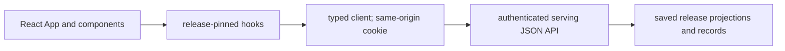

# `ui/` architecture

## Purpose

Layer 8 presentation in the [root architecture](../ARCHITECTURE.md): the existing
React/TypeScript app owns application components, layout, navigation and rendering.
Its presentation scope includes the legacy dashboard views still awaiting migration.

## Primary contracts and public interfaces

`src/App.tsx` composes board/event/score and native-parity views; `src/routes.ts` handles routes.
`src/api/client.ts` is the sole fetch boundary to the authenticated serving API.
Wire shapes and shipped views are detailed in the [README](README.md).

## Operations status contract (`GET /api/v1/operations`)

One JSON object produced by ops (`OperationsStatus`, `engine/v2/contracts/operations.py`), served as a plain untyped document by `engine/v2/serving/api.py` from the scope-root `operations_status.json`; producer field names are the keys and tuples are arrays. The document always describes the scope's current state, never a pinned release; a `?release_id=` pin differing from the document's own `release_id` is a typed 409, a missing, symlinked, non-object, unparseable or other-versioned file is a typed retryable 503, and responses are `Cache-Control: no-store`. The typed client validates required fields, nullability/types, history row schema and flags; the existing operations presentation validates session-date form and ordering as separately described under Failure semantics. The typed client treats malformed or missing documents as unknown, never current.

Top-level fields — all always present; nullability is the wire value:

| Field | Type | Nullable | Notes |
|---|---|---|---|
| `scope` | string | no | publication scope this sidecar describes |
| `release_id`, `attempted_release_id` | string | yes | `release_id` is the release current after this write (the new one on success, the unchanged prior one on a failed update, `null` if none has ever published); `attempted_release_id` is this attempt's own candidate id, whether or not it became current, or `null` when the attempt failed before any publication candidate existed |
| `generated_at`, `requested_session`, `resolved_session` | string | no | write timestamp; `YYYY-MM-DD` session dates |
| `engineering_history` | array | no | `EngineeringNight` rows, oldest first; below |
| `engineering_streak` | JSON object | no | summary derived from that same history; carried, never re-derived |
| `conflicts`, `degraded_model_evidence` | JSON arrays | no | the render job's `calendar_date_conflict` / `model_evidence_stale` flags carried from the bound render bundle, never reconstructed |
| `selfcheck` | JSON value | yes | the bound `selfcheck.json` verbatim, or the explicit unknown `{"ok": null, "known": false, "detail": ...}` — never a bare null misread as "checked and fine" |
| `stale`, `stale_reason` | boolean, string | no, yes | stale when the current release was not updated by the latest attempt |
| `withheld`, `withheld_reason` | boolean, string | no, yes | staged-but-not-eligible current release |
| `failed_update`, `failed_update_reason` | boolean, string | no, yes | display rule below |
| `schema_version` | string | no | exactly `operations_status.v1.0` |

`engineering_history` rows (`EngineeringNight`):

| Field | Type | Nullable | Notes |
|---|---|---|---|
| `occurrence` | string | no | `YYYY-MM-DD` scheduled night |
| `status` | `pass` / `fail` / `unknown` | no | a scheduled night with no recorded observation is `unknown`, never rendered green |
| `retry_count` | integer | no | extra observations of this SAME occurrence — never a count of nights |
| `detail` | JSON value | yes | the observation receipt, or `null` |
| `schema_version` | string | no | exactly `engineering_night.v1.0` |

Failed-update display: `failed_update` and `stale` are explicit producer flags, and the UI validates and displays these flags rather than inferring the outcome from nullable identifiers. For a failed publication with a candidate, `attempted_release_id` names that candidate while `release_id` remains the unchanged current release; for a terminal failure with no candidate, `attempted_release_id` is `null`.

## Inputs

Saved JSON release metadata, paginated events, score details and operations data
from [serving](../engine/v2/serving/ARCHITECTURE.md), plus route/filter state.
Native parity renders the summary from `/api/v1/native_parity`, including its
saved refused-ticker list (`native_refused_tickers`: ticker and reason code)
separately from field mismatches. A nonempty list has its own refused-ticker
section and count; an empty list adds no refused-ticker section. The screen also reads `/mismatches` through the typed client and renders a cursor-paged table of differing fields only (legacy and native side by side); `/unpaired` is exposed by the client but not yet presented. The retired `/native_parity.json` HTML paths are
not part of this React screen.

## Outputs

React DOM and chart pixels, navigation/deep links, loading/error/refusal states
and links to the same pinned compatibility release. No engine records are written.

## Financial display units

The serving contract defines wire units for both legacy-via-v2 and native rows;
the React app formats those values once. `fmtPercentagePoint` displays
`driver_forecast` and `market_implied_move` with `%` and no multiplication by
100. Fractional `headline_expected_return` values and non-count
`coverage_summary` ratios use fraction-times-100 percent formatting.
`planned_population` and `compared_population` display as whole-number counts.
`entry_premium` is USD, and null display values remain an em dash. The existing
operations HTML and legacy previews remain compatibility exceptions; this
formatting contract applies to the React presentation layer.

## Dependencies

React components use typed client/hooks; the browser calls serving over HTTP.
No direct scoring/model/ledger/evaluation/provider access; browser users enter
through `App`; integration/browser tests exercise the same API contract.

## External systems and libraries

React, TypeScript and Vite; browser fetch with the same-origin `operations_token`
cookie. Build output is static assets; serving those bytes is transport.

## Failure semantics

| Condition | Outcome |
|---|---|
| Loading, empty, 401 or unknown identity | Explicit loading/empty/auth/refusal state; detail failure preserves board. |
| A mismatch page's `generated_at` or `as_of` differs from the summary's | The screen shows an alert ("These mismatch rows come from a different report than the summary above. Restart to refresh both.") with a single restart that reloads both, and hides the pager's own restart. |
| Current release changes | Announce only; reload opts in. Cache keys retain explicit release pin. |
| Release-current polling | Default 30 seconds (`?pollMs=` test override); hidden tabs make no calls; becoming visible runs one check; requests never overlap. Only the latest request may replace publication evidence; a failed latest read clears identity and drift to unknown, a successful rollback to the pin clears drift, and operations status uses only the latest successful identity. The pin never moves, and failures wait for the next unchanged interval without immediate retry. |
| Operations status | Show its observation age, requested/resolved sessions, engineering history (including scheduled `unknown` occurrences), latest attempt outcome, its described release, the board pin, and the latest published release separately. More than 24 hours old is stale; a scheduled `unknown` or `fail` observation is never current. Requested/resolved session dates must use the producer's `YYYY-MM-DD` form or the UI's `eng-night-YYYY-MM-DD` form, be valid calendar dates, and resolved must not be later than requested. Never label the board current unless its pin equals the latest successful current-release discovery. |
| Missing, malformed, stale-session, or wrong-release operations status | Show unknown/stale with the observation age and reason; absent or malformed session dates, unrecognized session prefixes, resolved sessions later than requested, and unavailable publication identity are unknown. Do not turn a failed read into current. A status release mismatch never repins the board. |
| Parity loading, 401 or `no_report` | Explicit loading/auth/no-report state, independent of release resolution; no-report rendering reads status only. |
| Parity `stale` | Banner with saved identity, counts and refusal reasons still shown. |
| Parity `unavailable` | Explicit error; failed data is withheld, never presented as an empty comparison. |
| Parity zero counts or no refusal reasons | Saved zero counts remain visible; an explicit message identifies absent refusal reasons. |
| Parity `partial` | Saved counts remain visible with an alert that refusal data is incomplete. |
| Retry or navigation | Reads keep pinned identity; reload opts into current. Failed operations-status reads leave the board and pin in place, with status unknown; failed current-release discovery clears the displayed publication identity and prior drift hint. No read retries immediately, and no durable transaction or partial publication is left behind. |

## Invariants

All new application rendering belongs here. Serving returns data/API responses
and transports commands; application HTML/DOM scripts there violate the boundary.
Format saved financial values; do not fit, rescore, derive financial evidence or
fetch vendors. Preserve saved replay clocks and provenance without relabelling.
Existing operations HTML/legacy previews are compatibility exceptions with
migration outstanding, not evidence that a React application view is shipped.
Native parity summary presentation belongs here; mismatch detail is
presented by this component; unpaired detail is not yet. The operations parity HTML/JSON preview is retired.

## Diagrams

